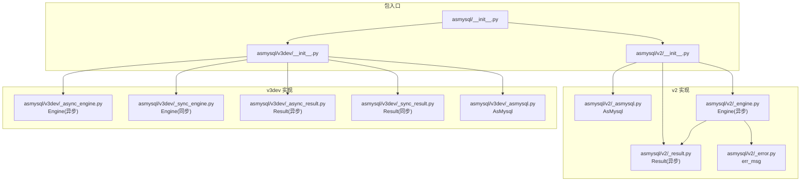
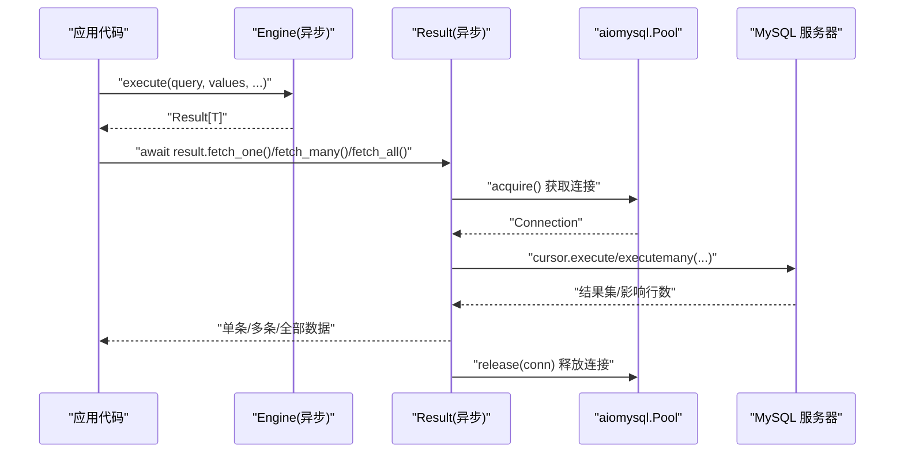
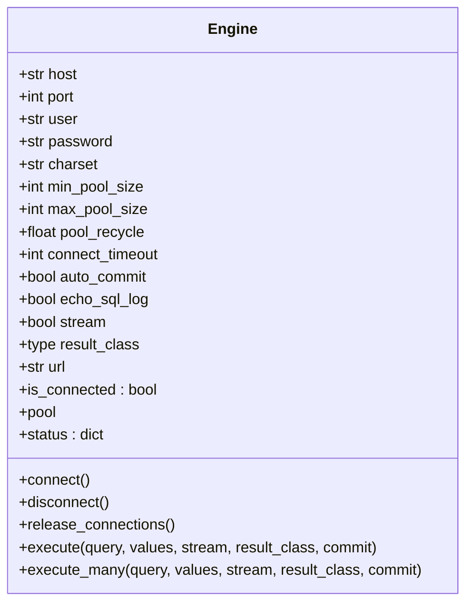
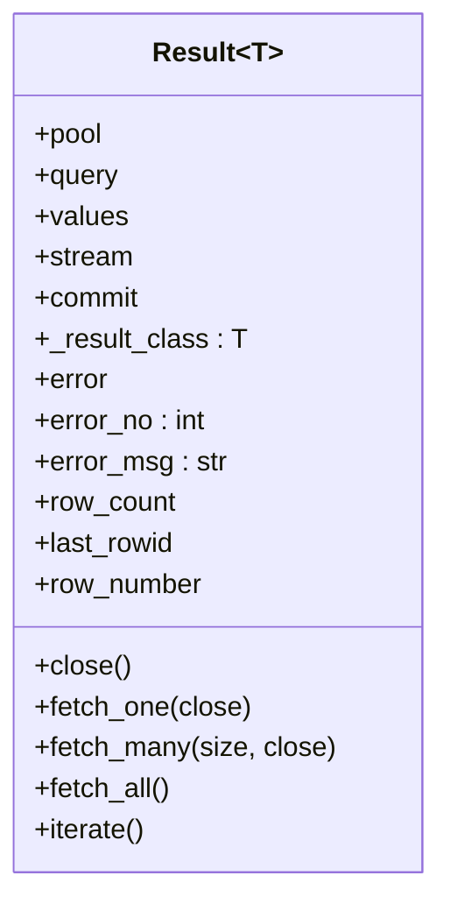
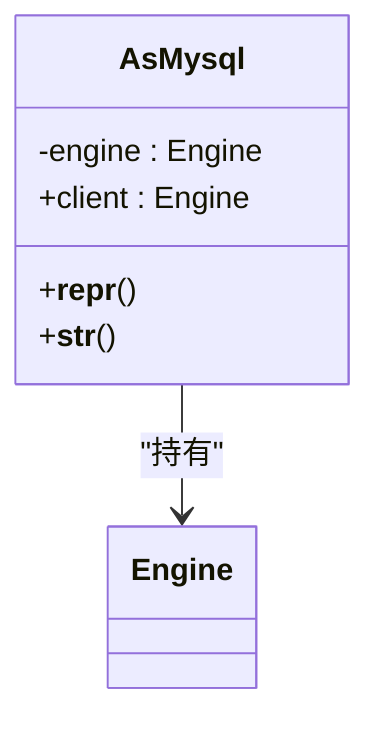
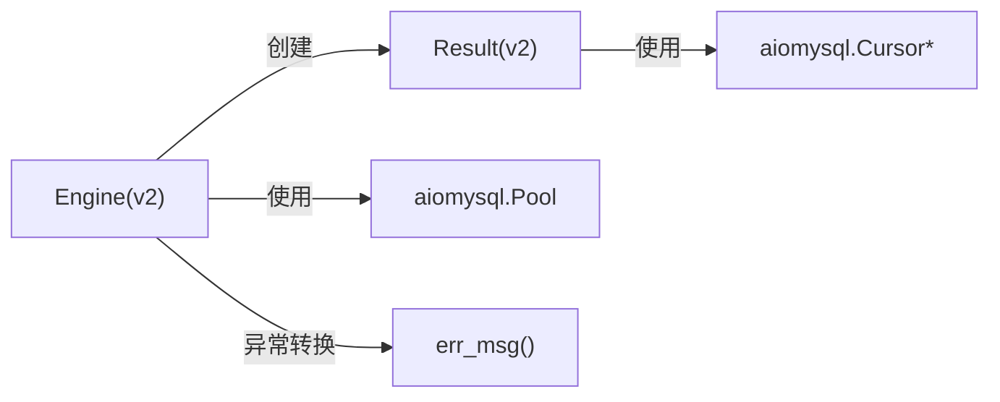

# API 参考

<cite>
**本文引用的文件**   
- [asmysql/__init__.py](file://asmysql/__init__.py)
- [asmysql/v2/__init__.py](file://asmysql/v2/__init__.py)
- [asmysql/v2/_asmysql.py](file://asmysql/v2/_asmysql.py)
- [asmysql/v2/_engine.py](file://asmysql/v2/_engine.py)
- [asmysql/v2/_result.py](file://asmysql/v2/_result.py)
- [asmysql/v2/_error.py](file://asmysql/v2/_error.py)
- [asmysql/v3dev/_async_engine.py](file://asmysql/v3dev/_async_engine.py)
- [asmysql/v3dev/_sync_engine.py](file://asmysql/v3dev/_sync_engine.py)
- [asmysql/v3dev/_async_result.py](file://asmysql/v3dev/_async_result.py)
- [asmysql/v3dev/_sync_result.py](file://asmysql/v3dev/_sync_result.py)
- [asmysql/v3dev/_asmysql.py](file://asmysql/v3dev/_asmysql.py)
</cite>

## 目录
1. [简介](#简介)
2. [项目结构](#项目结构)
3. [核心组件](#核心组件)
4. [架构总览](#架构总览)
5. [详细组件分析](#详细组件分析)
6. [依赖关系分析](#依赖关系分析)
7. [性能与使用建议](#性能与使用建议)
8. [故障排查指南](#故障排查指南)
9. [版本兼容性与迁移](#版本兼容性与迁移)
10. [结论](#结论)

## 简介
本 API 参考聚焦于 asmysql 的 v2 稳定版，同时提供 v3dev（异步/同步双引擎）的对照说明。文档围绕以下目标展开：
- 完整记录 Engine 类的公共方法与属性、构造函数参数、返回值类型、异常说明
- 记录 AsMysql 基类在 v2 中的职责与扩展点
- 完整记录 Result 类的数据获取方法与属性
- 给出类型定义与约束说明（含泛型 T 的使用）
- 按功能模块组织，便于查找与参考
- 提供版本兼容性信息与废弃 API 迁移指南

## 项目结构
仓库采用多版本并存策略：
- v2：当前推荐使用的异步封装，对外暴露 Engine、Result、AsMysql
- v3dev：实验性开发分支，提供异步与同步两套 Engine/Result 实现

图表来源
- [asmysql/__init__.py:1-16](file://asmysql/__init__.py#L1-L16)
- [asmysql/v2/__init__.py:1-15](file://asmysql/v2/__init__.py#L1-L15)
- [asmysql/v3dev/__init__.py:1-14](file://asmysql/v3dev/__init__.py#L1-L14)

章节来源
- [asmysql/__init__.py:1-16](file://asmysql/__init__.py#L1-L16)
- [asmysql/v2/__init__.py:1-15](file://asmysql/v2/__init__.py#L1-L15)
- [asmysql/v3dev/__init__.py:1-14](file://asmysql/v3dev/__init__.py#L1-L14)

## 核心组件
- Engine（异步，v2）：数据库连接池管理与 SQL 执行入口，支持 execute 与 execute_many，返回 Result
- Result（异步，v2）：SQL 结果集封装，支持 fetch_one/fetch_many/fetch_all/iterate 等数据读取方法
- AsMysql（v2）：业务逻辑容器，持有 Engine 实例并暴露 client 属性

章节来源
- [asmysql/v2/_engine.py:37-316](file://asmysql/v2/_engine.py#L37-L316)
- [asmysql/v2/_result.py:21-272](file://asmysql/v2/_result.py#L21-L272)
- [asmysql/v2/_asmysql.py:7-25](file://asmysql/v2/_asmysql.py#L7-L25)

## 架构总览
v2 的核心交互流程如下：应用通过 Engine 发起 SQL 请求，Engine 创建 Result；Result 内部从连接池获取连接与游标，执行 SQL 并提供多种数据读取方式。

图表来源
- [asmysql/v2/_engine.py:226-259](file://asmysql/v2/_engine.py#L226-L259)
- [asmysql/v2/_result.py:101-125](file://asmysql/v2/_result.py#L101-L125)
- [asmysql/v2/_result.py:186-272](file://asmysql/v2/_result.py#L186-L272)

## 详细组件分析

### Engine（异步，v2）
Engine 是异步 MySQL 客户端的核心，负责连接池管理、状态查询与 SQL 执行。

- 类属性（默认值）
  - host: str = "127.0.0.1"
  - port: int = 3306
  - user: str = ""
  - password: str = ""
  - charset: str = "utf8mb4"
  - min_pool_size: int = 1
  - max_pool_size: int = 10
  - pool_recycle: float = -1
  - connect_timeout: int = 5
  - auto_commit: bool = True
  - echo_sql_log: bool = False
  - stream: bool = False
  - result_class: type = tuple

- 构造函数
  - 签名
    - def __init__(self, url=None, *, host=None, port=None, user=None, password=None, charset=None, min_pool_size=None, max_pool_size=None, pool_recycle=None, connect_timeout=None, auto_commit=None, echo_sql_log=None, stream=None, result_class=None)
  - 行为
    - 解析 mysql:// URL，提取 host/port/user/password/charset 及 query 参数
    - 将显式参数与 URL 参数合并，未提供的字段回退到类默认值
    - 设置只读属性 url（格式为 mysql://{host}:{port}/）
  - 异常
    - ValueError：当 URL scheme 不是 "mysql" 时抛出
  - 示例路径
    - [构造与 URL 解析:55-114](file://asmysql/v2/_engine.py#L55-L114)

- 上下文与可调用协议
  - async with engine as e: ... 等价于 await engine.connect() / await engine.disconnect()
  - await engine(...) 等价于 await engine.connect()
  - 示例路径
    - [__aenter__/__aexit__:124-128](file://asmysql/v2/_engine.py#L124-L128)
    - [__await__/__call__:168-174](file://asmysql/v2/_engine.py#L168-L174)

- 连接管理
  - async def connect(): 初始化 aiomysql 连接池；失败时包装为 ConnectionError
  - async def disconnect(): 关闭连接池并等待完全关闭
  - async def release_connections(): 清空空闲连接
  - @property is_connected: 是否已建立连接池
  - @property pool: 若未连接则抛 ConnectionError
  - @property status: 返回连接池状态字典（address/connected/pool_minsize/pool_maxsize/pool_size/pool_free/pool_used）
  - 示例路径
    - [connect/disconnect/release_connections/is_connected/pool/status:130-202](file://asmysql/v2/_engine.py#L130-L202)

- SQL 执行
  - async def execute(query, values=None, *, stream=None, result_class=None, commit=None) -> Result[T] | AsyncContextManager[Result[T]] | AsyncGenerator[T, None]
  - async def execute_many(query, values: Sequence[Union[Sequence, dict]], *, stream=None, result_class=None, commit=None) -> Result[T] | AsyncContextManager[Result[T]] | AsyncGenerator[T, None]
  - 行为
    - 根据 stream/result_class 决定底层游标类型与结果类型
    - 返回 Result 对象，支持 await 或 async with 两种用法
  - 重载与泛型
    - 当 result_class=tuple 时，返回类型为 Result[tuple]/AsyncContextManager[Result[tuple]]/AsyncGenerator[tuple, None]
    - 当 result_class=type[T] 时，返回类型为 Result[T]/AsyncContextManager[Result[T]]/AsyncGenerator[T, None]
  - 示例路径
    - [execute 重载与实现:204-259](file://asmysql/v2/_engine.py#L204-L259)
    - [execute_many 重载与实现:261-316](file://asmysql/v2/_engine.py#L261-L316)

- 错误处理
  - 连接阶段：捕获底层 MySQLError，转换为 ConnectionError
  - 执行阶段：由 Result 内部捕获并记录 error/error_no/error_msg
  - 示例路径
    - [connect 异常转换:149-151](file://asmysql/v2/_engine.py#L149-L151)
    - [err_msg 工具](file://asmysql/v2/_error.py:1-7)

章节来源
- [asmysql/v2/_engine.py:37-316](file://asmysql/v2/_engine.py#L37-L316)
- [asmysql/v2/_error.py:1-7](file://asmysql/v2/_error.py#L1-L7)

#### Engine 类图（v2）

图表来源
- [asmysql/v2/_engine.py:37-316](file://asmysql/v2/_engine.py#L37-L316)

### Result（异步，v2）
Result 封装单次 SQL 执行的结果，提供多种数据读取方式与资源管理。

- 构造参数
  - pool: aiomysql.Pool
  - query: str
  - values: Union[Sequence, dict]
  - execute_many: bool
  - stream: bool
  - commit: bool
  - result_class: T（默认 tuple）

- 生命周期与协议
  - async with result as r: ... 自动执行并在退出时释放连接
  - async for item in result: 支持异步迭代
  - await result: 触发实际执行
  - close(): 手动关闭游标并释放连接

- 数据读取
  - async def fetch_one(close=None): 返回一条记录或 None
  - async def fetch_many(size=None, close=None): 返回多条记录列表
  - async def fetch_all(): 返回所有记录列表
  - async def iterate(): 异步生成器逐条产出记录

- 元信息属性
  - error: 底层异常对象（若有）
  - error_no: 错误码（无错误时为 0）
  - error_msg: 错误消息（无错误时空字符串）
  - row_count: 受影响行数（流式或报错时为 None）
  - last_rowid: 最近插入 ID（若无插入或报错则为 None）
  - row_number: 当前游标位置（无法确定则为 None）

- 类型与约束
  - 泛型 T：当 result_class 为自定义类时，fetch_one/many/all/iterate 会尝试以 **data 的方式构造 T
  - 当 result_class 为 tuple/dict 时，直接返回原始数据
  - 示例路径
    - [Result 构造与属性](file://asmysql/v2/_result.py:21-51)
    - [__call__/__aiter__/__anext__](file://asmysql/v2/_result.py:81-131)
    - [error_no/error_msg/row_count/last_rowid/row_number](file://asmysql/v2/_result.py:133-184)
    - [fetch_one/fetch_many/fetch_all/iterate](file://asmysql/v2/_result.py:186-272)

章节来源
- [asmysql/v2/_result.py:21-272](file://asmysql/v2/_result.py#L21-L272)

#### Result 类图（v2）

图表来源
- [asmysql/v2/_result.py:21-272](file://asmysql/v2/_result.py#L21-L272)

### AsMysql（v2）
AsMysql 作为业务逻辑容器，持有 Engine 实例并通过 client 属性暴露。

- 构造函数
  - def __init__(self, engine: Engine)
- 属性
  - client: Engine（只读）
- 行为
  - 提供 __repr__/__str__ 用于调试输出
- 示例路径
  - [AsMysql 定义](file://asmysql/v2/_asmysql.py:7-25)

章节来源
- [asmysql/v2/_asmysql.py:7-25](file://asmysql/v2/_asmysql.py#L7-L25)

#### AsMysql 类图（v2）

图表来源
- [asmysql/v2/_asmysql.py:7-25](file://asmysql/v2/_asmysql.py#L7-L25)

### v3dev 对照（异步/同步双引擎）
v3dev 提供异步与同步两套实现，API 风格与 v2 保持一致，便于未来迁移。

- 异步
  - Engine（异步）：asmysql/v3dev/_async_engine.py
  - Result（异步）：asmysql/v3dev/_async_result.py
- 同步
  - Engine（同步）：asmysql/v3dev/_sync_engine.py
  - Result（同步）：asmysql/v3dev/_sync_result.py
- AsMysql（v3dev）：asmysql/v3dev/_asmysql.py

章节来源
- [asmysql/v3dev/_async_engine.py:27-306](file://asmysql/v3dev/_async_engine.py#L27-L306)
- [asmysql/v3dev/_sync_engine.py:26-297](file://asmysql/v3dev/_sync_engine.py#L26-L297)
- [asmysql/v3dev/_async_result.py:21-272](file://asmysql/v3dev/_async_result.py#L21-L272)
- [asmysql/v3dev/_sync_result.py:23-267](file://asmysql/v3dev/_sync_result.py#L23-L267)
- [asmysql/v3dev/_asmysql.py:11-29](file://asmysql/v3dev/_asmysql.py#L11-L29)

## 依赖关系分析
- Engine 依赖 aiomysql.Pool/create_pool 进行连接池管理
- Result 依赖 aiomysql.Cursor/DictCursor/SSCursor/SSDictCursor 进行数据读取
- 错误处理统一通过 err_msg 格式化底层异常

图表来源
- [asmysql/v2/_engine.py:17-21](file://asmysql/v2/_engine.py#L17-L21)
- [asmysql/v2/_result.py:1-6](file://asmysql/v2/_result.py#L1-L6)
- [asmysql/v2/_error.py:1-7](file://asmysql/v2/_error.py#L1-L7)

章节来源
- [asmysql/v2/_engine.py:17-21](file://asmysql/v2/_engine.py#L17-L21)
- [asmysql/v2/_result.py:1-6](file://asmysql/v2/_result.py#L1-L6)
- [asmysql/v2/_error.py:1-7](file://asmysql/v2/_error.py#L1-L7)

## 性能与使用建议
- 连接池大小：根据并发量调整 min_pool_size/max_pool_size，避免频繁创建/销毁连接
- 流式读取：对大结果集使用 stream=True 配合 iterate 或 async for，降低内存占用
- 事务控制：commit 参数可覆盖全局 auto_commit；批量写入建议使用 execute_many
- 日志与诊断：开启 echo_sql_log 便于调试；使用 status 监控连接池健康度
- 结果类型：使用 result_class 指定自定义模型类，提升可读性与类型安全

## 故障排查指南
- 连接失败
  - 现象：抛出 ConnectionError
  - 可能原因：网络不可达、认证失败、URL 配置错误
  - 定位：检查 Engine.connect 异常转换与 err_msg 输出
  - 参考路径
    - [connect 异常转换:149-151](file://asmysql/v2/_engine.py#L149-L151)
    - [err_msg 工具](file://asmysql/v2/_error.py:1-7)
- 执行异常
  - 现象：Result.error 非空，error_no/error_msg 可用
  - 处理：在 fetch_* 前检查 error，必要时重试或降级
  - 参考路径
    - [Result 错误属性](file://asmysql/v2/_result.py:133-151)
- 资源泄漏
  - 现象：连接未释放导致池耗尽
  - 处理：优先使用 async with 或确保 close() 被调用
  - 参考路径
    - [Result.__aenter__/__aexit__/close](file://asmysql/v2/_result.py:65-79)

章节来源
- [asmysql/v2/_engine.py:149-151](file://asmysql/v2/_engine.py#L149-L151)
- [asmysql/v2/_error.py:1-7](file://asmysql/v2/_error.py#L1-L7)
- [asmysql/v2/_result.py:65-79](file://asmysql/v2/_result.py#L65-L79)
- [asmysql/v2/_result.py:133-151](file://asmysql/v2/_result.py#L133-L151)

## 版本兼容性与迁移
- v2 与 v3dev 的关系
  - v2 为稳定发布版本，v3dev 为实验性分支，提供同步/异步双引擎
  - 两者 API 风格一致，主要差异在于底层驱动与同步/异步语义
- 迁移建议
  - 从 v2 迁移至 v3dev 异步：替换导入路径为 v3dev._async_engine.Result/Engine
  - 从 v2 迁移至 v3dev 同步：替换导入路径为 v3dev._sync_engine.Result/Engine
  - 注意：v3dev 中同步版本的 connect 为阻塞调用，需适配现有异步代码
- 废弃 API
  - 当前仓库未标记明确废弃项；建议在升级前运行单元测试并核对行为差异
- 参考路径
  - [v2 导出](file://asmysql/v2/__init__.py:1-L15)
  - [v3dev 导出](file://asmysql/v3dev/__init__.py:1-L14)

章节来源
- [asmysql/v2/__init__.py:1-15](file://asmysql/v2/__init__.py#L1-L15)
- [asmysql/v3dev/__init__.py:1-14](file://asmysql/v3dev/__init__.py#L1-L14)

## 结论
asmysql v2 提供了简洁一致的异步 MySQL 访问接口：Engine 负责连接与执行，Result 负责结果读取与资源管理，AsMysql 作为业务容器组合二者。通过泛型 result_class、流式读取、上下文管理等特性，可在保证性能的同时提升代码可读性与健壮性。对于需要引入同步场景或进一步演进的团队，可参考 v3dev 的双引擎设计进行平滑迁移。