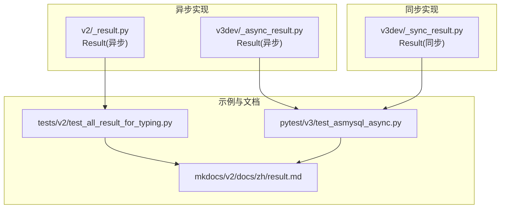
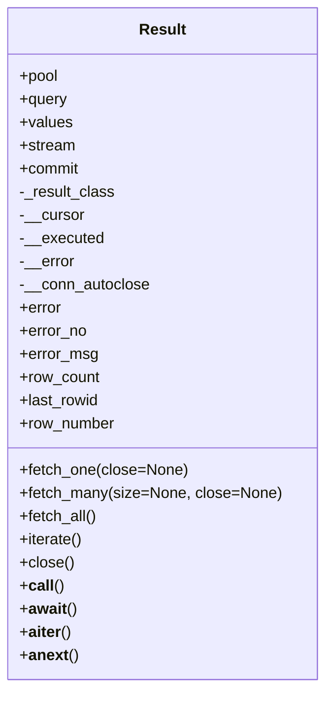
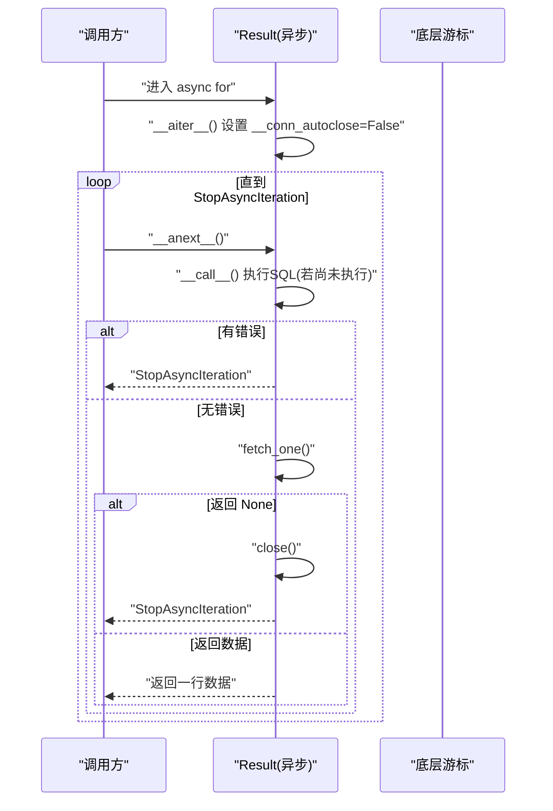
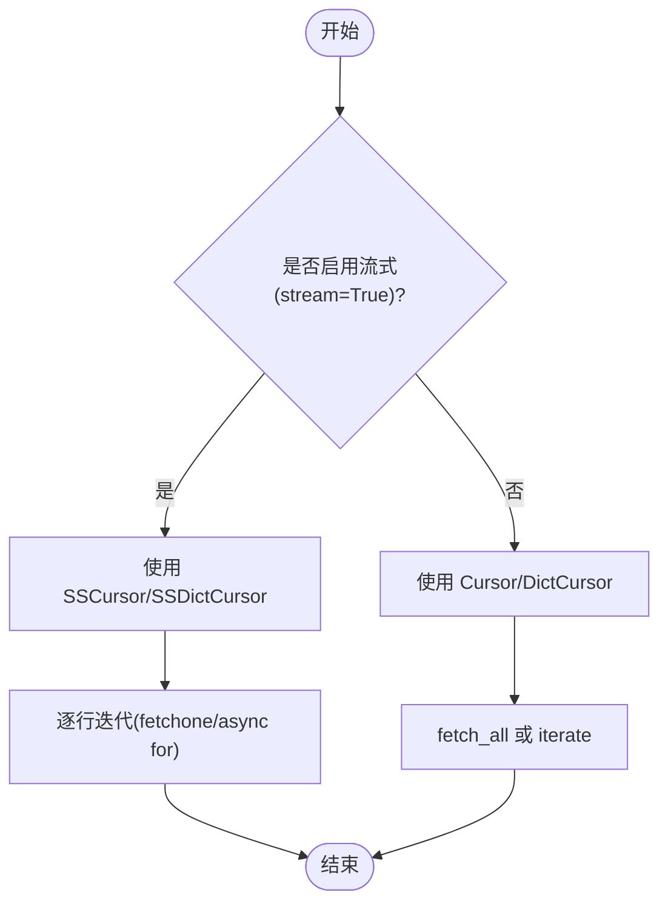
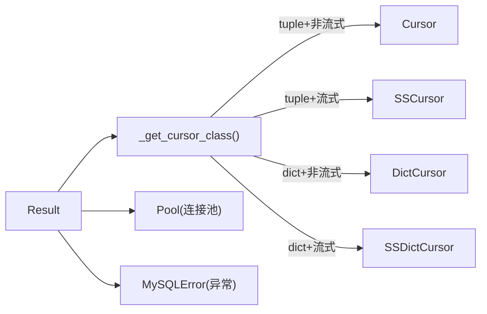

# Result 类 API

<cite>
**本文引用的文件**   
- [asmysql/v2/_result.py](file://asmysql/v2/_result.py)
- [asmysql/v3dev/_async_result.py](file://asmysql/v3dev/_async_result.py)
- [asmysql/v3dev/_sync_result.py](file://asmysql/v3dev/_sync_result.py)
- [asmysql/v1/_result.py](file://asmysql/v1/_result.py)
- [tests/v2/test_all_result_for_typing.py](file://tests/v2/test_all_result_for_typing.py)
- [pytest/v3/test_asmysql_async.py](file://pytest/v3/test_asmysql_async.py)
- [mkdocs/v2/docs/zh/result.md](file://mkdocs/v2/docs/zh/result.md)
</cite>

## 目录
1. [简介](#简介)
2. [项目结构](#项目结构)
3. [核心组件](#核心组件)
4. [架构总览](#架构总览)
5. [详细组件分析](#详细组件分析)
6. [依赖关系分析](#依赖关系分析)
7. [性能与内存优化](#性能与内存优化)
8. [故障排查指南](#故障排查指南)
9. [结论](#结论)
10. [附录：类型注解与泛型 T 使用](#附录类型注解与泛型-t-使用)

## 简介
本文件为 asmysql 库中 Result 类的完整 API 文档，聚焦于结果数据获取方法、异步迭代器支持、流式数据处理、状态与元数据访问、错误处理、类型注解（含泛型 T）以及最佳实践。Result 在 v2 与 v3dev 版本中提供异步实现，v3dev 同时提供同步实现；v1 为早期版本，API 较为基础。

## 项目结构
- v2 与 v3dev 的异步 Result 位于各自模块文件中，功能基本一致；v3dev 额外提供同步 Result。
- 测试用例展示了 tuple、dict、自定义模型三种结果类型的用法，以及直接 async for 迭代 Result 的方式。
- 官方文档提供了中文使用说明，涵盖 fetch_one/fetch_many/fetch_all/iterate 等常用接口。

图表来源
- [asmysql/v2/_result.py:1-273](file://asmysql/v2/_result.py#L1-L273)
- [asmysql/v3dev/_async_result.py:1-273](file://asmysql/v3dev/_async_result.py#L1-L273)
- [asmysql/v3dev/_sync_result.py:1-268](file://asmysql/v3dev/_sync_result.py#L1-L268)
- [tests/v2/test_all_result_for_typing.py:1-121](file://tests/v2/test_all_result_for_typing.py#L1-L121)
- [pytest/v3/test_asmysql_async.py:1-283](file://pytest/v3/test_asmysql_async.py#L1-L283)
- [mkdocs/v2/docs/zh/result.md:1-135](file://mkdocs/v2/docs/zh/result.md#L1-L135)

章节来源
- [asmysql/v2/_result.py:1-273](file://asmysql/v2/_result.py#L1-L273)
- [asmysql/v3dev/_async_result.py:1-273](file://asmysql/v3dev/_async_result.py#L1-L273)
- [asmysql/v3dev/_sync_result.py:1-268](file://asmysql/v3dev/_sync_result.py#L1-L268)
- [tests/v2/test_all_result_for_typing.py:1-121](file://tests/v2/test_all_result_for_typing.py#L1-L121)
- [pytest/v3/test_asmysql_async.py:1-283](file://pytest/v3/test_asmysql_async.py#L1-L283)
- [mkdocs/v2/docs/zh/result.md:1-135](file://mkdocs/v2/docs/zh/result.md#L1-L135)

## 核心组件
- Result 类封装了数据库查询执行、游标管理、自动关闭连接、错误捕获与状态暴露。
- 支持多种结果类型：tuple（默认）、dict、任意可构造对象（通过 result_class 指定）。
- 支持流式查询（stream=True），降低大数据集内存占用。
- 提供异步迭代器协议（__aiter__/__anext__）与生成器 iterate()，便于逐行消费。

章节来源
- [asmysql/v2/_result.py:21-273](file://asmysql/v2/_result.py#L21-L273)
- [asmysql/v3dev/_async_result.py:21-273](file://asmysql/v3dev/_async_result.py#L21-L273)
- [asmysql/v3dev/_sync_result.py:23-268](file://asmysql/v3dev/_sync_result.py#L23-L268)

## 架构总览
Result 内部根据 result_class 与 stream 标志选择底层游标类型（Cursor/DictCursor/SSCursor/SSDictCursor），并负责从连接池获取连接、执行 SQL、提交事务、异常捕获与资源释放。

图表来源
- [asmysql/v2/_result.py:21-273](file://asmysql/v2/_result.py#L21-L273)
- [asmysql/v3dev/_async_result.py:21-273](file://asmysql/v3dev/_async_result.py#L21-L273)
- [asmysql/v3dev/_sync_result.py:23-268](file://asmysql/v3dev/_sync_result.py#L23-L268)

## 详细组件分析

### 数据获取方法
以下方法均基于底层游标进行数据读取，并在需要时自动关闭连接以释放资源。

- fetch_one(close=None)
  - 作用：获取单条记录。
  - 参数：
    - close: 可选布尔值，控制是否在返回前自动关闭游标连接。若设为 False，需自行调用 close() 释放连接。
  - 返回值：
    - 成功：一条记录，类型为 tuple/dict/自定义对象（由 result_class 决定）。
    - 无数据或出错：None。
  - 行为要点：
    - 若已发生错误，直接返回 None。
    - 当 _result_class 不是 tuple 且不是 dict 时，将行数据作为关键字参数构造目标对象。
    - 若无数据或 close 为 True，则自动关闭连接。

- fetch_many(size=None, close=None)
  - 作用：批量获取多条记录。
  - 参数：
    - size: 获取数量，不传则使用底层游标默认策略。
    - close: 同上。
  - 返回值：
    - 列表，元素类型同 fetch_one。
    - 出错或无数据时返回空列表。
  - 行为要点：
    - 若 _result_class 不是 tuple/dict，对每条记录进行对象构造。
    - 若无数据或 close 为 True，则自动关闭连接。

- fetch_all()
  - 作用：一次性获取所有记录。
  - 返回值：
    - 列表，元素类型同 fetch_one。
    - 出错时返回空列表。
  - 行为要点：
    - 若 _result_class 不是 tuple/dict，对每条记录进行对象构造。
    - 完成后自动关闭连接。

- iterate()
  - 作用：异步/同步生成器，逐行产出记录，适合大数据集流式处理。
  - 返回值：
    - 异步版本返回异步生成器；同步版本返回普通生成器。
  - 行为要点：
    - 出错时立即结束迭代。
    - 在 finally 中确保关闭连接。

注意：当前代码未提供 fetch_dict()/fetch_dicts() 独立方法。若需要字典形式结果，可通过设置 result_class=dict 使 fetch_one/fetch_many/fetch_all 返回 dict 或 list[dict]。

章节来源
- [asmysql/v2/_result.py:186-273](file://asmysql/v2/_result.py#L186-L273)
- [asmysql/v3dev/_async_result.py:186-273](file://asmysql/v3dev/_async_result.py#L186-L273)
- [asmysql/v3dev/_sync_result.py:186-268](file://asmysql/v3dev/_sync_result.py#L186-L268)
- [mkdocs/v2/docs/zh/result.md:1-135](file://mkdocs/v2/docs/zh/result.md#L1-L135)

### 异步迭代器支持
Result 实现了异步迭代协议，可直接用于 async for 遍历。

- __aiter__()
  - 作用：返回自身，标记为异步可迭代对象。
  - 行为：在进入迭代前禁用自动关闭（__conn_autoclose=False），以便用户控制生命周期。

- __anext__()
  - 作用：每次迭代取一行。
  - 行为：
    - 若存在错误，直接停止迭代。
    - 否则调用 fetch_one() 取下一行；若返回 None，则关闭连接并停止迭代。

图表来源
- [asmysql/v2/_result.py:81-131](file://asmysql/v2/_result.py#L81-L131)
- [asmysql/v3dev/_async_result.py:81-131](file://asmysql/v3dev/_async_result.py#L81-L131)

章节来源
- [asmysql/v2/_result.py:81-131](file://asmysql/v2/_result.py#L81-L131)
- [asmysql/v3dev/_async_result.py:81-131](file://asmysql/v3dev/_async_result.py#L81-L131)

### 流式数据处理与内存优化
- 流式模式：创建 Result 时设置 stream=True，底层将使用 SSCursor/SSDictCursor，避免一次性加载全部结果到内存。
- row_count 在流式模式下返回 None，因为无法提前获知总行数。
- 推荐用法：
  - 使用 async for 直接迭代 Result，或在 with 语句中使用 Result 以确保资源释放。
  - 使用 iterate() 逐行处理，避免构建大列表。
  - 对于超大结果集，优先使用流式模式配合逐行处理。

图表来源
- [asmysql/v2/_result.py:10-18](file://asmysql/v2/_result.py#L10-L18)
- [asmysql/v3dev/_async_result.py:10-18](file://asmysql/v3dev/_async_result.py#L10-L18)
- [asmysql/v3dev/_sync_result.py:12-20](file://asmysql/v3dev/_sync_result.py#L12-L20)

章节来源
- [asmysql/v2/_result.py:10-18](file://asmysql/v2/_result.py#L10-L18)
- [asmysql/v3dev/_async_result.py:10-18](file://asmysql/v3dev/_async_result.py#L10-L18)
- [asmysql/v3dev/_sync_result.py:12-20](file://asmysql/v3dev/_sync_result.py#L12-L20)
- [pytest/v3/test_asmysql_async.py:200-236](file://pytest/v3/test_asmysql_async.py#L200-L236)

### 结果集状态属性与元数据访问
- error: 错误异常对象（MySQLError 或 None）。
- error_no: 错误码（整数，无错误时为 0）。
- error_msg: 错误信息（字符串，无错误时空串）。
- row_count: 受影响/返回的行数；错误或流式模式下返回 None。
- last_rowid: 最近插入记录的 ID（仅 INSERT 有效，出错返回 None）。
- row_number: 当前游标位置（索引从 0 开始，出错返回 None）。

章节来源
- [asmysql/v2/_result.py:133-184](file://asmysql/v2/_result.py#L133-L184)
- [asmysql/v3dev/_async_result.py:133-184](file://asmysql/v3dev/_async_result.py#L133-L184)
- [asmysql/v3dev/_sync_result.py:129-184](file://asmysql/v3dev/_sync_result.py#L129-L184)
- [mkdocs/v2/docs/zh/result.md:96-135](file://mkdocs/v2/docs/zh/result.md#L96-L135)

### 不同类型结果的处理示例
- tuple（默认）：fetch_one/fetch_many/fetch_all 返回 tuple/list[tuple]。
- dict：设置 result_class=dict，返回 dict/list[dict]。
- 自定义对象：设置 result_class=YourClass，要求该类支持 **data 构造；返回 YourClass/列表。

参考测试与文档中的示例路径：
- [tests/v2/test_all_result_for_typing.py:25-108](file://tests/v2/test_all_result_for_typing.py#L25-L108)
- [pytest/v3/test_asmysql_async.py:49-146](file://pytest/v3/test_asmysql_async.py#L49-L146)
- [mkdocs/v2/docs/zh/result.md:52-94](file://mkdocs/v2/docs/zh/result.md#L52-L94)

章节来源
- [tests/v2/test_all_result_for_typing.py:25-108](file://tests/v2/test_all_result_for_typing.py#L25-L108)
- [pytest/v3/test_asmysql_async.py:49-146](file://pytest/v3/test_asmysql_async.py#L49-L146)
- [mkdocs/v2/docs/zh/result.md:52-94](file://mkdocs/v2/docs/zh/result.md#L52-L94)

### 错误处理与异常情况
- 执行阶段异常会被捕获并保存到 self.__error，后续 fetch_* 方法会检查该状态并返回安全值（None 或空列表）。
- 可通过 result.error/error_no/error_msg 判断与诊断错误。
- 流式模式下，row_count 返回 None；出错时亦返回 None。

章节来源
- [asmysql/v2/_result.py:101-131](file://asmysql/v2/_result.py#L101-L131)
- [asmysql/v3dev/_async_result.py:101-131](file://asmysql/v3dev/_async_result.py#L101-L131)
- [asmysql/v3dev/_sync_result.py:103-127](file://asmysql/v3dev/_sync_result.py#L103-L127)
- [mkdocs/v2/docs/zh/result.md:96-135](file://mkdocs/v2/docs/zh/result.md#L96-L135)

## 依赖关系分析
- 异步版本依赖 aiomysql 的 Cursor/DictCursor/Pool/SSCursor/SSDictCursor 与 pymysql.err.MySQLError。
- 同步版本依赖 pymysql.cursors 对应游标与 MySQLError，并使用本地 Pool 抽象。
- Result 内部通过 _get_cursor_class 根据 result_class 与 stream 动态选择游标类型。

图表来源
- [asmysql/v2/_result.py:10-18](file://asmysql/v2/_result.py#L10-L18)
- [asmysql/v3dev/_async_result.py:10-18](file://asmysql/v3dev/_async_result.py#L10-L18)
- [asmysql/v3dev/_sync_result.py:12-20](file://asmysql/v3dev/_sync_result.py#L12-L20)

章节来源
- [asmysql/v2/_result.py:10-18](file://asmysql/v2/_result.py#L10-L18)
- [asmysql/v3dev/_async_result.py:10-18](file://asmysql/v3dev/_async_result.py#L10-L18)
- [asmysql/v3dev/_sync_result.py:12-20](file://asmysql/v3dev/_sync_result.py#L12-L20)

## 性能与内存优化
- 大数据集优先使用流式模式（stream=True）并结合 async for 或 iterate() 逐行处理，避免一次性加载全量结果。
- 使用 result_class=dict 可减少字段映射开销，但需注意键名与列名一致性。
- 使用自定义对象（如 Pydantic BaseModel）可获得强类型与校验能力，但构造成本略高；在高频小结果场景下权衡使用。
- 合理设置 close 参数：仅在需要复用游标时显式关闭；否则保持默认自动关闭，避免连接泄漏。
- 避免在流式模式下依赖 row_count，因其返回 None。

章节来源
- [asmysql/v2/_result.py:153-165](file://asmysql/v2/_result.py#L153-L165)
- [asmysql/v3dev/_async_result.py:153-165](file://asmysql/v3dev/_async_result.py#L153-L165)
- [asmysql/v3dev/_sync_result.py:149-161](file://asmysql/v3dev/_sync_result.py#L149-L161)
- [pytest/v3/test_asmysql_async.py:200-236](file://pytest/v3/test_asmysql_async.py#L200-L236)

## 故障排查指南
- 现象：fetch_one/fetch_many/fetch_all 返回 None 或空列表。
  - 排查：检查 result.error/error_no/error_msg，确认 SQL 执行是否失败。
- 现象：row_count 为 None。
  - 排查：是否为流式模式（stream=True）或执行出错。
- 现象：内存占用过高。
  - 排查：是否使用了 fetch_all 而非 iterate()/async for；是否启用了流式模式。
- 现象：连接未释放导致连接池耗尽。
  - 排查：是否在 close=False 后忘记手动调用 close()；建议使用 async with 或确保 finally 中关闭。

章节来源
- [asmysql/v2/_result.py:133-184](file://asmysql/v2/_result.py#L133-L184)
- [asmysql/v3dev/_async_result.py:133-184](file://asmysql/v3dev/_async_result.py#L133-L184)
- [asmysql/v3dev/_sync_result.py:129-184](file://asmysql/v3dev/_sync_result.py#L129-L184)

## 结论
Result 类提供了统一的结果访问接口，支持 tuple/dict/自定义对象三种结果类型，具备完善的异步迭代与流式处理能力，并通过错误状态与统计属性提升可观测性。结合流式模式与逐行迭代，可在保证性能的同时有效控制内存占用。

## 附录：类型注解与泛型 T 使用
- 泛型 T 表示结果对象的类型变量，通常绑定为 type（如 tuple、dict 或自定义类）。
- 在 v3dev 同步版本中，T 被约束为 bound=type，强调其为“类型”而非实例。
- 使用方式：
  - 默认：result_class=tuple，返回 tuple 或 list[tuple]。
  - 字典：result_class=dict，返回 dict 或 list[dict]。
  - 自定义：result_class=YourModel，返回 YourModel 或 list[YourModel]。

章节来源
- [asmysql/v2/_result.py:2-7](file://asmysql/v2/_result.py#L2-L7)
- [asmysql/v3dev/_async_result.py:2-7](file://asmysql/v3dev/_async_result.py#L2-L7)
- [asmysql/v3dev/_sync_result.py:2-9](file://asmysql/v3dev/_sync_result.py#L2-L9)
- [tests/v2/test_all_result_for_typing.py:14-24](file://tests/v2/test_all_result_for_typing.py#L14-L24)