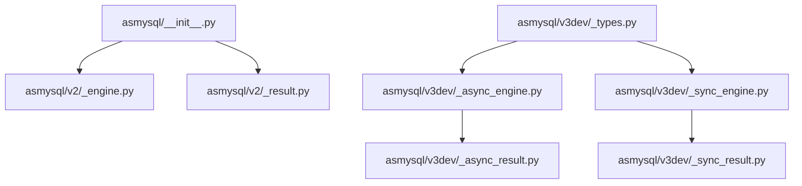
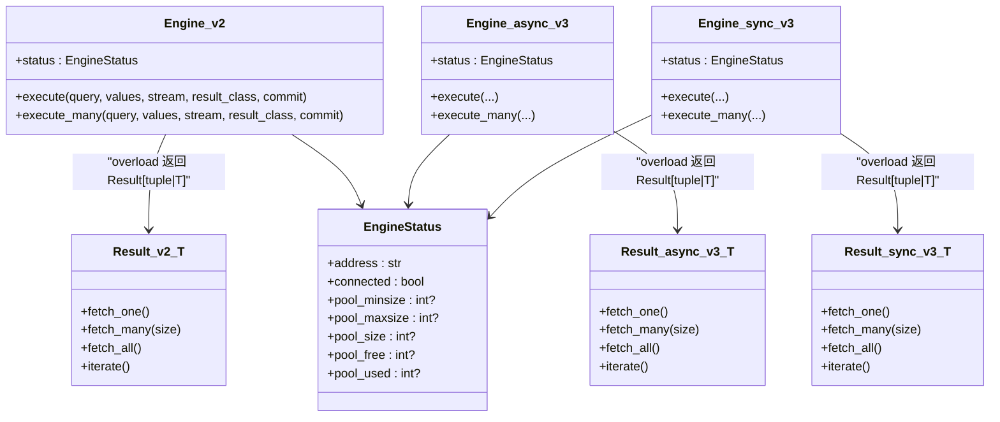
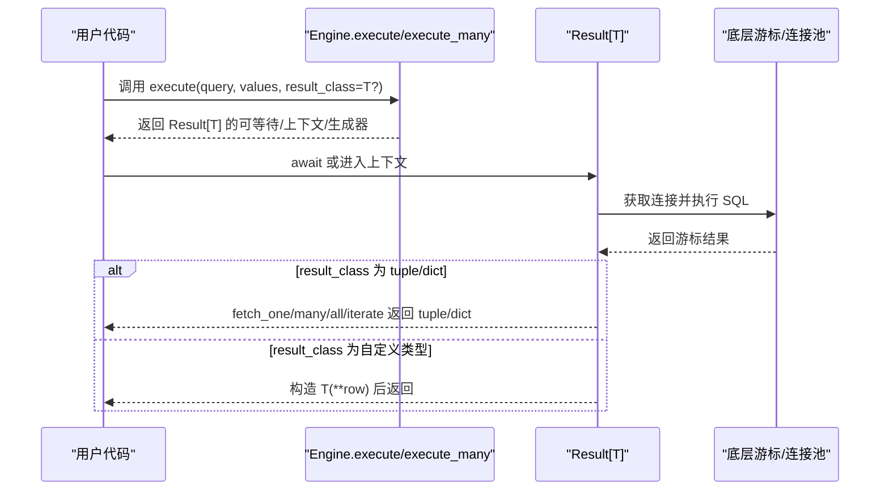
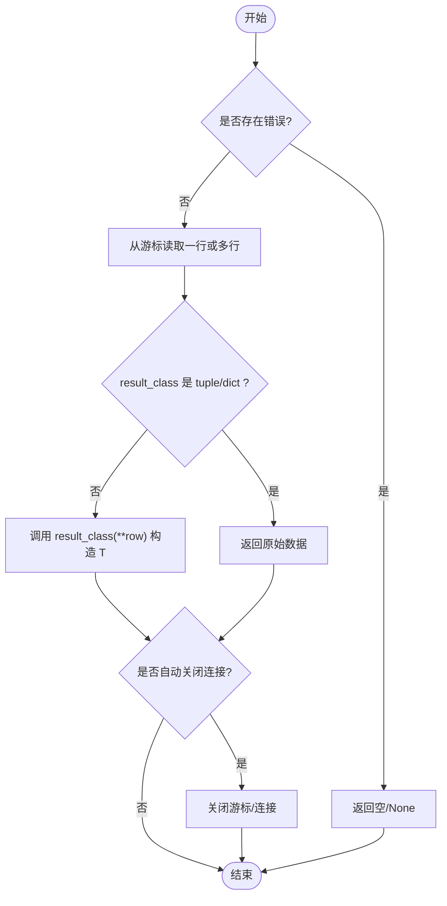
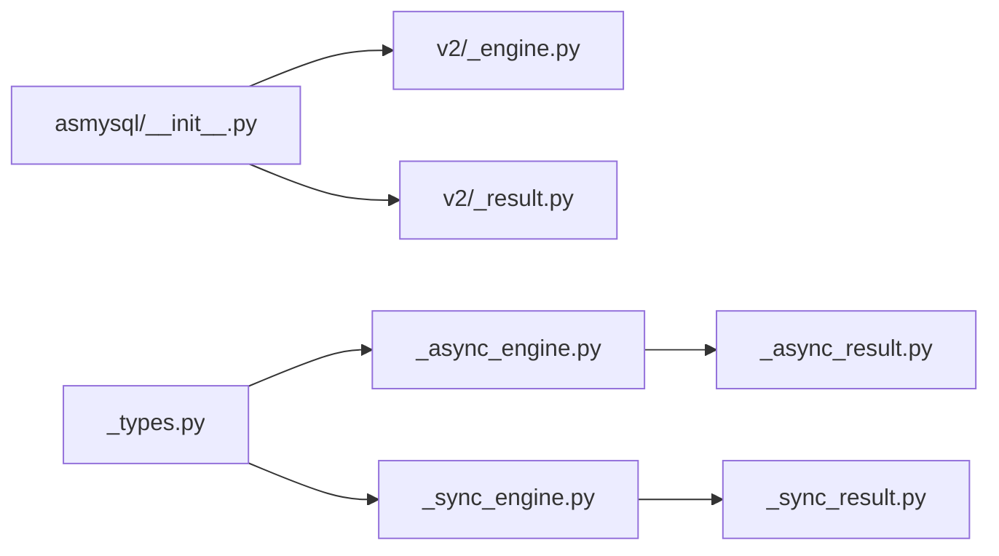

# 类型定义和约束

<cite>
**本文引用的文件**   
- [asmysql/__init__.py](file://asmysql/__init__.py)
- [asmysql/v2/_engine.py](file://asmysql/v2/_engine.py)
- [asmysql/v2/_result.py](file://asmysql/v2/_result.py)
- [asmysql/v3dev/_types.py](file://asmysql/v3dev/_types.py)
- [asmysql/v3dev/_async_engine.py](file://asmysql/v3dev/_async_engine.py)
- [asmysql/v3dev/_sync_engine.py](file://asmysql/v3dev/_sync_engine.py)
- [asmysql/v3dev/_async_result.py](file://asmysql/v3dev/_async_result.py)
- [asmysql/v3dev/_sync_result.py](file://asmysql/v3dev/_sync_result.py)
- [tests/v2/test_all_result_for_typing.py](file://tests/v2/test_all_result_for_typing.py)
- [pyproject.toml](file://pyproject.toml)
</cite>

## 目录
1. [简介](#简介)
2. [项目结构](#项目结构)
3. [核心组件](#核心组件)
4. [架构总览](#架构总览)
5. [详细组件分析](#详细组件分析)
6. [依赖关系分析](#依赖关系分析)
7. [性能与类型推断特性](#性能与类型推断特性)
8. [故障排查指南](#故障排查指南)
9. [结论](#结论)
10. [附录：类型注解示例与最佳实践](#附录类型注解示例与最佳实践)

## 简介
本文件聚焦 asmysql 的类型系统与约束，覆盖以下要点：
- 类型变量 T、泛型参数与约束的定义与使用方式
- EngineStatus TypedDict 的结构与字段含义
- execute() 与 execute_many() 的 overloading 类型定义及返回类型推断
- Result[T] 泛型类的使用方法，包括类型安全的数据获取
- 类型检查工具（mypy、pyright）配置建议
- 版本兼容性对类型定义的影响
- 面向现代 Python 类型系统的规范与最佳实践

## 项目结构
asmysql 提供 v2 稳定版与 v3dev 开发版两套实现。v2 以异步为主，v3dev 同时提供同步与异步引擎，并抽取了共享类型定义。顶层包将常用符号统一导出，便于业务代码导入。

图表来源
- [asmysql/__init__.py:1-16](file://asmysql/__init__.py#L1-L16)
- [asmysql/v2/_engine.py:1-317](file://asmysql/v2/_engine.py#L1-L317)
- [asmysql/v2/_result.py:1-273](file://asmysql/v2/_result.py#L1-L273)
- [asmysql/v3dev/_types.py:1-12](file://asmysql/v3dev/_types.py#L1-L12)
- [asmysql/v3dev/_async_engine.py:1-307](file://asmysql/v3dev/_async_engine.py#L1-L307)
- [asmysql/v3dev/_sync_engine.py:1-298](file://asmysql/v3dev/_sync_engine.py#L1-L298)
- [asmysql/v3dev/_async_result.py:1-273](file://asmysql/v3dev/_async_result.py#L1-L273)
- [asmysql/v3dev/_sync_result.py:1-268](file://asmysql/v3dev/_sync_result.py#L1-L268)

章节来源
- [asmysql/__init__.py:1-16](file://asmysql/__init__.py#L1-L16)

## 核心组件
- 类型变量与泛型
  - T = TypeVar("T")：用于表示结果行类型或 result_class 的占位符，贯穿 Engine.execute/execute_many 与 Result[T]。
  - 在 v3dev 同步实现中，Result 的 T 被约束为 type，即 result_class 必须为类型对象。
- EngineStatus TypedDict
  - 描述连接池状态的结构化字典，包含地址、连通性、池大小等字段。
- Engine 与 Result
  - Engine 暴露 execute()/execute_many()，通过 overloading 根据 result_class 推断返回类型。
  - Result[T] 封装查询执行、迭代、批量获取与资源释放，支持 tuple/dict 或自定义类型。

章节来源
- [asmysql/v2/_engine.py:23-35](file://asmysql/v2/_engine.py#L23-L35)
- [asmysql/v2/_result.py:1-44](file://asmysql/v2/_result.py#L1-L44)
- [asmysql/v3dev/_types.py:1-12](file://asmysql/v3dev/_types.py#L1-L12)
- [asmysql/v3dev/_sync_result.py:9-46](file://asmysql/v3dev/_sync_result.py#L9-L46)

## 架构总览
下图展示 v2 与 v3dev 的关键类型与调用关系，以及 execute/execute_many 的 overloading 如何影响返回类型推断。

图表来源
- [asmysql/v2/_engine.py:204-316](file://asmysql/v2/_engine.py#L204-L316)
- [asmysql/v2/_result.py:21-273](file://asmysql/v2/_result.py#L21-L273)
- [asmysql/v3dev/_async_engine.py:194-306](file://asmysql/v3dev/_async_engine.py#L194-L306)
- [asmysql/v3dev/_sync_engine.py:184-297](file://asmysql/v3dev/_sync_engine.py#L184-L297)
- [asmysql/v3dev/_async_result.py:21-273](file://asmysql/v3dev/_async_result.py#L21-L273)
- [asmysql/v3dev/_sync_result.py:23-268](file://asmysql/v3dev/_sync_result.py#L23-L268)
- [asmysql/v3dev/_types.py:4-12](file://asmysql/v3dev/_types.py#L4-L12)

## 详细组件分析

### 类型变量与泛型约束
- 通用类型变量
  - T = TypeVar("T")：用于表达“结果行类型”，既可以是 tuple/dict，也可以是任意可构造类型（如 Pydantic BaseModel）。
- 同步版本的额外约束
  - 在 v3dev 同步 Result 中，T 被声明为 bound=type，强调 result_class 必须是类型对象，从而保证 fetch_* 与 iterate 的返回值类型为 T。
- 使用位置
  - Engine.execute/execute_many 的 overloading 根据 result_class 是否显式传入具体类型来区分返回类型是 Result[tuple] 还是 Result[T]。
  - Result[T] 内部根据 _result_class 是否为 tuple/dict 决定直接返回原始数据或调用构造函数生成 T 实例。

章节来源
- [asmysql/v2/_engine.py:23-24](file://asmysql/v2/_engine.py#L23-L24)
- [asmysql/v2/_result.py:7-8](file://asmysql/v2/_result.py#L7-L8)
- [asmysql/v3dev/_sync_result.py:9](file://asmysql/v3dev/_sync_result.py#L9)

### EngineStatus TypedDict 结构与字段
EngineStatus 描述了数据库连接池的状态信息，字段如下：
- address: 连接地址字符串
- connected: 是否已连接
- pool_minsize: 最小池大小（可能为空）
- pool_maxsize: 最大池大小（可能为空）
- pool_size: 当前池大小（可能为空）
- pool_free: 空闲连接数（可能为空）
- pool_used: 已用连接数（可能为空）

该类型在 v2 与 v3dev 中均有使用，v3dev 将其抽离到独立模块以便复用。

章节来源
- [asmysql/v2/_engine.py:27-35](file://asmysql/v2/_engine.py#L27-L35)
- [asmysql/v3dev/_types.py:4-12](file://asmysql/v3dev/_types.py#L4-L12)
- [asmysql/v3dev/_async_engine.py:145-156](file://asmysql/v3dev/_async_engine.py#L145-L156)
- [asmysql/v3dev/_sync_engine.py:143-154](file://asmysql/v3dev/_sync_engine.py#L143-L154)

### execute() 与 execute_many() 的 Overloading 与返回类型推断
- 两种重载分支
  - 当 result_class 未指定或为默认 tuple 时，返回类型为 Result[tuple]（或对应的上下文管理器/生成器变体）。
  - 当 result_class 显式传入具体类型 T 时，返回类型为 Result[T]（或对应变体）。
- 返回类型集合
  - 异步版本：Union[Awaitable[Result[T]], AsyncContextManager[Result[T]], AsyncGenerator[T, None]]
  - 同步版本：Union[Result[T], ContextManager[Result[T]], Generator[T, None, None]]
- 行为说明
  - 支持 await engine.execute(...) 与 async with engine.execute(...) as result 两种用法；也支持直接在 execute 返回上迭代。
  - 当 result_class 为 tuple/dict 时，fetch_* 与 iterate 返回原始元组/字典；否则调用 result_class(**row) 构造 T 实例。

图表来源
- [asmysql/v2/_engine.py:204-316](file://asmysql/v2/_engine.py#L204-L316)
- [asmysql/v3dev/_async_engine.py:194-306](file://asmysql/v3dev/_async_engine.py#L194-L306)
- [asmysql/v3dev/_sync_engine.py:184-297](file://asmysql/v3dev/_sync_engine.py#L184-L297)
- [asmysql/v2/_result.py:101-273](file://asmysql/v2/_result.py#L101-L273)
- [asmysql/v3dev/_async_result.py:101-273](file://asmysql/v3dev/_async_result.py#L101-L273)
- [asmysql/v3dev/_sync_result.py:103-268](file://asmysql/v3dev/_sync_result.py#L103-L268)

章节来源
- [asmysql/v2/_engine.py:204-316](file://asmysql/v2/_engine.py#L204-L316)
- [asmysql/v3dev/_async_engine.py:194-306](file://asmysql/v3dev/_async_engine.py#L194-L306)
- [asmysql/v3dev/_sync_engine.py:184-297](file://asmysql/v3dev/_sync_engine.py#L184-L297)

### Result[T] 泛型类的使用与类型安全
- 构造与生命周期
  - 由 Engine.execute/execute_many 创建，支持 await、async with、async for 三种模式。
  - 自动管理连接与游标释放，错误路径下也会正确回收资源。
- 数据获取方法
  - fetch_one(): 返回 Optional[T]
  - fetch_many(size): 返回 list[T]
  - fetch_all(): 返回 list[T]
  - iterate(): 异步/同步生成器，产出 T
- 类型安全策略
  - 当 result_class 为 tuple/dict 时，直接返回原始数据结构。
  - 否则，使用 result_class(**row) 构造 T 实例，确保下游类型一致。

图表来源
- [asmysql/v2/_result.py:186-273](file://asmysql/v2/_result.py#L186-L273)
- [asmysql/v3dev/_async_result.py:186-273](file://asmysql/v3dev/_async_result.py#L186-L273)
- [asmysql/v3dev/_sync_result.py:186-268](file://asmysql/v3dev/_sync_result.py#L186-L268)

章节来源
- [asmysql/v2/_result.py:21-273](file://asmysql/v2/_result.py#L21-L273)
- [asmysql/v3dev/_async_result.py:21-273](file://asmysql/v3dev/_async_result.py#L21-L273)
- [asmysql/v3dev/_sync_result.py:23-268](file://asmysql/v3dev/_sync_result.py#L23-L268)

## 依赖关系分析
- 顶层导出
  - asmysql.__init__ 将 v2 的 AsMysql、Engine、Result、AsyncEngine、AsyncResult 统一导出，简化业务导入。
- 版本差异
  - v2 仅异步实现；v3dev 同时提供同步与异步引擎，并将 EngineStatus 抽离至 _types.py。
- 外部依赖
  - 基于 aiomysql（异步）与 pymysql（同步），错误类型来自 pymysql.err.MySQLError。

图表来源
- [asmysql/__init__.py:1-16](file://asmysql/__init__.py#L1-L16)
- [asmysql/v2/_engine.py:1-317](file://asmysql/v2/_engine.py#L1-L317)
- [asmysql/v2/_result.py:1-273](file://asmysql/v2/_result.py#L1-L273)
- [asmysql/v3dev/_types.py:1-12](file://asmysql/v3dev/_types.py#L1-L12)
- [asmysql/v3dev/_async_engine.py:1-307](file://asmysql/v3dev/_async_engine.py#L1-L307)
- [asmysql/v3dev/_sync_engine.py:1-298](file://asmysql/v3dev/_sync_engine.py#L1-L298)
- [asmysql/v3dev/_async_result.py:1-273](file://asmysql/v3dev/_async_result.py#L1-L273)
- [asmysql/v3dev/_sync_result.py:1-268](file://asmysql/v3dev/_sync_result.py#L1-L268)

章节来源
- [asmysql/__init__.py:1-16](file://asmysql/__init__.py#L1-L16)

## 性能与类型推断特性
- 类型推断带来的收益
  - 通过 overloading 与 Generic[T]，IDE 与静态检查器能准确推断 fetch_one/many/all/iterate 的返回类型，减少运行时类型转换与错误。
- 流式与批处理
  - Result 支持流式迭代（async for / iterate），避免一次性加载大量数据，降低内存占用。
- 资源管理
  - 自动关闭游标与连接，错误路径下也能释放资源，提升稳定性。

[本节为通用指导，不直接分析具体文件]

## 故障排查指南
- 常见类型问题
  - 未传入 result_class 导致返回 tuple/dict，而非期望的模型类型。建议在每次查询显式传入 result_class。
  - 在同步版本中，result_class 必须为类型对象（bound=type），否则会触发类型检查错误。
- 运行期异常
  - MySQLError 会被捕获并记录到 Result.error，可通过 error_no/error_msg 获取诊断信息。
- 连接与池状态
  - 使用 status 属性查看连接池状态，确认连接是否建立、池大小与使用情况。

章节来源
- [asmysql/v2/_result.py:133-151](file://asmysql/v2/_result.py#L133-L151)
- [asmysql/v3dev/_async_result.py:133-151](file://asmysql/v3dev/_async_result.py#L133-L151)
- [asmysql/v3dev/_sync_result.py:129-147](file://asmysql/v3dev/_sync_result.py#L129-L147)
- [asmysql/v2/_engine.py:154-166](file://asmysql/v2/_engine.py#L154-L166)
- [asmysql/v3dev/_async_engine.py:145-156](file://asmysql/v3dev/_async_engine.py#L145-L156)
- [asmysql/v3dev/_sync_engine.py:143-154](file://asmysql/v3dev/_sync_engine.py#L143-L154)

## 结论
asmysql 的类型系统围绕 TypeVar(T)、Generic[T] 与 @overload 构建，实现了从查询到结果的全链路类型推断。配合 EngineStatus TypedDict 与 Result[T] 的严格约束，开发者可以在编译期获得更强的类型安全保障，并在运行时享受简洁一致的 API。

[本节为总结性内容，不直接分析具体文件]

## 附录：类型注解示例与最佳实践

- 基本用法（异步）
  - 使用 await engine.execute(..., result_class=MyModel) 获取 Result[MyModel]，随后通过 fetch_one/many/all/iterate 得到 MyModel 实例。
  - 也可直接在 execute 返回上迭代，无需显式保存 Result。
- 批量写入
  - 使用 execute_many(...) 进行批量插入，返回 Result[tuple|T]，可根据需要选择是否传入 result_class。
- 同步场景
  - 在 v3dev 同步引擎中，result_class 必须为类型对象，fetch_* 与 iterate 返回 T 或 list[T]。
- 类型检查工具配置建议
  - mypy
    - 启用严格模式：strict
    - 设置 python_version 与目标平台
    - 忽略第三方库缺失类型提示的警告（如必要）
  - pyright
    - 开启 strict 或 basic 模式
    - 配置 include/exclude 以限定分析范围
    - 针对第三方库设置 ignoreMissingImports
- 版本兼容性
  - 项目要求 Python >= 3.9，兼容 3.9-3.14。
  - v2 为异步实现；v3dev 提供同步与异步双实现，且将 EngineStatus 抽离为共享类型。
- 参考用例路径
  - 类型使用示例参见测试文件，展示了 await、async for、fetch_one/many/all、iterate 等多种模式。

章节来源
- [tests/v2/test_all_result_for_typing.py:1-121](file://tests/v2/test_all_result_for_typing.py#L1-L121)
- [pyproject.toml:31-31](file://pyproject.toml#L31-L31)
- [pyproject.toml:8-19](file://pyproject.toml#L8-L19)