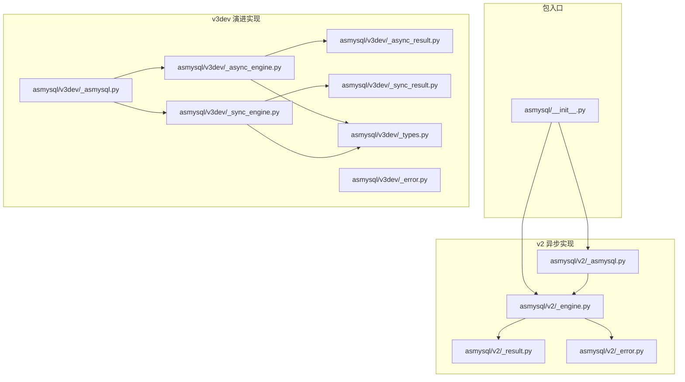
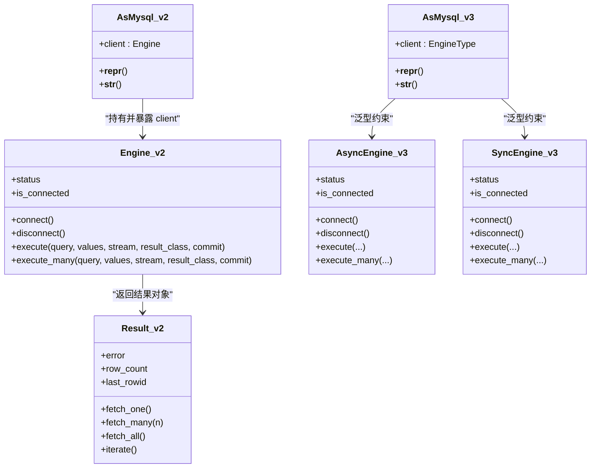
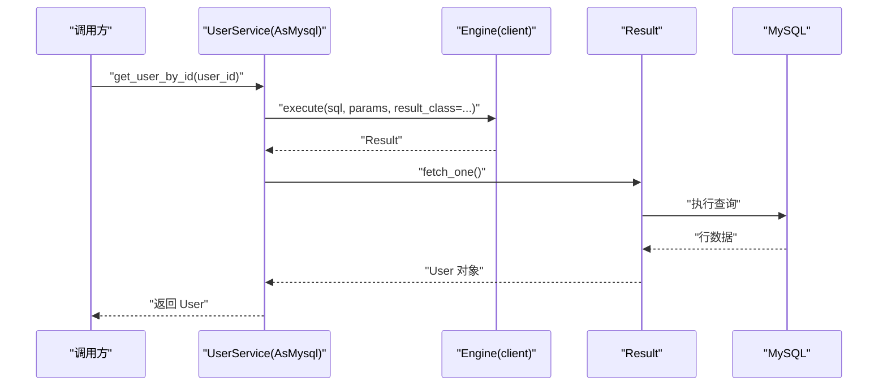
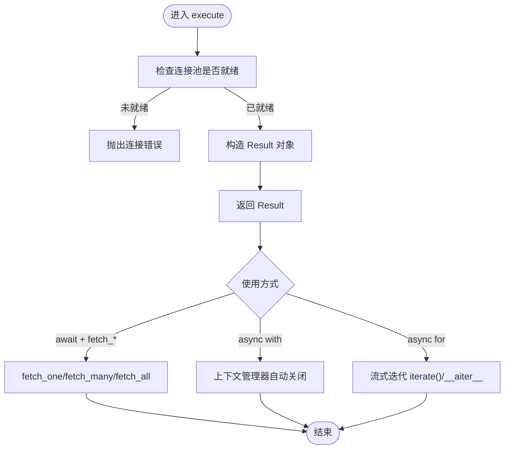
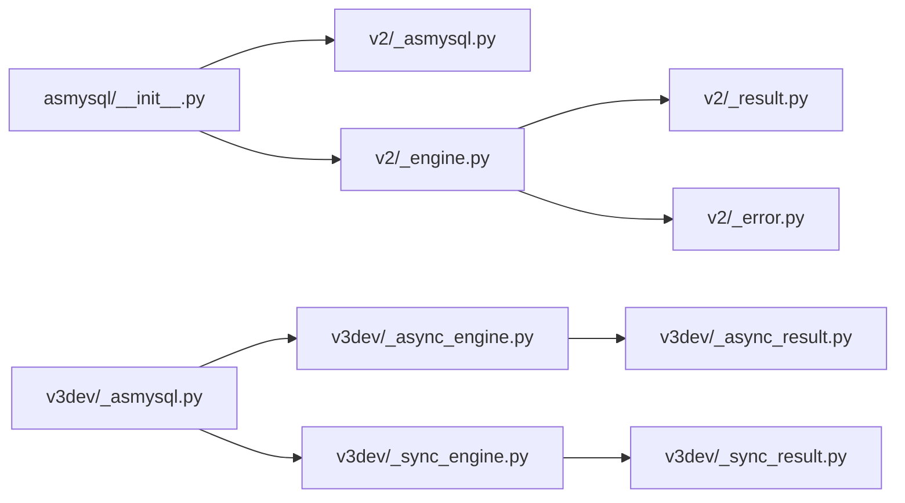

# 业务逻辑开发

<cite>
**本文引用的文件**   
- [asmysql/__init__.py](file://asmysql/__init__.py)
- [asmysql/v2/_asmysql.py](file://asmysql/v2/_asmysql.py)
- [asmysql/v2/_engine.py](file://asmysql/v2/_engine.py)
- [asmysql/v2/_error.py](file://asmysql/v2/_error.py)
- [asmysql/v3dev/_asmysql.py](file://asmysql/v3dev/_asmysql.py)
- [asmysql/v3dev/_async_engine.py](file://asmysql/v3dev/_async_engine.py)
- [asmysql/v3dev/_sync_engine.py](file://asmysql/v3dev/_sync_engine.py)
- [asmysql/v3dev/_types.py](file://asmysql/v3dev/_types.py)
- [mkdocs/v2/docs/zh/business-logic.md](file://mkdocs/v2/docs/zh/business-logic.md)
- [mkdocs/v2/docs/zh/best-practices.md](file://mkdocs/v2/docs/zh/best-practices.md)
- [mkdocs/v2/docs/zh/examples.md](file://mkdocs/v2/docs/zh/examples.md)
- [pytest/v2/test_asmysql_mock.py](file://pytest/v2/test_asmysql_mock.py)
- [pytest/v3/test_asmysql_async_mock.py](file://pytest/v3/test_asmysql_async_mock.py)
- [tests/v2/v2_start.py](file://tests/v2/v2_start.py)
</cite>

## 目录
1. [简介](#简介)
2. [项目结构](#项目结构)
3. [核心组件](#核心组件)
4. [架构总览](#架构总览)
5. [详细组件分析](#详细组件分析)
6. [依赖关系分析](#依赖关系分析)
7. [性能与可扩展性](#性能与可扩展性)
8. [故障排查指南](#故障排查指南)
9. [结论](#结论)
10. [附录：企业级最佳实践清单](#附录企业级最佳实践清单)

## 简介
本指南面向企业级应用，系统讲解如何使用 asmysql 进行业务逻辑开发。重点包括：
- AsMysql 基类的设计理念与继承模式，如何通过继承获得数据库访问能力
- client 属性的使用方式，如何直接访问底层 Engine 实例执行高级操作
- 类型安全在业务逻辑中的应用（泛型、类型提示）
- 单元测试编写方法（Mock 测试与集成测试）
- 完整业务场景示例（用户管理、订单处理、数据分析等）
- 代码组织与模块划分策略，可维护、可扩展的业务逻辑开发指导

## 项目结构
仓库按版本与用途分层组织：
- asmysql/v2：当前稳定版异步封装（基于 aiomysql），提供 Engine、AsMysql、Result 等
- asmysql/v3dev：下一代同步/异步双引擎与通用 AsMysql 泛型基类（实验/演进中）
- mkdocs：官方文档与示例（含中文业务逻辑、最佳实践、示例）
- pytest/tests：单元测试与集成测试样例

图表来源
- [asmysql/__init__.py:1-16](file://asmysql/__init__.py#L1-L16)
- [asmysql/v2/_asmysql.py:1-26](file://asmysql/v2/_asmysql.py#L1-L26)
- [asmysql/v2/_engine.py:1-317](file://asmysql/v2/_engine.py#L1-L317)
- [asmysql/v3dev/_asmysql.py:1-30](file://asmysql/v3dev/_asmysql.py#L1-L30)
- [asmysql/v3dev/_async_engine.py:1-307](file://asmysql/v3dev/_async_engine.py#L1-L307)
- [asmysql/v3dev/_sync_engine.py:1-298](file://asmysql/v3dev/_sync_engine.py#L1-L298)
- [asmysql/v3dev/_types.py:1-12](file://asmysql/v3dev/_types.py#L1-L12)

章节来源
- [asmysql/__init__.py:1-16](file://asmysql/__init__.py#L1-L16)

## 核心组件
- AsMysql：业务逻辑基类，持有对 Engine 的引用并通过 client 属性暴露底层能力
- Engine：数据库连接池与 SQL 执行入口（v2 为异步；v3dev 同时提供同步/异步）
- Result：SQL 执行结果封装，支持 fetch_one/fetch_many/fetch_all/iterate 以及上下文管理与迭代协议
- 错误处理：统一错误消息格式化，避免空字符串导致日志不可读

要点
- 通过继承 AsMysql，业务类天然具备 execute/execute_many 等能力
- client 属性返回底层 Engine，可直接调用更高级或扩展接口
- v3dev 引入泛型 AsMysql[EngineType]，使 client 的类型提示更精确

章节来源
- [asmysql/v2/_asmysql.py:1-26](file://asmysql/v2/_asmysql.py#L1-L26)
- [asmysql/v2/_engine.py:1-317](file://asmysql/v2/_engine.py#L1-L317)
- [asmysql/v3dev/_asmysql.py:1-30](file://asmysql/v3dev/_asmysql.py#L1-L30)
- [asmysql/v3dev/_async_engine.py:1-307](file://asmysql/v3dev/_async_engine.py#L1-L307)
- [asmysql/v3dev/_sync_engine.py:1-298](file://asmysql/v3dev/_sync_engine.py#L1-L298)
- [asmysql/v2/_error.py:1-7](file://asmysql/v2/_error.py#L1-L7)

## 架构总览
下图展示从业务类到数据库驱动的核心交互路径，以及 v2 与 v3dev 的差异。

图表来源
- [asmysql/v2/_asmysql.py:1-26](file://asmysql/v2/_asmysql.py#L1-L26)
- [asmysql/v2/_engine.py:1-317](file://asmysql/v2/_engine.py#L1-L317)
- [asmysql/v3dev/_asmysql.py:1-30](file://asmysql/v3dev/_asmysql.py#L1-L30)
- [asmysql/v3dev/_async_engine.py:1-307](file://asmysql/v3dev/_async_engine.py#L1-L307)
- [asmysql/v3dev/_sync_engine.py:1-298](file://asmysql/v3dev/_sync_engine.py#L1-L298)

## 详细组件分析

### AsMysql 基类与继承模式
- 设计目标：将数据库访问能力下沉至基类，业务类仅关注领域方法
- 关键特性：
  - __init__ 接收 Engine 实例并保存为私有字段
  - client 属性以只读形式暴露 Engine，便于直接调用 execute/execute_many 等
  - 提供友好的 __repr__/__str__ 输出，便于调试与日志记录
- 继承建议：
  - 每个业务域创建一个服务类，继承 AsMysql
  - 方法命名遵循“动词+名词”风格，如 get_user_by_id、create_order
  - 参数与返回值尽量使用类型提示，结合 Pydantic 模型提升可读性与校验能力

章节来源
- [asmysql/v2/_asmysql.py:1-26](file://asmysql/v2/_asmysql.py#L1-L26)
- [asmysql/v3dev/_asmysql.py:1-30](file://asmysql/v3dev/_asmysql.py#L1-L30)
- [mkdocs/v2/docs/zh/business-logic.md:1-67](file://mkdocs/v2/docs/zh/business-logic.md#L1-L67)

### Engine 与结果集 Result
- Engine 职责：
  - 解析连接 URL 与参数，创建并管理连接池
  - 提供 connect/disconnect/status/is_connected 等生命周期与状态查询
  - 提供 execute/execute_many 两种执行入口，支持流式与非流式
- Result 职责：
  - 封装单次执行的元数据与数据访问方法
  - 支持 fetch_one/fetch_many/fetch_all/iterate 多种读取方式
  - 支持上下文管理器与异步迭代协议，简化资源释放
- 类型与重载：
  - execute/execute_many 使用 overloads 表达不同 result_class 的返回类型
  - v3dev 进一步引入 TypedDict 描述 EngineStatus，增强静态检查体验

章节来源
- [asmysql/v2/_engine.py:1-317](file://asmysql/v2/_engine.py#L1-L317)
- [asmysql/v3dev/_async_engine.py:1-307](file://asmysql/v3dev/_async_engine.py#L1-L307)
- [asmysql/v3dev/_sync_engine.py:1-298](file://asmysql/v3dev/_sync_engine.py#L1-L298)
- [asmysql/v3dev/_types.py:1-12](file://asmysql/v3dev/_types.py#L1-L12)

### 错误处理与日志
- 统一错误消息格式化，避免异常内容为空导致日志不可用
- 建议在业务层：
  - 始终检查 result.error，并在失败时记录 error_no/error_msg
  - 将底层异常转换为领域异常或 HTTP 异常，保持上层语义清晰

章节来源
- [asmysql/v2/_error.py:1-7](file://asmysql/v2/_error.py#L1-L7)
- [mkdocs/v2/docs/zh/best-practices.md:70-87](file://mkdocs/v2/docs/zh/best-practices.md#L70-L87)

### 类型安全与泛型
- v2：通过 overloads 为 execute/execute_many 提供多态返回类型，配合 result_class 指定 tuple/dict/自定义模型
- v3dev：AsMysql 使用 Generic[EngineType]，client 的类型随传入 Engine 类型推导，IDE 提示更准确

章节来源
- [asmysql/v2/_engine.py:204-316](file://asmysql/v2/_engine.py#L204-L316)
- [asmysql/v3dev/_asmysql.py:1-30](file://asmysql/v3dev/_asmysql.py#L1-L30)

### 单元测试：Mock 与集成测试
- Mock 测试要点：
  - 使用 unittest.mock.Mock/AsyncMock 模拟 Engine 与 Result
  - 验证 execute/execute_many 的调用参数与返回值
  - 模拟异步迭代器行为（__aiter__/__anext__）以覆盖 async for 分支
- 集成测试要点：
  - 启动真实 MySQL，使用 Engine 上下文管理器自动管理连接
  - 准备测试数据，断言业务方法的行为与边界条件

章节来源
- [pytest/v2/test_asmysql_mock.py:1-245](file://pytest/v2/test_asmysql_mock.py#L1-L245)
- [pytest/v3/test_asmysql_async_mock.py:1-247](file://pytest/v3/test_asmysql_async_mock.py#L1-L247)
- [tests/v2/v2_start.py:1-107](file://tests/v2/v2_start.py#L1-L107)

### 序列图：业务方法执行流程（以用户查询为例）

图表来源
- [mkdocs/v2/docs/zh/business-logic.md:1-67](file://mkdocs/v2/docs/zh/business-logic.md#L1-L67)
- [asmysql/v2/_engine.py:226-259](file://asmysql/v2/_engine.py#L226-L259)

### 流程图：execute 执行与结果获取

图表来源
- [asmysql/v2/_engine.py:226-259](file://asmysql/v2/_engine.py#L226-L259)
- [mkdocs/v2/docs/zh/best-practices.md:25-68](file://mkdocs/v2/docs/zh/best-practices.md#L25-L68)

## 依赖关系分析
- 包入口集中导出 v2 的 AsMysql/Engine/Result 及 v3 的异步变体
- v2 依赖 aiomysql 与 pymysql.err，封装连接池与错误信息
- v3dev 同时提供同步/异步 Engine，并通过泛型 AsMysql 统一对外

图表来源
- [asmysql/__init__.py:1-16](file://asmysql/__init__.py#L1-L16)
- [asmysql/v2/_asmysql.py:1-26](file://asmysql/v2/_asmysql.py#L1-L26)
- [asmysql/v2/_engine.py:1-317](file://asmysql/v2/_engine.py#L1-L317)
- [asmysql/v3dev/_asmysql.py:1-30](file://asmysql/v3dev/_asmysql.py#L1-L30)
- [asmysql/v3dev/_async_engine.py:1-307](file://asmysql/v3dev/_async_engine.py#L1-L307)
- [asmysql/v3dev/_sync_engine.py:1-298](file://asmysql/v3dev/_sync_engine.py#L1-L298)

章节来源
- [asmysql/__init__.py:1-16](file://asmysql/__init__.py#L1-L16)

## 性能与可扩展性
- 连接池配置
  - 根据并发量设置 min_pool_size/max_pool_size/pool_recycle/connect_timeout
  - 生产环境不建议使用默认值
- 大数据集处理
  - 优先使用流式查询（stream=True）与 async for 逐行处理，避免一次性加载导致内存溢出
- 事务与提交
  - 需要精细控制时，关闭 auto_commit 并使用 commit 参数或显式事务管理
- 可扩展性
  - 通过继承 AsMysql 拆分领域服务，每个服务聚焦单一职责
  - 使用 Pydantic 模型作为输入/输出契约，便于跨层传递与校验

章节来源
- [mkdocs/v2/docs/zh/best-practices.md:124-141](file://mkdocs/v2/docs/zh/best-practices.md#L124-L141)
- [mkdocs/v2/docs/zh/best-practices.md:89-103](file://mkdocs/v2/docs/zh/best-practices.md#L89-L103)
- [mkdocs/v2/docs/zh/examples.md:356-404](file://mkdocs/v2/docs/zh/examples.md#L356-L404)

## 故障排查指南
- 常见错误
  - 连接未建立即访问 pool：会抛出连接错误
  - 忘记断开连接或手动 close=False 后未调用 close：可能导致连接池耗尽
  - 忽略 result.error：可能得到空结果或异常数据
- 定位技巧
  - 打印 engine.status 观察连接池大小、空闲与使用中连接数
  - 开启 echo_sql_log 打印 SQL 语句，辅助定位慢查询与参数问题
  - 使用统一的 err_msg 格式化异常，确保日志可读

章节来源
- [asmysql/v2/_engine.py:176-202](file://asmysql/v2/_engine.py#L176-L202)
- [mkdocs/v2/docs/zh/best-practices.md:25-68](file://mkdocs/v2/docs/zh/best-practices.md#L25-L68)
- [asmysql/v2/_error.py:1-7](file://asmysql/v2/_error.py#L1-L7)

## 结论
- 使用 AsMysql 作为业务基类，可以显著降低重复代码，提升可维护性
- 借助 Engine 的连接池与 Result 的统一结果抽象，既能保证性能，又能简化资源管理
- 通过类型提示与泛型，提高 IDE 支持与代码健壮性
- 完善的 Mock 与集成测试用例，保障业务逻辑的正确性与回归稳定性

## 附录：企业级最佳实践清单
- 代码组织
  - 按领域划分服务类，每个服务类继承 AsMysql
  - 将 SQL 与参数分离，使用参数化查询防止注入
- 错误处理
  - 所有 execute 调用后检查 result.error，记录错误码与消息
  - 将底层异常转换为领域异常或 HTTP 异常
- 日志记录
  - 使用 engine.status 与 echo_sql_log 辅助排障
  - 对关键路径打点，记录耗时与影响行数
- 类型安全
  - 使用 Pydantic 模型定义输入/输出契约
  - 利用 result_class 与 overloads 获得准确的类型提示
- 测试策略
  - 单元层：Mock Engine/Result，覆盖正常与异常分支
  - 集成层：使用真实数据库，验证端到端流程
- 性能优化
  - 合理配置连接池参数
  - 大数据集采用流式查询与异步迭代
  - 批量写入使用 execute_many

章节来源
- [mkdocs/v2/docs/zh/best-practices.md:1-141](file://mkdocs/v2/docs/zh/best-practices.md#L1-L141)
- [mkdocs/v2/docs/zh/examples.md:688-808](file://mkdocs/v2/docs/zh/examples.md#L688-L808)
- [pytest/v2/test_asmysql_mock.py:1-245](file://pytest/v2/test_asmysql_mock.py#L1-L245)
- [pytest/v3/test_asmysql_async_mock.py:1-247](file://pytest/v3/test_asmysql_async_mock.py#L1-L247)