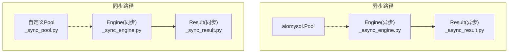
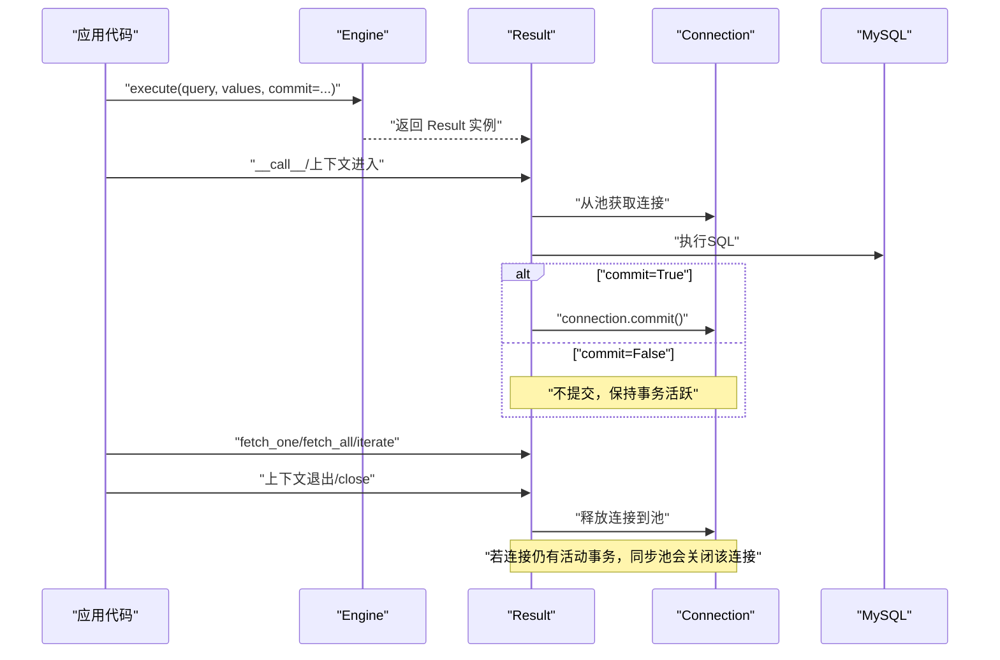
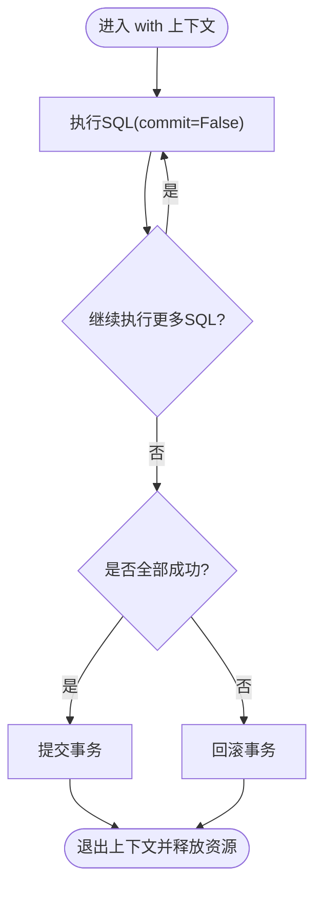
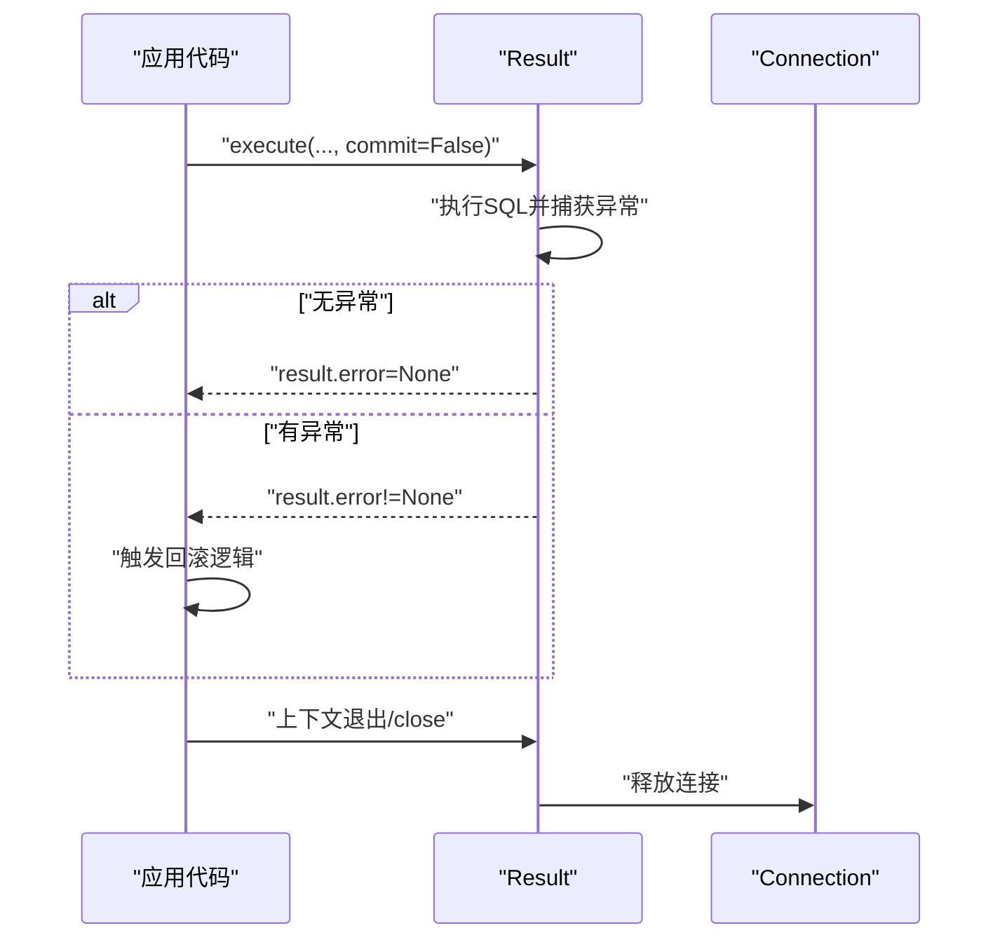
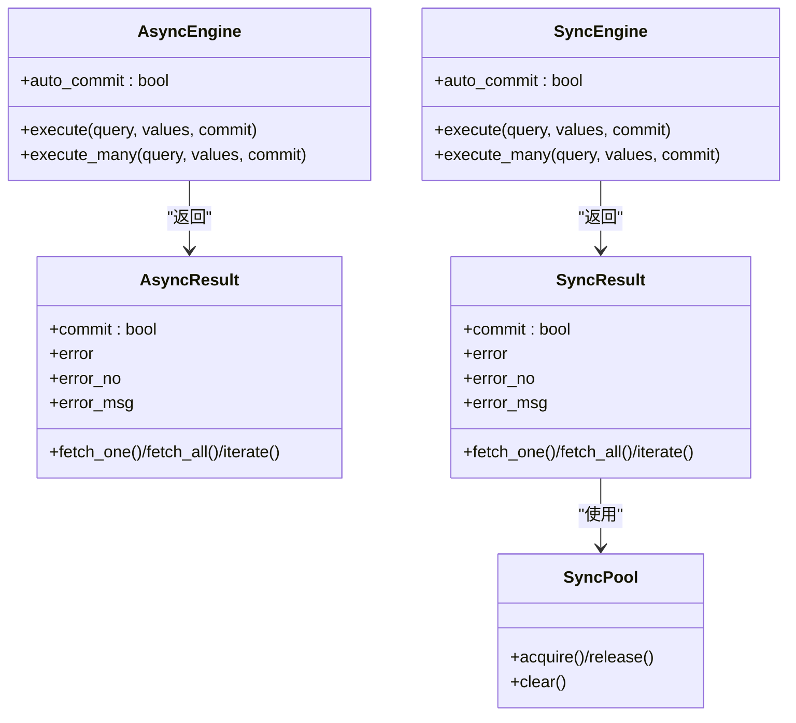

# 事务控制

<cite>
**本文引用的文件**   
- [asmysql/v3dev/_async_engine.py](file://asmysql/v3dev/_async_engine.py)
- [asmysql/v3dev/_sync_engine.py](file://asmysql/v3dev/_sync_engine.py)
- [asmysql/v3dev/_async_result.py](file://asmysql/v3dev/_async_result.py)
- [asmysql/v3dev/_sync_result.py](file://asmysql/v3dev/_sync_result.py)
- [asmysql/v3dev/_sync_pool.py](file://asmysql/v3dev/_sync_pool.py)
- [mkdocs/v2/docs/zh/transaction.md](file://mkdocs/v2/docs/zh/transaction.md)
- [mkdocs/v2/docs/en/transaction.md](file://mkdocs/v2/docs/en/transaction.md)
- [mkdocs/v2/docs/zh/examples.md](file://mkdocs/v2/docs/zh/examples.md)
- [mkdocs/v2/docs/en/examples.md](file://mkdocs/v2/docs/en/examples.md)
- [mkdocs/v2/docs/zh/best-practices.md](file://mkdocs/v2/docs/zh/best-practices.md)
- [tests/v3/test_async.py](file://tests/v3/test_async.py)
- [tests/v3/test_sync.py](file://tests/v3/test_sync.py)
</cite>

## 目录
1. [简介](#简介)
2. [项目结构](#项目结构)
3. [核心组件](#核心组件)
4. [架构总览](#架构总览)
5. [详细组件分析](#详细组件分析)
6. [依赖关系分析](#依赖关系分析)
7. [性能考虑](#性能考虑)
8. [故障排查指南](#故障排查指南)
9. [结论](#结论)
10. [附录：典型业务场景示例](#附录典型业务场景示例)

## 简介
本章节面向需要保证数据一致性的应用场景，系统梳理 asmysql 在 v3dev 分支中的事务控制能力与使用方式。重点包括：
- 自动提交与手动事务管理的区别、适用场景
- 基于 with 语句的上下文管理（开始、提交、回滚）
- 嵌套事务的处理策略与最佳实践
- 异常处理与错误恢复机制
- 隔离级别与并发控制的现状与建议
- 完整的事务操作示例（如转账、订单处理）
- 事务性能影响与优化策略
- 事务监控与调试方法

## 项目结构
v3dev 版本将同步与异步两套实现解耦，分别通过 Engine 暴露 execute/execute_many 接口，返回 Result 对象负责执行 SQL、结果读取以及连接生命周期管理。事务相关的关键点集中在：
- Engine 构造参数 auto_commit 决定底层连接的默认提交行为
- Result.__call__ 在执行 SQL 后根据 commit 参数决定是否调用 connection.commit()
- 同步池 _sync_pool.Pool 在释放连接时检测是否处于活动事务，若存在未提交事务则关闭连接以规避状态泄漏

图表来源
- [asmysql/v3dev/_async_engine.py:216-249](file://asmysql/v3dev/_async_engine.py#L216-L249)
- [asmysql/v3dev/_async_result.py:101-125](file://asmysql/v3dev/_async_result.py#L101-L125)
- [asmysql/v3dev/_sync_engine.py:206-239](file://asmysql/v3dev/_sync_engine.py#L206-L239)
- [asmysql/v3dev/_sync_result.py:103-127](file://asmysql/v3dev/_sync_result.py#L103-L127)
- [asmysql/v3dev/_sync_pool.py:243-272](file://asmysql/v3dev/_sync_pool.py#L243-L272)

章节来源
- [asmysql/v3dev/_async_engine.py:216-249](file://asmysql/v3dev/_async_engine.py#L216-L249)
- [asmysql/v3dev/_sync_engine.py:206-239](file://asmysql/v3dev/_sync_engine.py#L206-L239)
- [asmysql/v3dev/_async_result.py:101-125](file://asmysql/v3dev/_async_result.py#L101-L125)
- [asmysql/v3dev/_sync_result.py:103-127](file://asmysql/v3dev/_sync_result.py#L103-L127)
- [asmysql/v3dev/_sync_pool.py:243-272](file://asmysql/v3dev/_sync_pool.py#L243-L272)

## 核心组件
- Engine（异步/同步）
  - 提供 connect/disconnect、status、execute/execute_many 等接口
  - 构造参数 auto_commit 传递到底层连接池或连接，用于设置 autocommit 模式
- Result（异步/同步）
  - 封装一次 SQL 执行的完整生命周期：获取连接、创建游标、执行 SQL、可选提交、结果读取、释放连接
  - 支持上下文管理器（with/async with）、迭代器（for/async for）和显式 close
  - 关键参数 commit 控制本次执行是否提交事务
- 连接池
  - 异步：aiomysql.Pool
  - 同步：自定义 Pool，具备空闲回收、超时清理、事务状态检查等逻辑

章节来源
- [asmysql/v3dev/_async_engine.py:46-101](file://asmysql/v3dev/_async_engine.py#L46-L101)
- [asmysql/v3dev/_sync_engine.py:44-100](file://asmysql/v3dev/_sync_engine.py#L44-L100)
- [asmysql/v3dev/_async_result.py:21-44](file://asmysql/v3dev/_async_result.py#L21-L44)
- [asmysql/v3dev/_sync_result.py:23-45](file://asmysql/v3dev/_sync_result.py#L23-L45)
- [asmysql/v3dev/_sync_pool.py:18-89](file://asmysql/v3dev/_sync_pool.py#L18-L89)

## 架构总览
下图展示了“自动提交”和“手动事务”两条主要路径，以及 Result 在上下文退出时的资源释放流程。

图表来源
- [asmysql/v3dev/_async_engine.py:216-249](file://asmysql/v3dev/_async_engine.py#L216-L249)
- [asmysql/v3dev/_async_result.py:101-125](file://asmysql/v3dev/_async_result.py#L101-L125)
- [asmysql/v3dev/_sync_result.py:103-127](file://asmysql/v3dev/_sync_result.py#L103-L127)
- [asmysql/v3dev/_sync_pool.py:243-272](file://asmysql/v3dev/_sync_pool.py#L243-L272)

## 详细组件分析

### 自动提交 vs 手动事务
- 自动提交（默认）
  - Engine 构造参数 auto_commit=True 时，底层连接默认 autocommit 开启，每次 DML 完成后立即生效
  - 适合简单、独立的数据写入场景
- 手动事务
  - 设置 auto_commit=False，并通过 execute(..., commit=False) 组合，将多条 SQL 纳入同一事务
  - 在业务成功时提交；发生异常时回滚（见下节）
  - 适合跨表、跨步骤的一致性要求场景（如转账、下单）

章节来源
- [asmysql/v3dev/_async_engine.py:46-101](file://asmysql/v3dev/_async_engine.py#L46-L101)
- [asmysql/v3dev/_sync_engine.py:44-100](file://asmysql/v3dev/_sync_engine.py#L44-L100)
- [mkdocs/v2/docs/zh/transaction.md:1-44](file://mkdocs/v2/docs/zh/transaction.md#L1-L44)
- [mkdocs/v2/docs/en/transaction.md:1-45](file://mkdocs/v2/docs/en/transaction.md#L1-L45)

### 基于 with 的事务上下文管理
- 推荐用法
  - 使用 async with engine.execute(...) / with engine.execute(...) 作为上下文，确保连接与游标正确释放
  - 在上下文中多次调用 execute(..., commit=False)，最后统一提交或回滚
- 注意事项
  - 当 commit=False 时，Result 不会自动提交，需由上层逻辑在成功路径提交
  - 若未显式提交且连接被释放，同步池检测到活动事务会直接关闭连接，避免状态泄漏

图表来源
- [asmysql/v3dev/_async_result.py:71-79](file://asmysql/v3dev/_async_result.py#L71-L79)
- [asmysql/v3dev/_sync_result.py:73-81](file://asmysql/v3dev/_sync_result.py#L73-L81)
- [asmysql/v3dev/_sync_pool.py:243-272](file://asmysql/v3dev/_sync_pool.py#L243-L272)

章节来源
- [asmysql/v3dev/_async_result.py:71-79](file://asmysql/v3dev/_async_result.py#L71-L79)
- [asmysql/v3dev/_sync_result.py:73-81](file://asmysql/v3dev/_sync_result.py#L73-L81)
- [mkdocs/v2/docs/zh/best-practices.md:1-141](file://mkdocs/v2/docs/zh/best-practices.md#L1-L141)

### 嵌套事务与最佳实践
- MySQL 不支持真正的嵌套事务，但可通过保存点（SAVEPOINT）模拟
- 建议策略
  - 外层事务：auto_commit=False，commit=False 的多条 SQL
  - 内层“子事务”：在进入前创建 SAVEPOINT，失败时 ROLLBACK TO SAVEPOINT，成功后 RELEASE SAVEPOINT
  - 外层最终根据整体结果决定 COMMIT 或 ROLLBACK
- 注意
  - 保存点仅在同一连接上有效，务必复用同一连接（即同一事务上下文）
  - 避免在长事务中持有过多锁，减少死锁风险

[本节为概念性说明，不直接分析具体文件]

### 异常处理与错误恢复
- Result 在执行阶段捕获 MySQLError，并将错误信息缓存于 result.error/error_no/error_msg
- 推荐做法
  - 每次执行后检查 result.error，必要时抛出业务异常或记录日志
  - 在 try/except 块中组织事务边界，出现异常时执行回滚
- 连接释放安全
  - 即使发生异常，上下文退出也会释放连接；同步池对活动事务的连接会主动关闭，防止状态泄漏

图表来源
- [asmysql/v3dev/_async_result.py:101-125](file://asmysql/v3dev/_async_result.py#L101-L125)
- [asmysql/v3dev/_sync_result.py:103-127](file://asmysql/v3dev/_sync_result.py#L103-L127)
- [asmysql/v3dev/_sync_pool.py:243-272](file://asmysql/v3dev/_sync_pool.py#L243-L272)

章节来源
- [asmysql/v3dev/_async_result.py:101-125](file://asmysql/v3dev/_async_result.py#L101-L125)
- [asmysql/v3dev/_sync_result.py:103-127](file://asmysql/v3dev/_sync_result.py#L103-L127)
- [mkdocs/v2/docs/zh/best-practices.md:70-88](file://mkdocs/v2/docs/zh/best-practices.md#L70-L88)

### 事务隔离级别与并发控制
- 当前库未暴露设置隔离级别的 API
- 建议
  - 通过数据库配置或会话级 SET TRANSACTION ISOLATION LEVEL 调整（需在应用侧自行维护）
  - 在高并发写场景，结合唯一索引、幂等设计、乐观锁（版本号）降低冲突
  - 合理拆分事务范围，缩短持锁时间，减少锁竞争与死锁概率

[本节为通用建议，不直接分析具体文件]

### 事务监控与调试
- 连接池状态
  - 使用 engine.status 查看地址、连接数、空闲/使用中数量等
- SQL 日志
  - 异步：echo_sql_log 可透传到 aiomysql 的 echo 开关
  - 同步：echo_sql_log 传入自定义 Pool 内部（便于定位问题）
- 错误诊断
  - 通过 result.error_no/result.error_msg 快速定位错误码与信息
  - 结合日志记录事务边界（开始、提交、回滚）

章节来源
- [asmysql/v3dev/_async_engine.py:144-156](file://asmysql/v3dev/_async_engine.py#L144-L156)
- [asmysql/v3dev/_sync_engine.py:142-154](file://asmysql/v3dev/_sync_engine.py#L142-L154)
- [asmysql/v3dev/_async_engine.py:121-141](file://asmysql/v3dev/_async_engine.py#L121-L141)
- [asmysql/v3dev/_sync_engine.py:119-139](file://asmysql/v3dev/_sync_engine.py#L119-L139)
- [asmysql/v3dev/_async_result.py:133-151](file://asmysql/v3dev/_async_result.py#L133-L151)
- [asmysql/v3dev/_sync_result.py:129-147](file://asmysql/v3dev/_sync_result.py#L129-L147)

## 依赖关系分析
- Engine 依赖连接池（异步：aiomysql.Pool；同步：自定义 Pool）
- Result 依赖 Connection/Cursor 完成 SQL 执行与结果读取
- 同步池在 release 时检测活动事务，若存在则关闭连接，避免脏状态传播

图表来源
- [asmysql/v3dev/_async_engine.py:216-249](file://asmysql/v3dev/_async_engine.py#L216-L249)
- [asmysql/v3dev/_sync_engine.py:206-239](file://asmysql/v3dev/_sync_engine.py#L206-L239)
- [asmysql/v3dev/_async_result.py:21-44](file://asmysql/v3dev/_async_result.py#L21-L44)
- [asmysql/v3dev/_sync_result.py:23-45](file://asmysql/v3dev/_sync_result.py#L23-L45)
- [asmysql/v3dev/_sync_pool.py:165-184](file://asmysql/v3dev/_sync_pool.py#L165-L184)

章节来源
- [asmysql/v3dev/_async_engine.py:216-249](file://asmysql/v3dev/_async_engine.py#L216-L249)
- [asmysql/v3dev/_sync_engine.py:206-239](file://asmysql/v3dev/_sync_engine.py#L206-L239)
- [asmysql/v3dev/_sync_pool.py:243-272](file://asmysql/v3dev/_sync_pool.py#L243-L272)

## 性能考虑
- 事务粒度
  - 尽量缩小事务范围，减少持锁时间与锁竞争
- 批量操作
  - 使用 execute_many 批量写入，减少往返开销
- 流式查询
  - 大数据集采用 stream=True 与 iterate/async for 逐行处理，避免内存峰值
- 连接池调优
  - min_pool_size/max_pool_size/pool_recycle/connect_timeout 按负载配置
- 自动提交权衡
  - 简单写入用自动提交；复杂一致性场景用手动事务

[本节为通用指导，不直接分析具体文件]

## 故障排查指南
- 现象：连接被意外关闭
  - 可能原因：在 commit=False 的情况下提前释放连接，同步池检测到活动事务而关闭连接
  - 解决：确保在事务结束前提交或回滚，再释放连接
- 现象：事务未生效
  - 可能原因：误用 commit=True 导致每条 SQL 单独提交
  - 解决：在事务范围内统一设置 commit=False，并在成功路径提交
- 现象：死锁或高等待
  - 可能原因：事务过长、锁范围过大
  - 解决：拆分事务、增加索引、优化 SQL、引入幂等与重试

章节来源
- [asmysql/v3dev/_sync_pool.py:243-272](file://asmysql/v3dev/_sync_pool.py#L243-L272)
- [asmysql/v3dev/_async_result.py:101-125](file://asmysql/v3dev/_async_result.py#L101-L125)
- [asmysql/v3dev/_sync_result.py:103-127](file://asmysql/v3dev/_sync_result.py#L103-L127)

## 结论
asmysql v3dev 提供了清晰的自动提交与手动事务两种模式，并通过 Result 的上下文管理与 commit 参数简化了事务边界的表达。对于需要强一致性的业务，建议采用“关闭自动提交 + 显式 commit=False + 统一提交/回滚”的模式，并结合保存点实现“伪嵌套”。同时，利用 engine.status、错误码与 SQL 日志进行监控与排障，配合合理的连接池与事务粒度优化，可获得稳定高效的事务处理能力。

[本节为总结性内容，不直接分析具体文件]

## 附录：典型业务场景示例
以下示例为概念性描述，展示如何在 asmysql 中组织事务逻辑。实际使用时请参照仓库文档与测试用例中的用法模式。

- 银行转账（账户A扣款、账户B入账）
  - 关闭自动提交，开启事务
  - 执行扣款 SQL（commit=False），校验余额与结果
  - 执行入账 SQL（commit=False），校验结果
  - 任一失败则回滚；均成功则提交
- 订单处理（创建订单、扣库存、生成流水）
  - 关闭自动提交，开启事务
  - 插入订单主表（commit=False）
  - 更新库存（commit=False），检查受影响行数
  - 插入流水记录（commit=False）
  - 任一失败则回滚；均成功则提交

[本节为概念性示例，不直接分析具体文件]