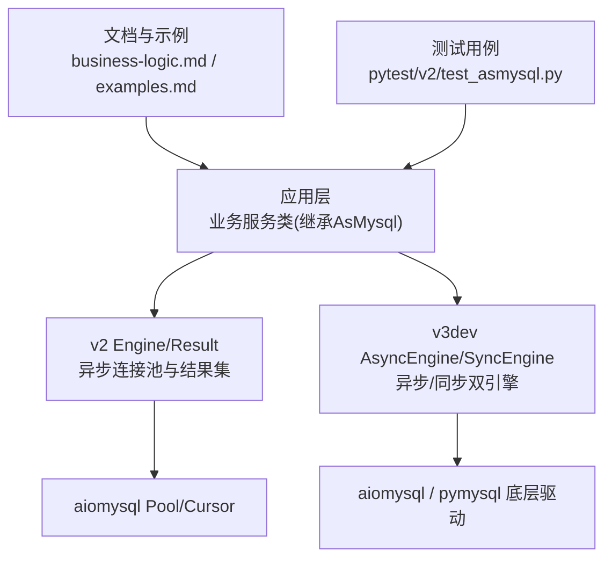
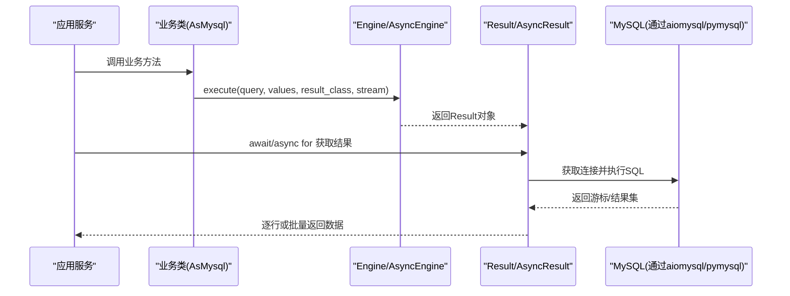
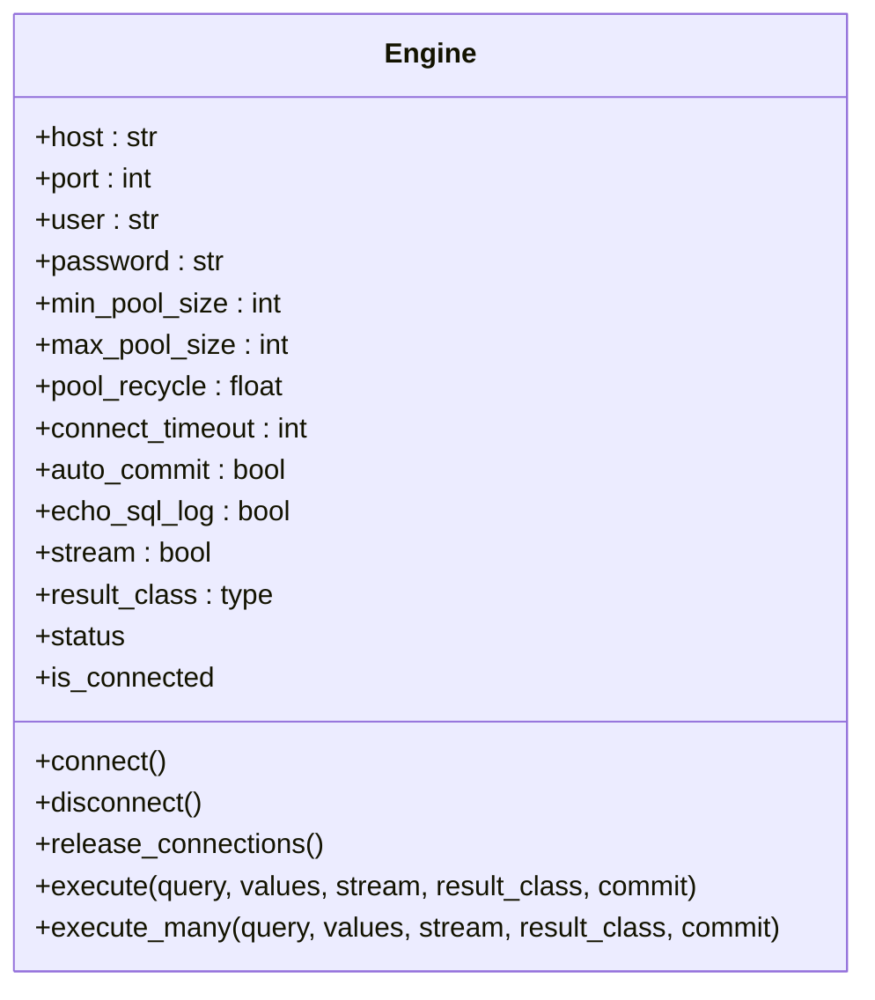
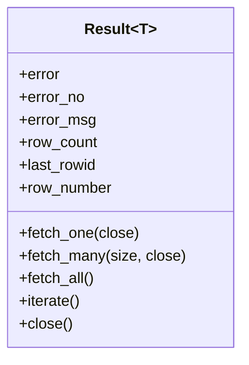
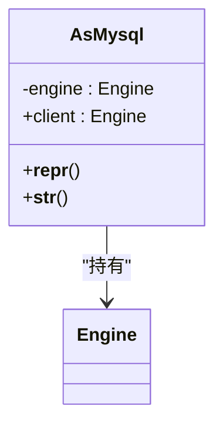
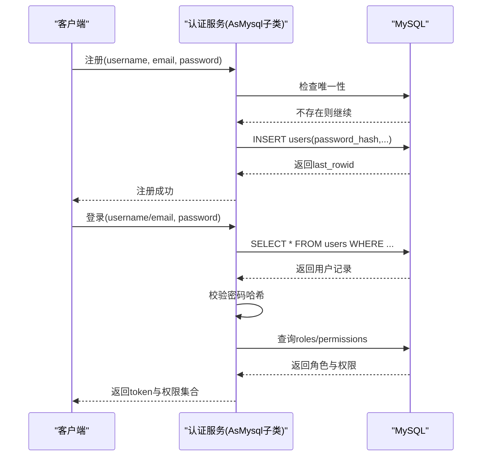
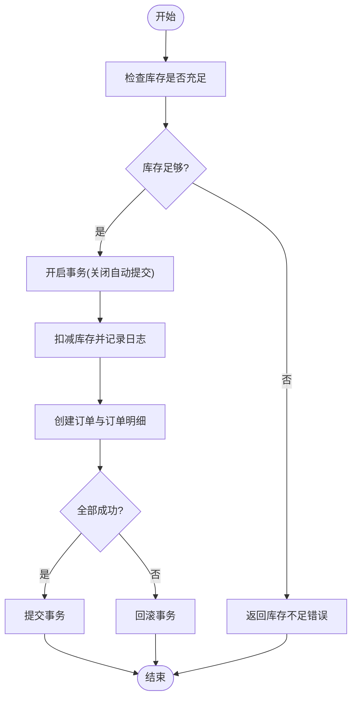
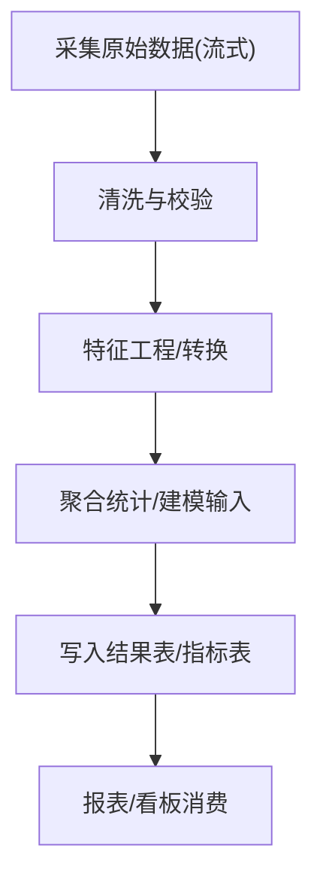
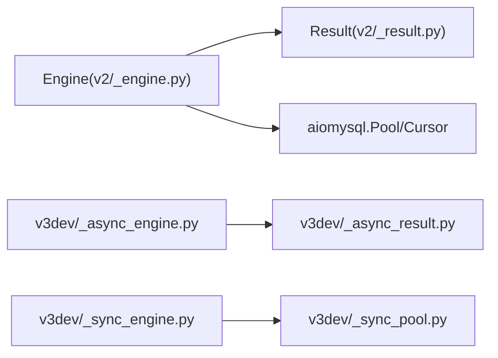

# 业务场景实战

<cite>
**本文引用的文件**   
- [README.md](file://README.md)
- [asmysql/__init__.py](file://asmysql/__init__.py)
- [asmysql/v2/__init__.py](file://asmysql/v2/__init__.py)
- [asmysql/v3dev/__init__.py](file://asmysql/v3dev/__init__.py)
- [asmysql/v2/_asmysql.py](file://asmysql/v2/_asmysql.py)
- [asmysql/v2/_engine.py](file://asmysql/v2/_engine.py)
- [asmysql/v2/_result.py](file://asmysql/v2/_result.py)
- [asmysql/v2/_error.py](file://asmysql/v2/_error.py)
- [asmysql/v3dev/_async_engine.py](file://asmysql/v3dev/_async_engine.py)
- [asmysql/v3dev/_sync_engine.py](file://asmysql/v3dev/_sync_engine.py)
- [asmysql/v3dev/_types.py](file://asmysql/v3dev/_types.py)
- [mkdocs/v2/docs/zh/business-logic.md](file://mkdocs/v2/docs/zh/business-logic.md)
- [mkdocs/v2/docs/zh/examples.md](file://mkdocs/v2/docs/zh/examples.md)
- [tests/v2/v2_start.py](file://tests/v2/v2_start.py)
- [pytest/v2/test_asmysql.py](file://pytest/v2/test_asmysql.py)
</cite>

## 目录
1. [引言](#引言)
2. [项目结构](#项目结构)
3. [核心组件](#核心组件)
4. [架构总览](#架构总览)
5. [详细组件分析](#详细组件分析)
6. [依赖分析](#依赖分析)
7. [性能考虑](#性能考虑)
8. [故障排查指南](#故障排查指南)
9. [结论](#结论)
10. [附录](#附录)

## 引言
本教程面向使用 asmysql 构建企业级业务的开发者，围绕以下三大典型场景提供完整实现思路与最佳实践：
- 用户认证系统：注册、登录验证、权限管理等核心流程
- 订单管理系统：数据库设计、订单创建、状态流转、库存管理
- 数据分析管道：大规模数据采集、清洗与分析，结合实时处理、缓存策略与一致性保证

asmysql 基于 aiomysql/pymysql 封装了异步/同步连接池、流式结果集、批量执行、类型化结果映射等能力，适合高并发与大数据量场景。

## 项目结构
仓库采用多版本并存的组织方式：
- v2：稳定版异步封装（Engine + Result + AsMysql）
- v3dev：开发中的异步/同步双引擎版本，提供更清晰的类型定义与分离的同步实现
- mkdocs：官方文档与示例
- tests/pytest：单元测试与集成测试样例

图表来源
- [asmysql/v2/_engine.py:1-317](file://asmysql/v2/_engine.py#L1-L317)
- [asmysql/v2/_result.py:1-273](file://asmysql/v2/_result.py#L1-L273)
- [asmysql/v3dev/_async_engine.py:1-307](file://asmysql/v3dev/_async_engine.py#L1-L307)
- [asmysql/v3dev/_sync_engine.py:1-298](file://asmysql/v3dev/_sync_engine.py#L1-L298)
- [mkdocs/v2/docs/zh/business-logic.md:1-67](file://mkdocs/v2/docs/zh/business-logic.md#L1-L67)
- [mkdocs/v2/docs/zh/examples.md:1-800](file://mkdocs/v2/docs/zh/examples.md#L1-L800)
- [pytest/v2/test_asmysql.py:1-283](file://pytest/v2/test_asmysql.py#L1-L283)

章节来源
- [README.md:1-135](file://README.md#L1-L135)
- [asmysql/__init__.py:1-16](file://asmysql/__init__.py#L1-L16)
- [asmysql/v2/__init__.py:1-15](file://asmysql/v2/__init__.py#L1-L15)
- [asmysql/v3dev/__init__.py:1-14](file://asmysql/v3dev/__init__.py#L1-L14)

## 核心组件
- Engine/AsyncEngine/SyncEngine：负责连接池生命周期管理、参数解析、SQL 执行入口（execute/execute_many），支持流式返回与自定义结果类型
- Result/AsyncResult/SyncResult：封装游标与结果获取（fetch_one/fetch_many/fetch_all/iterate），统一错误信息、行计数、最后插入ID等
- AsMysql：业务逻辑基类，持有 client 属性指向 Engine，便于组织领域方法

关键特性
- URL 参数解析：支持 host/port/user/password/charset/min_pool_size/max_pool_size/pool_recycle/connect_timeout/auto_commit/echo_sql_log/stream/result_class
- 流式查询：stream=True 时按需拉取行，避免大结果集内存占用
- 类型化结果：result_class 支持 tuple/dict/自定义模型（如 Pydantic）
- 上下文管理与可迭代：支持 async with 与 async for 直接遍历结果

章节来源
- [asmysql/v2/_engine.py:1-317](file://asmysql/v2/_engine.py#L1-L317)
- [asmysql/v2/_result.py:1-273](file://asmysql/v2/_result.py#L1-L273)
- [asmysql/v2/_asmysql.py:1-26](file://asmysql/v2/_asmysql.py#L1-L26)
- [asmysql/v3dev/_async_engine.py:1-307](file://asmysql/v3dev/_async_engine.py#L1-L307)
- [asmysql/v3dev/_sync_engine.py:1-298](file://asmysql/v3dev/_sync_engine.py#L1-L298)

## 架构总览
下图展示了从业务层到数据库驱动的调用链路与数据流向。

图表来源
- [asmysql/v2/_engine.py:226-317](file://asmysql/v2/_engine.py#L226-L317)
- [asmysql/v2/_result.py:101-273](file://asmysql/v2/_result.py#L101-L273)
- [asmysql/v3dev/_async_engine.py:216-307](file://asmysql/v3dev/_async_engine.py#L216-L307)

## 详细组件分析

### 组件A：Engine/AsyncEngine（连接与执行）
职责
- 解析连接URL与参数，初始化连接池
- 暴露 execute/execute_many 作为统一执行入口
- 提供 status/is_connected/release_connections 等运维能力
- 支持自动提交与SQL日志开关

关键点
- 参数优先级：URL 查询参数 > 构造参数 > 类默认值
- 异常包装：连接失败抛出 ConnectionError，并附带可读错误消息
- 流式模式：stream 控制是否使用 SSCursor/SSDictCursor

图表来源
- [asmysql/v2/_engine.py:37-317](file://asmysql/v2/_engine.py#L37-L317)
- [asmysql/v3dev/_async_engine.py:27-307](file://asmysql/v3dev/_async_engine.py#L27-L307)

章节来源
- [asmysql/v2/_engine.py:1-317](file://asmysql/v2/_engine.py#L1-L317)
- [asmysql/v3dev/_async_engine.py:1-307](file://asmysql/v3dev/_async_engine.py#L1-L307)

### 组件B：Result/AsyncResult（结果与游标）
职责
- 封装游标生命周期与资源释放
- 提供 fetch_one/fetch_many/fetch_all/iterate 多种读取方式
- 统一错误码与错误消息访问
- 支持 last_rowid/row_count/row_number 等元信息

关键点
- 自动关闭：在 fetch_one/fetch_many 无数据或 iterate 结束时释放连接
- 类型映射：根据 result_class 将行转换为 tuple/dict/自定义模型
- 流式行为：stream=True 时 row_count 为 None

图表来源
- [asmysql/v2/_result.py:21-273](file://asmysql/v2/_result.py#L21-L273)

章节来源
- [asmysql/v2/_result.py:1-273](file://asmysql/v2/_result.py#L1-L273)

### 组件C：AsMysql（业务基类）
职责
- 持有 Engine 实例并通过 client 暴露执行能力
- 提供 __repr__/__str__ 便于调试输出

图表来源
- [asmysql/v2/_asmysql.py:7-26](file://asmysql/v2/_asmysql.py#L7-L26)

章节来源
- [asmysql/v2/_asmysql.py:1-26](file://asmysql/v2/_asmysql.py#L1-L26)

### 场景一：用户认证系统（注册、登录、权限）
目标
- 用户注册：校验唯一性、密码安全存储、写入用户表
- 登录验证：按用户名/邮箱查找、校验凭证、生成会话令牌
- 权限管理：角色/权限表关联、鉴权中间件

数据库设计建议
- users(id, username, email, password_hash, created_at, updated_at)
- roles(id, name, description)
- user_roles(user_id, role_id)
- permissions(id, name, resource, action)
- role_permissions(role_id, permission_id)

业务流程（序列图）

要点与建议
- 使用 result_class=dict 或 Pydantic 模型提升可读性与类型安全
- 使用 execute_many 批量导入初始角色/权限
- 对敏感字段进行加密/加盐处理，不在日志中打印明文
- 使用流式查询仅用于导出用户列表等场景，常规查询避免开启

章节来源
- [mkdocs/v2/docs/zh/business-logic.md:1-67](file://mkdocs/v2/docs/zh/business-logic.md#L1-L67)
- [mkdocs/v2/docs/zh/examples.md:688-800](file://mkdocs/v2/docs/zh/examples.md#L688-L800)
- [pytest/v2/test_asmysql.py:49-146](file://pytest/v2/test_asmysql.py#L49-L146)

### 场景二：订单管理系统（创建、状态流转、库存）
目标
- 订单创建：下单前预检库存、扣减库存、落库订单与明细
- 状态流转：待支付→已支付→发货→完成/取消
- 库存管理：原子扣减、回滚机制、超卖防护

数据库设计建议
- orders(id, order_no, user_id, total_amount, status, created_at, updated_at)
- order_items(id, order_id, product_id, quantity, price, subtotal)
- products(id, name, stock, price, updated_at)
- inventory_logs(id, product_id, change_qty, reason, created_at)

业务流程（流程图）

要点与建议
- 使用 auto_commit=False 并在业务层显式提交/回滚
- 扣减库存使用 UPDATE ... SET stock = stock - ? WHERE id = ? AND stock >= ? 防止超卖
- 使用 execute_many 批量写入订单明细
- 使用 result.last_rowid 获取主键，减少额外查询

章节来源
- [mkdocs/v2/docs/zh/examples.md:356-404](file://mkdocs/v2/docs/zh/examples.md#L356-L404)
- [pytest/v2/test_asmysql.py:148-198](file://pytest/v2/test_asmysql.py#L148-L198)

### 场景三：数据分析管道（采集、清洗、分析）
目标
- 大规模数据流式采集与处理
- 清洗规则与转换流水线
- 聚合分析与结果持久化

数据处理流程（流程图）

要点与建议
- 使用 stream=True 与 iterate()/async for 逐行处理，避免 OOM
- 分批写入：每 N 条进行一次 execute_many 提交，平衡吞吐与延迟
- 使用 result_class=Pydantic 模型做强类型校验与默认值填充
- 监控与告警：记录处理进度、失败重试、死信队列

章节来源
- [mkdocs/v2/docs/zh/examples.md:406-469](file://mkdocs/v2/docs/zh/examples.md#L406-L469)
- [tests/v2/v2_start.py:48-88](file://tests/v2/v2_start.py#L48-L88)

## 依赖分析
- 外部依赖
  - aiomysql：异步连接池与游标
  - pymysql.err.MySQLError：异常类型
- 内部依赖
  - v2：Engine → Result → aiomysql
  - v3dev：AsyncEngine/SyncEngine 分别对应异步/同步结果与池实现

图表来源
- [asmysql/v2/_engine.py:1-317](file://asmysql/v2/_engine.py#L1-L317)
- [asmysql/v2/_result.py:1-273](file://asmysql/v2/_result.py#L1-L273)
- [asmysql/v3dev/_async_engine.py:1-307](file://asmysql/v3dev/_async_engine.py#L1-L307)
- [asmysql/v3dev/_sync_engine.py:1-298](file://asmysql/v3dev/_sync_engine.py#L1-L298)

章节来源
- [asmysql/v2/_engine.py:1-317](file://asmysql/v2/_engine.py#L1-L317)
- [asmysql/v3dev/_async_engine.py:1-307](file://asmysql/v3dev/_async_engine.py#L1-L307)
- [asmysql/v3dev/_sync_engine.py:1-298](file://asmysql/v3dev/_sync_engine.py#L1-L298)

## 性能考虑
- 连接池调优
  - min_pool_size/max_pool_size 根据并发与慢查询比例设置
  - pool_recycle 避免长连接被服务端回收导致异常
  - connect_timeout 合理配置，避免雪崩
- 查询优化
  - 大结果集务必使用 stream=True 与 iterate()/async for
  - 合理使用 result_class=dict 或 Pydantic 模型，减少后续转换开销
  - 批量操作优先使用 execute_many
- 事务与一致性
  - 关闭 auto_commit，在业务层控制提交/回滚
  - 使用幂等更新与乐观锁（版本号）降低冲突
- 可观测性
  - echo_sql_log 仅在开发环境开启
  - 记录耗时、错误码、受影响行数与 last_rowid

[本节为通用指导，不直接分析具体文件]

## 故障排查指南
常见问题
- 连接失败：检查 URL 格式、网络连通、账号权限；查看 ConnectionError 的错误消息
- 结果集为空：确认 SQL 条件与索引；注意流式模式下 row_count 为 None
- 内存溢出：大结果集未启用流式；改为 stream=True 并使用 iterate()
- 事务不一致：未正确提交/回滚；确保异常路径触发回滚

定位手段
- 使用 engine.status 观察连接池大小、空闲/使用中连接
- 使用 result.error/error_no/error_msg 快速定位错误
- 使用 result.row_count/last_rowid 验证写操作效果

章节来源
- [asmysql/v2/_engine.py:130-193](file://asmysql/v2/_engine.py#L130-L193)
- [asmysql/v2/_result.py:133-185](file://asmysql/v2/_result.py#L133-L185)
- [asmysql/v2/_error.py:1-7](file://asmysql/v2/_error.py#L1-L7)

## 结论
借助 asmysql 的连接池、流式结果与类型化映射能力，可以高效构建用户认证、订单管理与数据分析等企业级场景。建议在项目中：
- 以 AsMysql 为基类组织业务域方法
- 针对大数据量场景启用流式与批量写入
- 严格的事务边界与幂等设计保障一致性
- 完善的错误处理与可观测性支撑生产稳定性

[本节为总结，不直接分析具体文件]

## 附录
- 快速上手与示例参考
  - 基础用法与上下文管理器
  - 流式查询与批量操作
  - 自定义模型与错误处理
- 测试与演练
  - 使用 pytest 编写覆盖 CRUD、批量、流式的用例
  - 使用 v2_start.py 进行交互式验证

章节来源
- [mkdocs/v2/docs/zh/examples.md:1-800](file://mkdocs/v2/docs/zh/examples.md#L1-L800)
- [tests/v2/v2_start.py:1-107](file://tests/v2/v2_start.py#L1-L107)
- [pytest/v2/test_asmysql.py:1-283](file://pytest/v2/test_asmysql.py#L1-L283)