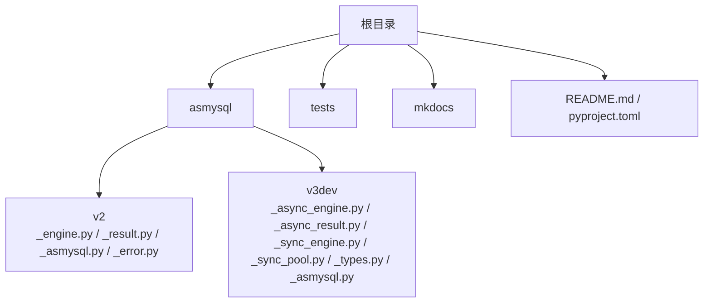
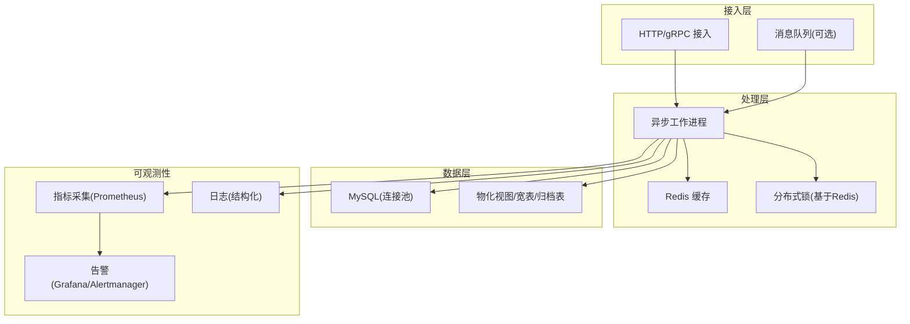
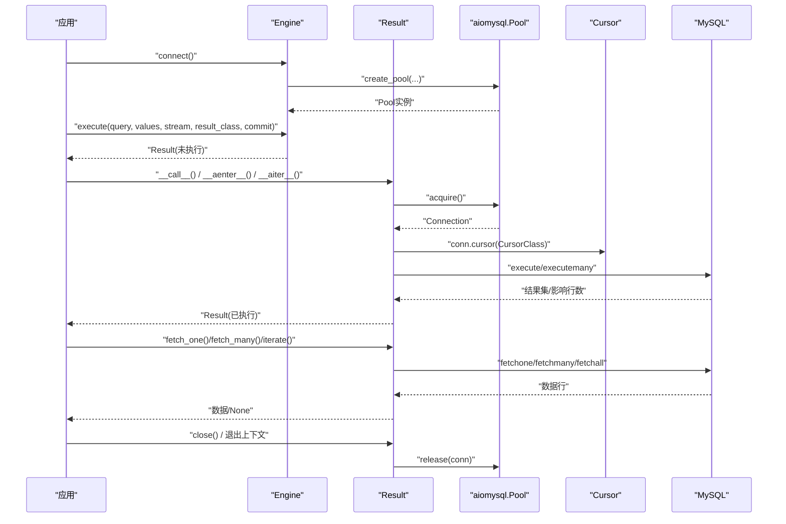
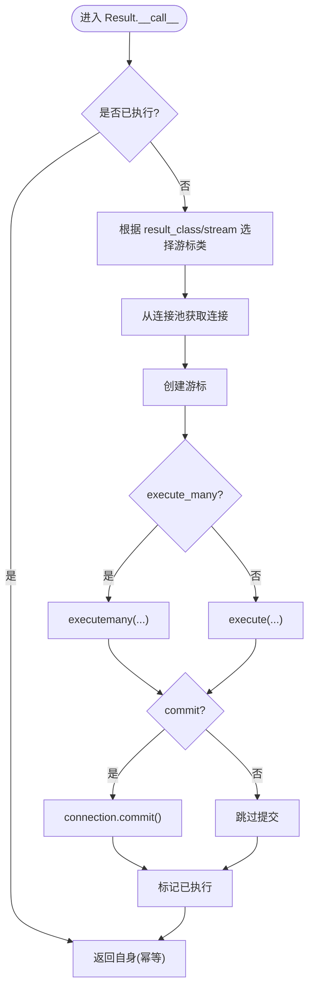
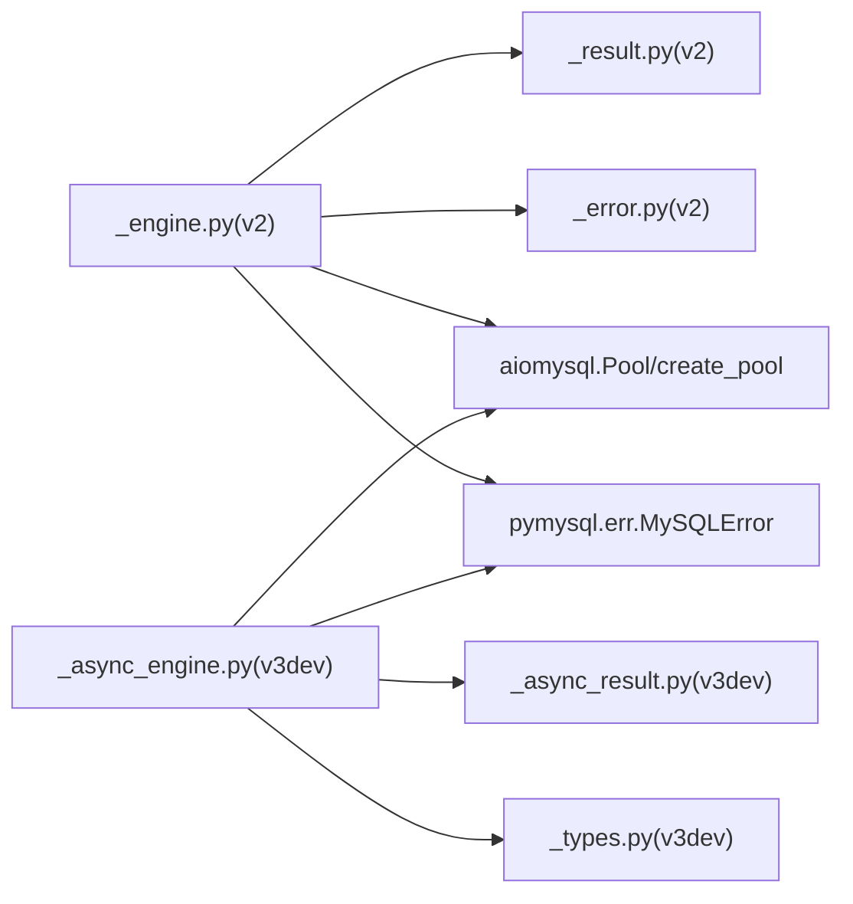

# 实时数据处理

<cite>
**本文引用的文件**   
- [README.md](file://README.md)
- [pyproject.toml](file://pyproject.toml)
- [asmysql/__init__.py](file://asmysql/__init__.py)
- [asmysql/v2/__init__.py](file://asmysql/v2/__init__.py)
- [asmysql/v3dev/__init__.py](file://asmysql/v3dev/__init__.py)
- [asmysql/v2/_engine.py](file://asmysql/v2/_engine.py)
- [asmysql/v2/_result.py](file://asmysql/v2/_result.py)
- [asmysql/v2/_error.py](file://asmysql/v2/_error.py)
- [asmysql/v2/_asmysql.py](file://asmysql/v2/_asmysql.py)
- [asmysql/v3dev/_async_engine.py](file://asmysql/v3dev/_async_engine.py)
- [asmysql/v3dev/_async_result.py](file://asmysql/v3dev/_async_result.py)
- [asmysql/v3dev/_types.py](file://asmysql/v3dev/_types.py)
- [asmysql/v3dev/_asmysql.py](file://asmysql/v3dev/_asmysql.py)
- [tests/v2/v2_start.py](file://tests/v2/v2_start.py)
- [mkdocs/v2/docs/en/best-practices.md](file://mkdocs/v2/docs/en/best-practices.md)
</cite>

## 目录
1. [简介](#简介)
2. [项目结构](#项目结构)
3. [核心组件](#核心组件)
4. [架构总览](#架构总览)
5. [详细组件分析](#详细组件分析)
6. [依赖分析](#依赖分析)
7. [性能考虑](#性能考虑)
8. [故障排查指南](#故障排查指南)
9. [结论](#结论)
10. [附录](#附录)

## 简介
本实战文档围绕 asmysql 的异步能力，构建面向高并发场景的实时数据处理系统。重点包括：
- 使用 asmysql 的异步连接池与流式结果迭代，实现低内存、高吞吐的数据接收与处理流水线
- 设计数据缓存策略（Redis）与 MySQL 同步机制，保障读写一致性与热点访问性能
- 提供一致性方案（分布式锁、版本控制、冲突解决）与可观测性（监控、告警、质量检查）
- 给出完整的异步代码示例路径与优化建议，确保高压环境稳定运行

## 项目结构
仓库采用多版本并存的组织方式：v2 为当前稳定版，v3dev 为演进中的异步/同步双引擎版本；测试与文档分别位于 tests 与 mkdocs 目录。

图表来源
- [asmysql/v2/_engine.py:1-317](file://asmysql/v2/_engine.py#L1-L317)
- [asmysql/v2/_result.py:1-273](file://asmysql/v2/_result.py#L1-L273)
- [asmysql/v3dev/_async_engine.py:1-307](file://asmysql/v3dev/_async_engine.py#L1-L307)
- [asmysql/v3dev/_async_result.py:1-273](file://asmysql/v3dev/_async_result.py#L1-L273)
- [asmysql/v3dev/_types.py:1-12](file://asmysql/v3dev/_types.py#L1-L12)

章节来源
- [README.md:1-135](file://README.md#L1-L135)
- [pyproject.toml:1-80](file://pyproject.toml#L1-L80)

## 核心组件
- Engine（连接与执行入口）
  - 负责解析连接参数、创建 aiomysql 连接池、暴露 execute/execute_many 接口
  - 支持上下文管理与 await 调用模式，返回 Result 对象
- Result（结果封装与游标管理）
  - 封装游标生命周期、错误信息、行计数、lastrowid、rownumber
  - 提供 fetch_one/fetch_many/fetch_all/iterate 以及 async for 遍历
  - 支持流式查询（SSCursor/SSDictCursor）降低内存占用
- AsMysql（业务逻辑基类）
  - 持有 Engine 引用，对外暴露 client 属性，便于继承扩展业务方法
- v3dev 演进
  - 提供 AsyncEngine/SyncEngine 双引擎抽象，AsMysql 泛型化以适配不同引擎类型

章节来源
- [asmysql/v2/_engine.py:1-317](file://asmysql/v2/_engine.py#L1-L317)
- [asmysql/v2/_result.py:1-273](file://asmysql/v2/_result.py#L1-L273)
- [asmysql/v2/_asmysql.py:1-26](file://asmysql/v2/_asmysql.py#L1-L26)
- [asmysql/v3dev/_async_engine.py:1-307](file://asmysql/v3dev/_async_engine.py#L1-L307)
- [asmysql/v3dev/_async_result.py:1-273](file://asmysql/v3dev/_async_result.py#L1-L273)
- [asmysql/v3dev/_asmysql.py:1-30](file://asmysql/v3dev/_asmysql.py#L1-L30)

## 架构总览
下图展示基于 asmysql 的实时数据处理系统整体架构：接入层将事件写入消息队列或缓冲，消费者通过 asmysql 的异步引擎进行批量入库与流式读取，结合 Redis 做热点缓存与分布式锁，MySQL 作为持久化存储，Prometheus/Grafana 等用于指标采集与告警。

[此图为概念架构图，不直接映射具体源码文件]

## 详细组件分析

### 组件一：Engine（连接池与执行器）
- 功能要点
  - 支持 URL 与显式参数初始化，自动解析 charset、pool 大小、超时、自动提交、SQL 回显等
  - 提供 connect/disconnect/release_connections/is_connected/status 等连接生命周期管理
  - execute/execute_many 返回 Result，支持 stream/result_class/commit 等选项
- 关键流程
  - 首次 connect 时创建 aiomysql Pool，后续复用
  - execute 内部构造 Result，延迟执行，在 __call__/__aenter__/__aiter__ 中触发实际 SQL 执行与游标获取
  - 异常统一包装为 ConnectionError，并附带友好错误信息

图表来源
- [asmysql/v2/_engine.py:120-192](file://asmysql/v2/_engine.py#L120-L192)
- [asmysql/v2/_engine.py:226-316](file://asmysql/v2/_engine.py#L226-L316)
- [asmysql/v2/_result.py:101-131](file://asmysql/v2/_result.py#L101-L131)
- [asmysql/v2/_result.py:186-273](file://asmysql/v2/_result.py#L186-L273)

章节来源
- [asmysql/v2/_engine.py:1-317](file://asmysql/v2/_engine.py#L1-L317)
- [asmysql/v2/_error.py:1-7](file://asmysql/v2/_error.py#L1-L7)

### 组件二：Result（结果与游标生命周期）
- 功能要点
  - 支持多种结果类型：tuple/dict/自定义类（通过 result_class 指定）
  - 支持流式游标（SSCursor/SSDictCursor），避免大结果集内存溢出
  - 统一的错误码/错误信息访问 error_no/error_msg
  - 自动关闭游标与连接释放，防止连接泄漏
- 关键流程
  - 第一次执行时选择 Cursor 类型（普通/字典/流式）
  - 若 commit=True，则在执行后自动提交
  - iterate/async for 会在结束时释放资源

图表来源
- [asmysql/v2/_result.py:101-131](file://asmysql/v2/_result.py#L101-L131)
- [asmysql/v2/_result.py:251-273](file://asmysql/v2/_result.py#L251-L273)

章节来源
- [asmysql/v2/_result.py:1-273](file://asmysql/v2/_result.py#L1-L273)

### 组件三：AsMysql（业务逻辑基类）
- 功能要点
  - 通过 final 修饰的 __init__ 注入 Engine
  - 暴露 client 属性供子类直接使用 Engine 的 execute/execute_many
  - 提供 __repr__/__str__ 便于调试输出
- 适用场景
  - 将数据库访问逻辑按领域拆分到多个 AsMysql 子类，提升可读性与可维护性

章节来源
- [asmysql/v2/_asmysql.py:1-26](file://asmysql/v2/_asmysql.py#L1-L26)
- [asmysql/v3dev/_asmysql.py:1-30](file://asmysql/v3dev/_asmysql.py#L1-L30)

### 组件四：v3dev 演进（AsyncEngine/SyncEngine 双引擎）
- 目标
  - 在保持 v2 行为的基础上，引入 SyncEngine 以兼容同步场景，同时保留 AsyncEngine
  - AsMysql 泛型化，使其能绑定任意 EngineType
- 差异点
  - 新增 _types.EngineStatus TypedDict 集中定义状态字段
  - 模块导出增加 SyncEngine/SyncResult

章节来源
- [asmysql/v3dev/_async_engine.py:1-307](file://asmysql/v3dev/_async_engine.py#L1-L307)
- [asmysql/v3dev/_async_result.py:1-273](file://asmysql/v3dev/_async_result.py#L1-L273)
- [asmysql/v3dev/_types.py:1-12](file://asmysql/v3dev/_types.py#L1-L12)
- [asmysql/v3dev/_asmysql.py:1-30](file://asmysql/v3dev/_asmysql.py#L1-L30)

## 依赖分析
- 外部依赖
  - aiomysql[rsa]>=0.3.2：底层异步 MySQL 驱动与连接池
- 内部依赖关系
  - v2/_engine.py 依赖 aiomysql.Pool/create_pool、pymysql.err.MySQLError、_error.err_msg、_result.Result
  - v2/_result.py 依赖 aiomysql.Cursor/DictCursor/SSCursor/SSDictCursor、Pool、MySQLError
  - v3dev 结构与 v2 类似，但拆分为 Async/Sync 两套引擎与结果类型

图表来源
- [asmysql/v2/_engine.py:1-317](file://asmysql/v2/_engine.py#L1-L317)
- [asmysql/v2/_result.py:1-273](file://asmysql/v2/_result.py#L1-L273)
- [asmysql/v2/_error.py:1-7](file://asmysql/v2/_error.py#L1-L7)
- [asmysql/v3dev/_async_engine.py:1-307](file://asmysql/v3dev/_async_engine.py#L1-L307)
- [asmysql/v3dev/_async_result.py:1-273](file://asmysql/v3dev/_async_result.py#L1-L273)
- [asmysql/v3dev/_types.py:1-12](file://asmysql/v3dev/_types.py#L1-L12)

章节来源
- [pyproject.toml:31-34](file://pyproject.toml#L31-L34)

## 性能考虑
- 连接池配置
  - 根据并发量设置 min_pool_size/max_pool_size，合理 pool_recycle 避免长连接失效
  - 参考最佳实践文档中的连接池配置建议
- 流式查询
  - 对大结果集使用 stream=True，配合 iterate/async for 逐行消费，避免一次性加载导致内存飙升
- 结果类型
  - 使用 dict 或自定义类作为 result_class，减少手动映射成本
- 事务与提交
  - 默认 auto_commit=True，如需批量写且保证一致性，可在业务层控制 commit=False 并在合适时机提交
- 资源释放
  - 优先使用 async with 或 async for 自动管理连接与游标，避免忘记 close 导致连接泄漏
- 监控与指标
  - 定期采集 engine.status 中的 pool_size/pool_free/pool_used 等指标，评估连接池压力

章节来源
- [mkdocs/v2/docs/en/best-practices.md:124-141](file://mkdocs/v2/docs/en/best-practices.md#L124-L141)
- [asmysql/v2/_engine.py:154-166](file://asmysql/v2/_engine.py#L154-L166)

## 故障排查指南
- 常见错误
  - 连接失败：检查 host/port/user/password/url 参数，确认网络可达与权限
  - 连接未建立：在未 connect 的情况下访问 pool 会抛出 ConnectionError
  - 游标未释放：未使用上下文管理器或未调用 close，可能导致连接池耗尽
- 诊断手段
  - 使用 engine.status 查看连接池状态
  - 使用 result.error/error_no/error_msg 定位 SQL 错误
  - 开启 echo_sql_log 打印 SQL 语句辅助排查
- 恢复策略
  - 使用 release_connections 清理空闲连接
  - 捕获 MySQLError 并记录上下文，必要时重试或降级

章节来源
- [asmysql/v2/_engine.py:176-202](file://asmysql/v2/_engine.py#L176-L202)
- [asmysql/v2/_result.py:133-151](file://asmysql/v2/_result.py#L133-L151)
- [asmysql/v2/_error.py:1-7](file://asmysql/v2/_error.py#L1-L7)

## 结论
asmysql 提供了简洁而强大的异步 MySQL 客户端与连接池封装，结合流式结果与上下文管理，能够高效支撑高并发实时数据处理场景。在生产环境中，应结合 Redis 缓存与分布式锁保障一致性与性能，并通过完善的监控告警体系保障稳定性。

## 附录

### 异步代码示例路径
- 基础用法与流式遍历
  - [tests/v2/v2_start.py:1-107](file://tests/v2/v2_start.py#L1-L107)
- 最佳实践（上下文管理、流式查询、参数化查询、连接池配置）
  - [mkdocs/v2/docs/en/best-practices.md:1-141](file://mkdocs/v2/docs/en/best-practices.md#L1-L141)

### 实时数据处理流水线设计要点
- 数据接收
  - 使用 HTTP/gRPC 或消息队列接入，落盘前可做轻量校验与去重
- 数据处理
  - 使用 asmysql 的 execute_many 批量写入，结合 result_class 转换为领域模型
  - 对大查询使用 stream=True + iterate 流式处理
- 数据缓存
  - 热点读走 Redis，写路径采用 Cache-Aside 或 Write-Behind 策略
  - 使用分布式锁保护热点键更新，避免并发写冲突
- 一致性保障
  - 版本号/时间戳比较解决写冲突
  - 重要写操作使用事务，必要时引入补偿任务
- 监控与告警
  - 指标：QPS、P99 延迟、连接池使用率、错误率、慢查询数
  - 告警：连接池耗尽、错误率突增、延迟超阈、数据质量异常（空值/重复/越界）

[本节为概念性内容，不直接分析具体源码文件]