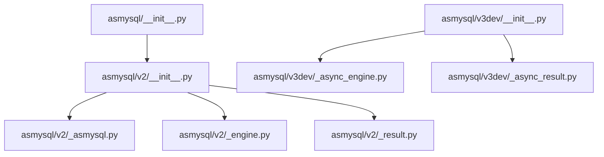
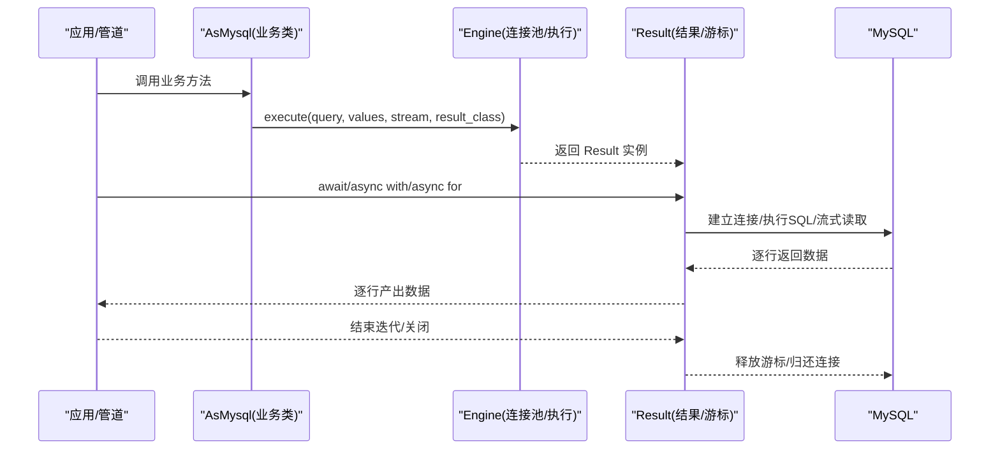
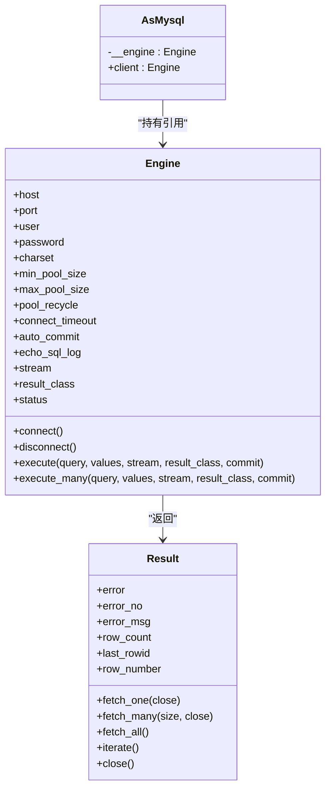
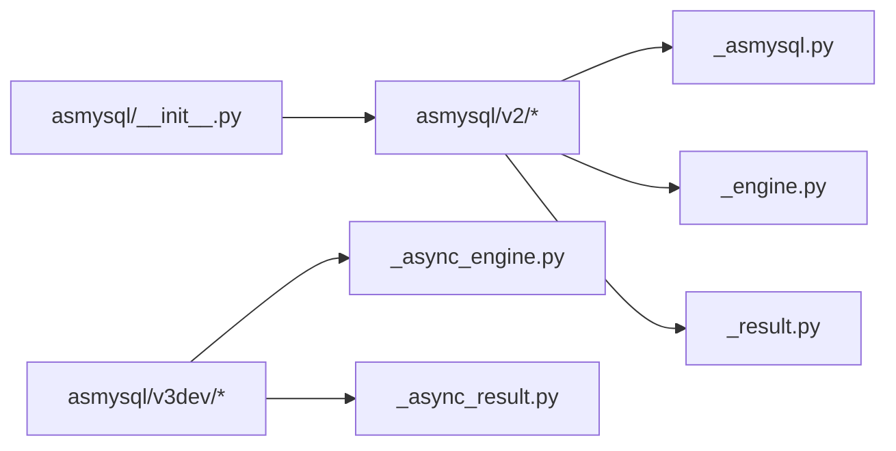
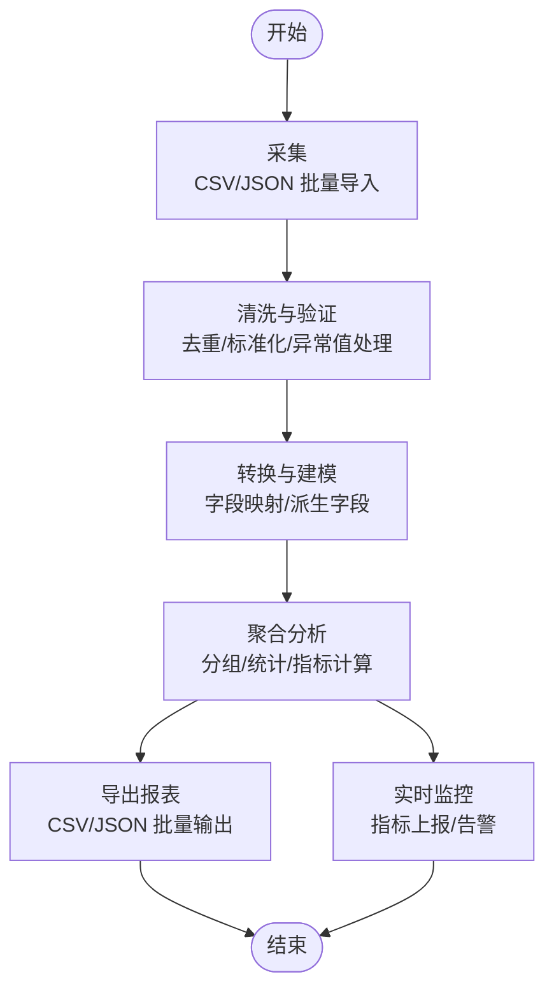

# 数据分析管道

<cite>
**本文引用的文件**   
- [README.md](file://README.md)
- [asmysql/__init__.py](file://asmysql/__init__.py)
- [asmysql/v2/_asmysql.py](file://asmysql/v2/_asmysql.py)
- [asmysql/v2/_engine.py](file://asmysql/v2/_engine.py)
- [asmysql/v2/_result.py](file://asmysql/v2/_result.py)
- [asmysql/v3dev/_async_engine.py](file://asmysql/v3dev/_async_engine.py)
- [asmysql/v3dev/_async_result.py](file://asmysql/v3dev/_async_result.py)
- [tests/v2/v2_start.py](file://tests/v2/v2_start.py)
- [mkdocs/v2/docs/zh/examples.md](file://mkdocs/v2/docs/zh/examples.md)
- [mkdocs/v2/docs/zh/best-practices.md](file://mkdocs/v2/docs/zh/best-practices.md)
</cite>

## 目录
1. [简介](#简介)
2. [项目结构](#项目结构)
3. [核心组件](#核心组件)
4. [架构总览](#架构总览)
5. [详细组件分析](#详细组件分析)
6. [依赖关系分析](#依赖关系分析)
7. [性能与内存优化](#性能与内存优化)
8. [故障排查指南](#故障排查指南)
9. [结论](#结论)
10. [附录：大数据管道实现案例](#附录大数据管道实现案例)

## 简介
本文件面向“基于 asmysql 的大数据分析管道”的落地实践，围绕大规模数据的采集、清洗、转换与分析全流程，给出可落地的工程化方案。重点包括：
- 数据导入导出（CSV、JSON）批量处理
- 数据清洗与验证（去重、格式标准化、异常值处理）
- 使用 asmysql 的流式查询与异步迭代器高效处理百万级记录
- 数据聚合分析、统计报表生成、实时数据监控
- 内存优化策略与性能调优技巧，确保大数据量下的稳定运行

asmysql 提供异步 MySQL 客户端与连接池封装，支持流式结果集与异步迭代器，适合构建高吞吐、低内存占用的数据处理管道。

## 项目结构
仓库采用多版本并存的组织方式：v1、v2 为已发布版本，v3dev 为开发分支。对外统一入口在 asmysql/__init__.py，默认暴露 v2 能力；v3dev 提供同步/异步双引擎与结果对象，便于未来演进。

图示来源
- [asmysql/__init__.py:1-16](file://asmysql/__init__.py#L1-L16)
- [asmysql/v2/_asmysql.py:1-26](file://asmysql/v2/_asmysql.py#L1-L26)
- [asmysql/v2/_engine.py:1-317](file://asmysql/v2/_engine.py#L1-L317)
- [asmysql/v2/_result.py:1-273](file://asmysql/v2/_result.py#L1-L273)
- [asmysql/v3dev/_async_engine.py:1-307](file://asmysql/v3dev/_async_engine.py#L1-L307)
- [asmysql/v3dev/_async_result.py:1-273](file://asmysql/v3dev/_async_result.py#L1-L273)

章节来源
- [README.md:1-135](file://README.md#L1-L135)
- [asmysql/__init__.py:1-16](file://asmysql/__init__.py#L1-L16)

## 核心组件
- Engine（异步数据库引擎）：负责连接池管理、SQL 执行、流式查询开关、结果类型映射等。
- Result（查询结果封装）：封装游标生命周期、错误信息、行计数、单条/多条/全部获取、异步迭代器 iterate() 等。
- AsMysql（业务逻辑基类）：对 Engine 进行轻量包装，便于继承扩展业务方法。

关键能力
- 流式返回：通过 stream=True 启用 SSCursor/SSDictCursor，避免一次性加载大结果集到内存。
- 异步迭代：Result 支持 async for 与 result.iterate()，逐行消费数据。
- 自定义结果类型：result_class 支持 tuple/dict 或任意可构造类（如 Pydantic 模型）。
- 批量写入：execute_many 支持批量插入/更新。

章节来源
- [asmysql/v2/_engine.py:37-317](file://asmysql/v2/_engine.py#L37-L317)
- [asmysql/v2/_result.py:21-273](file://asmysql/v2/_result.py#L21-L273)
- [asmysql/v2/_asmysql.py:7-26](file://asmysql/v2/_asmysql.py#L7-L26)

## 架构总览
下图展示了从应用层到 MySQL 的数据通路，以及 asmysql 在其中的角色。

图示来源
- [asmysql/v2/_engine.py:226-317](file://asmysql/v2/_engine.py#L226-L317)
- [asmysql/v2/_result.py:101-273](file://asmysql/v2/_result.py#L101-L273)

## 详细组件分析

### Engine 组件
职责
- 解析连接 URL 与参数，创建并维护 aiomysql Pool。
- 提供 execute/execute_many 接口，返回 Result。
- 暴露连接状态、断开、释放空闲连接等方法。
- 支持全局 stream/result_class 配置，也可在单次调用覆盖。

关键点
- 连接池参数：min_pool_size、max_pool_size、pool_recycle、connect_timeout、auto_commit、echo_sql_log。
- 流式模式：stream=True 时选择流式游标，降低内存占用。
- 结果类型：result_class 指定返回结构（tuple/dict/自定义类）。

章节来源
- [asmysql/v2/_engine.py:37-112](file://asmysql/v2/_engine.py#L37-L112)
- [asmysql/v2/_engine.py:131-183](file://asmysql/v2/_engine.py#L131-L183)
- [asmysql/v2/_engine.py:226-317](file://asmysql/v2/_engine.py#L226-L317)

### Result 组件
职责
- 管理游标生命周期（获取、执行、关闭、归还连接）。
- 提供 fetch_one/fetch_many/fetch_all/iterate 等 API。
- 暴露 error/error_no/error_msg/row_count/last_rowid/row_number 等元信息。
- 支持 async for 直接迭代 Result 本身。

关键点
- 流式游标：根据 result_class 与 stream 动态选择 Cursor/SSCursor/DictCursor/SSDictCursor。
- 自动关闭：fetch_one/fetch_many 默认 close=True，上下文管理器与 async for 会保证资源释放。
- 类型映射：当 result_class 非 tuple/dict 时，以 **data 形式构造对象。

章节来源
- [asmysql/v2/_result.py:10-19](file://asmysql/v2/_result.py#L10-L19)
- [asmysql/v2/_result.py:101-126](file://asmysql/v2/_result.py#L101-L126)
- [asmysql/v2/_result.py:186-273](file://asmysql/v2/_result.py#L186-L273)

### AsMysql 组件
职责
- 作为业务逻辑类的基类，持有 Engine 引用，简化 SQL 调用。

章节来源
- [asmysql/v2/_asmysql.py:7-26](file://asmysql/v2/_asmysql.py#L7-L26)

### 类图（代码级）

图示来源
- [asmysql/v2/_asmysql.py:7-26](file://asmysql/v2/_asmysql.py#L7-L26)
- [asmysql/v2/_engine.py:37-317](file://asmysql/v2/_engine.py#L37-L317)
- [asmysql/v2/_result.py:21-273](file://asmysql/v2/_result.py#L21-L273)

## 依赖关系分析
- asmysql 顶层 __init__.py 将 v2 的 AsMysql、Engine、Result 暴露为默认 API。
- v2 与 v3dev 各自独立实现 Engine/Result，v3dev 同时提供同步/异步引擎。
- 测试与示例文档提供了大量使用范式，可作为管道实现的参考。

图示来源
- [asmysql/__init__.py:1-16](file://asmysql/__init__.py#L1-L16)
- [asmysql/v2/_asmysql.py:1-26](file://asmysql/v2/_asmysql.py#L1-L26)
- [asmysql/v2/_engine.py:1-317](file://asmysql/v2/_engine.py#L1-L317)
- [asmysql/v2/_result.py:1-273](file://asmysql/v2/_result.py#L1-L273)
- [asmysql/v3dev/_async_engine.py:1-307](file://asmysql/v3dev/_async_engine.py#L1-L307)
- [asmysql/v3dev/_async_result.py:1-273](file://asmysql/v3dev/_async_result.py#L1-L273)

章节来源
- [asmysql/__init__.py:1-16](file://asmysql/__init__.py#L1-L16)

## 性能与内存优化
- 优先使用流式查询：对百万级数据集，务必开启 stream=True，并使用 async for 或 result.iterate() 逐行消费，避免 fetch_all 导致 OOM。
- 合理配置连接池：根据并发与负载设置 min_pool_size/max_pool_size/pool_recycle/connect_timeout，避免连接耗尽或频繁重建。
- 控制 close 行为：在手动 fetch_one/fetch_many 场景下，若设置 close=False，需在完成后显式调用 close()，否则连接无法归还。
- 使用参数化查询：防止 SQL 注入并提升执行计划稳定性。
- 批量写入：使用 execute_many 减少往返开销。
- 结果类型映射：对热点路径使用 dict 或轻量对象，避免过度对象化带来的 GC 压力。

章节来源
- [mkdocs/v2/docs/zh/best-practices.md:1-141](file://mkdocs/v2/docs/zh/best-practices.md#L1-L141)
- [mkdocs/v2/docs/zh/examples.md:406-469](file://mkdocs/v2/docs/zh/examples.md#L406-L469)

## 故障排查指南
- 检查错误码与信息：通过 result.error/error_no/error_msg 快速定位问题。
- 确认连接状态：使用 engine.status 查看连接池大小、空闲/使用中连接数。
- 资源泄漏排查：若出现连接池耗尽，检查是否忘记关闭游标或未正确退出上下文。
- 流式查询注意事项：流式模式下 row_count 不可用，需自行计数。

章节来源
- [asmysql/v2/_result.py:133-185](file://asmysql/v2/_result.py#L133-L185)
- [asmysql/v2/_engine.py:154-166](file://asmysql/v2/_engine.py#L154-L166)

## 结论
asmysql 提供了高性能、易用的异步 MySQL 访问能力，结合流式查询与异步迭代器，能够支撑百万级数据的高效处理。配合合理的连接池配置与内存优化策略，可在生产环境稳定运行。后续可将 CSV/JSON 导入导出、数据清洗与校验、聚合分析与报表生成等模块组合成完整的数据分析管道。

## 附录：大数据管道实现案例

本节给出一个端到端的大数据分析管道设计，涵盖数据采集、清洗、转换、分析、导出与监控。该方案可直接基于 asmysql 的流式查询与异步迭代器实现。

### 总体流程

[此图为概念性流程图，无需源码对应]

### 数据导入（CSV/JSON）
- CSV 导入
  - 使用 Python 标准库 csv 或第三方库逐行读取，组装为字典列表。
  - 分批提交：每批 N 条（如 5000~20000），调用 execute_many 批量插入。
  - 失败重试与断点续传：记录已处理偏移量，异常时回滚当前批次。
- JSON 导入
  - 使用 json 流式解析（如 ijson）按事件/对象块读取，避免一次性加载整个文件。
  - 同样采用批量写入策略。

章节来源
- [mkdocs/v2/docs/zh/examples.md:471-535](file://mkdocs/v2/docs/zh/examples.md#L471-L535)

### 数据清洗与验证
- 去重
  - 基于唯一键（如业务 ID）在目标表建立唯一索引，导入阶段利用 INSERT IGNORE 或 ON DUPLICATE KEY UPDATE 实现幂等。
  - 或在内存中使用集合去重（注意内存上限，建议分片/窗口）。
- 格式标准化
  - 时间戳统一为 UTC ISO 格式；数值字段做范围校验与空值填充；字符串字段去除首尾空白与非法字符。
- 异常值处理
  - 定义规则引擎（阈值、正则、枚举白名单），将异常数据分流至“脏数据表”，便于人工复核。

章节来源
- [mkdocs/v2/docs/zh/examples.md:107-188](file://mkdocs/v2/docs/zh/examples.md#L107-L188)

### 数据转换与建模
- 字段映射：将源字段映射为目标模型字段，必要时进行类型转换。
- 派生字段：基于规则计算衍生指标（如比率、区间标签）。
- 结果类型映射：使用 result_class 指定目标模型（如 Pydantic 模型），在读取侧完成强类型校验。

章节来源
- [mkdocs/v2/docs/zh/examples.md:537-617](file://mkdocs/v2/docs/zh/examples.md#L537-L617)

### 聚合分析与统计报表
- 流式聚合
  - 使用流式查询读取原始明细，按窗口/维度在内存中维护增量统计（计数器、滑动窗口、TopN）。
  - 定期持久化中间结果，避免长时间运行导致内存膨胀。
- 报表生成
  - 将聚合结果批量写入报表表，或导出为 CSV/JSON。
  - 支持分页/分片导出，避免一次性写出大文件。

章节来源
- [mkdocs/v2/docs/zh/examples.md:406-469](file://mkdocs/v2/docs/zh/examples.md#L406-L469)

### 实时数据监控
- 指标采集
  - 在管道各阶段埋点（读取速率、处理延迟、错误率、内存/CPU 使用）。
- 指标上报
  - 将指标写入监控数据库或消息队列，供可视化展示与告警。
- 健康检查
  - 定期检查数据库连接池状态（engine.status），发现异常及时告警与自愈。

章节来源
- [mkdocs/v2/docs/zh/best-practices.md:124-141](file://mkdocs/v2/docs/zh/best-practices.md#L124-L141)

### 流式查询与异步迭代器用法
- 推荐用法
  - 使用 async for 或 result.iterate() 逐行消费，避免 fetch_all。
  - 在上下文中使用 execute，确保资源自动释放。
- 示例参考
  - 参见测试与示例文档中的流式查询与迭代用法。

章节来源
- [tests/v2/v2_start.py:48-88](file://tests/v2/v2_start.py#L48-L88)
- [mkdocs/v2/docs/zh/examples.md:190-217](file://mkdocs/v2/docs/zh/examples.md#L190-L217)

### 内存优化与性能调优清单
- 使用流式查询与异步迭代器处理大数据集。
- 合理设置连接池参数，避免连接不足或过多。
- 批量写入，减少网络往返。
- 谨慎使用 fetch_all，仅在数据量可控时使用。
- 使用参数化查询，避免 SQL 注入与拼接开销。
- 控制 close 行为，确保连接及时归还。
- 对热点路径使用 dict 或轻量对象，避免过度对象化。

章节来源
- [mkdocs/v2/docs/zh/best-practices.md:1-141](file://mkdocs/v2/docs/zh/best-practices.md#L1-L141)