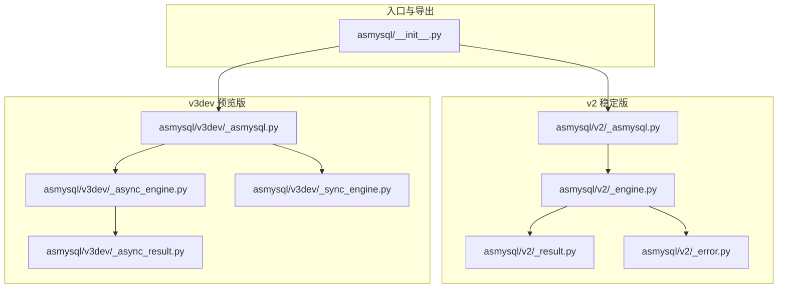
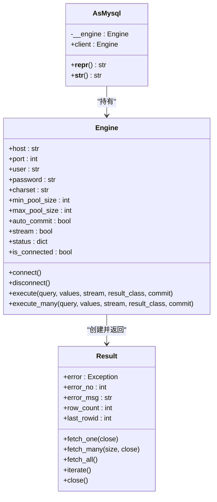
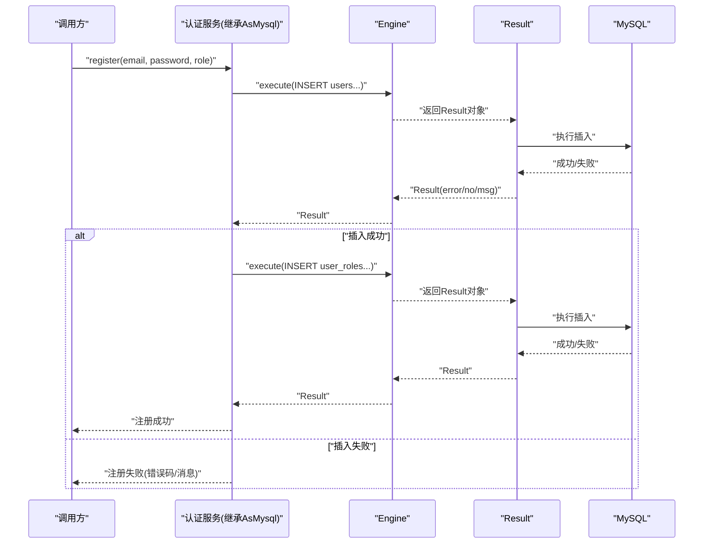
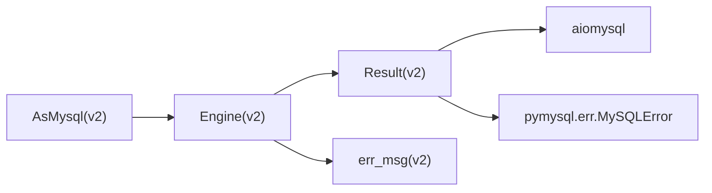
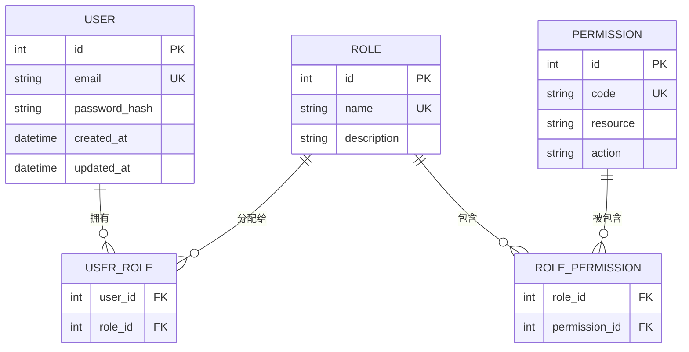

# 用户认证系统

<cite>
**本文引用的文件**   
- [asmysql/__init__.py](file://asmysql/__init__.py)
- [asmysql/v2/_asmysql.py](file://asmysql/v2/_asmysql.py)
- [asmysql/v2/_engine.py](file://asmysql/v2/_engine.py)
- [asmysql/v2/_result.py](file://asmysql/v2/_result.py)
- [asmysql/v2/_error.py](file://asmysql/v2/_error.py)
- [asmysql/v3dev/_asmysql.py](file://asmysql/v3dev/_asmysql.py)
- [asmysql/v3dev/_async_engine.py](file://asmysql/v3dev/_async_engine.py)
- [asmysql/v3dev/_sync_engine.py](file://asmysql/v3dev/_sync_engine.py)
- [asmysql/v3dev/_async_result.py](file://asmysql/v3dev/_async_result.py)
- [README.md](file://README.md)
- [tests/v2/v2_start.py](file://tests/v2/v2_start.py)
- [pytest/v2/test_asmysql.py](file://pytest/v2/test_asmysql.py)
- [mkdocs/v2/docs/zh/best-practices.md](file://mkdocs/v2/docs/zh/best-practices.md)
- [mkdocs/v2/docs/zh/transaction.md](file://mkdocs/v2/docs/zh/transaction.md)
</cite>

## 目录
1. [简介](#简介)
2. [项目结构](#项目结构)
3. [核心组件](#核心组件)
4. [架构总览](#架构总览)
5. [详细组件分析](#详细组件分析)
6. [依赖关系分析](#依赖关系分析)
7. [性能与优化建议](#性能与优化建议)
8. [故障排查指南](#故障排查指南)
9. [结论](#结论)
10. [附录：数据库设计与业务实现要点](#附录数据库设计与业务实现要点)

## 简介
本文件基于 asmysql 库，提供一套完整的“用户认证系统”设计与实现方案。围绕用户注册、登录验证、权限管理等核心能力，结合 asmysql 的异步连接池、结果集封装、事务控制等特性，给出：
- 数据库表结构设计（用户、角色、权限）
- 密码加密存储策略
- 会话管理方案
- 基于角色的访问控制（RBAC）
- 使用 AsMysql 基类封装认证相关数据库操作
- 事务处理确保数据一致性
- 错误处理与异常捕获机制
- 性能优化与安全最佳实践（参数化查询防注入、密码强度校验等）

## 项目结构
仓库采用多版本并存的结构，v2 为当前稳定版，v3dev 为开发预览版（同时支持同步/异步引擎）。认证系统的业务逻辑将基于 v2 的 AsMysql + Engine + Result 进行构建。

图表来源
- [asmysql/__init__.py:1-16](file://asmysql/__init__.py#L1-L16)
- [asmysql/v2/_asmysql.py:1-26](file://asmysql/v2/_asmysql.py#L1-L26)
- [asmysql/v2/_engine.py:1-317](file://asmysql/v2/_engine.py#L1-L317)
- [asmysql/v2/_result.py:1-273](file://asmysql/v2/_result.py#L1-L273)
- [asmysql/v2/_error.py:1-7](file://asmysql/v2/_error.py#L1-L7)
- [asmysql/v3dev/_asmysql.py:1-30](file://asmysql/v3dev/_asmysql.py#L1-L30)
- [asmysql/v3dev/_async_engine.py:1-307](file://asmysql/v3dev/_async_engine.py#L1-L307)
- [asmysql/v3dev/_sync_engine.py:1-298](file://asmysql/v3dev/_sync_engine.py#L1-L298)
- [asmysql/v3dev/_async_result.py:1-273](file://asmysql/v3dev/_async_result.py#L1-L273)

章节来源
- [README.md:1-135](file://README.md#L1-L135)

## 核心组件
- AsMysql：业务逻辑基类，持有 Engine 客户端，提供统一的 client 属性用于执行 SQL。
- Engine：异步 MySQL 连接池封装，负责连接生命周期、参数解析、execute/execute_many 返回 Result。
- Result：统一的结果集封装，支持 fetch_one/fetch_many/fetch_all/iterate，以及 async for 迭代；内部自动获取/释放连接，并可选择流式读取。
- 错误处理：err_msg 统一格式化底层异常信息，便于日志记录。

章节来源
- [asmysql/v2/_asmysql.py:1-26](file://asmysql/v2/_asmysql.py#L1-L26)
- [asmysql/v2/_engine.py:1-317](file://asmysql/v2/_engine.py#L1-L317)
- [asmysql/v2/_result.py:1-273](file://asmysql/v2/_result.py#L1-L273)
- [asmysql/v2/_error.py:1-7](file://asmysql/v2/_error.py#L1-L7)

## 架构总览
下图展示了认证系统在应用层与 asmysql 层的交互关系：业务服务继承 AsMysql，通过 client.execute 执行 SQL，Result 负责游标与连接的生命周期管理。

图表来源
- [asmysql/v2/_asmysql.py:1-26](file://asmysql/v2/_asmysql.py#L1-L26)
- [asmysql/v2/_engine.py:1-317](file://asmysql/v2/_engine.py#L1-L317)
- [asmysql/v2/_result.py:1-273](file://asmysql/v2/_result.py#L1-L273)

## 详细组件分析

### 组件一：AsMysql 基类
- 职责：作为业务逻辑类的基类，对外暴露 client 属性指向 Engine，屏蔽底层连接细节。
- 关键点：
  - __init__ 接收 Engine 实例并保存引用。
  - client 属性返回 Engine，供业务方法调用 execute/execute_many。
  - 提供 __repr__/__str__ 便于调试输出。

章节来源
- [asmysql/v2/_asmysql.py:1-26](file://asmysql/v2/_asmysql.py#L1-L26)

### 组件二：Engine 连接与执行
- 职责：封装 aiomysql 连接池，提供 connect/disconnect、execute/execute_many、状态查询等。
- 关键点：
  - 支持 URL 参数解析（如 charset、pool 大小、超时、自动提交、SQL 日志开关）。
  - execute/execute_many 返回 Result，支持上下文管理与异步迭代。
  - auto_commit 默认开启，可通过 execute(..., commit=...) 覆盖单次提交行为。
  - status/is_connected/pool 提供连接池监控与访问。

章节来源
- [asmysql/v2/_engine.py:1-317](file://asmysql/v2/_engine.py#L1-L317)

### 组件三：Result 结果集与资源管理
- 职责：统一封装执行结果，管理游标与连接生命周期，提供多种读取方式。
- 关键点：
  - 支持 tuple/dict/自定义模型（如 Pydantic BaseModel）作为 result_class。
  - 支持流式读取（stream=True），避免大结果集内存占用。
  - 自动在 fetch_one/fetch_many/fetch_all/iterate 结束时关闭连接（可手动控制 close 参数）。
  - error/error_no/error_msg 提供错误码与消息，便于上层判断。

章节来源
- [asmysql/v2/_result.py:1-273](file://asmysql/v2/_result.py#L1-L273)

### 组件四：错误处理
- 职责：统一格式化底层 MySQLError 信息，避免空字符串导致日志不可读。
- 关键点：
  - err_msg 提取异常类型与消息，规范化输出。

章节来源
- [asmysql/v2/_error.py:1-7](file://asmysql/v2/_error.py#L1-L7)

### 组件五：v3dev 预览版（同步/异步双引擎）
- 说明：v3dev 提供通用 AsMysql 泛型类，分别对接异步 Engine 与同步 Engine，Result 也对应异步实现。
- 适用场景：需要同时支持同步/异步代码路径或逐步迁移时参考。

章节来源
- [asmysql/v3dev/_asmysql.py:1-30](file://asmysql/v3dev/_asmysql.py#L1-L30)
- [asmysql/v3dev/_async_engine.py:1-307](file://asmysql/v3dev/_async_engine.py#L1-L307)
- [asmysql/v3dev/_sync_engine.py:1-298](file://asmysql/v3dev/_sync_engine.py#L1-L298)
- [asmysql/v3dev/_async_result.py:1-273](file://asmysql/v3dev/_async_result.py#L1-L273)

### 组件六：API/服务流程示例（序列图）
以下序列图展示“用户注册”的关键调用链：业务服务继承 AsMysql，通过 client.execute 插入用户与角色关联，并使用事务保证一致性。

图表来源
- [asmysql/v2/_asmysql.py:1-26](file://asmysql/v2/_asmysql.py#L1-L26)
- [asmysql/v2/_engine.py:1-317](file://asmysql/v2/_engine.py#L1-L317)
- [asmysql/v2/_result.py:1-273](file://asmysql/v2/_result.py#L1-L273)

## 依赖关系分析
- 模块耦合：
  - AsMysql 仅依赖 Engine，低耦合高内聚。
  - Engine 依赖 aiomysql Pool 与 pymysql.err.MySQLError，并通过 Result 完成执行与结果处理。
  - Result 依赖 aiomysql Cursor/DictCursor/SSCursor/SSDictCursor 与连接池。
- 外部依赖：
  - aiomysql：异步连接池与游标。
  - pymysql.err：MySQL 错误类型。
- 潜在循环依赖：无直接循环导入，结构清晰。

图表来源
- [asmysql/v2/_asmysql.py:1-26](file://asmysql/v2/_asmysql.py#L1-L26)
- [asmysql/v2/_engine.py:1-317](file://asmysql/v2/_engine.py#L1-L317)
- [asmysql/v2/_result.py:1-273](file://asmysql/v2/_result.py#L1-L273)
- [asmysql/v2/_error.py:1-7](file://asmysql/v2/_error.py#L1-L7)

章节来源
- [asmysql/__init__.py:1-16](file://asmysql/__init__.py#L1-L16)

## 性能与优化建议
- 连接池配置
  - 根据并发量设置 min_pool_size/max_pool_size，合理 pool_recycle 回收空闲连接。
  - 参考文档中的推荐做法与示例。
- 大数据集处理
  - 使用 stream=True 与 iterate()/async for 逐行处理，避免一次性加载到内存。
- 参数化查询
  - 始终使用参数化查询防止 SQL 注入，不要拼接字符串。
- 自动提交与事务
  - 默认 auto_commit=True，批量写入或跨表操作建议关闭自动提交并在业务中显式 commit。
- 结果类型选择
  - 使用 dict 或自定义模型（如 Pydantic）提升可读性与类型安全。

章节来源
- [mkdocs/v2/docs/zh/best-practices.md:1-141](file://mkdocs/v2/docs/zh/best-practices.md#L1-L141)
- [mkdocs/v2/docs/zh/transaction.md:1-44](file://mkdocs/v2/docs/zh/transaction.md#L1-L44)
- [tests/v2/v2_start.py:1-107](file://tests/v2/v2_start.py#L1-L107)

## 故障排查指南
- 常见错误定位
  - 检查 result.error/result.error_no/result.error_msg，快速定位 SQL 错误或连接问题。
  - 确认是否忘记断开连接或手动关闭游标（当 close=False 时必须调用 result.close()）。
- 连接池状态
  - 使用 engine.status 查看连接池大小、空闲数、已用数等指标。
- 事务相关问题
  - 若未正确提交或回滚，可能导致数据不一致；建议在关键路径使用 try/except 包裹事务块。
- 日志与调试
  - 开启 echo_sql_log 打印 SQL，辅助定位慢查询与错误语句。

章节来源
- [asmysql/v2/_result.py:1-273](file://asmysql/v2/_result.py#L1-L273)
- [asmysql/v2/_engine.py:1-317](file://asmysql/v2/_engine.py#L1-L317)
- [pytest/v2/test_asmysql.py:1-200](file://pytest/v2/test_asmysql.py#L1-L200)

## 结论
基于 asmysql 的用户认证系统具备清晰的层次结构与完善的异步处理能力。通过 AsMysql 基类组织业务逻辑，Engine 管理连接池与执行，Result 统一结果与资源管理，配合事务与错误处理机制，可实现高可靠的用户注册、登录与权限控制。在生产环境中，应重视连接池调优、流式读取、参数化查询与密码安全策略。

## 附录：数据库设计与业务实现要点

### 数据库设计（ER 图）

[本节为概念性设计，不直接分析具体源码文件]

### 密码加密存储
- 使用安全的哈希算法（如 bcrypt/argon2）对密码进行加盐哈希存储，禁止明文或弱哈希。
- 每次注册生成随机盐值，登录时比对哈希值。

[本节为通用安全实践，不直接分析具体源码文件]

### 会话管理
- 服务端维护会话（如 Redis/数据库），存储用户标识、角色、过期时间等。
- 登录成功后签发 Token（JWT）或 Session ID，并在请求头中携带。
- 鉴权中间件校验 Token/Session，并基于 RBAC 判定权限。

[本节为通用架构实践，不直接分析具体源码文件]

### 基于角色的访问控制（RBAC）
- 用户-角色-权限三元关系，通过 USER_ROLE 与 ROLE_PERMISSION 建立映射。
- 登录时加载用户角色与权限集合，缓存于会话或 Token 中，减少频繁查库。
- 接口级权限校验：按资源+动作匹配 PERMISSION.code。

[本节为通用权限模型，不直接分析具体源码文件]

### 使用 AsMysql 封装认证操作的要点
- 继承 AsMysql，定义注册、登录、权限查询等方法。
- 使用参数化查询（values 元组/字典）防止 SQL 注入。
- 批量写入或跨表更新时，关闭 auto_commit，并在成功时显式提交。
- 使用 result_class=dict 或自定义模型提升可读性与类型安全。
- 使用 stream=True 与 iterate()/async for 处理大结果集。

章节来源
- [README.md:1-135](file://README.md#L1-L135)
- [pytest/v2/test_asmysql.py:1-200](file://pytest/v2/test_asmysql.py#L1-L200)
- [mkdocs/v2/docs/zh/best-practices.md:1-141](file://mkdocs/v2/docs/zh/best-practices.md#L1-L141)
- [mkdocs/v2/docs/zh/transaction.md:1-44](file://mkdocs/v2/docs/zh/transaction.md#L1-L44)