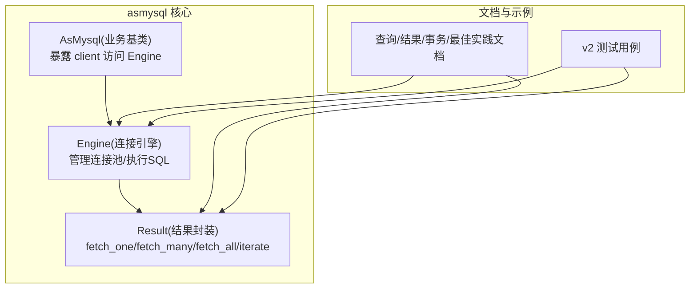
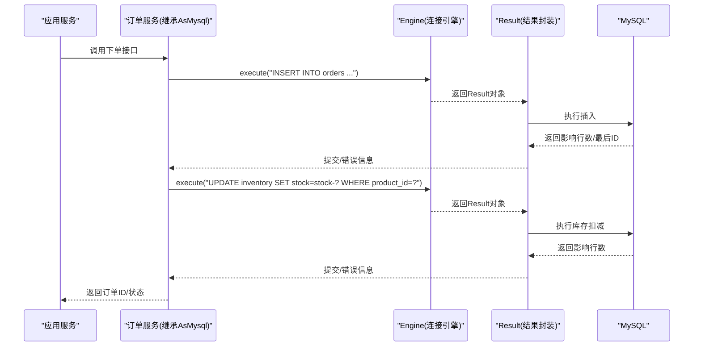
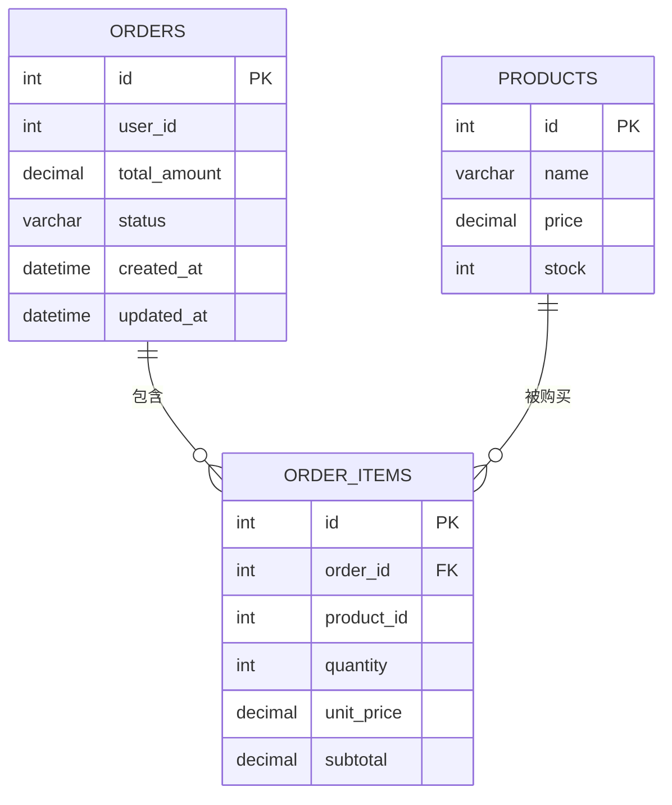
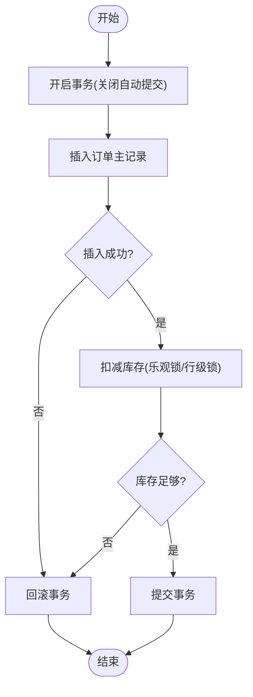
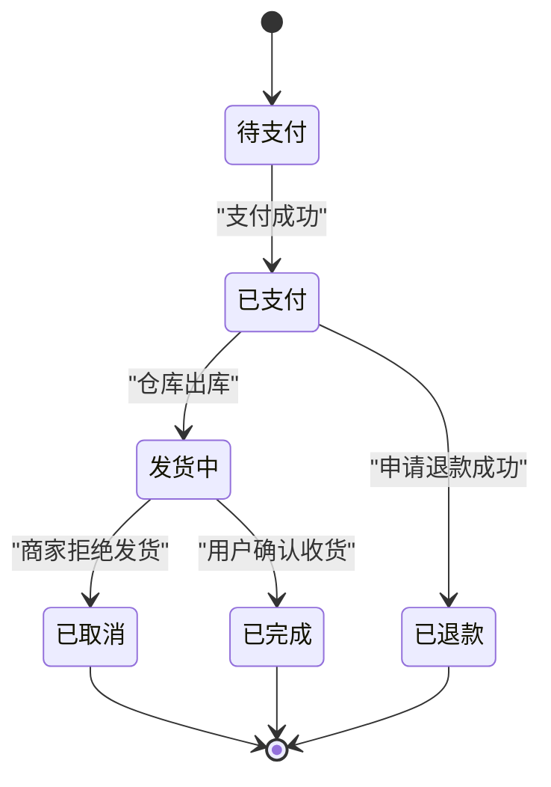
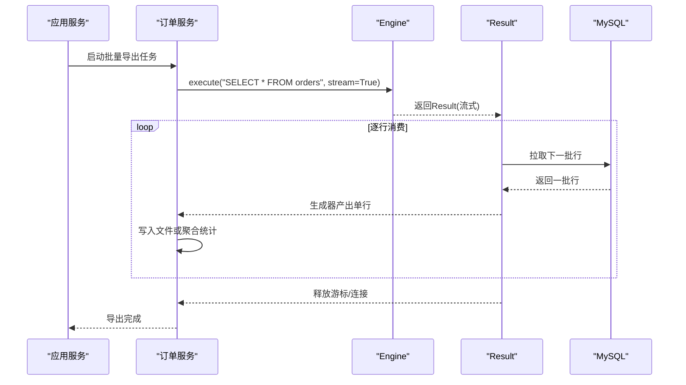
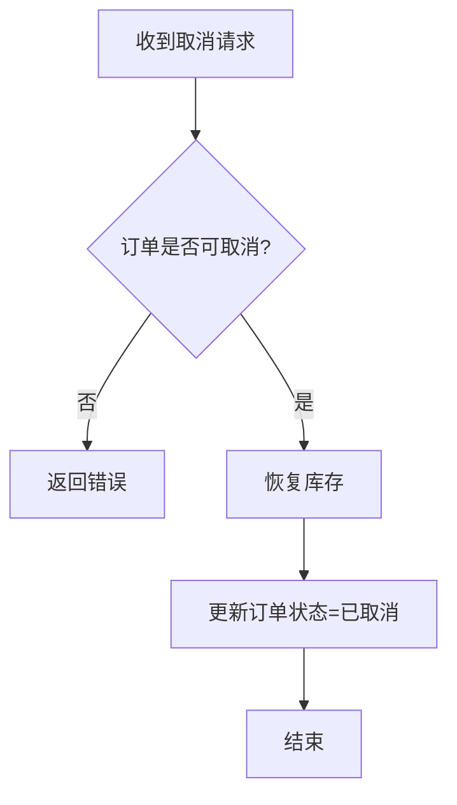
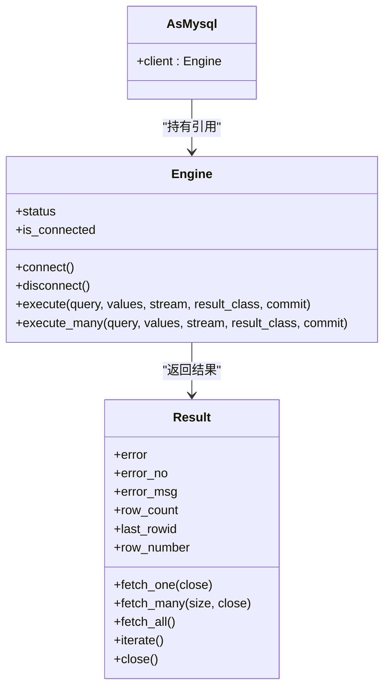

# 订单管理系统

<cite>
**本文引用的文件**   
- [README.md](file://README.md)
- [asmysql/__init__.py](file://asmysql/__init__.py)
- [asmysql/v2/_engine.py](file://asmysql/v2/_engine.py)
- [asmysql/v2/_result.py](file://asmysql/v2/_result.py)
- [asmysql/v2/_asmysql.py](file://asmysql/v2/_asmysql.py)
- [asmysql/v3dev/_async_engine.py](file://asmysql/v3dev/_async_engine.py)
- [asmysql/v3dev/_asmysql.py](file://asmysql/v3dev/_asmysql.py)
- [mkdocs/v2/docs/zh/query.md](file://mkdocs/v2/docs/zh/query.md)
- [mkdocs/v2/docs/zh/result.md](file://mkdocs/v2/docs/zh/result.md)
- [mkdocs/v2/docs/zh/transaction.md](file://mkdocs/v2/docs/zh/transaction.md)
- [mkdocs/v2/docs/zh/best-practices.md](file://mkdocs/v2/docs/zh/best-practices.md)
- [mkdocs/v2/docs/zh/business-logic.md](file://mkdocs/v2/docs/zh/business-logic.md)
- [mkdocs/v2/docs/zh/examples.md](file://mkdocs/v2/docs/zh/examples.md)
- [pytest/v2/test_asmysql.py](file://pytest/v2/test_asmysql.py)
</cite>

## 目录
1. [引言](#引言)
2. [项目结构](#项目结构)
3. [核心组件](#核心组件)
4. [架构总览](#架构总览)
5. [详细组件分析](#详细组件分析)
6. [依赖分析](#依赖分析)
7. [性能考虑](#性能考虑)
8. [故障排查指南](#故障排查指南)
9. [结论](#结论)
10. [附录](#附录)

## 引言
本实战文档围绕 asmysql 异步 MySQL 客户端，构建一个完整的“订单管理系统”。内容涵盖：
- 数据库模型设计（订单主表、订单明细表、商品库存表等）
- 订单创建、状态流转、库存扣减、支付处理等核心业务流程
- 使用 asmysql 的流式查询处理海量订单数据
- 使用事务保证订单操作的原子性
- 查询优化方案（索引设计、分页查询、复杂条件搜索）
- 逆向流程（取消、退款、退货）
- 异步业务逻辑示例与性能调优建议

## 项目结构
仓库包含 asmysql 库的核心实现与文档、测试用例。面向订单系统的工程化落地，主要关注 v2 版本 API 与最佳实践文档，并结合测试用例理解行为特征。

图表来源
- [asmysql/v2/_engine.py:1-317](file://asmysql/v2/_engine.py#L1-L317)
- [asmysql/v2/_result.py:1-273](file://asmysql/v2/_result.py#L1-L273)
- [asmysql/v2/_asmysql.py:1-26](file://asmysql/v2/_asmysql.py#L1-L26)
- [mkdocs/v2/docs/zh/query.md:1-98](file://mkdocs/v2/docs/zh/query.md#L1-L98)
- [mkdocs/v2/docs/zh/result.md:1-135](file://mkdocs/v2/docs/zh/result.md#L1-L135)
- [pytest/v2/test_asmysql.py:1-283](file://pytest/v2/test_asmysql.py#L1-L283)

章节来源
- [README.md:1-135](file://README.md#L1-L135)
- [asmysql/__init__.py:1-16](file://asmysql/__init__.py#L1-L16)

## 核心组件
- Engine：异步连接引擎，负责连接池管理、SQL 执行入口（execute/execute_many），支持流式返回与结果类型定制。
- Result：SQL 执行结果封装，提供 fetch_one/fetch_many/fetch_all/iterate 等方法，支持上下文管理与直接迭代。
- AsMysql：业务逻辑基类，持有 Engine 引用，便于组织领域服务方法。

章节来源
- [asmysql/v2/_engine.py:1-317](file://asmysql/v2/_engine.py#L1-L317)
- [asmysql/v2/_result.py:1-273](file://asmysql/v2/_result.py#L1-L273)
- [asmysql/v2/_asmysql.py:1-26](file://asmysql/v2/_asmysql.py#L1-L26)

## 架构总览
下图展示订单系统在高并发场景下的整体交互：应用层通过 AsMysql 服务编排业务，底层由 Engine 驱动连接池与 Result 完成 SQL 执行与结果消费；在大数据量场景下采用流式迭代避免内存峰值。

图表来源
- [asmysql/v2/_engine.py:226-317](file://asmysql/v2/_engine.py#L226-L317)
- [asmysql/v2/_result.py:101-126](file://asmysql/v2/_result.py#L101-L126)
- [mkdocs/v2/docs/zh/query.md:1-98](file://mkdocs/v2/docs/zh/query.md#L1-L98)

## 详细组件分析

### 数据库模型设计
- 订单主表 orders
  - 字段建议：id(PK), user_id, total_amount, status, created_at, updated_at
  - 索引建议：user_id、status、created_at
- 订单明细表 order_items
  - 字段建议：id(PK), order_id(FK), product_id, quantity, unit_price, subtotal
  - 索引建议：order_id、product_id
- 商品库存表 products
  - 字段建议：id(PK), name, price, stock
  - 索引建议：id(PK)、name

ER 关系示意：

[本节为概念性设计说明，不直接分析具体代码文件]

### 订单创建与库存扣减（含事务）
- 目标：在一个事务内完成订单写入与库存扣减，任一失败则回滚。
- 要点：
  - 关闭自动提交，显式控制 commit/rollback
  - 先写订单，再扣库存，校验库存充足
  - 异常捕获后统一回滚并记录日志

章节来源
- [mkdocs/v2/docs/zh/transaction.md:1-44](file://mkdocs/v2/docs/zh/transaction.md#L1-L44)
- [asmysql/v2/_engine.py:226-317](file://asmysql/v2/_engine.py#L226-L317)
- [asmysql/v2/_result.py:101-126](file://asmysql/v2/_result.py#L101-L126)

### 支付处理与状态流转
- 支付回调后更新订单状态为已支付，并触发后续履约流程。
- 状态机建议：待支付 -> 已支付 -> 发货中 -> 已完成 / 已取消 / 已退款

[本节为概念性状态图，不直接分析具体代码文件]

### 流式查询处理大量订单
- 适用场景：导出、对账、报表统计等需要遍历百万级订单的场景。
- 关键点：
  - 使用 stream=True 或 iterate() 逐行消费
  - 避免一次性加载到内存
  - 结合分页与分批处理提升吞吐

章节来源
- [mkdocs/v2/docs/zh/query.md:77-98](file://mkdocs/v2/docs/zh/query.md#L77-L98)
- [mkdocs/v2/docs/zh/result.md:31-50](file://mkdocs/v2/docs/zh/result.md#L31-L50)
- [asmysql/v2/_result.py:251-273](file://asmysql/v2/_result.py#L251-L273)

### 查询优化方案
- 索引设计
  - 高频过滤列建索引：user_id、status、created_at
  - 复合索引：(status, created_at) 用于按状态+时间范围分页
  - 外键列 order_id/product_id 建索引以加速关联查询
- 分页查询
  - 基于主键或自增 ID 的分页：WHERE id > last_id LIMIT N
  - 基于时间窗口的分页：WHERE created_at > last_time LIMIT N
- 复杂条件搜索
  - 将多条件组合为覆盖索引或使用全文检索/搜索引擎
  - 避免 SELECT *，只取必要列，减少网络与序列化开销

[本节为通用优化建议，不直接分析具体代码文件]

### 逆向流程：取消、退款、退货
- 取消订单
  - 校验订单可取消状态
  - 恢复库存（quantity 加回）
  - 更新订单状态为已取消
- 退款
  - 校验订单已支付且未退款
  - 调用支付渠道退款接口
  - 成功后更新订单状态为已退款
- 退货
  - 校验订单已完成
  - 入库增加库存
  - 更新订单状态为已退货

[本节为概念性流程图，不直接分析具体代码文件]

### 异步业务逻辑示例与最佳实践
- 使用 AsMysql 组织业务方法，通过 self.client 访问 Engine
- 推荐用法：
  - 使用上下文管理器管理连接与结果生命周期
  - 参数化查询防止注入
  - 大数据集使用流式迭代
  - 合理配置连接池大小与回收策略

章节来源
- [mkdocs/v2/docs/zh/business-logic.md:1-67](file://mkdocs/v2/docs/zh/business-logic.md#L1-L67)
- [mkdocs/v2/docs/zh/best-practices.md:1-141](file://mkdocs/v2/docs/zh/best-practices.md#L1-L141)
- [pytest/v2/test_asmysql.py:1-283](file://pytest/v2/test_asmysql.py#L1-L283)

## 依赖分析
- 模块耦合
  - AsMysql 依赖 Engine，仅通过 client 属性访问
  - Engine 依赖 aiomysql Pool 与 pymysql.err.MySQLError
  - Result 依赖 aiomysql Cursor/DictCursor/SSCursor/SSDictCursor
- 外部依赖
  - aiomysql：异步连接池与游标
  - pymysql.err：MySQL 错误类型

图表来源
- [asmysql/v2/_asmysql.py:1-26](file://asmysql/v2/_asmysql.py#L1-L26)
- [asmysql/v2/_engine.py:1-317](file://asmysql/v2/_engine.py#L1-L317)
- [asmysql/v2/_result.py:1-273](file://asmysql/v2/_result.py#L1-L273)

章节来源
- [asmysql/v2/_engine.py:1-317](file://asmysql/v2/_engine.py#L1-L317)
- [asmysql/v2/_result.py:1-273](file://asmysql/v2/_result.py#L1-L273)
- [asmysql/v2/_asmysql.py:1-26](file://asmysql/v2/_asmysql.py#L1-L26)

## 性能考虑
- 连接池配置
  - min_pool_size/max_pool_size 根据并发量设置
  - pool_recycle 定期回收空闲连接，避免长连接资源泄漏
- 流式查询
  - 大数据集务必使用 stream=True 或 iterate() 逐行消费
- 结果类型
  - 使用 dict 或自定义模型（如 Pydantic）进行强类型映射，提高可读性与健壮性
- 错误处理
  - 检查 result.error/error_no/error_msg，统一记录与告警
- 事务粒度
  - 尽量缩小事务范围，减少锁持有时间

章节来源
- [mkdocs/v2/docs/zh/best-practices.md:124-141](file://mkdocs/v2/docs/zh/best-practices.md#L124-L141)
- [mkdocs/v2/docs/zh/query.md:77-98](file://mkdocs/v2/docs/zh/query.md#L77-L98)
- [mkdocs/v2/docs/zh/result.md:96-135](file://mkdocs/v2/docs/zh/result.md#L96-L135)

## 故障排查指南
- 常见错误
  - 连接失败：检查 URL、账号密码、网络连通性
  - 事务未提交：确认 auto_commit 与 commit 参数
  - 连接池耗尽：检查是否存在未关闭的连接或未正确释放的游标
- 定位手段
  - 打印 engine.status 观察连接池使用情况
  - 打开 echo_sql_log 查看实际执行的 SQL
  - 使用 result.error/error_no/error_msg 获取错误详情

章节来源
- [mkdocs/v2/docs/zh/transaction.md:1-44](file://mkdocs/v2/docs/zh/transaction.md#L1-L44)
- [mkdocs/v2/docs/zh/best-practices.md:70-103](file://mkdocs/v2/docs/zh/best-practices.md#L70-L103)
- [mkdocs/v2/docs/zh/result.md:96-135](file://mkdocs/v2/docs/zh/result.md#L96-L135)

## 结论
借助 asmysql 的异步连接池、流式查询与结果封装能力，可以高效构建高并发、可扩展的订单管理系统。通过合理的数据库建模、事务边界控制、索引与分页优化，以及完善的错误处理与监控，可在生产环境获得稳定可靠的性能表现。

[本节为总结性内容，不直接分析具体代码文件]

## 附录
- 快速参考
  - 基础用法与示例：参见示例文档
  - 事务控制：参见事务文档
  - 结果处理：参见结果文档
  - 最佳实践：参见最佳实践文档

章节来源
- [mkdocs/v2/docs/zh/examples.md:1-800](file://mkdocs/v2/docs/zh/examples.md#L1-L800)
- [mkdocs/v2/docs/zh/transaction.md:1-44](file://mkdocs/v2/docs/zh/transaction.md#L1-L44)
- [mkdocs/v2/docs/zh/result.md:1-135](file://mkdocs/v2/docs/zh/result.md#L1-L135)
- [mkdocs/v2/docs/zh/best-practices.md:1-141](file://mkdocs/v2/docs/zh/best-practices.md#L1-L141)