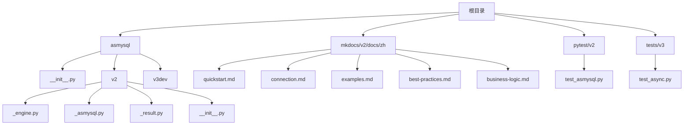
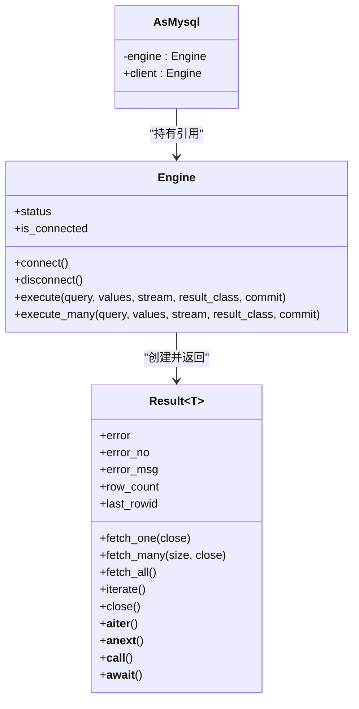
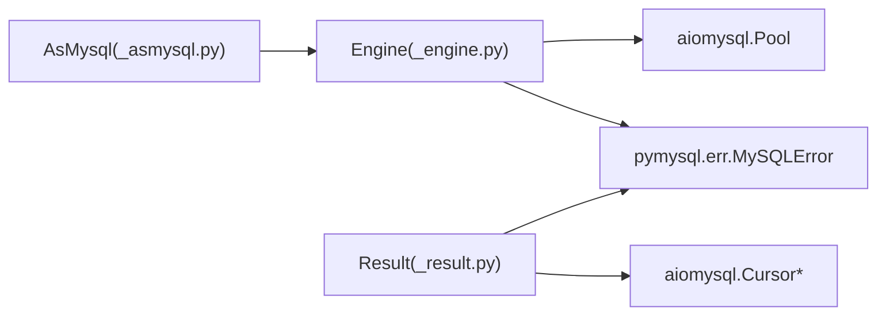

# 使用示例和教程

<cite>
**本文引用的文件**   
- [README.md](file://README.md)
- [asmysql/__init__.py](file://asmysql/__init__.py)
- [asmysql/v2/__init__.py](file://asmysql/v2/__init__.py)
- [asmysql/v2/_engine.py](file://asmysql/v2/_engine.py)
- [asmysql/v2/_asmysql.py](file://asmysql/v2/_asmysql.py)
- [asmysql/v2/_result.py](file://asmysql/v2/_result.py)
- [mkdocs/v2/docs/zh/quickstart.md](file://mkdocs/v2/docs/zh/quickstart.md)
- [mkdocs/v2/docs/zh/connection.md](file://mkdocs/v2/docs/zh/connection.md)
- [mkdocs/v2/docs/zh/examples.md](file://mkdocs/v2/docs/zh/examples.md)
- [mkdocs/v2/docs/zh/best-practices.md](file://mkdocs/v2/docs/zh/best-practices.md)
- [mkdocs/v2/docs/zh/business-logic.md](file://mkdocs/v2/docs/zh/business-logic.md)
- [pytest/v2/test_asmysql.py](file://pytest/v2/test_asmysql.py)
- [tests/v3/test_async.py](file://tests/v3/test_async.py)
</cite>

## 目录
1. [简介](#简介)
2. [项目结构](#项目结构)
3. [核心组件](#核心组件)
4. [架构总览](#架构总览)
5. [详细组件分析](#详细组件分析)
6. [依赖关系分析](#依赖关系分析)
7. [性能与高并发优化](#性能与高并发优化)
8. [错误处理与异常恢复](#错误处理与异常恢复)
9. [实战案例与业务场景](#实战案例与业务场景)
10. [与主流框架集成](#与主流框架集成)
11. [故障排查指南](#故障排查指南)
12. [结论](#结论)
13. [附录：学习路径与资源](#附录学习路径与资源)

## 简介
本教程面向不同层次的开发者，系统讲解 asmysql 的使用方法与最佳实践。内容覆盖基础 CRUD、批量数据处理、流式查询、事务控制、错误处理、性能优化，以及与 FastAPI、Django、异步任务队列等主流生态的集成方式。通过“从入门到精通”的渐进式路径，帮助你快速掌握 asmysql 在真实业务中的应用。

## 项目结构
仓库采用多版本并存的组织方式：v1（兼容旧版）、v2（当前稳定版）、v3dev（开发中，提供同步/异步双引擎）。文档与示例集中在 mkdocs 下，测试用例位于 pytest 与 tests 目录。

图表来源
- [asmysql/__init__.py:1-16](file://asmysql/__init__.py#L1-L16)
- [asmysql/v2/__init__.py:1-15](file://asmysql/v2/__init__.py#L1-L15)
- [asmysql/v2/_engine.py:1-317](file://asmysql/v2/_engine.py#L1-L317)
- [asmysql/v2/_asmysql.py:1-26](file://asmysql/v2/_asmysql.py#L1-L26)
- [asmysql/v2/_result.py:1-273](file://asmysql/v2/_result.py#L1-L273)
- [mkdocs/v2/docs/zh/quickstart.md:1-74](file://mkdocs/v2/docs/zh/quickstart.md#L1-L74)
- [mkdocs/v2/docs/zh/connection.md:1-131](file://mkdocs/v2/docs/zh/connection.md#L1-L131)
- [mkdocs/v2/docs/zh/examples.md:1-800](file://mkdocs/v2/docs/zh/examples.md#L1-L800)
- [mkdocs/v2/docs/zh/best-practices.md:1-141](file://mkdocs/v2/docs/zh/best-practices.md#L1-L141)
- [mkdocs/v2/docs/zh/business-logic.md:1-67](file://mkdocs/v2/docs/zh/business-logic.md#L1-L67)
- [pytest/v2/test_asmysql.py:1-283](file://pytest/v2/test_asmysql.py#L1-L283)
- [tests/v3/test_async.py:1-108](file://tests/v3/test_async.py#L1-L108)

章节来源
- [README.md:1-135](file://README.md#L1-L135)
- [asmysql/__init__.py:1-16](file://asmysql/__init__.py#L1-L16)
- [asmysql/v2/__init__.py:1-15](file://asmysql/v2/__init__.py#L1-L15)

## 核心组件
- Engine：异步连接引擎，封装 aiomysql 连接池，提供 execute/execute_many 执行 SQL，支持上下文管理与状态监控。
- Result：结果对象，封装游标生命周期、错误信息、行计数、自动关闭与迭代器协议，支持 tuple/dict/自定义模型类型转换。
- AsMysql：业务逻辑基类，持有 Engine 引用，暴露 client 属性用于执行 SQL。

章节来源
- [asmysql/v2/_engine.py:37-317](file://asmysql/v2/_engine.py#L37-L317)
- [asmysql/v2/_result.py:21-273](file://asmysql/v2/_result.py#L21-L273)
- [asmysql/v2/_asmysql.py:7-26](file://asmysql/v2/_asmysql.py#L7-L26)

## 架构总览
asmysql v2 的核心交互流程如下：Engine 负责连接池与执行入口；Result 负责游标获取、SQL 执行、结果读取与资源释放；AsMysql 作为业务层包装，统一对外暴露 client 接口。

图表来源
- [asmysql/v2/_engine.py:226-317](file://asmysql/v2/_engine.py#L226-L317)
- [asmysql/v2/_result.py:21-273](file://asmysql/v2/_result.py#L21-L273)
- [asmysql/v2/_asmysql.py:7-26](file://asmysql/v2/_asmysql.py#L7-L26)

## 详细组件分析

### Engine 组件
- 连接管理：支持 URL 与关键字参数初始化，内部基于 aiomysql.create_pool 建立连接池；提供 connect/disconnect/release_connections/is_connected/status 等方法。
- SQL 执行：execute/execute_many 返回 Result 实例，支持上下文管理器与直接 await 两种用法；支持 stream 与 result_class 参数。
- 配置项：min_pool_size、max_pool_size、pool_recycle、connect_timeout、auto_commit、echo_sql_log、stream、result_class 等。

章节来源
- [asmysql/v2/_engine.py:56-112](file://asmysql/v2/_engine.py#L56-L112)
- [asmysql/v2/_engine.py:131-183](file://asmysql/v2/_engine.py#L131-L183)
- [asmysql/v2/_engine.py:226-317](file://asmysql/v2/_engine.py#L226-L317)
- [mkdocs/v2/docs/zh/connection.md:1-131](file://mkdocs/v2/docs/zh/connection.md#L1-L131)

### Result 组件
- 执行与错误：内部 __call__ 获取连接与游标，执行 SQL，捕获 MySQLError 并记录 error/error_no/error_msg。
- 结果读取：fetch_one/fetch_many/fetch_all 支持自动关闭连接；iterate 提供异步生成器遍历；支持 async for 直接迭代。
- 类型转换：根据 result_class 将每行数据转换为 tuple/dict/自定义模型（如 Pydantic BaseModel）。
- 资源管理：__aenter__/__aexit__/__del__/close 确保连接归还到池，避免泄漏。

章节来源
- [asmysql/v2/_result.py:101-126](file://asmysql/v2/_result.py#L101-L126)
- [asmysql/v2/_result.py:186-273](file://asmysql/v2/_result.py#L186-L273)
- [pytest/v2/test_asmysql.py:49-147](file://pytest/v2/test_asmysql.py#L49-L147)

### AsMysql 组件
- 职责：为业务逻辑提供统一的 client 访问点，隐藏底层 Engine 细节。
- 使用模式：继承 AsMysql，实现业务方法，内部通过 self.client.execute 进行数据库操作。

章节来源
- [asmysql/v2/_asmysql.py:7-26](file://asmysql/v2/_asmysql.py#L7-L26)
- [mkdocs/v2/docs/zh/business-logic.md:1-67](file://mkdocs/v2/docs/zh/business-logic.md#L1-L67)

## 依赖关系分析
- Engine 依赖 aiomysql.Pool/create_pool 与 pymysql.err.MySQLError。
- Result 依赖 aiomysql.Cursor/DictCursor/SSCursor/SSDictCursor 与 pymysql.err.MySQLError。
- AsMysql 仅依赖 Engine。

图表来源
- [asmysql/v2/_engine.py:17-21](file://asmysql/v2/_engine.py#L17-L21)
- [asmysql/v2/_result.py:1-6](file://asmysql/v2/_result.py#L1-L6)
- [asmysql/v2/_asmysql.py:1-5](file://asmysql/v2/_asmysql.py#L1-L5)

章节来源
- [asmysql/v2/_engine.py:17-21](file://asmysql/v2/_engine.py#L17-L21)
- [asmysql/v2/_result.py:1-6](file://asmysql/v2/_result.py#L1-L6)

## 性能与高并发优化
- 连接池调优：根据应用负载设置 min_pool_size/max_pool_size/pool_recycle/connect_timeout，避免连接耗尽或频繁重建。
- 流式查询：对大数据集使用 stream=True 与 async for 逐行处理，降低内存占用。
- 批量写入：使用 execute_many 减少网络往返，提升吞吐。
- 结果类型选择：默认 tuple 性能较高；dict 便于可读性；自定义模型适合强类型校验但略有开销。
- 自动提交与事务：在高并发写场景谨慎使用 auto_commit，必要时显式控制事务边界。

章节来源
- [mkdocs/v2/docs/zh/best-practices.md:124-141](file://mkdocs/v2/docs/zh/best-practices.md#L124-L141)
- [mkdocs/v2/docs/zh/examples.md:406-469](file://mkdocs/v2/docs/zh/examples.md#L406-L469)
- [pytest/v2/test_asmysql.py:148-199](file://pytest/v2/test_asmysql.py#L148-L199)

## 错误处理与异常恢复
- 错误检查：每次执行后检查 result.error/result.error_no/result.error_msg，避免静默失败。
- 装饰器封装：可编写通用装饰器统一捕获与上报错误。
- 资源回收：务必使用上下文管理器或确保调用 result.close()，防止连接泄漏。
- 重试策略：针对临时性错误（如连接断开）可实现指数退避重试。

章节来源
- [mkdocs/v2/docs/zh/examples.md:619-686](file://mkdocs/v2/docs/zh/examples.md#L619-L686)
- [mkdocs/v2/docs/zh/best-practices.md:70-88](file://mkdocs/v2/docs/zh/best-practices.md#L70-L88)
- [asmysql/v2/_result.py:119-125](file://asmysql/v2/_result.py#L119-L125)

## 实战案例与业务场景

### 基础 CRUD 示例
- 单条查询：使用 fetch_one 或 async for 迭代一行。
- 多条查询：fetch_many/fetch_all 或 iterate 遍历。
- 插入/更新/删除：execute 返回 row_count/last_rowid 判断成功与否。
- 字典参数：支持 %(name)s 风格占位符。

章节来源
- [mkdocs/v2/docs/zh/examples.md:107-188](file://mkdocs/v2/docs/zh/examples.md#L107-L188)
- [mkdocs/v2/docs/zh/examples.md:219-354](file://mkdocs/v2/docs/zh/examples.md#L219-L354)

### 批量数据处理
- 批量插入：execute_many 传入列表或字典序列。
- 批量更新：构造 UPDATE 语句与参数列表，批量提交。
- 性能建议：合理分片大小，结合事务边界控制。

章节来源
- [mkdocs/v2/docs/zh/examples.md:471-535](file://mkdocs/v2/docs/zh/examples.md#L471-L535)
- [pytest/v2/test_asmysql.py:148-199](file://pytest/v2/test_asmysql.py#L148-L199)

### 流式查询
- 大数据集：stream=True 配合 async for 逐行处理，避免内存溢出。
- 与普通查询对比：普通 fetch_all 一次性加载，流式按需拉取。

章节来源
- [mkdocs/v2/docs/zh/examples.md:406-469](file://mkdocs/v2/docs/zh/examples.md#L406-L469)
- [tests/v3/test_async.py:49-89](file://tests/v3/test_async.py#L49-L89)

### 事务处理
- 基本事务：关闭 auto_commit，手动控制提交与回滚。
- 注意事项：v2 的事务控制需更精细地管理连接与提交时机。

章节来源
- [mkdocs/v2/docs/zh/examples.md:356-404](file://mkdocs/v2/docs/zh/examples.md#L356-L404)

### 自定义模型
- Pydantic 模型：result_class=YourModel，自动将行数据映射为模型实例。
- 普通类：支持任意可构造类，按字段名匹配。

章节来源
- [mkdocs/v2/docs/zh/examples.md:537-617](file://mkdocs/v2/docs/zh/examples.md#L537-L617)
- [pytest/v2/test_asmysql.py:8-18](file://pytest/v2/test_asmysql.py#L8-L18)

### 用户认证系统（概念性方案）
- 用户表设计：用户基本信息、密码哈希、角色权限、时间戳。
- 登录流程：根据用户名查询用户，验证密码哈希，签发令牌。
- 会话管理：可选 Redis 缓存会话，结合数据库持久化关键状态。
- 安全建议：参数化查询、最小权限原则、敏感信息加密存储。

[本节为概念性说明，不直接分析具体代码文件]

### 订单管理系统（概念性方案）
- 订单表设计：订单号、用户ID、商品ID、数量、金额、状态、时间戳。
- 下单流程：库存扣减、订单创建、支付回调、状态机流转。
- 并发控制：乐观锁版本号、分布式锁或数据库唯一约束防重。
- 审计与补偿：操作日志、幂等键、失败重试与补偿任务。

[本节为概念性说明，不直接分析具体代码文件]

### 数据分析管道（概念性方案）
- 数据抽取：流式查询大表，分批写入中间表或消息队列。
- 数据清洗：去重、格式标准化、缺失值填充。
- 聚合计算：窗口函数、分组聚合、增量统计。
- 输出与可视化：写入 OLAP 引擎或导出报表。

[本节为概念性说明，不直接分析具体代码文件]

## 与主流框架集成

### FastAPI Web 服务
- 启动时创建 Engine 并 connect，请求中使用 AsMysql 子类封装业务。
- 响应前确保连接释放，或使用上下文管理器自动管理。
- 错误处理：统一中间件捕获数据库错误并返回标准 JSON。

章节来源
- [mkdocs/v2/docs/zh/quickstart.md:1-74](file://mkdocs/v2/docs/zh/quickstart.md#L1-L74)
- [mkdocs/v2/docs/zh/best-practices.md:1-24](file://mkdocs/v2/docs/zh/best-practices.md#L1-L24)

### Django 应用
- 在 Django 异步视图或 Celery 任务中使用 asmysql 替代同步 ORM。
- 配置连接池参数适配生产环境，结合 Django settings 注入。
- 迁移与脚本：使用 manage.py shell 或独立脚本执行数据迁移。

章节来源
- [mkdocs/v2/docs/zh/connection.md:1-131](file://mkdocs/v2/docs/zh/connection.md#L1-L131)

### 异步任务队列（Celery/RQ）
- 任务内创建 Engine 实例，任务完成后 disconnect。
- 重试机制：对临时性错误进行指数退避重试。
- 监控：记录任务耗时、SQL 执行次数与错误率。

章节来源
- [mkdocs/v2/docs/zh/best-practices.md:70-88](file://mkdocs/v2/docs/zh/best-practices.md#L70-L88)

## 故障排查指南
- 连接问题：检查 host/port/user/password/url 是否正确，确认防火墙与 MySQL 服务状态。
- 连接池耗尽：增大 max_pool_size 或优化长事务，避免连接长时间占用。
- 内存溢出：改用流式查询，避免 fetch_all 一次性加载大结果集。
- 错误定位：打印 result.error_no/error_msg，结合 echo_sql_log 查看 SQL 语句。
- 资源泄漏：确保使用上下文管理器或手动调用 result.close()。

章节来源
- [mkdocs/v2/docs/zh/best-practices.md:1-24](file://mkdocs/v2/docs/zh/best-practices.md#L1-L24)
- [mkdocs/v2/docs/zh/examples.md:619-686](file://mkdocs/v2/docs/zh/examples.md#L619-L686)
- [asmysql/v2/_result.py:119-125](file://asmysql/v2/_result.py#L119-L125)

## 结论
asmysql 以简洁的 API 与强大的异步能力，为 Python 生态提供了高性能的 MySQL 客户端。通过合理的连接池配置、流式查询与批量操作，可在高并发与大流量场景下保持稳定与高效。结合业务逻辑封装与完善的错误处理，asmysql 能很好地服务于从简单脚本到复杂系统的多种需求。

## 附录：学习路径与资源
- 入门：快速开始与连接管理，理解 Engine/AsMysql/Result 的基本用法。
- 进阶：查询与批量操作、流式查询、事务处理、自定义模型。
- 高级：性能调优、错误处理与异常恢复、与框架集成。
- 参考：官方文档与示例、测试用例、最佳实践。

章节来源
- [mkdocs/v2/docs/zh/quickstart.md:1-74](file://mkdocs/v2/docs/zh/quickstart.md#L1-L74)
- [mkdocs/v2/docs/zh/connection.md:1-131](file://mkdocs/v2/docs/zh/connection.md#L1-L131)
- [mkdocs/v2/docs/zh/examples.md:1-800](file://mkdocs/v2/docs/zh/examples.md#L1-L800)
- [mkdocs/v2/docs/zh/best-practices.md:1-141](file://mkdocs/v2/docs/zh/best-practices.md#L1-L141)
- [pytest/v2/test_asmysql.py:1-283](file://pytest/v2/test_asmysql.py#L1-L283)