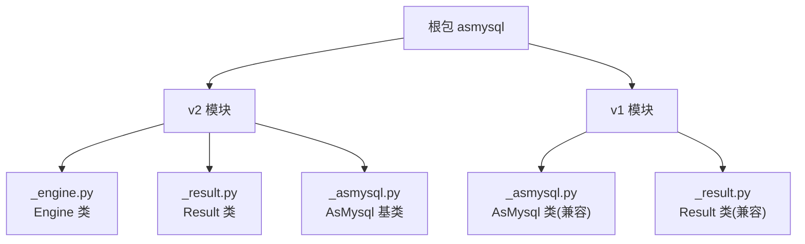
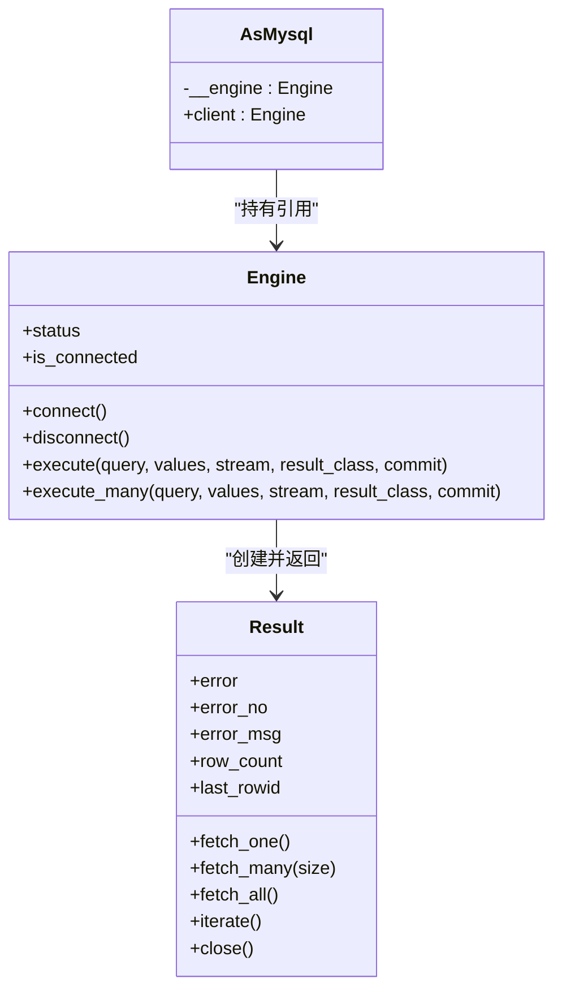
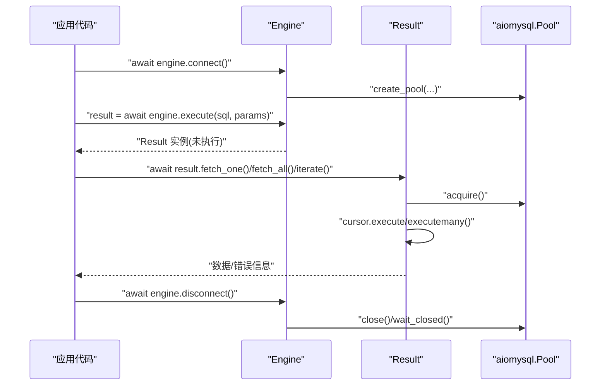
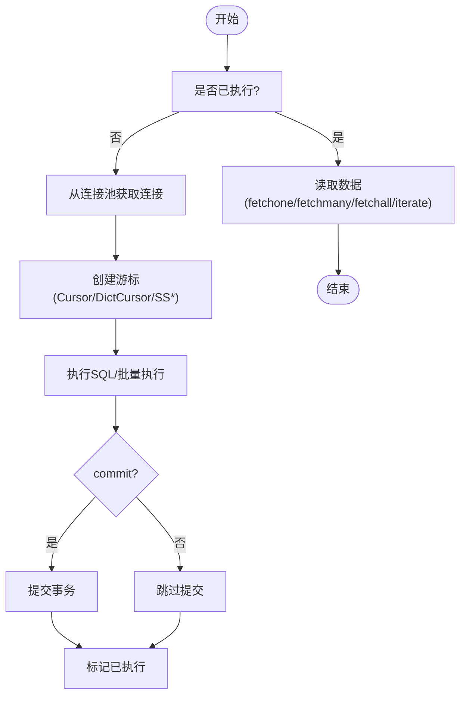
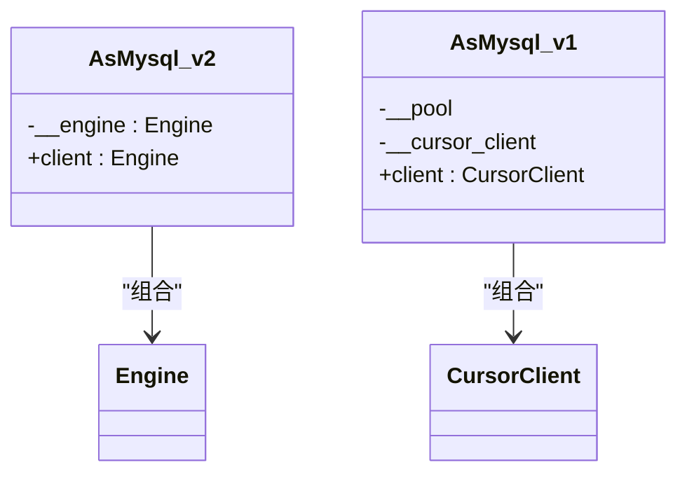
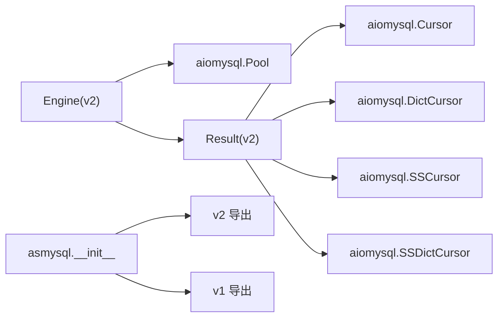

# 基础使用示例

<cite>
**本文引用的文件**   
- [README.md](file://README.md)
- [asmysql/__init__.py](file://asmysql/__init__.py)
- [asmysql/v2/__init__.py](file://asmysql/v2/__init__.py)
- [asmysql/v1/__init__.py](file://asmysql/v1/__init__.py)
- [asmysql/v2/_engine.py](file://asmysql/v2/_engine.py)
- [asmysql/v2/_result.py](file://asmysql/v2/_result.py)
- [asmysql/v2/_asmysql.py](file://asmysql/v2/_asmysql.py)
- [asmysql/v1/_asmysql.py](file://asmysql/v1/_asmysql.py)
- [asmysql/v1/_result.py](file://asmysql/v1/_result.py)
- [mkdocs/v2/docs/en/examples.md](file://mkdocs/v2/docs/en/examples.md)
</cite>

## 目录
1. [简介](#简介)
2. [项目结构](#项目结构)
3. [核心组件](#核心组件)
4. [架构总览](#架构总览)
5. [详细组件分析](#详细组件分析)
6. [依赖关系分析](#依赖关系分析)
7. [性能与内存特性](#性能与内存特性)
8. [故障排查指南](#故障排查指南)
9. [结论](#结论)
10. [附录：快速上手示例对照](#附录快速上手示例对照)

## 简介
本章节面向初学者，提供 asmysql 的基础使用示例文档。内容涵盖：
- 最简单的数据库连接
- 基本查询操作（单条、多条）
- INSERT、UPDATE、DELETE 等 CRUD 操作
- Engine 与 AsMysql 两种使用方式的对比
- 错误处理与异常捕获的基础模式
- 每个示例均配有详细注释说明与预期输出结果

为便于理解，文档同时给出 v2 的 Engine/AsMysql 方式与 v1 的兼容方式，帮助从旧版本平滑迁移或选择合适的使用风格。

## 项目结构
仓库采用多版本并存的结构，v2 是推荐的主流用法，v1 保留兼容性。顶层入口将 v2 的核心类型统一导出，方便直接 import。

图示来源
- [asmysql/__init__.py:1-16](file://asmysql/__init__.py#L1-L16)
- [asmysql/v2/__init__.py:1-15](file://asmysql/v2/__init__.py#L1-L15)
- [asmysql/v1/__init__.py:1-8](file://asmysql/v1/__init__.py#L1-L8)

章节来源
- [asmysql/__init__.py:1-16](file://asmysql/__init__.py#L1-L16)
- [asmysql/v2/__init__.py:1-15](file://asmysql/v2/__init__.py#L1-L15)
- [asmysql/v1/__init__.py:1-8](file://asmysql/v1/__init__.py#L1-L8)

## 核心组件
- Engine（v2）：异步 MySQL 连接池封装，负责连接管理、SQL 执行与批量执行，返回 Result 对象。
- Result（v2）：封装游标与结果集，支持 fetch_one/fetch_many/fetch_all/iterate，以及流式查询与自定义结果类型。
- AsMysql（v2）：业务逻辑基类，持有 Engine 引用，通过 self.client 访问 Engine。
- v1 兼容层：AsMysql 与 Result 的旧版实现，保持向后兼容。

章节来源
- [asmysql/v2/_engine.py:37-112](file://asmysql/v2/_engine.py#L37-L112)
- [asmysql/v2/_result.py:21-44](file://asmysql/v2/_result.py#L21-L44)
- [asmysql/v2/_asmysql.py:7-26](file://asmysql/v2/_asmysql.py#L7-L26)
- [asmysql/v1/_asmysql.py:11-58](file://asmysql/v1/_asmysql.py#L11-L58)
- [asmysql/v1/_result.py:10-18](file://asmysql/v1/_result.py#L10-L18)

## 架构总览
下图展示了 v2 中 Engine 与 Result 的交互流程，以及 AsMysql 如何委托给 Engine 完成 SQL 执行。

图示来源
- [asmysql/v2/_engine.py:226-259](file://asmysql/v2/_engine.py#L226-L259)
- [asmysql/v2/_result.py:21-44](file://asmysql/v2/_result.py#L21-L44)
- [asmysql/v2/_asmysql.py:7-26](file://asmysql/v2/_asmysql.py#L7-L26)

## 详细组件分析

### 组件一：Engine（v2）
- 功能要点
  - 支持 URL 参数解析与显式参数初始化
  - 自动创建与管理 aiomysql 连接池
  - execute/execute_many 返回 Result，支持上下文管理器与异步迭代
  - 支持流式查询与自定义结果类型（tuple/dict/自定义类）
- 关键方法
  - connect/disconnect：连接池生命周期管理
  - execute/execute_many：构造 Result 并延迟执行
  - status/is_connected：连接状态与池信息

图示来源
- [asmysql/v2/_engine.py:131-151](file://asmysql/v2/_engine.py#L131-L151)
- [asmysql/v2/_engine.py:226-259](file://asmysql/v2/_engine.py#L226-L259)
- [asmysql/v2/_result.py:101-125](file://asmysql/v2/_result.py#L101-L125)

章节来源
- [asmysql/v2/_engine.py:37-112](file://asmysql/v2/_engine.py#L37-L112)
- [asmysql/v2/_engine.py:226-259](file://asmysql/v2/_engine.py#L226-L259)
- [asmysql/v2/_engine.py:283-316](file://asmysql/v2/_engine.py#L283-L316)

### 组件二：Result（v2）
- 功能要点
  - 延迟执行：在首次调用 fetch_* 或迭代时执行 SQL
  - 错误封装：error/error_no/error_msg 统一错误访问
  - 结果类型：支持 tuple/dict/自定义类（通过 **data 构造）
  - 流式查询：stream=True 时使用 SSCursor/SSDictCursor，避免一次性加载全部数据
- 关键方法
  - fetch_one/fetch_many/fetch_all/iterate
  - close/__aenter__/__aexit__/__aiter__/__anext__

图示来源
- [asmysql/v2/_result.py:101-125](file://asmysql/v2/_result.py#L101-L125)
- [asmysql/v2/_result.py:186-208](file://asmysql/v2/_result.py#L186-L208)
- [asmysql/v2/_result.py:210-234](file://asmysql/v2/_result.py#L210-L234)
- [asmysql/v2/_result.py:236-249](file://asmysql/v2/_result.py#L236-L249)
- [asmysql/v2/_result.py:251-273](file://asmysql/v2/_result.py#L251-L273)

章节来源
- [asmysql/v2/_result.py:21-44](file://asmysql/v2/_result.py#L21-L44)
- [asmysql/v2/_result.py:101-125](file://asmysql/v2/_result.py#L101-L125)
- [asmysql/v2/_result.py:186-208](file://asmysql/v2/_result.py#L186-L208)
- [asmysql/v2/_result.py:210-234](file://asmysql/v2/_result.py#L210-L234)
- [asmysql/v2/_result.py:236-249](file://asmysql/v2/_result.py#L236-L249)
- [asmysql/v2/_result.py:251-273](file://asmysql/v2/_result.py#L251-L273)

### 组件三：AsMysql（v2 与 v1 对比）
- v2 AsMysql
  - 仅作为业务类容器，持有 Engine 引用，通过 self.client 访问 Engine
  - 适合将业务方法与数据库访问解耦
- v1 AsMysql
  - 自身即连接与客户端封装，内部维护 CursorClient
  - 通过 self.client 访问底层执行器

图示来源
- [asmysql/v2/_asmysql.py:7-26](file://asmysql/v2/_asmysql.py#L7-L26)
- [asmysql/v1/_asmysql.py:11-58](file://asmysql/v1/_asmysql.py#L11-L58)

章节来源
- [asmysql/v2/_asmysql.py:7-26](file://asmysql/v2/_asmysql.py#L7-L26)
- [asmysql/v1/_asmysql.py:11-58](file://asmysql/v1/_asmysql.py#L11-L58)

## 依赖关系分析
- Engine 依赖 aiomysql 的连接池与 pymysql 的错误类型
- Result 依赖 aiomysql 的多种游标类型（普通、字典、流式）
- v2 入口将 Engine/AsMysql/Result 统一暴露，v1 单独导出兼容接口

图示来源
- [asmysql/v2/_engine.py:17-21](file://asmysql/v2/_engine.py#L17-21)
- [asmysql/v2/_result.py:1-6](file://asmysql/v2/_result.py#L1-6)
- [asmysql/__init__.py:1-16](file://asmysql/__init__.py#L1-L16)
- [asmysql/v2/__init__.py:1-15](file://asmysql/v2/__init__.py#L1-L15)
- [asmysql/v1/__init__.py:1-8](file://asmysql/v1/__init__.py#L1-L8)

章节来源
- [asmysql/v2/_engine.py:17-21](file://asmysql/v2/_engine.py#L17-21)
- [asmysql/v2/_result.py:1-6](file://asmysql/v2/_result.py#L1-6)
- [asmysql/__init__.py:1-16](file://asmysql/__init__.py#L1-L16)
- [asmysql/v2/__init__.py:1-15](file://asmysql/v2/__init__.py#L1-L15)
- [asmysql/v1/__init__.py:1-8](file://asmysql/v1/__init__.py#L1-L8)

## 性能与内存特性
- 流式查询：当启用 stream=True 时，Result 使用 SSCursor/SSDictCursor，逐行拉取数据，避免一次性加载到内存，适合大数据集处理。
- 结果类型转换：当 result_class 为自定义类时，Result 会基于列名以 **data 的方式构造实例，注意字段映射一致性。
- 连接池：Engine 默认最小/最大连接数可配置，建议根据并发与资源合理设置。

章节来源
- [asmysql/v2/_result.py:10-18](file://asmysql/v2/_result.py#L10-18)
- [asmysql/v2/_result.py:251-273](file://asmysql/v2/_result.py#L251-L273)
- [asmysql/v2/_engine.py:46-53](file://asmysql/v2/_engine.py#L46-L53)

## 故障排查指南
- 常见错误访问
  - 使用 result.error/result.error_no/result.error_msg 判断与获取错误信息
- 连接问题
  - 检查 is_connected 与 status 中的 pool_size/pool_free/pool_used
- 事务控制
  - 可通过 auto_commit=False 与 execute(commit=...) 精细控制提交时机

章节来源
- [asmysql/v2/_result.py:133-151](file://asmysql/v2/_result.py#L133-L151)
- [asmysql/v2/_engine.py:154-166](file://asmysql/v2/_engine.py#L154-L166)
- [asmysql/v2/_engine.py:226-259](file://asmysql/v2/_engine.py#L226-L259)

## 结论
- v2 推荐使用 Engine + AsMysql 的组合：Engine 专注连接与执行，AsMysql 专注业务组织，Result 统一结果与错误处理。
- v1 仍可用于兼容旧代码，但建议逐步迁移至 v2 以获得更好的类型提示与扩展能力。
- 对于大数据量场景，优先使用流式查询；对复杂业务，结合自定义结果类型提升可读性与健壮性。

## 附录：快速上手示例对照

以下示例覆盖最基础的连接、查询、CRUD 与错误处理，并提供 v2 与 v1 的对比路径。为避免泄露具体代码，示例均以“代码片段路径”形式给出，读者可直接跳转查看完整实现。

- 最简单的数据库连接（v2）
  - 参考路径：[mkdocs/v2/docs/en/examples.md:25-45](file://mkdocs/v2/docs/en/examples.md#L25-L45)
  - 关键点：创建 Engine(url=...)，await engine.connect()，执行后 disconnect()
  - 预期输出：打印单行元组结果，如 (1,)

- 使用上下文管理器连接（v2）
  - 参考路径：[mkdocs/v2/docs/en/examples.md:47-62](file://mkdocs/v2/docs/en/examples.md#L47-L62)
  - 关键点：async with engine: 自动管理连接生命周期
  - 预期输出：打印单行元组结果

- 单条记录查询（v2）
  - 参考路径：[mkdocs/v2/docs/en/examples.md:109-141](file://mkdocs/v2/docs/en/examples.md#L109-L141)
  - 关键点：fetch_one()，支持 dict 类型结果
  - 预期输出：按字段顺序或键值打印用户信息

- 多条记录查询（v2）
  - 参考路径：[mkdocs/v2/docs/en/examples.md:143-166](file://mkdocs/v2/docs/en/examples.md#L143-L166)
  - 关键点：fetch_all()/fetch_many(n)
  - 预期输出：打印记录总数与部分记录

- 字典参数查询（v2）
  - 参考路径：[mkdocs/v2/docs/en/examples.md:168-188](file://mkdocs/v2/docs/en/examples.md#L168-L188)
  - 关键点：%(name)s/%(age)s 占位符与 dict 参数
  - 预期输出：打印匹配的用户列表

- 迭代遍历结果（v2）
  - 参考路径：[mkdocs/v2/docs/en/examples.md:190-217](file://mkdocs/v2/docs/en/examples.md#L190-L217)
  - 关键点：result.iterate() 或直接 async for result
  - 预期输出：逐行打印用户信息

- 插入单条记录（v2）
  - 参考路径：[mkdocs/v2/docs/en/examples.md:221-246](file://mkdocs/v2/docs/en/examples.md#L221-L246)
  - 关键点：INSERT 语句，result.row_count/last_rowid
  - 预期输出：成功则打印受影响行数与新 ID

- 更新单条记录（v2）
  - 参考路径：[mkdocs/v2/docs/en/examples.md:274-297](file://mkdocs/v2/docs/en/examples.md#L274-L297)
  - 关键点：UPDATE 语句，result.row_count
  - 预期输出：成功则打印受影响行数

- 删除记录（v2）
  - 参考路径：[mkdocs/v2/docs/en/examples.md:331-354](file://mkdocs/v2/docs/en/examples.md#L331-L354)
  - 关键点：DELETE 语句，result.row_count
  - 预期输出：成功则打印受影响行数

- 错误处理基础模式（v2）
  - 参考路径：[mkdocs/v2/docs/en/examples.md:621-644](file://mkdocs/v2/docs/en/examples.md#L621-L644)
  - 关键点：result.error/result.error_no/result.error_msg
  - 预期输出：打印错误码与错误消息

- v1 兼容方式（AsMysql 继承）
  - 参考路径：[README.md:98-134](file://README.md#L98-L134)
  - 关键点：继承 v1.AsMysql，self.client.execute(...)，result.err/err_msg
  - 预期输出：打印用户列表或错误信息

- v2 使用 AsMysql 进行业务封装
  - 参考路径：[README.md:65-96](file://README.md#L65-L96)
  - 关键点：定义业务类继承 AsMysql，通过 self.client 访问 Engine
  - 预期输出：打印用户列表

- 流式查询（大数据集）
  - 参考路径：[mkdocs/v2/docs/en/examples.md:406-442](file://mkdocs/v2/docs/en/examples.md#L406-L442)
  - 关键点：stream=True，逐行处理不占用大量内存
  - 预期输出：每处理一定数量打印进度，最终打印总数

- 批量插入（execute_many）
  - 参考路径：[mkdocs/v2/docs/en/examples.md:473-505](file://mkdocs/v2/docs/en/examples.md#L473-L505)
  - 关键点：execute_many 传入多组参数
  - 预期输出：打印成功插入的记录数

- 自定义模型（Pydantic/Plain Class）
  - 参考路径：[mkdocs/v2/docs/en/examples.md:537-617](file://mkdocs/v2/docs/en/examples.md#L537-L617)
  - 关键点：result_class=自定义类，自动以列名构造实例
  - 预期输出：打印模型实例属性

- Web 应用集成（FastAPI 示例）
  - 参考路径：[mkdocs/v2/docs/en/examples.md:810-880](file://mkdocs/v2/docs/en/examples.md#L810-L880)
  - 关键点：全局 Engine，lifespan 管理连接，服务类封装业务
  - 预期输出：HTTP 响应包含用户数据

- 命令行工具示例
  - 参考路径：[mkdocs/v2/docs/en/examples.md:882-958](file://mkdocs/v2/docs/en/examples.md#L882-L958)
  - 关键点：argparse 子命令，动态选择数据库，CLI 调用服务方法
  - 预期输出：列出用户或添加用户后的反馈

章节来源
- [mkdocs/v2/docs/en/examples.md:25-45](file://mkdocs/v2/docs/en/examples.md#L25-L45)
- [mkdocs/v2/docs/en/examples.md:47-62](file://mkdocs/v2/docs/en/examples.md#L47-L62)
- [mkdocs/v2/docs/en/examples.md:109-141](file://mkdocs/v2/docs/en/examples.md#L109-L141)
- [mkdocs/v2/docs/en/examples.md:143-166](file://mkdocs/v2/docs/en/examples.md#L143-L166)
- [mkdocs/v2/docs/en/examples.md:168-188](file://mkdocs/v2/docs/en/examples.md#L168-L188)
- [mkdocs/v2/docs/en/examples.md:190-217](file://mkdocs/v2/docs/en/examples.md#L190-L217)
- [mkdocs/v2/docs/en/examples.md:221-246](file://mkdocs/v2/docs/en/examples.md#L221-L246)
- [mkdocs/v2/docs/en/examples.md:274-297](file://mkdocs/v2/docs/en/examples.md#L274-L297)
- [mkdocs/v2/docs/en/examples.md:331-354](file://mkdocs/v2/docs/en/examples.md#L331-L354)
- [mkdocs/v2/docs/en/examples.md:406-442](file://mkdocs/v2/docs/en/examples.md#L406-L442)
- [mkdocs/v2/docs/en/examples.md:473-505](file://mkdocs/v2/docs/en/examples.md#L473-L505)
- [mkdocs/v2/docs/en/examples.md:537-617](file://mkdocs/v2/docs/en/examples.md#L537-L617)
- [mkdocs/v2/docs/en/examples.md:621-644](file://mkdocs/v2/docs/en/examples.md#L621-L644)
- [mkdocs/v2/docs/en/examples.md:810-880](file://mkdocs/v2/docs/en/examples.md#L810-L880)
- [mkdocs/v2/docs/en/examples.md:882-958](file://mkdocs/v2/docs/en/examples.md#L882-L958)
- [README.md:65-96](file://README.md#L65-L96)
- [README.md:98-134](file://README.md#L98-L134)