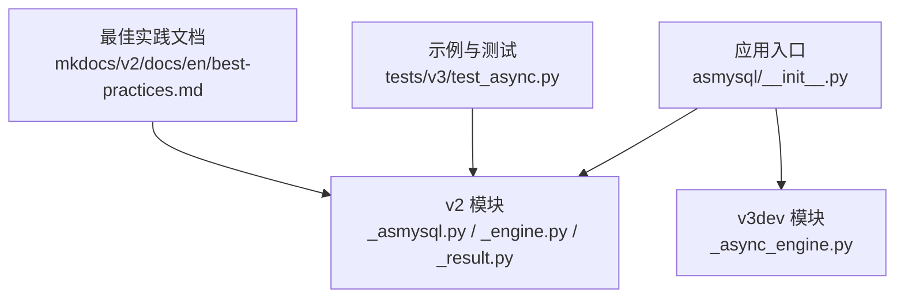
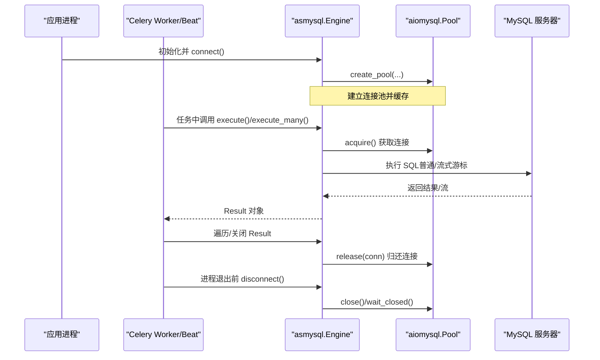
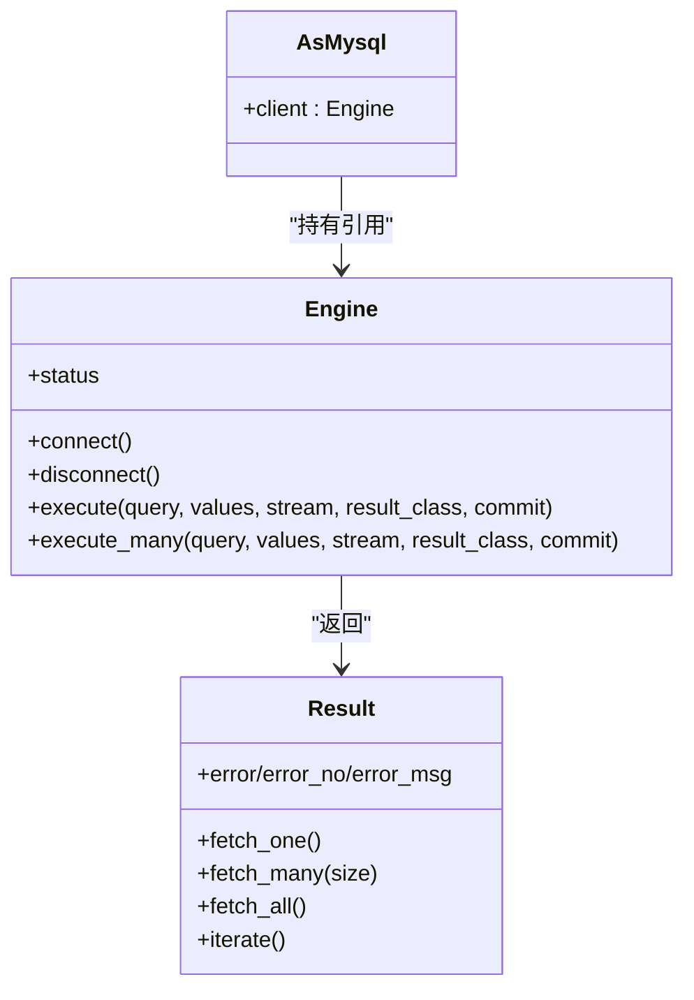

# Celery 任务队列集成

<cite>
**本文引用的文件**   
- [README.md](file://README.md)
- [asmysql/__init__.py](file://asmysql/__init__.py)
- [asmysql/v2/_asmysql.py](file://asmysql/v2/_asmysql.py)
- [asmysql/v2/_engine.py](file://asmysql/v2/_engine.py)
- [asmysql/v2/_result.py](file://asmysql/v2/_result.py)
- [asmysql/v3dev/_async_engine.py](file://asmysql/v3dev/_async_engine.py)
- [tests/v3/test_async.py](file://tests/v3/test_async.py)
- [mkdocs/v2/docs/en/best-practices.md](file://mkdocs/v2/docs/en/best-practices.md)
</cite>

## 目录
1. [简介](#简介)
2. [项目结构](#项目结构)
3. [核心组件](#核心组件)
4. [架构总览](#架构总览)
5. [详细组件分析](#详细组件分析)
6. [依赖关系分析](#依赖关系分析)
7. [性能与内存优化](#性能与内存优化)
8. [Celery 集成指南](#celery-集成指南)
9. [故障排查](#故障排查)
10. [结论](#结论)

## 简介
本文件面向在 Celery 异步任务队列中集成 asmysql 的开发者，重点说明：
- 如何在 Celery Worker 和 Beat 中使用 asmysql 进行后台数据处理
- 连接池隔离、事务与错误处理
- 大数据量流式查询避免内存溢出
- 监控、性能调优与生产部署最佳实践

asmysql 是基于 aiomysql 的异步 MySQL 客户端/连接池封装，提供 Engine/AsMysql/Result 等核心对象，支持流式结果集、上下文管理、类型提示与高并发场景。

## 项目结构
仓库包含多版本实现与文档、测试用例。与 Celery 集成主要使用 v2（稳定）或 v3dev（演进版）中的异步引擎与结果集对象。

图表来源
- [asmysql/__init__.py:1-16](file://asmysql/__init__.py#L1-L16)
- [asmysql/v2/_asmysql.py:1-26](file://asmysql/v2/_asmysql.py#L1-L26)
- [asmysql/v2/_engine.py:1-317](file://asmysql/v2/_engine.py#L1-L317)
- [asmysql/v2/_result.py:1-273](file://asmysql/v2/_result.py#L1-L273)
- [asmysql/v3dev/_async_engine.py:1-307](file://asmysql/v3dev/_async_engine.py#L1-L307)
- [tests/v3/test_async.py:1-108](file://tests/v3/test_async.py#L1-L108)
- [mkdocs/v2/docs/en/best-practices.md:1-141](file://mkdocs/v2/docs/en/best-practices.md#L1-L141)

章节来源
- [README.md:1-135](file://README.md#L1-L135)
- [asmysql/__init__.py:1-16](file://asmysql/__init__.py#L1-L16)

## 核心组件
- AsMysql：业务逻辑类，持有 Engine 引用，便于组织数据库访问代码。
- Engine：异步连接池封装，负责创建/释放连接池、执行 SQL、返回 Result。
- Result：封装游标与结果集，支持 fetch_one/fetch_many/fetch_all/iterate，以及 async for 迭代。

关键要点
- Engine 通过 aiomysql.create_pool 管理底层连接池，暴露 execute/execute_many。
- Result 内部选择普通或流式游标（SSCursor/SSDictCursor），以支持大结果集流式读取。
- 支持上下文管理器与异步迭代器，自动管理连接生命周期。

章节来源
- [asmysql/v2/_asmysql.py:1-26](file://asmysql/v2/_asmysql.py#L1-L26)
- [asmysql/v2/_engine.py:1-317](file://asmysql/v2/_engine.py#L1-L317)
- [asmysql/v2/_result.py:1-273](file://asmysql/v2/_result.py#L1-L273)

## 架构总览
下图展示 Celery Worker 与 asmysql 的交互流程：Worker 进程启动时初始化 Engine 并建立连接池；每个任务在执行时复用该连接池；Result 负责获取/释放连接与游标；Beat 定时任务同样复用同一 Engine。

图表来源
- [asmysql/v2/_engine.py:120-183](file://asmysql/v2/_engine.py#L120-L183)
- [asmysql/v2/_result.py:101-126](file://asmysql/v2/_result.py#L101-L126)
- [asmysql/v2/_result.py:251-273](file://asmysql/v2/_result.py#L251-L273)

## 详细组件分析

### Engine（连接池与执行入口）
- 职责：解析 URL/参数、创建/关闭连接池、暴露 execute/execute_many、状态查询。
- 关键点：
  - connect/disconnect 控制池生命周期。
  - status 属性可观测池大小、空闲/占用情况，便于监控。
  - execute/execute_many 返回 Result，由 Result 负责具体执行与资源回收。

章节来源
- [asmysql/v2/_engine.py:120-183](file://asmysql/v2/_engine.py#L120-L183)
- [asmysql/v2/_engine.py:226-317](file://asmysql/v2/_engine.py#L226-L317)

### Result（结果集与流式读取）
- 职责：封装游标、执行 SQL、错误信息、行计数、流式迭代。
- 关键点：
  - 根据 stream/result_class 选择 SSCursor/SSDictCursor 或普通 Cursor/DictCursor。
  - 支持 async with 与 async for，自动关闭游标与归还连接。
  - iterate() 为异步生成器，适合大数据量逐条处理。

章节来源
- [asmysql/v2/_result.py:10-19](file://asmysql/v2/_result.py#L10-L19)
- [asmysql/v2/_result.py:101-126](file://asmysql/v2/_result.py#L101-L126)
- [asmysql/v2/_result.py:251-273](file://asmysql/v2/_result.py#L251-L273)

### AsMysql（业务逻辑封装）
- 职责：持有 Engine 引用，对外暴露 client 属性供业务方法使用。
- 适用场景：将数据库访问逻辑按领域/服务拆分到独立类中，便于测试与复用。

章节来源
- [asmysql/v2/_asmysql.py:1-26](file://asmysql/v2/_asmysql.py#L1-L26)

## 依赖关系分析
- Engine 依赖 aiomysql.Pool 与 pymysql.err.MySQLError。
- Result 依赖 aiomysql.Cursor/SSCursor 等，并在异常路径确保释放连接。
- AsMysql 仅依赖 Engine，耦合度低，利于替换与扩展。

图表来源
- [asmysql/v2/_engine.py:226-317](file://asmysql/v2/_engine.py#L226-L317)
- [asmysql/v2/_result.py:186-273](file://asmysql/v2/_result.py#L186-L273)
- [asmysql/v2/_asmysql.py:1-26](file://asmysql/v2/_asmysql.py#L1-L26)

## 性能与内存优化
- 流式查询：对大结果集使用 stream=True 与 iterate()/async for，避免一次性加载导致内存暴涨。
- 连接池配置：根据并发与数据库能力设置 min_pool_size/max_pool_size/pool_recycle/connect_timeout。
- 参数化查询：防止 SQL 注入并提升执行计划稳定性。
- 监控：利用 Engine.status 观察池大小与占用，结合日志与指标系统。

章节来源
- [mkdocs/v2/docs/en/best-practices.md:89-141](file://mkdocs/v2/docs/en/best-practices.md#L89-L141)
- [asmysql/v2/_engine.py:144-166](file://asmysql/v2/_engine.py#L144-L166)

## Celery 集成指南

### 1. 在 Worker 中初始化与共享 Engine
- 建议：在 Worker 进程启动时创建 Engine 并 connect()，将其作为全局单例或通过依赖注入传递给各任务。
- 原因：避免每个任务重复创建连接池，减少开销；同时保证连接池在进程内共享。

参考模式
- 进程启动阶段：创建 Engine -> connect()
- 任务函数：直接调用 engine.execute()/execute_many()，并使用 async with 或 async for 自动管理资源

章节来源
- [asmysql/v2/_engine.py:120-183](file://asmysql/v2/_engine.py#L120-L183)
- [asmysql/v2/_result.py:71-84](file://asmysql/v2/_result.py#L71-L84)

### 2. 任务中的异步数据库操作
- 推荐用法：
  - 使用 async with engine.execute(...) as result 或 async for item in engine.execute(...) 自动管理连接与游标。
  - 对于大数据量，务必开启 stream=True 并使用 iterate()/async for 逐条处理。
- 错误处理：
  - 检查 result.error/error_no/error_msg，记录日志并根据需要重试或告警。

章节来源
- [asmysql/v2/_result.py:101-126](file://asmysql/v2/_result.py#L101-L126)
- [asmysql/v2/_result.py:133-151](file://asmysql/v2/_result.py#L133-L151)

### 3. 连接池隔离策略
- 进程级隔离：每个 Celery Worker 进程拥有独立的 Engine 实例与连接池，天然隔离。
- 跨进程共享：不要在不同进程间共享同一个 Engine 实例；如需跨进程，应各自初始化。
- 子进程/线程：Celery 默认以进程模型运行任务，无需额外线程隔离；若使用多线程 Worker，需评估连接池并发安全。

章节来源
- [asmysql/v2/_engine.py:120-183](file://asmysql/v2/_engine.py#L120-L183)

### 4. 错误与重试机制
- 基础策略：
  - 捕获 MySQLError 或检查 result.error，区分可重试（如网络抖动、锁等待超时）与不可重试（如权限、语法错误）。
  - 对可重试错误使用指数退避重试；对不可重试错误快速失败并告警。
- 事务一致性：
  - 若涉及多条写入，建议在任务内显式管理事务（例如使用 autocommit=False 配合手动提交/回滚），或在更上层封装事务边界。
- 幂等性：
  - 对批量写入/更新任务设计幂等键，避免重试导致数据重复。

章节来源
- [asmysql/v2/_engine.py:149-151](file://asmysql/v2/_engine.py#L149-L151)
- [asmysql/v2/_result.py:119-125](file://asmysql/v2/_result.py#L119-L125)

### 5. Celery Beat 定时任务与 asmysql
- 在 Beat 任务中复用同一 Engine 实例，按需执行统计、清理、报表等定时任务。
- 注意：
  - 定时任务可能产生长事务或大批量读取，建议使用流式查询与分批提交。
  - 合理设置 pool_recycle 以避免长时间运行的连接被数据库侧回收。

章节来源
- [asmysql/v2/_engine.py:120-183](file://asmysql/v2/_engine.py#L120-L183)

### 6. 大数据量处理的流式查询模式
- 模式一：async for item in engine.execute(..., stream=True)
- 模式二：result = await engine.execute(..., stream=True); async for item in result.iterate()
- 模式三：分片/分页拉取，结合业务窗口（时间范围、主键区间）降低单次扫描量

章节来源
- [tests/v3/test_async.py:49-89](file://tests/v3/test_async.py#L49-L89)
- [asmysql/v2/_result.py:251-273](file://asmysql/v2/_result.py#L251-L273)

### 7. 任务监控与可观测性
- 连接池状态：定期采集 Engine.status，记录池大小、空闲/占用数，发现连接泄漏或瓶颈。
- 慢查询与 SQL 日志：启用 echo_sql_log 辅助定位问题（生产谨慎开启）。
- 指标上报：将任务耗时、错误率、行数处理量等指标上报至监控系统。

章节来源
- [asmysql/v2/_engine.py:144-166](file://asmysql/v2/_engine.py#L144-L166)

### 8. 生产环境部署最佳实践
- 连接池规模：依据并发与数据库容量设定 min_pool_size/max_pool_size，避免过大导致数据库压力。
- 超时与回收：设置 connect_timeout 与 pool_recycle，避免僵尸连接。
- 资源清理：确保进程退出前调用 disconnect()，避免连接未释放。
- 安全与合规：使用参数化查询，最小权限账户，敏感配置外置。

章节来源
- [mkdocs/v2/docs/en/best-practices.md:124-141](file://mkdocs/v2/docs/en/best-practices.md#L124-L141)
- [asmysql/v2/_engine.py:167-183](file://asmysql/v2/_engine.py#L167-L183)

## 故障排查
- 症状：连接耗尽或阻塞
  - 排查：查看 Engine.status 的 pool_size/pool_free/pool_used；确认是否忘记关闭 Result 或未使用上下文/迭代器。
- 症状：内存飙升
  - 排查：是否使用了 fetch_all() 而非流式读取；是否未开启 stream=True。
- 症状：偶发连接断开
  - 排查：检查 pool_recycle 与数据库侧 wait_timeout；必要时调整或启用重连。
- 症状：SQL 注入风险
  - 排查：是否拼接字符串构造 SQL；改为参数化查询。

章节来源
- [asmysql/v2/_result.py:236-249](file://asmysql/v2/_result.py#L236-L249)
- [mkdocs/v2/docs/en/best-practices.md:89-123](file://mkdocs/v2/docs/en/best-practices.md#L89-L123)

## 结论
- 在 Celery 中集成 asmysql 的关键在于：进程级共享 Engine 与连接池、正确使用 Result 的上下文/迭代器、针对大数据量采用流式查询、完善错误与重试策略、并通过 Engine.status 做好监控。
- 遵循最佳实践可有效避免连接泄漏、内存溢出与性能瓶颈，保障生产环境的稳定性与可扩展性。