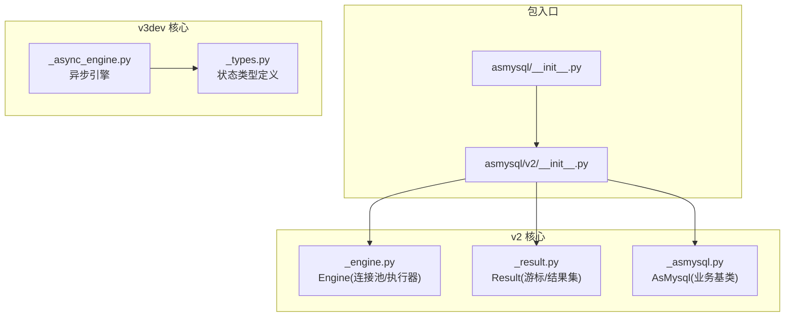
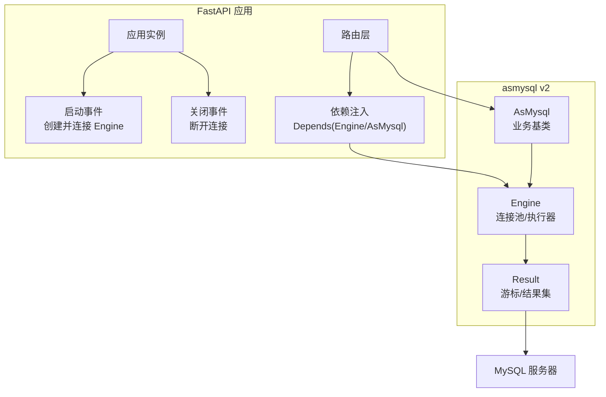
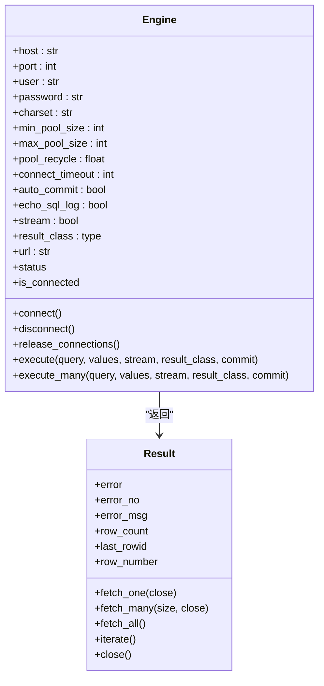
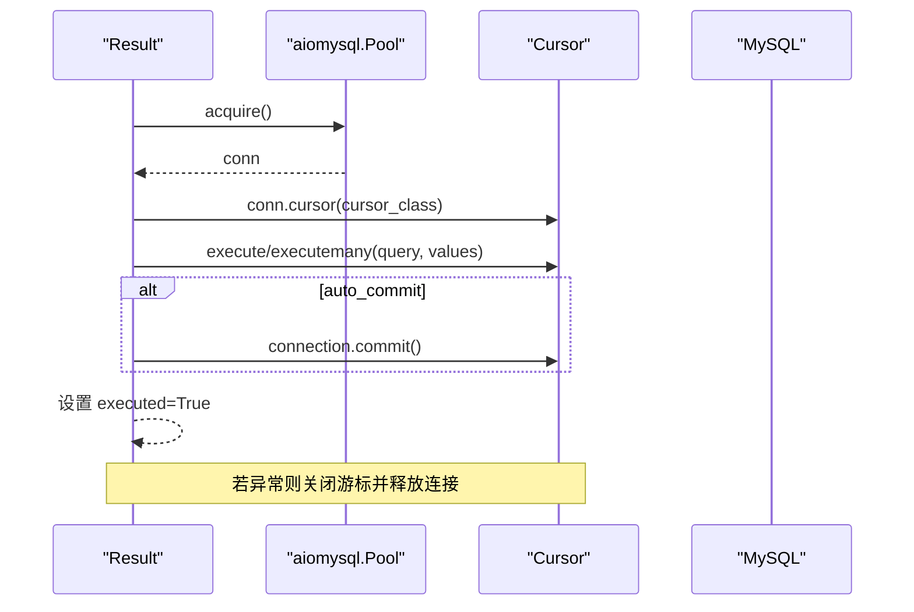
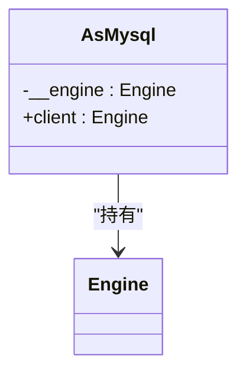
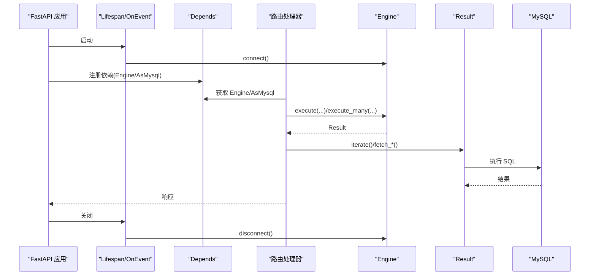
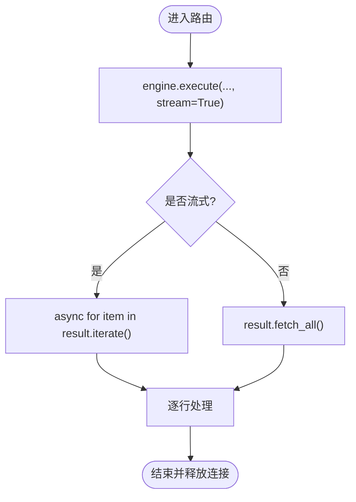
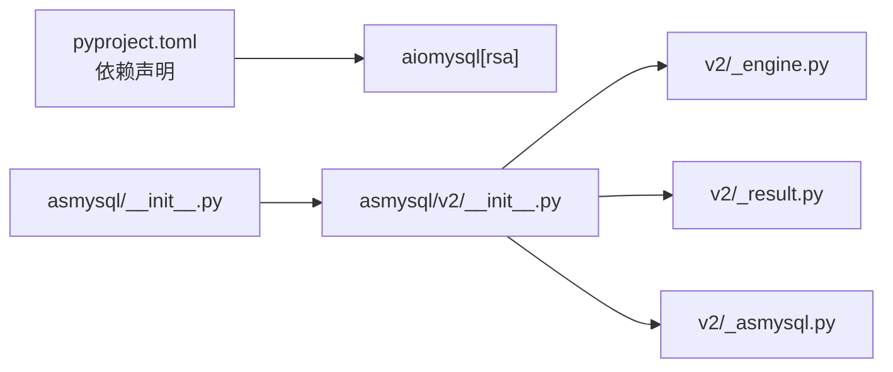

# FastAPI 集成

<cite>
**本文引用的文件**   
- [README.md](file://README.md)
- [pyproject.toml](file://pyproject.toml)
- [asmysql/__init__.py](file://asmysql/__init__.py)
- [asmysql/v2/__init__.py](file://asmysql/v2/__init__.py)
- [asmysql/v2/_engine.py](file://asmysql/v2/_engine.py)
- [asmysql/v2/_result.py](file://asmysql/v2/_result.py)
- [asmysql/v2/_asmysql.py](file://asmysql/v2/_asmysql.py)
- [asmysql/v3dev/_async_engine.py](file://asmysql/v3dev/_async_engine.py)
- [asmysql/v3dev/_types.py](file://asmysql/v3dev/_types.py)
- [tests/v2/v2_start.py](file://tests/v2/v2_start.py)
- [mkdocs/v2/docs/en/examples.md](file://mkdocs/v2/docs/en/examples.md)
- [mkdocs/v2/docs/en/best-practices.md](file://mkdocs/v2/docs/en/best-practices.md)
</cite>

## 目录
1. [简介](#简介)
2. [项目结构](#项目结构)
3. [核心组件](#核心组件)
4. [架构总览](#架构总览)
5. [详细组件分析](#详细组件分析)
6. [依赖关系分析](#依赖关系分析)
7. [性能考虑](#性能考虑)
8. [故障排查指南](#故障排查指南)
9. [结论](#结论)
10. [附录](#附录)

## 简介
本文件面向在 FastAPI 异步应用中集成 asmysql 的开发者，系统讲解如何在 FastAPI 中正确配置与使用 asmysql，包括：
- 连接池配置与生命周期管理（应用启动/关闭）
- 依赖注入模式（FastAPI Depends）
- 并发请求下的连接管理与资源释放
- 在异步上下文中正确使用 await 与 async for
- 错误处理、日志记录与中间件编写建议
- 性能优化与最佳实践

asmysql v2 基于 aiomysql 提供异步 MySQL 客户端与连接池封装，支持流式结果、批量执行、自定义结果类型等特性。v3dev 分支提供了更清晰的异步/同步分离实现，可作为后续演进参考。

## 项目结构
仓库采用多版本共存策略：
- asmysql/v2：当前稳定版，对外暴露 Engine、AsMysql、Result 等核心类
- asmysql/v3dev：开发中的异步/同步双引擎版本，便于未来迁移
- tests/mkdocs：测试用例与文档示例，展示典型用法与最佳实践

图示来源
- [asmysql/__init__.py:1-16](file://asmysql/__init__.py#L1-L16)
- [asmysql/v2/__init__.py:1-15](file://asmysql/v2/__init__.py#L1-L15)
- [asmysql/v2/_engine.py:1-317](file://asmysql/v2/_engine.py#L1-L317)
- [asmysql/v2/_result.py:1-273](file://asmysql/v2/_result.py#L1-L273)
- [asmysql/v2/_asmysql.py:1-26](file://asmysql/v2/_asmysql.py#L1-L26)
- [asmysql/v3dev/_async_engine.py:1-307](file://asmysql/v3dev/_async_engine.py#L1-L307)
- [asmysql/v3dev/_types.py:1-12](file://asmysql/v3dev/_types.py#L1-L12)

章节来源
- [README.md:1-135](file://README.md#L1-L135)
- [pyproject.toml:1-80](file://pyproject.toml#L1-L80)

## 核心组件
- Engine：封装 aiomysql 连接池，提供 connect/disconnect、execute/execute_many、状态查询等能力
- Result：封装游标与结果集，支持 fetch_one/fetch_many/fetch_all/iterate，以及上下文与迭代协议
- AsMysql：业务逻辑基类，持有 Engine 引用并通过 client 属性访问数据库

关键要点
- Engine 支持 URL 参数解析与连接池参数配置（最小/最大连接数、回收时间、超时、自动提交、SQL 回显等）
- Result 支持流式读取（stream=True），避免大结果集内存占用
- AsMysql 通过 lru_cache 缓存字符串表示，减少重复构造开销

章节来源
- [asmysql/v2/_engine.py:37-112](file://asmysql/v2/_engine.py#L37-L112)
- [asmysql/v2/_result.py:21-44](file://asmysql/v2/_result.py#L21-L44)
- [asmysql/v2/_asmysql.py:7-26](file://asmysql/v2/_asmysql.py#L7-L26)

## 架构总览
下图展示了 FastAPI 应用与 asmysql 的集成关系：应用启动时创建并连接 Engine，通过 FastAPI 依赖注入将 Engine 或 AsMysql 实例注入到路由；请求处理中使用 execute/iterate 进行异步查询；应用关闭时断开连接并清理池。

图示来源
- [asmysql/v2/_engine.py:131-151](file://asmysql/v2/_engine.py#L131-L151)
- [asmysql/v2/_engine.py:177-182](file://asmysql/v2/_engine.py#L177-L182)
- [asmysql/v2/_result.py:101-125](file://asmysql/v2/_result.py#L101-L125)

## 详细组件分析

### 组件一：Engine（连接池与执行器）
职责
- 解析连接 URL 与参数，初始化 aiomysql Pool
- 提供 connect/disconnect、release_connections、status/is_connected/pool 等能力
- 提供 execute/execute_many 返回 Result 对象，支持上下文与迭代协议

并发与生命周期
- connect 内部调用 create_pool，仅首次建立连接池
- disconnect 调用 pool.close() 与 wait_closed()，确保优雅退出
- release_connections 可主动清空空闲连接，适合健康检查或限流场景

执行流程
- execute/execute_many 返回 Result，实际执行在 Result.__call__ 中完成
- Result 内部从池获取连接、创建游标、执行 SQL、可选 commit、异常捕获与资源释放

图示来源
- [asmysql/v2/_engine.py:37-112](file://asmysql/v2/_engine.py#L37-L112)
- [asmysql/v2/_engine.py:131-151](file://asmysql/v2/_engine.py#L131-L151)
- [asmysql/v2/_engine.py:177-182](file://asmysql/v2/_engine.py#L177-L182)
- [asmysql/v2/_engine.py:227-259](file://asmysql/v2/_engine.py#L227-L259)
- [asmysql/v2/_engine.py:284-316](file://asmysql/v2/_engine.py#L284-L316)
- [asmysql/v2/_result.py:21-44](file://asmysql/v2/_result.py#L21-L44)
- [asmysql/v2/_result.py:186-273](file://asmysql/v2/_result.py#L186-L273)

章节来源
- [asmysql/v2/_engine.py:37-112](file://asmysql/v2/_engine.py#L37-L112)
- [asmysql/v2/_engine.py:131-151](file://asmysql/v2/_engine.py#L131-L151)
- [asmysql/v2/_engine.py:177-182](file://asmysql/v2/_engine.py#L177-L182)
- [asmysql/v2/_engine.py:227-259](file://asmysql/v2/_engine.py#L227-L259)
- [asmysql/v2/_engine.py:284-316](file://asmysql/v2/_engine.py#L284-L316)

### 组件二：Result（游标与结果集）
职责
- 封装 aiomysql Cursor，提供多种数据获取方式
- 支持流式迭代（iterate/async for），降低内存占用
- 统一错误信息（error/error_no/error_msg）
- 自动/手动控制连接释放（close/close=False）

执行时序
- __call__/__await__ 触发实际执行
- 选择合适游标类型（普通/字典/流式）
- 执行 SQL，必要时提交事务
- 异常捕获并记录 error，确保连接释放

图示来源
- [asmysql/v2/_result.py:101-125](file://asmysql/v2/_result.py#L101-L125)
- [asmysql/v2/_result.py:186-273](file://asmysql/v2/_result.py#L186-L273)

章节来源
- [asmysql/v2/_result.py:101-125](file://asmysql/v2/_result.py#L101-L125)
- [asmysql/v2/_result.py:186-273](file://asmysql/v2/_result.py#L186-L273)

### 组件三：AsMysql（业务基类）
职责
- 持有 Engine 引用，提供 client 属性用于执行 SQL
- 简化业务类继承与复用

图示来源
- [asmysql/v2/_asmysql.py:7-26](file://asmysql/v2/_asmysql.py#L7-L26)

章节来源
- [asmysql/v2/_asmysql.py:7-26](file://asmysql/v2/_asmysql.py#L7-L26)

### FastAPI 集成方案（依赖注入与生命周期）
- 应用启动：创建 Engine 实例并 connect；可通过 lifespan 或 on_event 钩子
- 依赖注入：使用 Depends 注入 Engine 或 AsMysql 子类实例，避免在每个路由重复创建
- 请求处理：在路由中直接使用 engine.execute(...) 或 service.client.execute(...)
- 应用关闭：调用 engine.disconnect() 释放连接池

图示来源
- [asmysql/v2/_engine.py:131-151](file://asmysql/v2/_engine.py#L131-L151)
- [asmysql/v2/_engine.py:177-182](file://asmysql/v2/_engine.py#L177-L182)
- [asmysql/v2/_result.py:101-125](file://asmysql/v2/_result.py#L101-L125)

章节来源
- [tests/v2/v2_start.py:90-106](file://tests/v2/v2_start.py#L90-L106)
- [mkdocs/v2/docs/en/examples.md:25-62](file://mkdocs/v2/docs/en/examples.md#L25-L62)

### 并发与异步用法
- 使用 await engine.execute(...) 或 async with engine.execute(...) as result
- 使用 async for item in result.iterate() 或 async for item in engine.execute(...)
- 大结果集务必开启 stream=True，避免一次性加载导致内存溢出

图示来源
- [asmysql/v2/_result.py:251-273](file://asmysql/v2/_result.py#L251-L273)
- [mkdocs/v2/docs/en/best-practices.md:89-103](file://mkdocs/v2/docs/en/best-practices.md#L89-L103)

章节来源
- [tests/v2/v2_start.py:48-88](file://tests/v2/v2_start.py#L48-L88)
- [mkdocs/v2/docs/en/best-practices.md:89-103](file://mkdocs/v2/docs/en/best-practices.md#L89-L103)

## 依赖关系分析
- asmysql 依赖 aiomysql[rsa] 作为底层驱动
- v2 模块导出 Engine、AsMysql、Result，并提供 AsyncEngine/AsyncResult 别名
- v3dev 提供异步/同步双引擎，便于未来迁移

图示来源
- [pyproject.toml:31-34](file://pyproject.toml#L31-L34)
- [asmysql/__init__.py:1-16](file://asmysql/__init__.py#L1-L16)
- [asmysql/v2/__init__.py:1-15](file://asmysql/v2/__init__.py#L1-L15)

章节来源
- [pyproject.toml:31-34](file://pyproject.toml#L31-L34)
- [asmysql/__init__.py:1-16](file://asmysql/__init__.py#L1-L16)
- [asmysql/v2/__init__.py:1-15](file://asmysql/v2/__init__.py#L1-L15)

## 性能考虑
- 连接池参数
  - min_pool_size/max_pool_size：根据并发量与数据库承载能力调优
  - pool_recycle：定期回收空闲 TCP 连接，避免长连接失效
  - connect_timeout：合理设置连接超时，防止雪崩
- 流式查询
  - 对大结果集使用 stream=True 与 iterate/async for，避免内存峰值
- 结果类型
  - 使用 dict 或自定义模型（如 Pydantic）提升可读性与校验能力
- 自动提交与事务
  - 默认 auto_commit=True；需要事务时设置为 False，并在业务层控制提交/回滚
- 日志与监控
  - echo_sql_log 可打印 SQL 语句，便于调试；生产环境谨慎开启
  - 使用 engine.status 监控连接池使用情况

章节来源
- [asmysql/v2/_engine.py:37-112](file://asmysql/v2/_engine.py#L37-L112)
- [mkdocs/v2/docs/en/best-practices.md:124-141](file://mkdocs/v2/docs/en/best-practices.md#L124-L141)
- [mkdocs/v2/docs/en/examples.md:406-469](file://mkdocs/v2/docs/en/examples.md#L406-L469)

## 故障排查指南
常见问题与建议
- 未连接即使用 pool
  - 现象：访问 pool 属性抛出连接错误
  - 解决：先 await engine.connect()
- 忘记关闭连接
  - 现象：连接泄漏，池耗尽
  - 解决：使用 async with 或确保调用 result.close()
- 忽略错误
  - 现象：空结果或异常行为
  - 解决：检查 result.error/error_no/error_msg
- 大结果集内存溢出
  - 现象：内存飙升
  - 解决：启用 stream=True 并使用 iterate/async for

定位方法
- 使用 engine.status 查看连接池状态
- 使用 echo_sql_log 打印 SQL 语句
- 在业务层记录 result.error 相关信息

章节来源
- [asmysql/v2/_engine.py:195-202](file://asmysql/v2/_engine.py#L195-L202)
- [asmysql/v2/_result.py:49-52](file://asmysql/v2/_result.py#L49-L52)
- [mkdocs/v2/docs/en/best-practices.md:70-88](file://mkdocs/v2/docs/en/best-practices.md#L70-L88)

## 结论
- 在 FastAPI 中集成 asmysql 的关键在于：应用级生命周期管理、依赖注入、正确的异步用法与资源释放
- 推荐在生产环境中合理配置连接池、启用流式查询、完善错误处理与日志
- 遵循最佳实践，可有效提升稳定性与性能

## 附录
- 安装与依赖
  - 通过 pip 安装 asmysql，依赖 aiomysql[rsa]
- 快速开始
  - 参考 README 与 mkdocs 示例，掌握 Engine/AsMysql 的基本用法
- 迁移与演进
  - v3dev 提供异步/同步双引擎，便于未来平滑升级

章节来源
- [README.md:29-96](file://README.md#L29-L96)
- [pyproject.toml:31-34](file://pyproject.toml#L31-L34)
- [mkdocs/v2/docs/en/examples.md:25-62](file://mkdocs/v2/docs/en/examples.md#L25-L62)