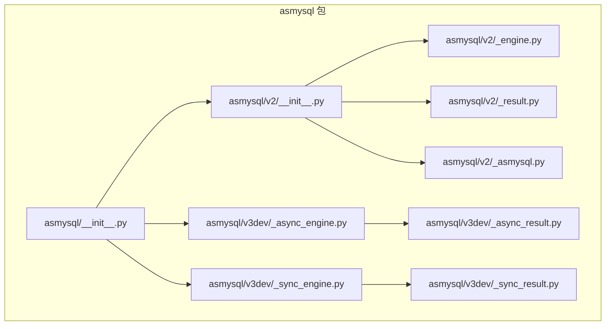
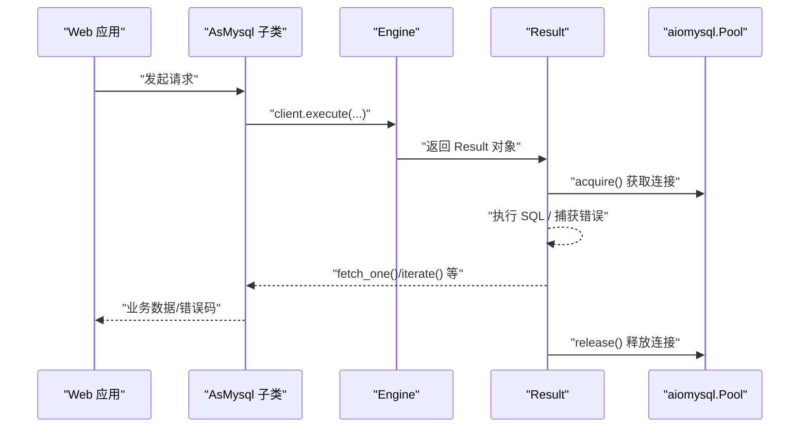
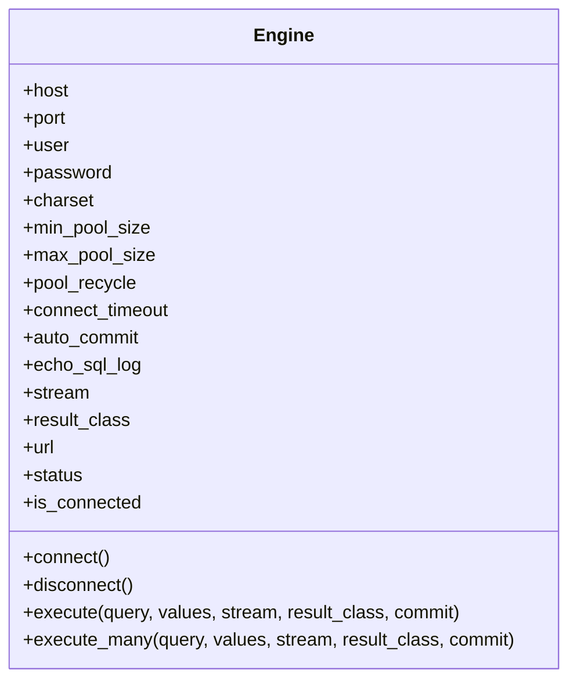
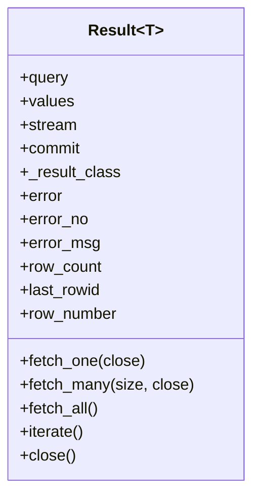
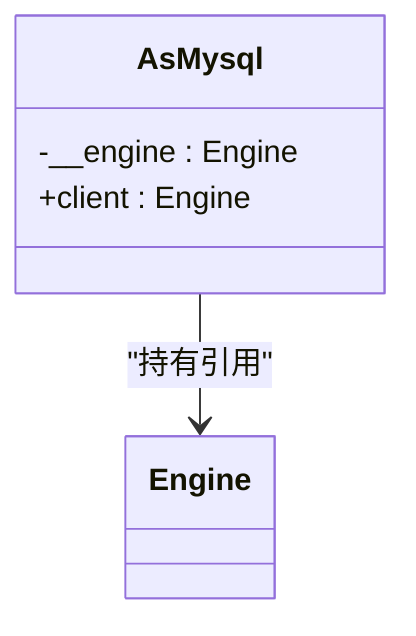
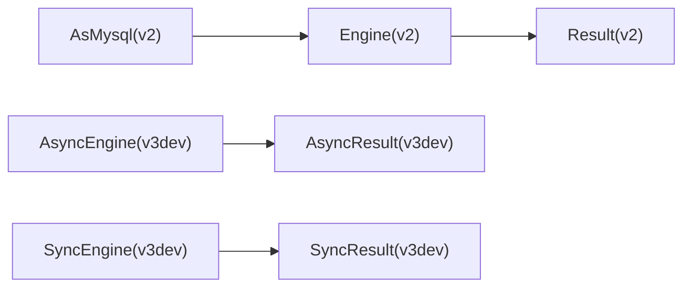

# 其他框架集成

<cite>
**本文引用的文件**   
- [README.md](file://README.md)
- [asmysql/__init__.py](file://asmysql/__init__.py)
- [asmysql/v2/__init__.py](file://asmysql/v2/__init__.py)
- [asmysql/v2/_asmysql.py](file://asmysql/v2/_asmysql.py)
- [asmysql/v2/_engine.py](file://asmysql/v2/_engine.py)
- [asmysql/v2/_result.py](file://asmysql/v2/_result.py)
- [asmysql/v3dev/_async_engine.py](file://asmysql/v3dev/_async_engine.py)
- [asmysql/v3dev/_async_result.py](file://asmysql/v3dev/_async_result.py)
- [asmysql/v3dev/_sync_engine.py](file://asmysql/v3dev/_sync_engine.py)
- [asmysql/v3dev/_sync_result.py](file://asmysql/v3dev/_sync_result.py)
- [tests/v2/v2_start.py](file://tests/v2/v2_start.py)
- [mkdocs/v2/docs/zh/examples.md](file://mkdocs/v2/docs/zh/examples.md)
</cite>

## 目录
1. [简介](#简介)
2. [项目结构](#项目结构)
3. [核心组件](#核心组件)
4. [架构总览](#架构总览)
5. [详细组件分析](#详细组件分析)
6. [依赖分析](#依赖分析)
7. [性能考虑](#性能考虑)
8. [故障排查指南](#故障排查指南)
9. [结论](#结论)
10. [附录：各框架集成方案](#附录各框架集成方案)

## 简介
本指南面向将 asmysql 与多种 Python Web 框架集成的开发者，覆盖以下场景：
- Flask（WSGI）+ gunicorn 的集成方案
- Sanic、Tornado 等原生异步框架的集成示例
- Starlette 基础应用的集成方法
- aiohttp 微服务架构中的使用模式

每个框架均提供：
- 基本配置示例（连接参数、连接池、流式查询、结果类型）
- 连接管理策略（生命周期、优雅关闭）
- 错误处理方案（统一异常捕获、错误码/信息获取）

说明：
- 本文以 asmysql v2 为主进行讲解，v3dev 中提供了独立的异步/同步引擎与结果类，便于在需要时选择。
- 所有代码片段路径均以“章节来源”形式给出，避免直接粘贴源码。

## 项目结构
asmysql 的核心由“引擎 + 结果 + 业务封装基类”组成，并通过版本化包组织：
- v2：统一的异步 Engine/Result，AsMysql 作为业务逻辑基类
- v3dev：分离 AsyncEngine/SyncEngine 与对应 Result，便于在不同运行环境下选择

图表来源
- [asmysql/__init__.py:1-16](file://asmysql/__init__.py#L1-L16)
- [asmysql/v2/__init__.py:1-15](file://asmysql/v2/__init__.py#L1-L15)
- [asmysql/v2/_engine.py:1-317](file://asmysql/v2/_engine.py#L1-L317)
- [asmysql/v2/_result.py:1-273](file://asmysql/v2/_result.py#L1-L273)
- [asmysql/v2/_asmysql.py:1-26](file://asmysql/v2/_asmysql.py#L1-L26)
- [asmysql/v3dev/_async_engine.py:1-307](file://asmysql/v3dev/_async_engine.py#L1-L307)
- [asmysql/v3dev/_sync_engine.py](file://asmysql/v3dev/_sync_engine.py)
- [asmysql/v3dev/_async_result.py](file://asmysql/v3dev/_async_result.py)
- [asmysql/v3dev/_sync_result.py](file://asmysql/v3dev/_sync_result.py)

章节来源
- [README.md:1-135](file://README.md#L1-L135)
- [asmysql/__init__.py:1-16](file://asmysql/__init__.py#L1-L16)
- [asmysql/v2/__init__.py:1-15](file://asmysql/v2/__init__.py#L1-L15)

## 核心组件
- Engine（v2/v3dev 异步）：负责连接池创建、连接状态、SQL 执行入口（execute/execute_many），支持 URL 解析、连接池参数、流式返回、结果类型定制。
- Result（v2/v3dev 异步）：封装游标生命周期、错误收集、fetch_one/fetch_many/fetch_all/iterate 等读取接口，支持上下文管理与异步迭代。
- AsMysql（v2）：业务逻辑基类，持有 Engine 引用，通过 client 属性访问数据库能力。

关键要点
- 连接池：基于 aiomysql.Pool，支持 min/max size、回收时间、超时、自动提交、SQL 日志开关。
- 错误处理：底层 MySQLError 被捕获并包装为 ConnectionError 或 Result.error/error_no/error_msg。
- 流式查询：stream=True 时使用 SSCursor/SSDictCursor，适合大数据集逐行处理。
- 结果类型：result_class 可指定 tuple/dict 或自定义类（需支持 **data 构造）。

章节来源
- [asmysql/v2/_engine.py:37-317](file://asmysql/v2/_engine.py#L37-L317)
- [asmysql/v2/_result.py:21-273](file://asmysql/v2/_result.py#L21-L273)
- [asmysql/v2/_asmysql.py:7-26](file://asmysql/v2/_asmysql.py#L7-L26)
- [asmysql/v3dev/_async_engine.py:27-307](file://asmysql/v3dev/_async_engine.py#L27-L307)
- [asmysql/v3dev/_async_result.py](file://asmysql/v3dev/_async_result.py)

## 架构总览
下图展示了 asmysql 在应用中的典型调用链：Web 框架层 -> 业务类（AsMysql）-> 引擎（Engine）-> 结果（Result）-> 底层 aiomysql 连接池。

图表来源
- [asmysql/v2/_asmysql.py:22-26](file://asmysql/v2/_asmysql.py#L22-L26)
- [asmysql/v2/_engine.py:226-259](file://asmysql/v2/_engine.py#L226-L259)
- [asmysql/v2/_result.py:101-125](file://asmysql/v2/_result.py#L101-L125)
- [asmysql/v2/_result.py:186-208](file://asmysql/v2/_result.py#L186-L208)
- [asmysql/v2/_result.py:251-273](file://asmysql/v2/_result.py#L251-L273)

## 详细组件分析

### 组件：Engine（v2 异步）
职责
- 解析连接 URL 与参数
- 创建/关闭连接池
- 暴露 execute/execute_many 执行入口
- 提供连接状态与连接池监控

图表来源
- [asmysql/v2/_engine.py:37-317](file://asmysql/v2/_engine.py#L37-L317)

章节来源
- [asmysql/v2/_engine.py:37-317](file://asmysql/v2/_engine.py#L37-L317)

### 组件：Result（v2 异步）
职责
- 管理游标生命周期
- 统一错误收集（error/error_no/error_msg）
- 提供 fetch_one/fetch_many/fetch_all/iterate
- 支持 async with 与 async for 语法

图表来源
- [asmysql/v2/_result.py:21-273](file://asmysql/v2/_result.py#L21-L273)

章节来源
- [asmysql/v2/_result.py:21-273](file://asmysql/v2/_result.py#L21-L273)

### 组件：AsMysql（v2 业务基类）
职责
- 持有 Engine 引用
- 对外暴露 client 属性用于执行 SQL

图表来源
- [asmysql/v2/_asmysql.py:7-26](file://asmysql/v2/_asmysql.py#L7-L26)

章节来源
- [asmysql/v2/_asmysql.py:7-26](file://asmysql/v2/_asmysql.py#L7-L26)

## 依赖分析
- 外部依赖
  - aiomysql：连接池与游标实现
  - pymysql.err.MySQLError：MySQL 错误类型
- 内部依赖
  - v2：Engine 依赖 Result；AsMysql 依赖 Engine
  - v3dev：AsyncEngine/SyncEngine 分别依赖对应的 AsyncResult/SyncResult

图表来源
- [asmysql/v2/_engine.py:1-317](file://asmysql/v2/_engine.py#L1-L317)
- [asmysql/v2/_result.py:1-273](file://asmysql/v2/_result.py#L1-L273)
- [asmysql/v2/_asmysql.py:1-26](file://asmysql/v2/_asmysql.py#L1-L26)
- [asmysql/v3dev/_async_engine.py:1-307](file://asmysql/v3dev/_async_engine.py#L1-L307)
- [asmysql/v3dev/_sync_engine.py](file://asmysql/v3dev/_sync_engine.py)

章节来源
- [asmysql/v2/_engine.py:1-317](file://asmysql/v2/_engine.py#L1-L317)
- [asmysql/v2/_result.py:1-273](file://asmysql/v2/_result.py#L1-L273)
- [asmysql/v2/_asmysql.py:1-26](file://asmysql/v2/_asmysql.py#L1-L26)
- [asmysql/v3dev/_async_engine.py:1-307](file://asmysql/v3dev/_async_engine.py#L1-L307)

## 性能考虑
- 连接池大小：根据并发量设置 min_pool_size/max_pool_size，避免过大导致资源浪费或过小造成阻塞。
- 流式查询：对大结果集使用 stream=True 与 iterate()/async for，降低内存占用。
- 结果类型：dict 更灵活但略慢于 tuple；自定义类可在业务层做轻量转换。
- 自动提交：默认 auto_commit=True，事务场景需关闭并在合适时机手动提交/回滚。
- SQL 日志：生产环境建议关闭 echo_sql_log，调试阶段开启。

[本节为通用指导，不直接分析具体文件]

## 故障排查指南
- 连接失败：检查 URL 格式与网络连通性；关注 ConnectionError 提示。
- 执行错误：通过 result.error/error_no/error_msg 定位 MySQL 错误码与信息。
- 连接泄漏：确保使用 async with 或显式 close()；避免长时间持有游标。
- 流式查询未释放：iterate()/async for 会在结束时自动 close()，注意不要在外部重复关闭。

章节来源
- [asmysql/v2/_engine.py:131-151](file://asmysql/v2/_engine.py#L131-L151)
- [asmysql/v2/_result.py:119-125](file://asmysql/v2/_result.py#L119-L125)
- [asmysql/v2/_result.py:134-151](file://asmysql/v2/_result.py#L134-L151)
- [asmysql/v2/_result.py:251-273](file://asmysql/v2/_result.py#L251-L273)

## 结论
asmysql 提供了简洁一致的异步数据库访问 API，结合不同 Web 框架的生命周期管理，可实现高可用、高性能的数据库集成。建议在应用中：
- 集中管理 Engine 实例与生命周期
- 使用 AsMysql 子类封装领域逻辑
- 统一错误处理与监控指标（连接池状态、错误码分布）

[本节为总结性内容，不直接分析具体文件]

## 附录：各框架集成方案

### Flask（WSGI）+ gunicorn 集成
- 关键点
  - Flask 是同步 WSGI 框架，gunicorn 多进程模型下应全局初始化一个 Engine 实例，并在进程启动时 connect，在进程退出时 disconnect。
  - 业务层建议使用 AsMysql 子类，注入共享 Engine。
  - 错误处理：在中间件或蓝图层统一捕获并记录 result.error/error_no/error_msg。
- 参考路径
  - 引擎初始化与连接/断开：[asmysql/v2/_engine.py:131-183](file://asmysql/v2/_engine.py#L131-L183)
  - 业务基类 client 访问：[asmysql/v2/_asmysql.py:22-26](file://asmysql/v2/_asmysql.py#L22-L26)
  - 结果读取与错误：[asmysql/v2/_result.py:186-208](file://asmysql/v2/_result.py#L186-L208), [asmysql/v2/_result.py:134-151](file://asmysql/v2/_result.py#L134-L151)
- 配置建议
  - 连接池：根据 gunicorn workers 数与并发调整 max_pool_size
  - 流式查询：大数据导出接口启用 stream=True
  - 自动提交：默认 True；事务接口关闭 auto_commit 并在业务层控制

章节来源
- [asmysql/v2/_engine.py:131-183](file://asmysql/v2/_engine.py#L131-L183)
- [asmysql/v2/_asmysql.py:22-26](file://asmysql/v2/_asmysql.py#L22-L26)
- [asmysql/v2/_result.py:186-208](file://asmysql/v2/_result.py#L186-L208)
- [asmysql/v2/_result.py:134-151](file://asmysql/v2/_result.py#L134-L151)

### Sanic（原生异步）集成
- 关键点
  - 使用单例 Engine，在 app.on_startup 中 connect，在 on_shutdown 中 disconnect。
  - 路由处理器可直接 await engine.execute(...) 或使用 AsMysql 子类。
  - 错误处理：在异常处理器中统一处理 result.error。
- 参考路径
  - 引擎生命周期：[asmysql/v2/_engine.py:131-183](file://asmysql/v2/_engine.py#L131-L183)
  - 执行与结果：[asmysql/v2/_engine.py:226-259](file://asmysql/v2/_engine.py#L226-L259), [asmysql/v2/_result.py:101-125](file://asmysql/v2/_result.py#L101-L125)
- 配置建议
  - 流式查询：长列表导出使用 stream=True 与 async for
  - 结果类型：dict 便于序列化响应

章节来源
- [asmysql/v2/_engine.py:131-183](file://asmysql/v2/_engine.py#L131-L183)
- [asmysql/v2/_engine.py:226-259](file://asmysql/v2/_engine.py#L226-L259)
- [asmysql/v2/_result.py:101-125](file://asmysql/v2/_result.py#L101-L125)

### Tornado（原生异步）集成
- 关键点
  - 在 Application 初始化时创建 Engine 并 connect；在 stop 钩子中 disconnect。
  - 请求处理中使用 await engine.execute(...) 或 AsMysql 子类。
  - 错误处理：在 RequestHandler 的异常分支中统一处理 result.error。
- 参考路径
  - 引擎与结果：[asmysql/v2/_engine.py:226-259](file://asmysql/v2/_engine.py#L226-L259), [asmysql/v2/_result.py:186-208](file://asmysql/v2/_result.py#L186-L208)
- 配置建议
  - 连接池：按 Tornado IO 循环并发度调优
  - 流式查询：大批量写入/读取使用 stream=True

章节来源
- [asmysql/v2/_engine.py:226-259](file://asmysql/v2/_engine.py#L226-L259)
- [asmysql/v2/_result.py:186-208](file://asmysql/v2/_result.py#L186-L208)

### Starlette（基础应用）集成
- 关键点
  - 使用 lifespan 事件管理 Engine 生命周期（startup/connect，shutdown/disconnect）。
  - 在路由中通过依赖注入或全局变量访问 Engine/AsMysql。
  - 错误处理：在异常中间件中统一处理 result.error。
- 参考路径
  - 引擎生命周期：[asmysql/v2/_engine.py:131-183](file://asmysql/v2/_engine.py#L131-L183)
  - 执行与结果：[asmysql/v2/_engine.py:226-259](file://asmysql/v2/_engine.py#L226-L259), [asmysql/v2/_result.py:101-125](file://asmysql/v2/_result.py#L101-L125)
- 配置建议
  - 流式查询：导出接口使用 stream=True 与 async for
  - 结果类型：dict 便于 JSON 序列化

章节来源
- [asmysql/v2/_engine.py:131-183](file://asmysql/v2/_engine.py#L131-L183)
- [asmysql/v2/_engine.py:226-259](file://asmysql/v2/_engine.py#L226-L259)
- [asmysql/v2/_result.py:101-125](file://asmysql/v2/_result.py#L101-L125)

### aiohttp（微服务）集成
- 关键点
  - 在 web.AppRunner 启动前创建 Engine 并 connect；在停止时 disconnect。
  - 在 handler 中直接使用 await engine.execute(...) 或 AsMysql 子类。
  - 错误处理：在中间件或 handler 中统一处理 result.error。
- 参考路径
  - 引擎与结果：[asmysql/v2/_engine.py:226-259](file://asmysql/v2/_engine.py#L226-L259), [asmysql/v2/_result.py:186-208](file://asmysql/v2/_result.py#L186-L208)
- 配置建议
  - 连接池：根据 aiohttp 并发与下游 MySQL 容量调优
  - 流式查询：大数据导出使用 stream=True

章节来源
- [asmysql/v2/_engine.py:226-259](file://asmysql/v2/_engine.py#L226-L259)
- [asmysql/v2/_result.py:186-208](file://asmysql/v2/_result.py#L186-L208)

### 通用最佳实践（适用于所有框架）
- 连接管理
  - 全局单例 Engine，应用启动时 connect，退出时 disconnect
  - 使用 status/is_connected 监控连接状态
- 查询模式
  - 小结果集：fetch_one/fetch_all
  - 大结果集：stream=True + iterate()/async for
- 结果类型
  - tuple：性能最优
  - dict：开发便捷
  - 自定义类：结合 Pydantic/数据模型
- 错误处理
  - 统一捕获 result.error/error_no/error_msg
  - 在框架异常处理器中输出结构化日志

章节来源
- [asmysql/v2/_engine.py:155-166](file://asmysql/v2/_engine.py#L155-L166)
- [asmysql/v2/_result.py:134-151](file://asmysql/v2/_result.py#L134-L151)
- [mkdocs/v2/docs/zh/examples.md:406-469](file://mkdocs/v2/docs/zh/examples.md#L406-L469)
- [tests/v2/v2_start.py:12-107](file://tests/v2/v2_start.py#L12-L107)