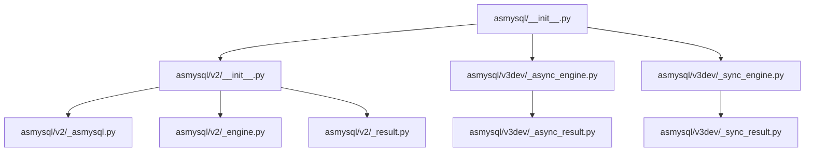
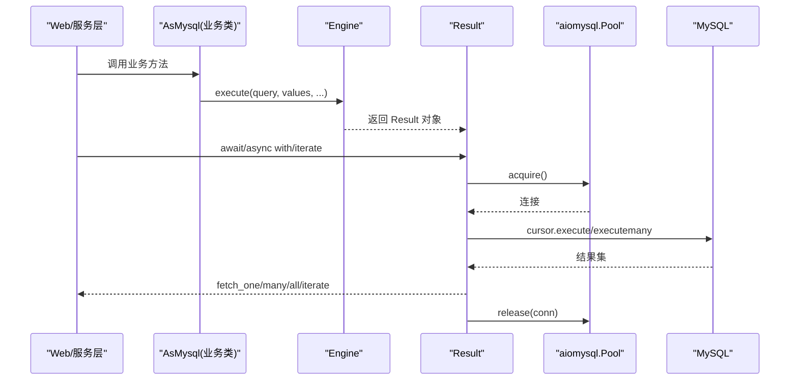
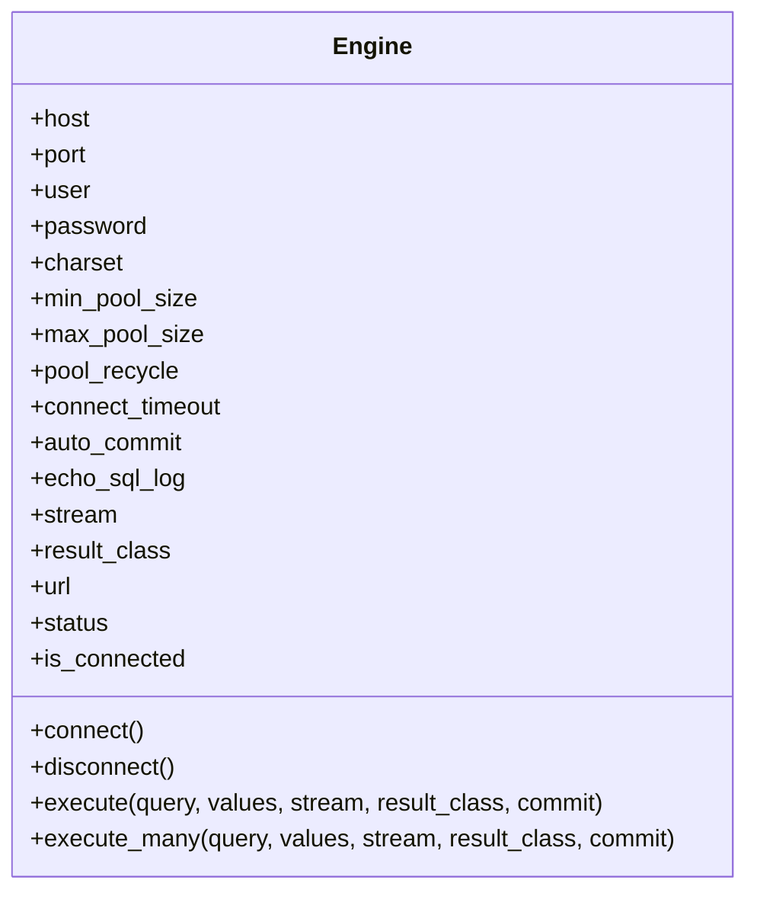
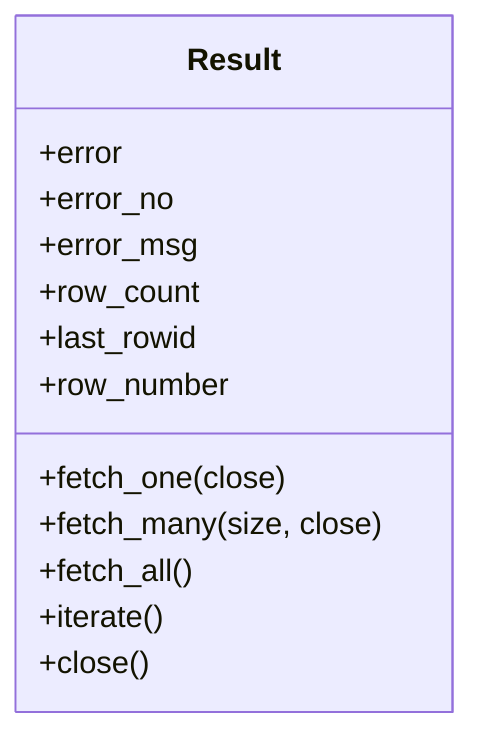
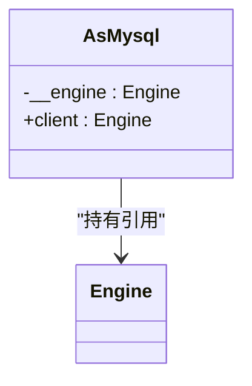
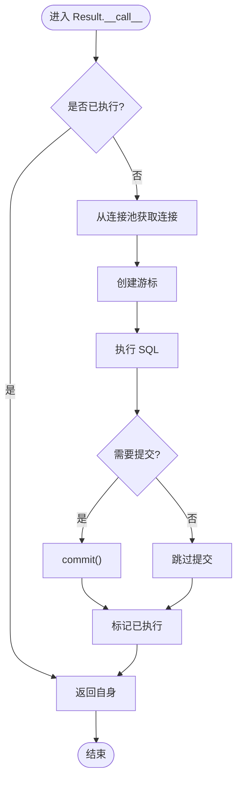
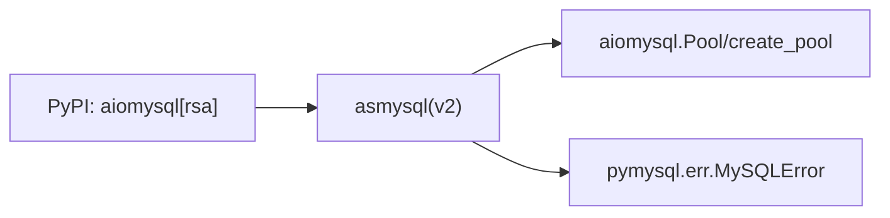

# 框架集成示例

<cite>
**本文引用的文件**   
- [README.md](file://README.md)
- [pyproject.toml](file://pyproject.toml)
- [asmysql/__init__.py](file://asmysql/__init__.py)
- [asmysql/v2/__init__.py](file://asmysql/v2/__init__.py)
- [asmysql/v2/_asmysql.py](file://asmysql/v2/_asmysql.py)
- [asmysql/v2/_engine.py](file://asmysql/v2/_engine.py)
- [asmysql/v2/_result.py](file://asmysql/v2/_result.py)
- [asmysql/v3dev/_async_engine.py](file://asmysql/v3dev/_async_engine.py)
- [asmysql/v3dev/_sync_engine.py](file://asmysql/v3dev/_sync_engine.py)
- [asmysql/v3dev/_async_result.py](file://asmysql/v3dev/_async_result.py)
- [asmysql/v3dev/_sync_result.py](file://asmysql/v3dev/_sync_result.py)
- [tests/v2/v2_start.py](file://tests/v2/v2_start.py)
- [pytest/v2/test_asmysql.py](file://pytest/v2/test_asmysql.py)
- [mkdocs/v2/docs/zh/examples.md](file://mkdocs/v2/docs/zh/examples.md)
- [mkdocs/v2/docs/en/examples.md](file://mkdocs/v2/docs/en/examples.md)
- [mkdocs/v2/docs/zh/faq.md](file://mkdocs/v2/docs/zh/faq.md)
</cite>

## 目录
1. [简介](#简介)
2. [项目结构](#项目结构)
3. [核心组件](#核心组件)
4. [架构总览](#架构总览)
5. [详细组件分析](#详细组件分析)
6. [依赖分析](#依赖分析)
7. [性能考虑](#性能考虑)
8. [故障排查指南](#故障排查指南)
9. [结论](#结论)
10. [附录：与主流框架的集成示例](#附录与主流框架的集成示例)

## 简介
本文件面向企业级应用，提供 asmysql 与主流 Python 框架的集成方案与实践模式。内容覆盖 FastAPI、Django（同步/异步混合）、Celery 异步任务队列、Flask、Sanic 等框架的集成要点，并给出中间件编写、依赖注入、生命周期管理等最佳实践。文档中的示例均基于仓库内现有 API 能力与测试用例进行说明，确保可落地与可验证。

## 项目结构
仓库采用版本化模块组织方式：
- v2：稳定版异步封装，对外暴露 Engine、AsMysql、Result 等核心类
- v3dev：开发分支，分离异步与同步引擎及结果集实现，便于未来演进
- tests/pytest/mkdocs：测试与文档样例，包含大量使用模式与示例

图表来源
- [asmysql/__init__.py:1-16](file://asmysql/__init__.py#L1-L16)
- [asmysql/v2/__init__.py:1-15](file://asmysql/v2/__init__.py#L1-L15)
- [asmysql/v2/_asmysql.py:1-26](file://asmysql/v2/_asmysql.py#L1-L26)
- [asmysql/v2/_engine.py:1-317](file://asmysql/v2/_engine.py#L1-L317)
- [asmysql/v2/_result.py:1-273](file://asmysql/v2/_result.py#L1-L273)
- [asmysql/v3dev/_async_engine.py:1-307](file://asmysql/v3dev/_async_engine.py#L1-L307)
- [asmysql/v3dev/_sync_engine.py:1-298](file://asmysql/v3dev/_sync_engine.py#L1-L298)
- [asmysql/v3dev/_async_result.py:1-273](file://asmysql/v3dev/_async_result.py#L1-L273)
- [asmysql/v3dev/_sync_result.py:1-268](file://asmysql/v3dev/_sync_result.py#L1-L268)

章节来源
- [README.md:1-135](file://README.md#L1-L135)
- [pyproject.toml:1-80](file://pyproject.toml#L1-L80)

## 核心组件
- AsMysql：业务逻辑基类，持有 Engine 引用，通过 client 属性访问执行器
- Engine：连接池与 SQL 执行入口，支持 execute/execute_many、上下文管理、状态查询
- Result：统一的结果封装，支持 fetch_one/fetch_many/fetch_all/iterate、错误码/信息、流式迭代

关键特性
- 支持 URL 参数解析与连接池配置
- 支持 tuple/dict/自定义模型类型映射
- 支持流式查询与异步迭代
- 统一的错误处理与资源释放

章节来源
- [asmysql/v2/_asmysql.py:1-26](file://asmysql/v2/_asmysql.py#L1-L26)
- [asmysql/v2/_engine.py:1-317](file://asmysql/v2/_engine.py#L1-L317)
- [asmysql/v2/_result.py:1-273](file://asmysql/v2/_result.py#L1-L273)

## 架构总览
下图展示了 v2 版本的运行时交互：Web 层或服务层通过 AsMysql 调用 Engine.execute，Engine 返回 Result；Result 内部从连接池获取连接、创建游标、执行 SQL，并在完成后释放连接。

图表来源
- [asmysql/v2/_asmysql.py:1-26](file://asmysql/v2/_asmysql.py#L1-L26)
- [asmysql/v2/_engine.py:1-317](file://asmysql/v2/_engine.py#L1-L317)
- [asmysql/v2/_result.py:1-273](file://asmysql/v2/_result.py#L1-L273)

## 详细组件分析

### 组件：Engine（v2）
职责
- 解析连接 URL 与参数
- 管理 aiomysql 连接池
- 提供 execute/execute_many 接口
- 暴露 status/is_connected/pool 等状态与方法

关键点
- connect/disconnect 生命周期管理
- execute 返回 Result，支持多种用法：await、async with、直接 async for
- stream/result_class 控制结果类型与内存占用

图表来源
- [asmysql/v2/_engine.py:1-317](file://asmysql/v2/_engine.py#L1-L317)

章节来源
- [asmysql/v2/_engine.py:1-317](file://asmysql/v2/_engine.py#L1-L317)

### 组件：Result（v2）
职责
- 封装一次 SQL 执行的完整生命周期
- 提供 fetch_one/fetch_many/fetch_all/iterate
- 统一错误信息与行计数、最后插入 ID 等元数据
- 自动或手动关闭游标与释放连接

图表来源
- [asmysql/v2/_result.py:1-273](file://asmysql/v2/_result.py#L1-L273)

章节来源
- [asmysql/v2/_result.py:1-273](file://asmysql/v2/_result.py#L1-L273)

### 组件：AsMysql（v2）
职责
- 作为业务逻辑基类，持有 Engine 引用
- 通过 client 属性访问 Engine，简化业务代码

图表来源
- [asmysql/v2/_asmysql.py:1-26](file://asmysql/v2/_asmysql.py#L1-L26)

章节来源
- [asmysql/v2/_asmysql.py:1-26](file://asmysql/v2/_asmysql.py#L1-L26)

### 复杂逻辑流程：Result 执行与资源释放

图表来源
- [asmysql/v2/_result.py:101-125](file://asmysql/v2/_result.py#L101-L125)

章节来源
- [asmysql/v2/_result.py:101-125](file://asmysql/v2/_result.py#L101-L125)

## 依赖分析
- 外部依赖
  - aiomysql[rsa]>=0.3.2：异步 MySQL 客户端与连接池
- 内部依赖
  - v2 模块导出 Engine/AsMysql/Result
  - v3dev 提供异步/同步双实现，便于未来迁移

图表来源
- [pyproject.toml:31-34](file://pyproject.toml#L31-L34)
- [asmysql/v2/_engine.py:17-21](file://asmysql/v2/_engine.py#L17-L21)
- [asmysql/v2/_result.py:4-5](file://asmysql/v2/_result.py#L4-L5)

章节来源
- [pyproject.toml:1-80](file://pyproject.toml#L1-L80)
- [asmysql/v2/_engine.py:1-317](file://asmysql/v2/_engine.py#L1-L317)
- [asmysql/v2/_result.py:1-273](file://asmysql/v2/_result.py#L1-L273)

## 性能考虑
- 流式查询：对大数据集使用 stream=True 与 iterate()/async for，避免一次性加载到内存
- 结果类型：默认 tuple 最轻量；dict 可读性更好；自定义模型适合强类型校验
- 连接池：根据并发与数据库能力设置 min_pool_size/max_pool_size/connect_timeout
- 批量操作：使用 execute_many 减少往返开销
- 日志：开启 echo_sql_log 用于调试，生产环境谨慎开启

章节来源
- [mkdocs/v2/docs/zh/examples.md:406-469](file://mkdocs/v2/docs/zh/examples.md#L406-L469)
- [mkdocs/v2/docs/zh/faq.md:1-78](file://mkdocs/v2/docs/zh/faq.md#L1-L78)

## 故障排查指南
- 连接失败：检查 URL 格式、网络连通、认证信息；查看 ConnectionError 提示
- 执行报错：通过 result.error/error_no/error_msg 定位具体错误
- 资源泄漏：确保使用 async with 或显式 close()；避免长时间持有未释放的连接
- 事务：v2 需结合 auto_commit=False 与手动提交/回滚策略

章节来源
- [asmysql/v2/_engine.py:131-151](file://asmysql/v2/_engine.py#L131-L151)
- [asmysql/v2/_result.py:119-125](file://asmysql/v2/_result.py#L119-L125)
- [mkdocs/v2/docs/zh/faq.md:29-49](file://mkdocs/v2/docs/zh/faq.md#L29-L49)

## 结论
asmysql 提供了简洁一致的异步 MySQL 访问抽象，配合 Engine/AsMysql/Result 三层设计，既易于上手又具备企业级所需的连接池管理、错误处理与流式处理能力。在各类 Web 框架与任务队列中，均可通过统一的依赖注入与生命周期管理实现稳定集成。

## 附录：与主流框架的集成示例

### FastAPI 集成（异步 Web 服务）
- 生命周期管理：在应用启动时连接 Engine，在关闭时断开
- 依赖注入：将 Engine 实例注入到 AsMysql 子类（服务层），或在路由中按需构造
- 结果类型：结合 Pydantic 模型，使用 result_class=YourModel 获得强类型响应

参考路径
- [FastAPI 示例（英文）:810-880](file://mkdocs/v2/docs/en/examples.md#L810-L880)
- [FastAPI 示例（中文镜像）:810-880](file://mkdocs/v2/docs/zh/examples.md#L810-L880)

章节来源
- [mkdocs/v2/docs/en/examples.md:810-880](file://mkdocs/v2/docs/en/examples.md#L810-L880)
- [mkdocs/v2/docs/zh/examples.md:810-880](file://mkdocs/v2/docs/zh/examples.md#L810-L880)

### Django 集成（同步/异步混合场景）
- 同步视图：使用 v3dev 的 SyncEngine/SyncResult 或封装同步适配器
- 异步视图：使用 v2/v3dev 的 AsyncEngine/AsyncResult，并通过 Django 的异步视图运行
- 共享 Engine：在应用初始化阶段创建并缓存 Engine 实例，通过全局或依赖注入共享
- 事务：在需要时关闭自动提交，手动控制提交/回滚

参考路径
- [常见问题：跨模块共享 Engine:63-78](file://mkdocs/v2/docs/zh/faq.md#L63-L78)

章节来源
- [mkdocs/v2/docs/zh/faq.md:63-78](file://mkdocs/v2/docs/zh/faq.md#L63-L78)

### Celery 异步任务队列集成
- 任务函数中使用 Engine 执行后台数据处理任务
- 在 worker 启动时连接 Engine，退出时断开；或使用任务生命周期钩子管理
- 大批量数据处理建议启用流式查询与逐条处理

参考路径
- [基础示例与连接管理:21-105](file://mkdocs/v2/docs/zh/examples.md#L21-L105)

章节来源
- [mkdocs/v2/docs/zh/examples.md:21-105](file://mkdocs/v2/docs/zh/examples.md#L21-L105)

### Flask 集成
- 传统 WSGI：使用 v3dev 的同步引擎或在线程池中运行异步任务
- ASGI（如 gunicorn+uvicorn）：可直接使用异步引擎
- 推荐在应用启动时初始化 Engine，并在请求上下文中注入服务层

参考路径
- [常见问题：连接池大小与超时:80-97](file://mkdocs/v2/docs/zh/faq.md#L80-L97)

章节来源
- [mkdocs/v2/docs/zh/faq.md:80-97](file://mkdocs/v2/docs/zh/faq.md#L80-L97)

### Sanic 集成
- 原生异步框架，直接使用 Engine/AsMysql
- 建议在应用生命周期中连接/断开 Engine，并使用依赖注入在服务层复用

参考路径
- [基础示例与连接管理:21-105](file://mkdocs/v2/docs/zh/examples.md#L21-L105)

章节来源
- [mkdocs/v2/docs/zh/examples.md:21-105](file://mkdocs/v2/docs/zh/examples.md#L21-L105)

### 中间件编写与依赖注入
- 中间件：在请求进入前建立必要的上下文（如记录 SQL 日志、限流），在退出时清理资源
- 依赖注入：将 Engine 实例作为单例注入到各服务层，避免重复创建与连接泄漏
- 生命周期：遵循“启动连接、关闭断开”的原则，确保进程优雅退出

参考路径
- [常见问题：跨模块共享 Engine:63-78](file://mkdocs/v2/docs/zh/faq.md#L63-L78)

章节来源
- [mkdocs/v2/docs/zh/faq.md:63-78](file://mkdocs/v2/docs/zh/faq.md#L63-L78)

### 端到端示例与测试参考
- 快速开始与多用法演示（execute/execute_many/iterate/async for）
- 自定义模型与错误处理
- 流式查询与普通查询对比

参考路径
- [v2 快速开始](file://tests/v2/v2_start.py:1-L107)
- [单元测试：不同结果类型与批量操作](file://pytest/v2/test_asmysql.py:1-L283)
- [示例文档：基础与高级用法](file://mkdocs/v2/docs/zh/examples.md:1-L800)

章节来源
- [tests/v2/v2_start.py:1-107](file://tests/v2/v2_start.py#L1-L107)
- [pytest/v2/test_asmysql.py:1-283](file://pytest/v2/test_asmysql.py#L1-L283)
- [mkdocs/v2/docs/zh/examples.md:1-800](file://mkdocs/v2/docs/zh/examples.md#L1-L800)