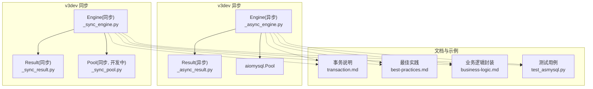
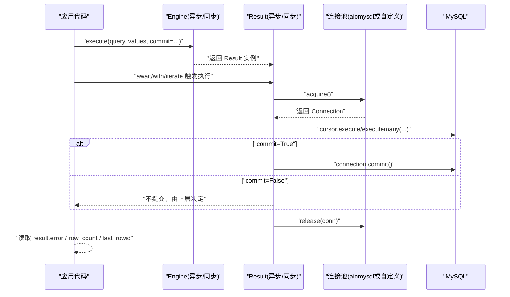
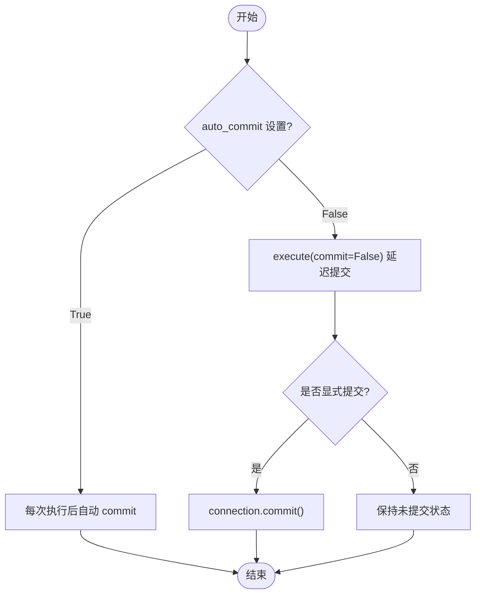
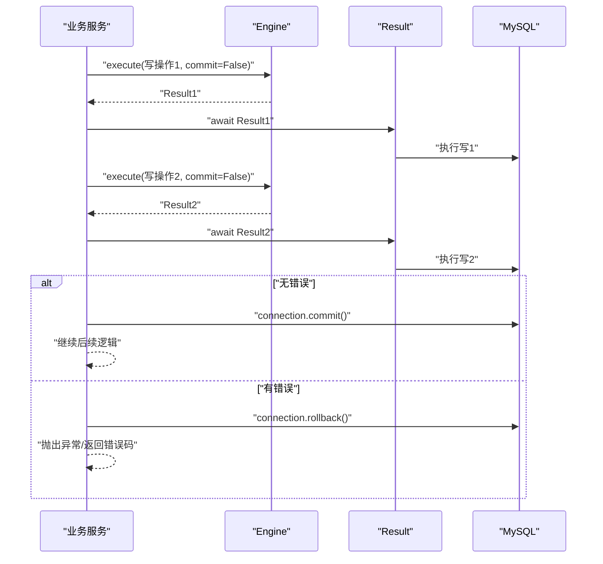
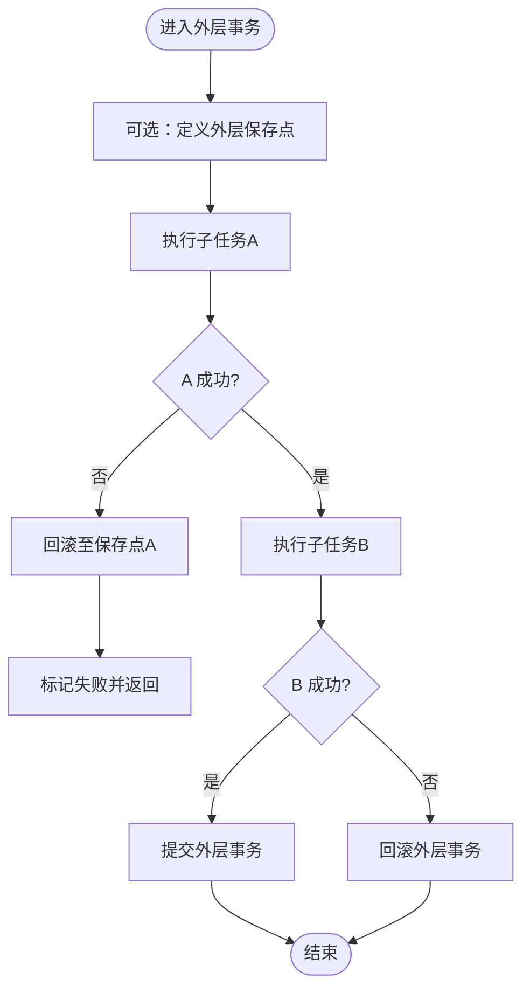
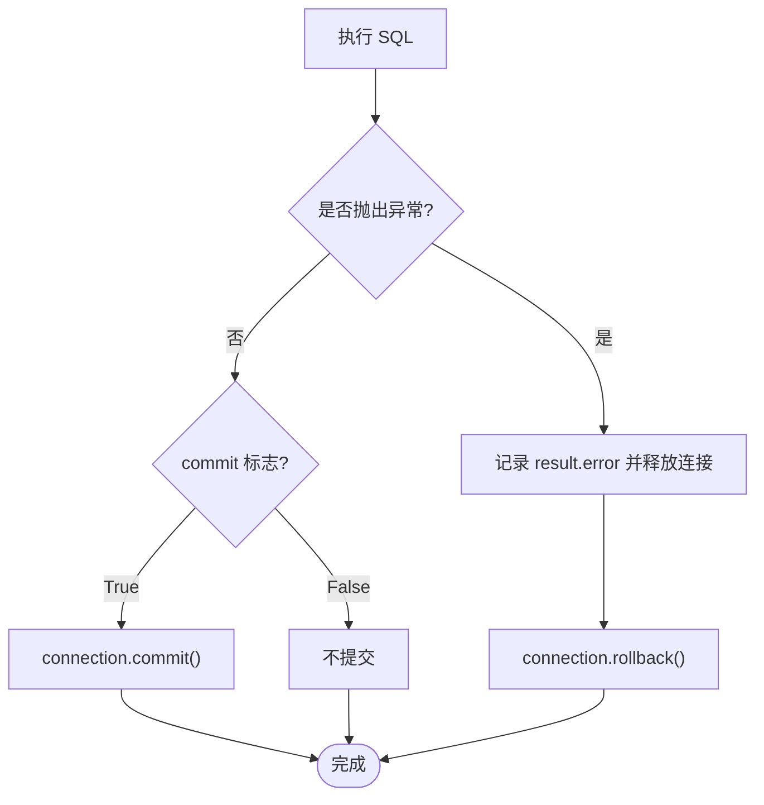
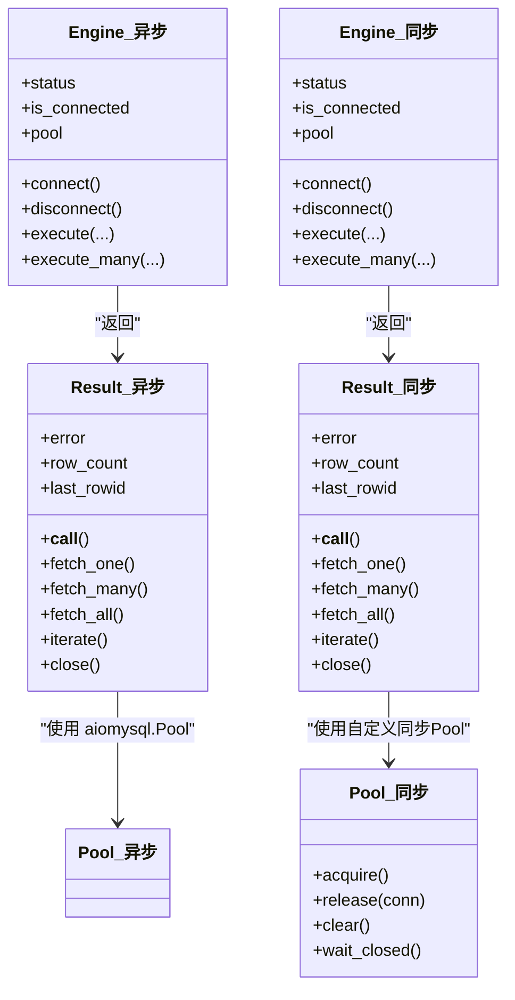
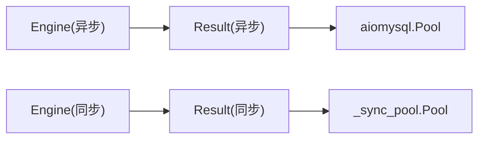

# 事务管理最佳实践

<cite>
**本文引用的文件**   
- [asmysql/v3dev/_async_engine.py](file://asmysql/v3dev/_async_engine.py)
- [asmysql/v3dev/_sync_engine.py](file://asmysql/v3dev/_sync_engine.py)
- [asmysql/v3dev/_async_result.py](file://asmysql/v3dev/_async_result.py)
- [asmysql/v3dev/_sync_result.py](file://asmysql/v3dev/_sync_result.py)
- [asmysql/v3dev/_sync_pool.py](file://asmysql/v3dev/_sync_pool.py)
- [mkdocs/v2/docs/zh/transaction.md](file://mkdocs/v2/docs/zh/transaction.md)
- [mkdocs/v2/docs/zh/best-practices.md](file://mkdocs/v2/docs/zh/best-practices.md)
- [mkdocs/v2/docs/zh/business-logic.md](file://mkdocs/v2/docs/zh/business-logic.md)
- [pytest/v2/test_asmysql.py](file://pytest/v2/test_asmysql.py)
</cite>

## 目录
1. [简介](#简介)
2. [项目结构](#项目结构)
3. [核心组件](#核心组件)
4. [架构总览](#架构总览)
5. [详细组件分析](#详细组件分析)
6. [依赖关系分析](#依赖关系分析)
7. [性能与连接池优化](#性能与连接池优化)
8. [故障排查指南](#故障排查指南)
9. [结论](#结论)
10. [附录：分布式事务边界建议](#附录分布式事务边界建议)

## 简介
本文件面向使用 asmysql 进行数据库访问的开发者，聚焦“事务管理高级用法”。内容覆盖自动提交与手动事务的区别、复杂业务逻辑中的事务组织方式、嵌套事务策略、回滚错误处理模式、长事务的性能考量与连接池配置优化，以及在分布式环境中协调多库操作的事务边界建议。文档以代码级实现为依据，结合仓库中 v3dev（异步/同步）与 v2 文档示例，给出可落地的最佳实践。

## 项目结构
仓库中与事务相关的关键路径如下：
- 异步引擎与结果集：_async_engine.py、_async_result.py
- 同步引擎与结果集：_sync_engine.py、_sync_result.py
- 同步连接池（开发中）：_sync_pool.py
- v2 事务文档与最佳实践：mkdocs/v2/docs/zh/transaction.md、best-practices.md
- 测试用例参考：pytest/v2/test_asmysql.py

图表来源
- [asmysql/v3dev/_async_engine.py:1-307](file://asmysql/v3dev/_async_engine.py#L1-L307)
- [asmysql/v3dev/_sync_engine.py:1-298](file://asmysql/v3dev/_sync_engine.py#L1-L298)
- [asmysql/v3dev/_async_result.py:1-273](file://asmysql/v3dev/_async_result.py#L1-L273)
- [asmysql/v3dev/_sync_result.py:1-268](file://asmysql/v3dev/_sync_result.py#L1-L268)
- [asmysql/v3dev/_sync_pool.py:1-281](file://asmysql/v3dev/_sync_pool.py#L1-L281)
- [mkdocs/v2/docs/zh/transaction.md:1-44](file://mkdocs/v2/docs/zh/transaction.md#L1-L44)
- [mkdocs/v2/docs/zh/best-practices.md:1-141](file://mkdocs/v2/docs/zh/best-practices.md#L1-L141)
- [mkdocs/v2/docs/zh/business-logic.md:1-67](file://mkdocs/v2/docs/zh/business-logic.md#L1-L67)
- [pytest/v2/test_asmysql.py:1-200](file://pytest/v2/test_asmysql.py#L1-L200)

章节来源
- [asmysql/v3dev/_async_engine.py:1-307](file://asmysql/v3dev/_async_engine.py#L1-L307)
- [asmysql/v3dev/_sync_engine.py:1-298](file://asmysql/v3dev/_sync_engine.py#L1-L298)
- [asmysql/v3dev/_async_result.py:1-273](file://asmysql/v3dev/_async_result.py#L1-L273)
- [asmysql/v3dev/_sync_result.py:1-268](file://asmysql/v3dev/_sync_result.py#L1-L268)
- [asmysql/v3dev/_sync_pool.py:1-281](file://asmysql/v3dev/_sync_pool.py#L1-L281)
- [mkdocs/v2/docs/zh/transaction.md:1-44](file://mkdocs/v2/docs/zh/transaction.md#L1-L44)
- [mkdocs/v2/docs/zh/best-practices.md:1-141](file://mkdocs/v2/docs/zh/best-practices.md#L1-L141)
- [mkdocs/v2/docs/zh/business-logic.md:1-67](file://mkdocs/v2/docs/zh/business-logic.md#L1-L67)
- [pytest/v2/test_asmysql.py:1-200](file://pytest/v2/test_asmysql.py#L1-L200)

## 核心组件
- Engine（异步/同步）：负责连接池创建、参数解析（含 auto_commit）、执行入口 execute/execute_many，返回 Result 对象。
- Result（异步/同步）：封装游标生命周期、SQL 执行、commit 控制、错误记录、结果获取与迭代。
- Pool（同步，开发中）：仿 aiomysql.Pool 的同步实现，包含连接回收、事务状态检测等。

关键要点
- auto_commit 在 Engine 初始化时传入底层连接池；默认 True。
- execute/execute_many 支持 commit 参数，用于覆盖默认提交行为。
- Result 在执行成功后若 commit=True 则调用 connection.commit()；异常路径会记录 error 并释放资源。

章节来源
- [asmysql/v3dev/_async_engine.py:45-101](file://asmysql/v3dev/_async_engine.py#L45-L101)
- [asmysql/v3dev/_async_engine.py:216-249](file://asmysql/v3dev/_async_engine.py#L216-L249)
- [asmysql/v3dev/_sync_engine.py:44-100](file://asmysql/v3dev/_sync_engine.py#L44-L100)
- [asmysql/v3dev/_sync_engine.py:206-239](file://asmysql/v3dev/_sync_engine.py#L206-L239)
- [asmysql/v3dev/_async_result.py:101-125](file://asmysql/v3dev/_async_result.py#L101-L125)
- [asmysql/v3dev/_sync_result.py:103-127](file://asmysql/v3dev/_sync_result.py#L103-L127)

## 架构总览
下图展示一次 SQL 执行从 Engine 到 Result 再到连接池/驱动层的调用链，以及 commit 的控制点。

图表来源
- [asmysql/v3dev/_async_engine.py:216-249](file://asmysql/v3dev/_async_engine.py#L216-L249)
- [asmysql/v3dev/_sync_engine.py:206-239](file://asmysql/v3dev/_sync_engine.py#L206-L239)
- [asmysql/v3dev/_async_result.py:101-125](file://asmysql/v3dev/_async_result.py#L101-L125)
- [asmysql/v3dev/_sync_result.py:103-127](file://asmysql/v3dev/_sync_result.py#L103-L127)

## 详细组件分析

### 自动提交 vs 手动事务
- 自动提交（默认）
  - Engine 构造时 auto_commit=True，底层连接池 autocommit=True。
  - 每次 execute 成功即 commit，适合简单单条写入场景。
- 手动事务
  - Engine 构造时 auto_commit=False，或在单次 execute 中传入 commit=False。
  - 需要显式关闭 Result 或等待上下文退出后，再统一提交；否则不会持久化。
  - v2 文档强调：手动提交需自行管理连接生命周期。

图表来源
- [mkdocs/v2/docs/zh/transaction.md:1-44](file://mkdocs/v2/docs/zh/transaction.md#L1-L44)
- [asmysql/v3dev/_async_engine.py:45-101](file://asmysql/v3dev/_async_engine.py#L45-L101)
- [asmysql/v3dev/_sync_engine.py:44-100](file://asmysql/v3dev/_sync_engine.py#L44-L100)
- [asmysql/v3dev/_async_result.py:101-125](file://asmysql/v3dev/_async_result.py#L101-L125)
- [asmysql/v3dev/_sync_result.py:103-127](file://asmysql/v3dev/_sync_result.py#L103-L127)

章节来源
- [mkdocs/v2/docs/zh/transaction.md:1-44](file://mkdocs/v2/docs/zh/transaction.md#L1-L44)
- [asmysql/v3dev/_async_engine.py:45-101](file://asmysql/v3dev/_async_engine.py#L45-L101)
- [asmysql/v3dev/_sync_engine.py:44-100](file://asmysql/v3dev/_sync_engine.py#L44-L100)
- [asmysql/v3dev/_async_result.py:101-125](file://asmysql/v3dev/_async_result.py#L101-L125)
- [asmysql/v3dev/_sync_result.py:103-127](file://asmysql/v3dev/_sync_result.py#L103-L127)

### 复杂业务逻辑中的事务组织
- 推荐将多条写操作放入同一事务边界内，确保原子性。
- 使用上下文管理器管理 Result 生命周期，避免忘记 close 导致连接泄漏。
- 通过 result.error 快速判断失败分支，必要时抛出异常以便上层捕获并回滚。

章节来源
- [mkdocs/v2/docs/zh/best-practices.md:1-141](file://mkdocs/v2/docs/zh/best-practices.md#L1-L141)
- [mkdocs/v2/docs/zh/business-logic.md:1-67](file://mkdocs/v2/docs/zh/business-logic.md#L1-L67)
- [pytest/v2/test_asmysql.py:1-200](file://pytest/v2/test_asmysql.py#L1-L200)

### 嵌套事务的处理策略
- MySQL 原生不支持嵌套事务，通常通过保存点（SAVEPOINT）模拟。
- 在 asmysql 中，建议在业务层维护一个“事务作用域”的状态机：
  - 外层开启事务（auto_commit=False 或 commit=False）。
  - 内层逻辑通过 SAVEPOINT 划分子范围，出现异常则回滚至保存点。
  - 外层根据整体结果决定是否最终提交或回滚。
- 注意：Result 的 commit 仅控制当前连接的提交，不改变保存点语义，需在业务层显式发出 SAVEPOINT/ROLLBACK TO 语句。

[本节为概念性流程，不直接映射具体源码文件]

### 事务回滚的错误处理模式
- 在 Result 执行阶段发生 MySQLError 时，Result 会记录 error 并释放连接，但不会自动 rollback。
- 正确做法：
  - 检查 result.error，若存在则主动对当前连接执行 rollback。
  - 在上下文管理器或 finally 块中确保连接被 release。
  - 向上传播异常或返回结构化错误信息。

图表来源
- [asmysql/v3dev/_async_result.py:101-125](file://asmysql/v3dev/_async_result.py#L101-L125)
- [asmysql/v3dev/_sync_result.py:103-127](file://asmysql/v3dev/_sync_result.py#L103-L127)

章节来源
- [asmysql/v3dev/_async_result.py:101-125](file://asmysql/v3dev/_async_result.py#L101-L125)
- [asmysql/v3dev/_sync_result.py:103-127](file://asmysql/v3dev/_sync_result.py#L103-L127)

### 类图：核心对象关系

图表来源
- [asmysql/v3dev/_async_engine.py:1-307](file://asmysql/v3dev/_async_engine.py#L1-L307)
- [asmysql/v3dev/_sync_engine.py:1-298](file://asmysql/v3dev/_sync_engine.py#L1-L298)
- [asmysql/v3dev/_async_result.py:1-273](file://asmysql/v3dev/_async_result.py#L1-L273)
- [asmysql/v3dev/_sync_result.py:1-268](file://asmysql/v3dev/_sync_result.py#L1-L268)
- [asmysql/v3dev/_sync_pool.py:1-281](file://asmysql/v3dev/_sync_pool.py#L1-L281)

## 依赖关系分析
- Engine 依赖连接池（异步用 aiomysql.Pool，同步用自定义 _sync_pool.Pool）。
- Result 依赖连接池获取/释放连接，并在执行完成后按 commit 标志决定是否提交。
- 同步 Pool 实现了连接回收与事务状态检测（当检测到活动事务且连接归还时，安全地关闭连接以避免悬挂事务）。

图表来源
- [asmysql/v3dev/_async_engine.py:1-307](file://asmysql/v3dev/_async_engine.py#L1-L307)
- [asmysql/v3dev/_sync_engine.py:1-298](file://asmysql/v3dev/_sync_engine.py#L1-L298)
- [asmysql/v3dev/_async_result.py:1-273](file://asmysql/v3dev/_async_result.py#L1-L273)
- [asmysql/v3dev/_sync_result.py:1-268](file://asmysql/v3dev/_sync_result.py#L1-L268)
- [asmysql/v3dev/_sync_pool.py:1-281](file://asmysql/v3dev/_sync_pool.py#L1-L281)

章节来源
- [asmysql/v3dev/_sync_pool.py:243-272](file://asmysql/v3dev/_sync_pool.py#L243-L272)

## 性能与连接池优化
- 长事务风险
  - 长时间持有连接会占用池资源，降低吞吐，增加锁竞争与死锁概率。
  - 建议缩短事务边界，拆分大事务为多个小事务，或使用批处理减少往返。
- 连接池参数
  - min_pool_size/max_pool_size：根据并发量与数据库承载能力调优。
  - pool_recycle：定期回收空闲连接，避免远端超时导致的连接失效。
  - connect_timeout：防止连接建立阻塞过久。
- 流式查询
  - 大数据集优先使用 stream=True 与 iterate()/async for，避免一次性加载导致内存峰值。
- 日志与诊断
  - echo_sql_log 有助于定位慢 SQL 与异常路径。

章节来源
- [mkdocs/v2/docs/zh/best-practices.md:124-141](file://mkdocs/v2/docs/zh/best-practices.md#L124-L141)
- [asmysql/v3dev/_async_engine.py:31-43](file://asmysql/v3dev/_async_engine.py#L31-L43)
- [asmysql/v3dev/_sync_engine.py:30-42](file://asmysql/v3dev/_sync_engine.py#L30-L42)
- [asmysql/v3dev/_sync_pool.py:23-80](file://asmysql/v3dev/_sync_pool.py#L23-L80)

## 故障排查指南
- 现象：连接池耗尽
  - 可能原因：忘记 close 或未使用上下文管理器；fetch_one/close 参数误用。
  - 排查：检查 Result 的生命周期管理，优先使用 async with/engine 上下文。
- 现象：数据未提交
  - 可能原因：auto_commit=False 且未显式提交；commit=False 但未在合适时机提交。
  - 排查：确认 execute 的 commit 参数与业务提交点。
- 现象：异常后仍持有连接
  - 可能原因：未在异常路径执行 rollback 或释放连接。
  - 排查：在 except 分支中执行 rollback 并确保 close/release。
- 现象：同步连接归还时报错
  - 可能原因：连接上仍有活动事务，Pool 检测到后主动关闭连接。
  - 排查：确保在 return 前提交或回滚事务。

章节来源
- [mkdocs/v2/docs/zh/best-practices.md:25-68](file://mkdocs/v2/docs/zh/best-practices.md#L25-L68)
- [asmysql/v3dev/_sync_pool.py:243-272](file://asmysql/v3dev/_sync_pool.py#L243-L272)
- [asmysql/v3dev/_async_result.py:101-125](file://asmysql/v3dev/_async_result.py#L101-L125)
- [asmysql/v3dev/_sync_result.py:103-127](file://asmysql/v3dev/_sync_result.py#L103-L127)

## 结论
- 简单写入优先使用自动提交；复杂写路径务必显式开启事务并集中提交。
- 嵌套事务通过保存点模拟，业务层维护作用域与回滚策略。
- 严格遵循错误处理模式：检测 result.error、主动 rollback、确保连接释放。
- 长事务要谨慎，配合合理的连接池参数与流式查询，提升系统稳定性与吞吐。
- 分布式环境下，尽量将跨库一致性交由外部编排（Saga/TCC/消息最终一致），避免跨库长事务。

## 附录：分布式事务边界建议
- 原则
  - 本地事务最小化：每个数据库只保证自身一致性。
  - 跨库协调采用补偿机制：失败时发送补偿消息或重试。
  - 幂等设计：所有写接口具备幂等性，避免重复提交造成副作用。
- 模式
  - Saga：将长事务拆分为一系列本地事务，并提供反向补偿。
  - TCC：Try-Confirm-Cancel 三阶段，适用于强一致要求较高的场景。
  - 事件驱动：基于消息队列的最终一致性，配合去重表与重试策略。
- 与 asmysql 的结合
  - 在本地事务边界内使用 asmysql 的 execute(commit=False) 组合多次写，最后统一提交。
  - 在补偿路径中同样使用 asmysql 执行补偿 SQL，并记录审计日志。

[本节为概念性指导，不直接映射具体源码文件]