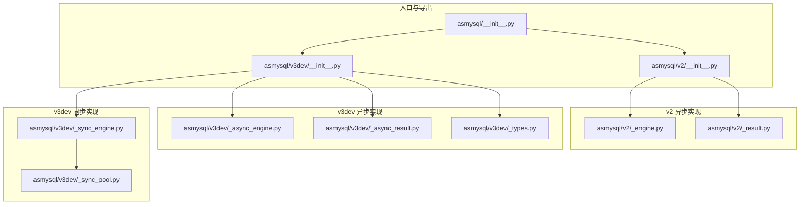
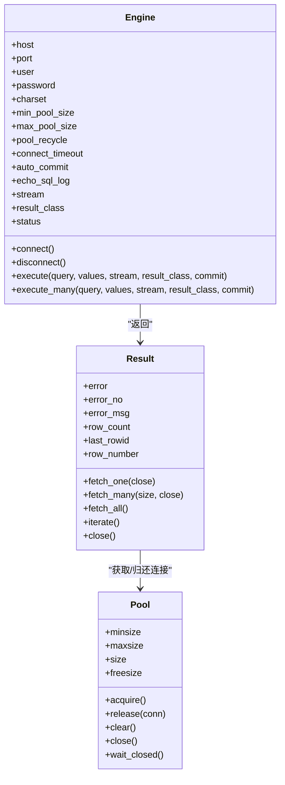
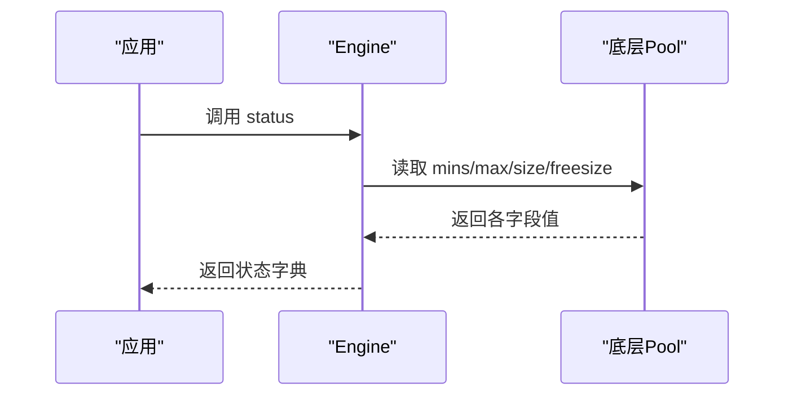
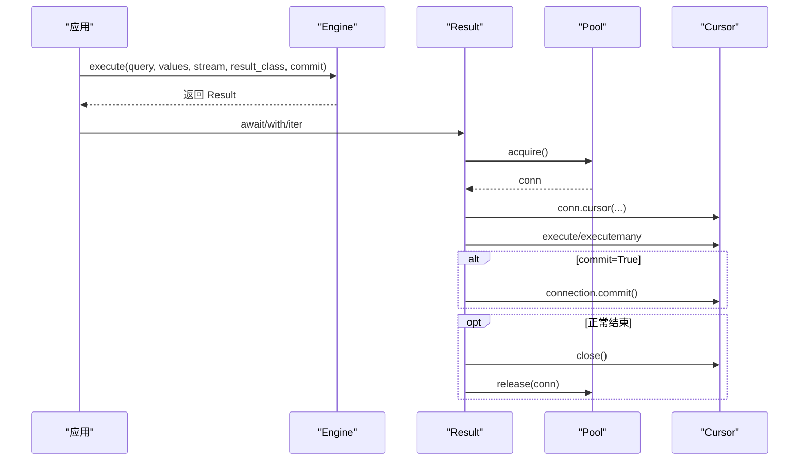
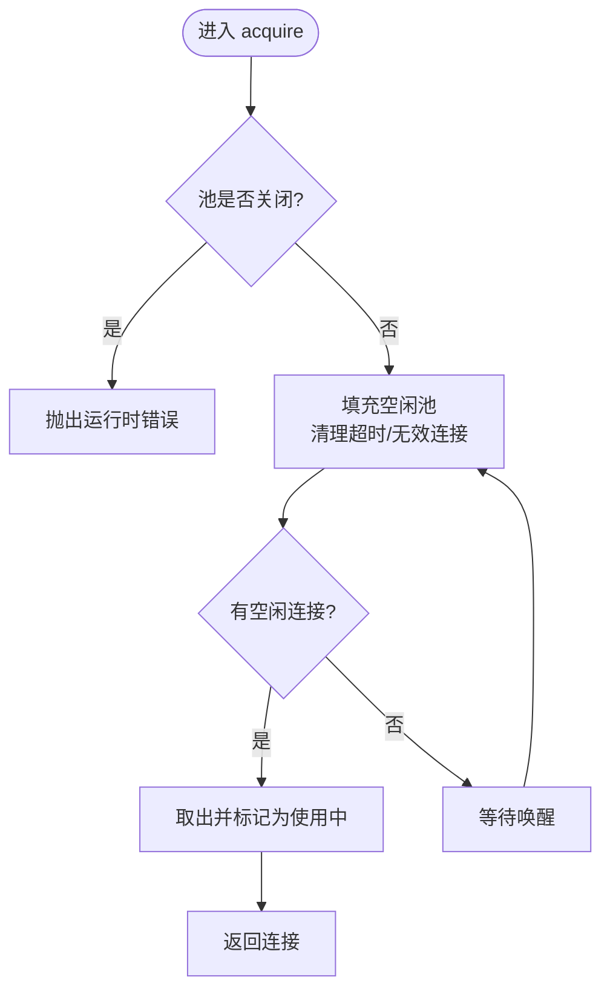
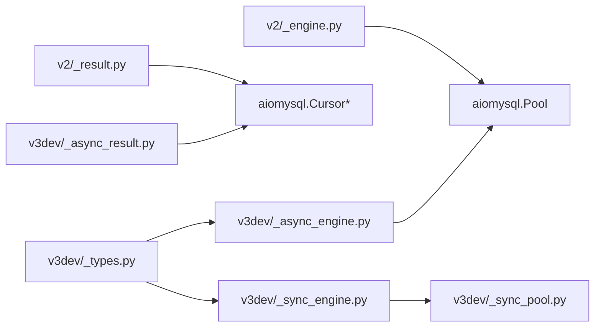

# 性能优化实战

<cite>
**本文引用的文件**   
- [README.md](file://README.md)
- [asmysql/__init__.py](file://asmysql/__init__.py)
- [asmysql/v2/__init__.py](file://asmysql/v2/__init__.py)
- [asmysql/v2/_engine.py](file://asmysql/v2/_engine.py)
- [asmysql/v2/_result.py](file://asmysql/v2/_result.py)
- [asmysql/v3dev/_async_engine.py](file://asmysql/v3dev/_async_engine.py)
- [asmysql/v3dev/_async_result.py](file://asmysql/v3dev/_async_result.py)
- [asmysql/v3dev/_sync_pool.py](file://asmysql/v3dev/_sync_pool.py)
- [asmysql/v3dev/_sync_engine.py](file://asmysql/v3dev/_sync_engine.py)
- [asmysql/v3dev/_types.py](file://asmysql/v3dev/_types.py)
- [mkdocs/v2/docs/zh/connection.md](file://mkdocs/v2/docs/zh/connection.md)
- [mkdocs/v2/docs/zh/best-practices.md](file://mkdocs/v2/docs/zh/best-practices.md)
- [tests/v1/test_asmysql_performance.py](file://tests/v1/test_asmysql_performance.py)
</cite>

## 目录
1. [引言](#引言)
2. [项目结构](#项目结构)
3. [核心组件](#核心组件)
4. [架构总览](#架构总览)
5. [详细组件分析](#详细组件分析)
6. [依赖关系分析](#依赖关系分析)
7. [性能考量与调优策略](#性能考量与调优策略)
8. [故障排查指南](#故障排查指南)
9. [结论](#结论)
10. [附录](#附录)

## 引言
本指南面向生产环境，聚焦 asmysql 的性能优化实战。围绕连接池参数调优、连接池状态与查询性能监控、慢查询诊断与优化技巧、大数据集内存管理以及生产监控告警方案展开，结合代码实现与文档说明给出可落地的建议。

## 项目结构
asmysql 提供 v2（异步）与 v3dev（异步/同步双栈）两套实现，统一暴露 Engine/Result 等核心能力；v3dev 还包含同步连接池实现，便于在同步场景下复用连接池思想。

图表来源
- [asmysql/__init__.py:1-16](file://asmysql/__init__.py#L1-L16)
- [asmysql/v2/__init__.py:1-15](file://asmysql/v2/__init__.py#L1-L15)
- [asmysql/v3dev/_async_engine.py:1-307](file://asmysql/v3dev/_async_engine.py#L1-L307)
- [asmysql/v3dev/_sync_engine.py:1-298](file://asmysql/v3dev/_sync_engine.py#L1-L298)
- [asmysql/v3dev/_sync_pool.py:1-281](file://asmysql/v3dev/_sync_pool.py#L1-L281)

章节来源
- [README.md:1-135](file://README.md#L1-L135)
- [asmysql/__init__.py:1-16](file://asmysql/__init__.py#L1-L16)
- [asmysql/v2/__init__.py:1-15](file://asmysql/v2/__init__.py#L1-L15)

## 核心组件
- Engine：封装数据库连接池的创建、生命周期管理与执行入口，支持 URL 与关键字参数配置，暴露 status 属性用于监控连接池状态。
- Result：封装游标与结果获取逻辑，支持流式迭代、批量获取、错误码/消息访问、自动释放连接等。
- 同步 Pool（v3dev）：基于 pymysql 的同步连接池实现，具备最小/最大连接数、空闲回收、线程安全等特性。

章节来源
- [asmysql/v2/_engine.py:37-166](file://asmysql/v2/_engine.py#L37-L166)
- [asmysql/v2/_result.py:21-126](file://asmysql/v2/_result.py#L21-L126)
- [asmysql/v3dev/_sync_pool.py:18-110](file://asmysql/v3dev/_sync_pool.py#L18-L110)

## 架构总览
Engine 负责连接池与执行上下文，Result 负责具体 SQL 执行与结果消费。异步版本基于 aiomysql 的 Pool/Cursor，同步版本基于 pymysql 的 Connection 与自定义 Pool。

图表来源
- [asmysql/v2/_engine.py:37-166](file://asmysql/v2/_engine.py#L37-L166)
- [asmysql/v2/_result.py:21-126](file://asmysql/v2/_result.py#L21-L126)
- [asmysql/v3dev/_sync_pool.py:18-110](file://asmysql/v3dev/_sync_pool.py#L18-L110)

## 详细组件分析

### 连接池参数与调优要点
- min_pool_size：初始空闲连接数，影响冷启动延迟与突发请求响应时间。
- max_pool_size：并发上限，过大导致数据库端压力增大，过小造成排队等待。
- pool_recycle：空闲连接回收周期，避免长连接被对端关闭导致的异常。
- connect_timeout：连接建立超时，防止阻塞。
- auto_commit：是否自动提交事务，影响事务边界与锁持有时间。
- echo_sql_log：SQL 日志开关，调试时开启，生产谨慎使用。
- stream：默认关闭，大数据集处理建议开启流式读取。
- result_class：结果类型，tuple/dict 或自定义对象，影响序列化开销。

URL 与关键字参数均支持上述配置项，详见连接管理文档。

章节来源
- [asmysql/v2/_engine.py:46-111](file://asmysql/v2/_engine.py#L46-L111)
- [asmysql/v3dev/_async_engine.py:36-101](file://asmysql/v3dev/_async_engine.py#L36-L101)
- [mkdocs/v2/docs/zh/connection.md:48-65](file://mkdocs/v2/docs/zh/connection.md#L48-L65)

### 连接池状态监控（engine.status）
Engine 暴露 status 属性，返回连接地址、连接状态、池容量与使用量等信息，可用于健康检查与指标上报。

图表来源
- [asmysql/v2/_engine.py:154-166](file://asmysql/v2/_engine.py#L154-L166)
- [asmysql/v3dev/_async_engine.py:144-156](file://asmysql/v3dev/_async_engine.py#L144-L156)
- [asmysql/v3dev/_sync_engine.py:142-154](file://asmysql/v3dev/_sync_engine.py#L142-L154)
- [asmysql/v3dev/_types.py:4-12](file://asmysql/v3dev/_types.py#L4-L12)

章节来源
- [mkdocs/v2/docs/zh/connection.md:103-122](file://mkdocs/v2/docs/zh/connection.md#L103-L122)

### 执行流程与资源释放
Engine.execute/execute_many 返回 Result，Result 内部完成连接获取、游标创建、SQL 执行、提交与错误捕获，并在合适时机释放连接。

图表来源
- [asmysql/v2/_engine.py:227-259](file://asmysql/v2/_engine.py#L227-L259)
- [asmysql/v2/_result.py:101-126](file://asmysql/v2/_result.py#L101-L126)
- [asmysql/v3dev/_async_result.py:101-126](file://asmysql/v3dev/_async_result.py#L101-L126)

章节来源
- [asmysql/v2/_result.py:186-273](file://asmysql/v2/_result.py#L186-L273)
- [asmysql/v3dev/_async_result.py:186-273](file://asmysql/v3dev/_async_result.py#L186-L273)

### 大数据集与内存管理
- 流式读取：通过 stream=True 或 iterate() 逐行消费，避免一次性加载到内存。
- fetch_all 会拉取全部数据，适合小结果集；大数据集优先使用 iterate 或 fetch_many 分批。
- 自定义 result_class 可在迭代中按需构造轻量对象，减少内存占用。

章节来源
- [mkdocs/v2/docs/zh/best-practices.md:89-103](file://mkdocs/v2/docs/zh/best-practices.md#L89-L103)
- [asmysql/v2/_result.py:251-273](file://asmysql/v2/_result.py#L251-L273)
- [asmysql/v3dev/_async_result.py:251-273](file://asmysql/v3dev/_async_result.py#L251-273)

### 同步连接池实现要点（v3dev）
- 维护 free/used/acquiring 集合与条件变量，保证线程安全。
- _fill_free_pool 负责按 minsize 预热、按 maxsize 扩容、按 recycle 清理过期连接。
- release 时检测事务状态，存在未提交事务则直接关闭连接，避免污染池。

图表来源
- [asmysql/v3dev/_sync_pool.py:165-184](file://asmysql/v3dev/_sync_pool.py#L165-L184)
- [asmysql/v3dev/_sync_pool.py:185-237](file://asmysql/v3dev/_sync_pool.py#L185-L237)

章节来源
- [asmysql/v3dev/_sync_pool.py:18-110](file://asmysql/v3dev/_sync_pool.py#L18-L110)

## 依赖关系分析
- v2 异步 Engine/Result 依赖 aiomysql.Pool/Cursor 与 pymysql.err.MySQLError。
- v3dev 异步 Engine/Result 同样依赖 aiomysql，同步 Engine 依赖自研同步 Pool。
- 类型定义集中在 v3dev/_types.py，供多模块共享。

图表来源
- [asmysql/v2/_engine.py:17-21](file://asmysql/v2/_engine.py#L17-L21)
- [asmysql/v2/_result.py:4-5](file://asmysql/v2/_result.py#L4-L5)
- [asmysql/v3dev/_async_engine.py:16-21](file://asmysql/v3dev/_async_engine.py#L16-L21)
- [asmysql/v3dev/_async_result.py:4-5](file://asmysql/v3dev/_async_result.py#L4-L5)
- [asmysql/v3dev/_sync_engine.py:15-20](file://asmysql/v3dev/_sync_engine.py#L15-L20)
- [asmysql/v3dev/_sync_pool.py:6-7](file://asmysql/v3dev/_sync_pool.py#L6-L7)
- [asmysql/v3dev/_types.py:1-12](file://asmysql/v3dev/_types.py#L1-L12)

章节来源
- [asmysql/v2/_engine.py:17-21](file://asmysql/v2/_engine.py#L17-L21)
- [asmysql/v3dev/_sync_pool.py:6-7](file://asmysql/v3dev/_sync_pool.py#L6-L7)

## 性能考量与调优策略

### 连接池参数调优策略
- 低并发场景：min_pool_size=2~5，max_pool_size=10~20，pool_recycle 根据网络稳定性设置（如 3600s）。
- 中等并发：min_pool_size=5~10，max_pool_size=50~100，关注 pool_used/pool_free 比值。
- 高并发：min_pool_size=10+，max_pool_size=100+，结合压测观察队列等待与数据库 CPU/IO。
- pool_recycle 非 -1 时，定期回收空闲连接，降低对端主动断开引发的异常率。
- connect_timeout 合理设置，避免长时间阻塞。
- auto_commit 与业务事务粒度配合，避免长事务占用连接。

章节来源
- [mkdocs/v2/docs/zh/faq.md:80-97](file://mkdocs/v2/docs/zh/faq.md#L80-L97)
- [mkdocs/v2/docs/zh/best-practices.md:124-141](file://mkdocs/v2/docs/zh/best-practices.md#L124-L141)
- [asmysql/v2/_engine.py:46-111](file://asmysql/v2/_engine.py#L46-L111)

### 连接池状态与查询性能监控
- 周期性采集 engine.status，记录 pool_size/pool_free/pool_used，计算使用率与等待趋势。
- 结合 echo_sql_log 在开发/预发环境定位热点 SQL，生产环境谨慎开启。
- 对关键接口增加耗时统计，关联连接使用率与数据库侧慢查询日志。

章节来源
- [mkdocs/v2/docs/zh/connection.md:103-122](file://mkdocs/v2/docs/zh/connection.md#L103-L122)
- [asmysql/v2/_engine.py:154-166](file://asmysql/v2/_engine.py#L154-L166)

### 慢查询诊断与优化技巧
- 使用 EXPLAIN 分析执行计划，关注全表扫描、临时表、文件排序等。
- 索引建议：覆盖查询列、过滤条件列、JOIN 键、ORDER BY/GROUP BY 列；避免函数包裹索引列。
- 查询重写：分页用 LIMIT/OFFSET 或基于游标的翻页；拆分大查询为多次小查询；避免 SELECT *。
- 批量化写入：使用 execute_many 或批量 INSERT，减少往返次数。

[本节为通用方法论，不直接分析具体文件]

### 大数据集内存优化
- 优先使用 stream=True 或 iterate() 逐行消费，避免 fetch_all。
- 分块处理：fetch_many(size) 控制单次批次大小，平衡吞吐与内存。
- 自定义 result_class 仅保留必要字段，减少对象体积。
- 及时关闭 Result 或使用上下文管理器，确保连接归还。

章节来源
- [mkdocs/v2/docs/zh/best-practices.md:89-103](file://mkdocs/v2/docs/zh/best-practices.md#L89-L103)
- [asmysql/v2/_result.py:251-273](file://asmysql/v2/_result.py#L251-L273)

### 生产监控与告警方案
- 指标采集：每 N 秒采集 engine.status，输出至监控系统（如 Prometheus），记录池容量、使用率、空闲率。
- 告警规则：
  - pool_used/pool_maxsize > 阈值（如 0.8）持续一段时间，触发扩容或限流告警。
  - pool_free 长期接近 0，提示潜在瓶颈。
  - 连接失败/超时错误计数突增，触发快速恢复或降级。
- 链路追踪：将 SQL 文本（脱敏）、耗时、连接 ID 纳入日志，便于定位慢查询与热点路径。
- 压测回归：变更前后进行基准对比，评估参数调整效果。

[本节为通用方法论，不直接分析具体文件]

## 故障排查指南
- 连接未初始化：在未 connect 前访问 pool 会抛错，需先建立连接。
- 忘记关闭连接：手动控制 close=False 后必须显式调用 close，否则连接泄漏。
- 事务未提交：同步池在释放连接时会检测事务状态，存在未提交事务将直接关闭连接。
- 流式读取未完成：若提前退出迭代，需确保最终能释放连接（上下文管理器可自动处理）。

章节来源
- [asmysql/v2/_engine.py:196-202](file://asmysql/v2/_engine.py#L196-L202)
- [asmysql/v2/_result.py:71-80](file://asmysql/v2/_result.py#L71-L80)
- [asmysql/v3dev/_sync_pool.py:243-272](file://asmysql/v3dev/_sync_pool.py#L243-L272)

## 结论
通过合理的连接池参数配置、持续的连接池状态监控、规范的流式数据处理与严格的资源释放，可以显著提升 asmysql 在生产环境的稳定性与吞吐能力。结合慢查询诊断与索引优化，进一步降低数据库侧压力，形成端到端的性能闭环。

## 附录
- 示例参考：测试用例展示了高并发任务下的查询模式与迭代用法，可作为压测基线参考。

章节来源
- [tests/v1/test_asmysql_performance.py:1-51](file://tests/v1/test_asmysql_performance.py#L1-L51)