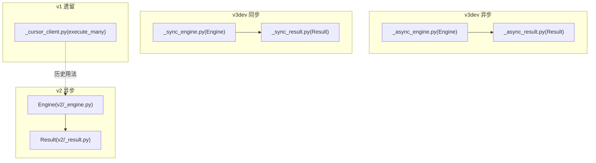
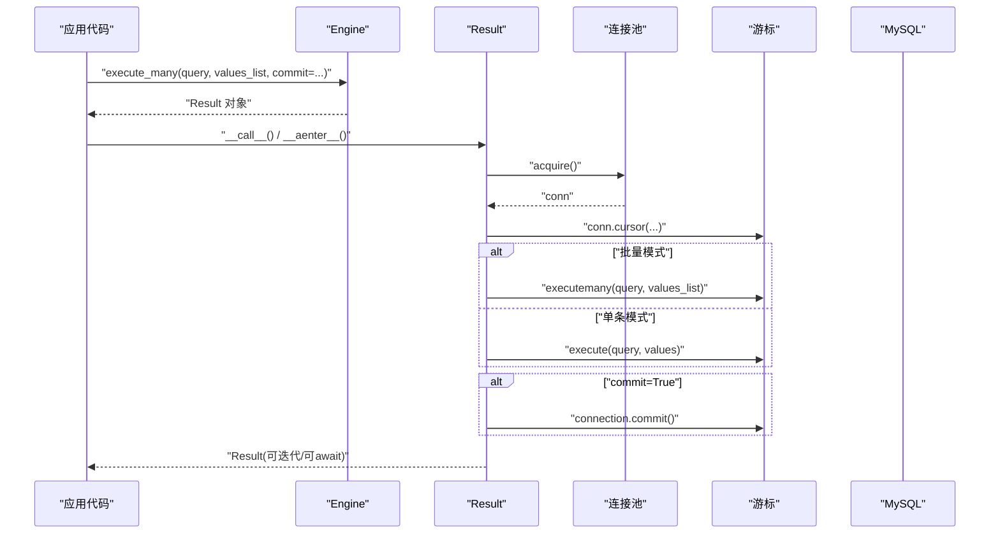
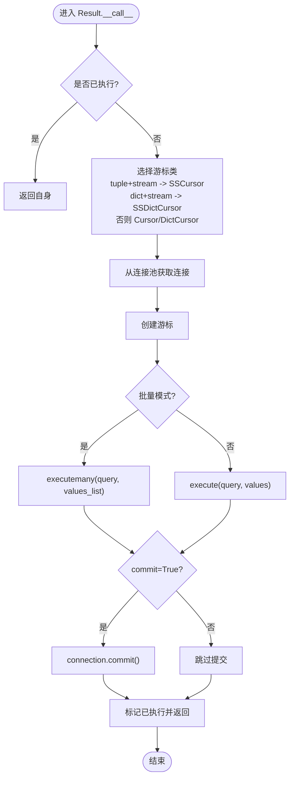
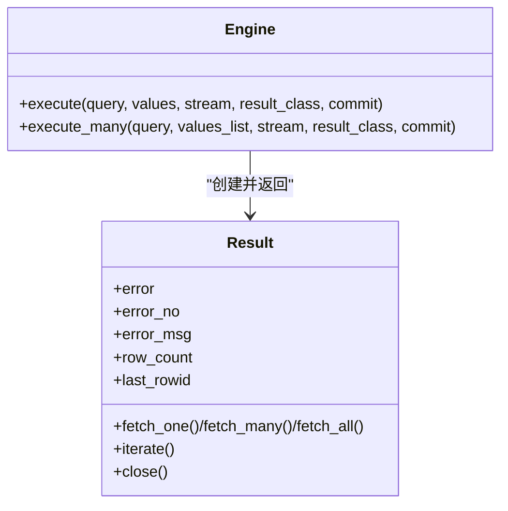

# 批量数据操作

<cite>
**本文引用的文件**   
- [asmysql/v2/_engine.py](file://asmysql/v2/_engine.py)
- [asmysql/v2/_result.py](file://asmysql/v2/_result.py)
- [asmysql/v3dev/_async_engine.py](file://asmysql/v3dev/_async_engine.py)
- [asmysql/v3dev/_sync_engine.py](file://asmysql/v3dev/_sync_engine.py)
- [asmysql/v3dev/_async_result.py](file://asmysql/v3dev/_async_result.py)
- [asmysql/v3dev/_sync_result.py](file://asmysql/v3dev/_sync_result.py)
- [asmysql/v1/_cursor_client.py](file://asmysql/v1/_cursor_client.py)
- [mkdocs/v2/docs/zh/transaction.md](file://mkdocs/v2/docs/zh/transaction.md)
</cite>

## 目录
1. [简介](#简介)
2. [项目结构](#项目结构)
3. [核心组件](#核心组件)
4. [架构总览](#架构总览)
5. [详细组件分析](#详细组件分析)
6. [依赖关系分析](#依赖关系分析)
7. [性能考量与优化建议](#性能考量与优化建议)
8. [故障排查指南](#故障排查指南)
9. [结论](#结论)
10. [附录：使用要点与最佳实践](#附录使用要点与最佳实践)

## 简介
本文件聚焦 asmysql 的批量数据操作能力，围绕高性能的批量插入、批量更新与批量删除展开。重点说明如何通过 Engine.execute() 与 Engine.execute_many() 进行参数化批量 SQL 执行，结合事务管理确保一致性与完整性，并给出部分失败处理与恢复策略、性能对比与优化建议。文档同时覆盖 v2（异步）与 v3dev（异步/同步）两套实现路径，帮助读者在不同版本中选择合适的方案。

## 项目结构
与批量操作直接相关的代码主要分布在以下模块：
- v2 异步引擎与结果封装：Engine + Result
- v3dev 异步/同步引擎与结果封装：AsyncEngine/SyncEngine + AsyncResult/SyncResult
- v1 遗留实现：CursorClient 中的 execute_many

图表来源
- [asmysql/v2/_engine.py:204-316](file://asmysql/v2/_engine.py#L204-L316)
- [asmysql/v2/_result.py:101-125](file://asmysql/v2/_result.py#L101-L125)
- [asmysql/v3dev/_async_engine.py:194-306](file://asmysql/v3dev/_async_engine.py#L194-L306)
- [asmysql/v3dev/_async_result.py:101-125](file://asmysql/v3dev/_async_result.py#L101-L125)
- [asmysql/v3dev/_sync_engine.py:184-297](file://asmysql/v3dev/_sync_engine.py#L184-L297)
- [asmysql/v3dev/_sync_result.py:103-127](file://asmysql/v3dev/_sync_result.py#L103-L127)
- [asmysql/v1/_cursor_client.py:47-68](file://asmysql/v1/_cursor_client.py#L47-L68)

章节来源
- [asmysql/v2/_engine.py:204-316](file://asmysql/v2/_engine.py#L204-L316)
- [asmysql/v3dev/_async_engine.py:194-306](file://asmysql/v3dev/_async_engine.py#L194-L306)
- [asmysql/v3dev/_sync_engine.py:184-297](file://asmysql/v3dev/_sync_engine.py#L184-L297)

## 核心组件
- Engine.execute(query, values, stream, result_class, commit)
  - 单条 SQL 执行入口，返回 Result 对象；支持 await 或 async with 两种模式。
- Engine.execute_many(query, values_list, stream, result_class, commit)
  - 批量 SQL 执行入口，底层调用驱动层的 executemany；返回 Result 对象。
- Result
  - 封装连接获取、游标创建、SQL 执行、提交/错误处理、结果读取与资源释放。
  - 提供 row_count、last_rowid、error/error_no/error_msg 等属性用于诊断与统计。

章节来源
- [asmysql/v2/_engine.py:226-316](file://asmysql/v2/_engine.py#L226-L316)
- [asmysql/v3dev/_async_engine.py:216-306](file://asmysql/v3dev/_async_engine.py#L216-L306)
- [asmysql/v3dev/_sync_engine.py:206-297](file://asmysql/v3dev/_sync_engine.py#L206-L297)
- [asmysql/v2/_result.py:21-125](file://asmysql/v2/_result.py#L21-L125)
- [asmysql/v3dev/_async_result.py:21-125](file://asmysql/v3dev/_async_result.py#L21-L125)
- [asmysql/v3dev/_sync_result.py:23-127](file://asmysql/v3dev/_sync_result.py#L23-L127)

## 架构总览
下图展示从业务层到数据库的批量执行流程，包括 execute_many 的参数传递、Result 内部选择游标类型、executemany 执行以及自动提交控制。

图表来源
- [asmysql/v2/_engine.py:283-316](file://asmysql/v2/_engine.py#L283-L316)
- [asmysql/v2/_result.py:101-125](file://asmysql/v2/_result.py#L101-L125)
- [asmysql/v3dev/_async_engine.py:273-306](file://asmysql/v3dev/_async_engine.py#L273-L306)
- [asmysql/v3dev/_async_result.py:101-125](file://asmysql/v3dev/_async_result.py#L101-L125)
- [asmysql/v3dev/_sync_engine.py:263-297](file://asmysql/v3dev/_sync_engine.py#L263-L297)
- [asmysql/v3dev/_sync_result.py:103-127](file://asmysql/v3dev/_sync_result.py#L103-L127)

## 详细组件分析

### 批量执行 API 概览
- 单条执行
  - Engine.execute(query, values, stream, result_class, commit)
  - 适合 INSERT/UPDATE/DELETE 单行或少量行场景。
- 批量执行
  - Engine.execute_many(query, values_list, stream, result_class, commit)
  - values_list 为 Sequence[Sequence|dict]，即多组参数集合。
  - 底层通过驱动层的 executemany 完成批量写入，减少网络往返与解析开销。

章节来源
- [asmysql/v2/_engine.py:204-316](file://asmysql/v2/_engine.py#L204-L316)
- [asmysql/v3dev/_async_engine.py:194-306](file://asmysql/v3dev/_async_engine.py#L194-L306)
- [asmysql/v3dev/_sync_engine.py:184-297](file://asmysql/v3dev/_sync_engine.py#L184-L297)

### 批量插入
- 适用场景：大批量 INSERT INTO ... VALUES(...) 或 INSERT ... SELECT。
- 推荐方式：
  - 使用 execute_many 传入多组参数列表。
  - 若需要强一致性，关闭 auto_commit 并在业务层统一提交。
- 关键行为：
  - Result.__call__ 在批量模式下调用 executemany。
  - 当 commit=True 时，执行后自动提交当前连接的事务。

章节来源
- [asmysql/v2/_result.py:113-118](file://asmysql/v2/_result.py#L113-L118)
- [asmysql/v3dev/_async_result.py:113-118](file://asmysql/v3dev/_async_result.py#L113-L118)
- [asmysql/v3dev/_sync_result.py:115-120](file://asmysql/v3dev/_sync_result.py#L115-L120)

### 批量更新
- 适用场景：按主键或唯一键批量 UPDATE。
- 推荐方式：
  - 使用 execute_many 传入多组参数。
  - 对超大数据集，考虑分批提交（见“事务与分批”小节）。
- 注意事项：
  - 批量更新通常不会返回 last_rowid，row_count 表示受影响行数。

章节来源
- [asmysql/v2/_result.py:153-165](file://asmysql/v2/_result.py#L153-L165)
- [asmysql/v3dev/_async_result.py:153-165](file://asmysql/v3dev/_async_result.py#L153-L165)
- [asmysql/v3dev/_sync_result.py:149-161](file://asmysql/v3dev/_sync_result.py#L149-L161)

### 批量删除
- 适用场景：按条件批量 DELETE。
- 推荐方式：
  - 使用 execute_many 传入多组过滤参数。
  - 注意 WHERE 条件与索引设计，避免全表扫描。
- 注意事项：
  - 同样关注 row_count 与错误码 error_no。

章节来源
- [asmysql/v2/_result.py:153-165](file://asmysql/v2/_result.py#L153-L165)
- [asmysql/v3dev/_async_result.py:153-165](file://asmysql/v3dev/_async_result.py#L153-L165)
- [asmysql/v3dev/_sync_result.py:149-161](file://asmysql/v3dev/_sync_result.py#L149-L161)

### 参数化查询与批量处理
- 参数形式：
  - 单条：values 可为 tuple/dict。
  - 批量：values_list 为 Sequence[tuple|dict]。
- 安全与性能：
  - 始终使用参数化占位符，避免字符串拼接。
  - 批量模式显著降低网络与解析开销。

章节来源
- [asmysql/v2/_engine.py:226-316](file://asmysql/v2/_engine.py#L226-L316)
- [asmysql/v3dev/_async_engine.py:216-306](file://asmysql/v3dev/_async_engine.py#L216-L306)
- [asmysql/v3dev/_sync_engine.py:206-297](file://asmysql/v3dev/_sync_engine.py#L206-L297)

### 事务管理与一致性
- 自动提交（默认）：
  - 当 commit=True 时，每次执行完成后自动提交。
- 手动提交：
  - 设置 auto_commit=False，并通过多次 execute/execute_many 组合，最后统一提交。
  - 文档示例展示了在 v2 中如何以 commit=False 的方式参与事务。
- 建议：
  - 跨多条语句的写操作应置于同一事务内，保证原子性。
  - 长事务需权衡锁持有时间与并发影响。

章节来源
- [mkdocs/v2/docs/zh/transaction.md:1-44](file://mkdocs/v2/docs/zh/transaction.md#L1-L44)
- [asmysql/v2/_result.py:117-118](file://asmysql/v2/_result.py#L117-L118)
- [asmysql/v3dev/_async_result.py:117-118](file://asmysql/v3dev/_async_result.py#L117-L118)
- [asmysql/v3dev/_sync_result.py:119-120](file://asmysql/v3dev/_sync_result.py#L119-L120)

### 部分失败与错误恢复策略
- 错误捕获：
  - Result.error/error_no/error_msg 提供错误信息。
  - 批量执行由底层驱动决定是整体失败还是部分成功；建议根据业务语义做重试或补偿。
- 常见策略：
  - 分块提交：将大批量拆分为多个小块，每块独立事务，失败仅回滚该块。
  - 幂等写入：对重复执行安全的语句（如 UPSERT），便于重试。
  - 记录失败明细：将失败参数落盘，后续离线修复或重放。
- 流式与内存：
  - 对于读多写少或超大结果集，可使用 stream 模式降低内存占用（读场景更常用）。

章节来源
- [asmysql/v2/_result.py:133-151](file://asmysql/v2/_result.py#L133-L151)
- [asmysql/v3dev/_async_result.py:133-151](file://asmysql/v3dev/_async_result.py#L133-L151)
- [asmysql/v3dev/_sync_result.py:129-147](file://asmysql/v3dev/_sync_result.py#L129-L147)

### 执行流程与算法细节
下图展示 Result 在执行阶段的决策流程（含批量分支、提交与异常处理）。

图表来源
- [asmysql/v2/_result.py:101-125](file://asmysql/v2/_result.py#L101-L125)
- [asmysql/v3dev/_async_result.py:101-125](file://asmysql/v3dev/_async_result.py#L101-L125)
- [asmysql/v3dev/_sync_result.py:103-127](file://asmysql/v3dev/_sync_result.py#L103-L127)

## 依赖关系分析
- Engine 负责连接池生命周期与 execute/execute_many 入口。
- Result 负责具体执行、提交、错误收集与资源回收。
- v2 与 v3dev 的异步/同步实现遵循相同接口约定，差异在于底层驱动与协程/同步语义。

图表来源
- [asmysql/v2/_engine.py:204-316](file://asmysql/v2/_engine.py#L204-L316)
- [asmysql/v2/_result.py:21-125](file://asmysql/v2/_result.py#L21-L125)
- [asmysql/v3dev/_async_engine.py:194-306](file://asmysql/v3dev/_async_engine.py#L194-L306)
- [asmysql/v3dev/_async_result.py:21-125](file://asmysql/v3dev/_async_result.py#L21-L125)
- [asmysql/v3dev/_sync_engine.py:184-297](file://asmysql/v3dev/_sync_engine.py#L184-L297)
- [asmysql/v3dev/_sync_result.py:23-127](file://asmysql/v3dev/_sync_result.py#L23-L127)

章节来源
- [asmysql/v2/_engine.py:204-316](file://asmysql/v2/_engine.py#L204-L316)
- [asmysql/v3dev/_async_engine.py:194-306](file://asmysql/v3dev/_async_engine.py#L194-L306)
- [asmysql/v3dev/_sync_engine.py:184-297](file://asmysql/v3dev/_sync_engine.py#L184-L297)

## 性能考量与优化建议
- 优先使用 execute_many：
  - 相比循环逐条执行，批量可减少网络往返与协议解析成本。
- 合理分块：
  - 将超大数据集切分为合适大小的批次（例如数百至数千条），平衡吞吐与内存占用。
- 事务粒度：
  - 大事务可能持有锁较久，建议按批次提交，缩短锁持有时间。
- 流式读取：
  - 读多写少或超大结果集场景下，开启 stream 可降低内存峰值。
- 索引与语句设计：
  - 批量更新/删除尽量命中索引，避免全表扫描。
- 监控与指标：
  - 利用 row_count、error_no/error_msg 评估成功率与吞吐。

[本节为通用指导，不直接分析具体文件]

## 故障排查指南
- 常见问题定位：
  - 检查 Result.error/error_no/error_msg 获取错误详情。
  - 确认 commit 参数与 auto_commit 配置是否符合预期。
  - 核对 values/values_list 结构与占位符数量匹配。
- 连接与游标：
  - 确保在上下文退出或显式 close 后释放连接，避免连接泄漏。
- 事务回滚：
  - 在手动提交模式下，出现异常时应回滚当前事务，避免脏写。

章节来源
- [asmysql/v2/_result.py:133-151](file://asmysql/v2/_result.py#L133-L151)
- [asmysql/v3dev/_async_result.py:133-151](file://asmysql/v3dev/_async_result.py#L133-L151)
- [asmysql/v3dev/_sync_result.py:129-147](file://asmysql/v3dev/_sync_result.py#L129-L147)
- [mkdocs/v2/docs/zh/transaction.md:1-44](file://mkdocs/v2/docs/zh/transaction.md#L1-L44)

## 结论
asmysql 通过 Engine.execute/execute_many 与 Result 的统一封装，提供了简洁且高性能的批量数据操作能力。配合事务管理与分块策略，可在保证一致性的前提下获得良好吞吐。建议在大规模写入场景中采用分批提交、幂等设计与完善的错误观测，以获得稳定可靠的批处理效果。

## 附录：使用要点与最佳实践
- 单条 vs 批量：
  - 少量数据用 execute；大量数据用 execute_many。
- 参数化：
  - 始终使用占位符传参，禁止字符串拼接。
- 事务：
  - 跨多条写操作使用同一事务；必要时按批次提交。
- 错误处理：
  - 基于 error_no/error_msg 分类处理；对可重试错误实施退避重试。
- 资源管理：
  - 使用 async with/with 或显式 close 确保连接与游标释放。

[本节为通用指导，不直接分析具体文件]