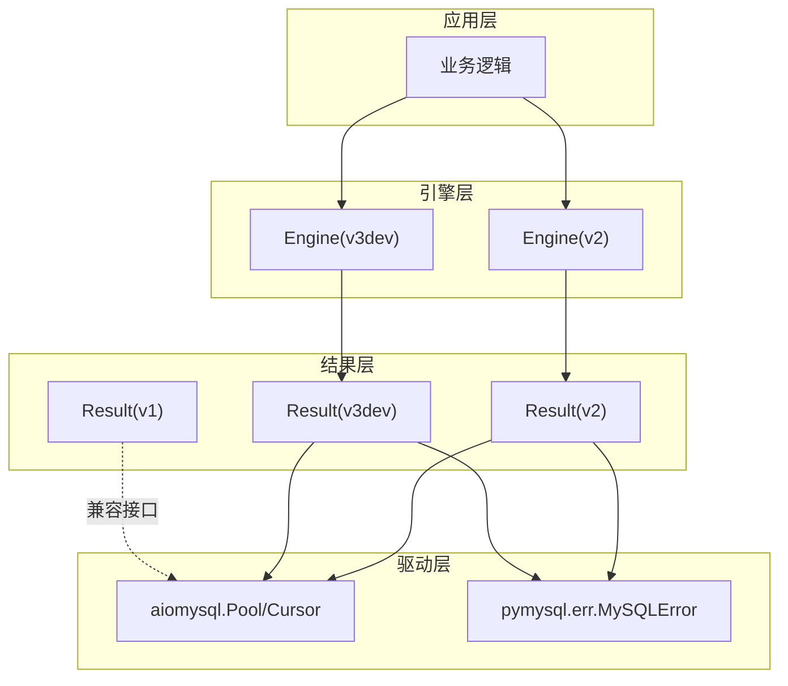
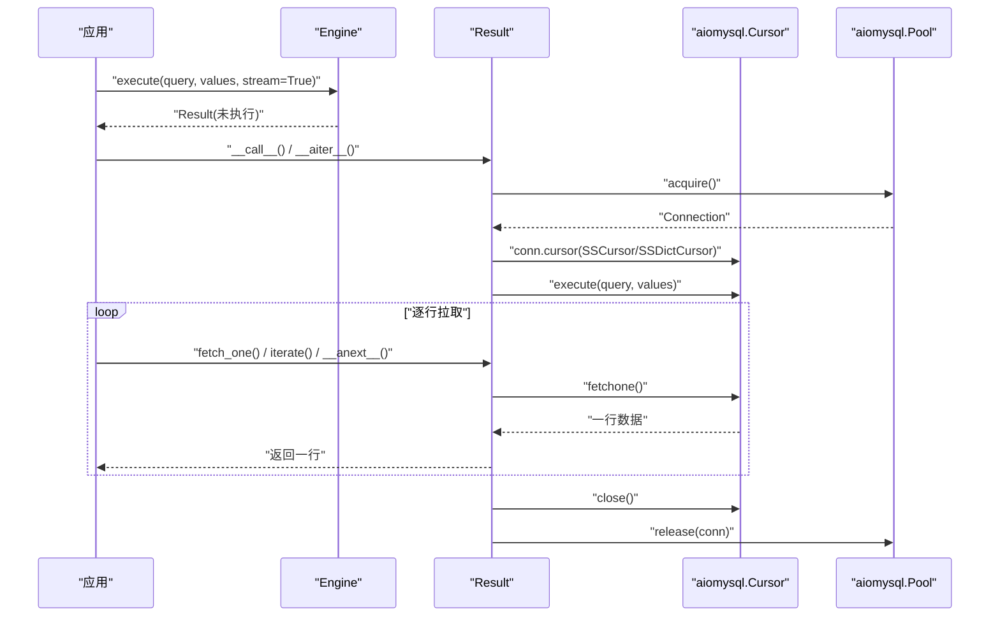
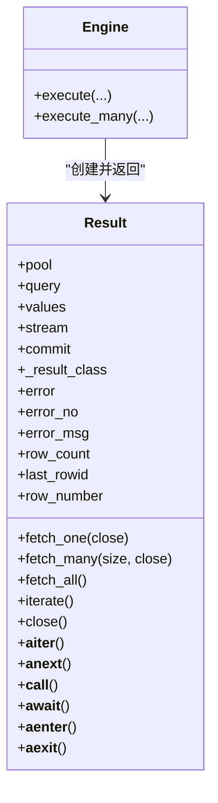
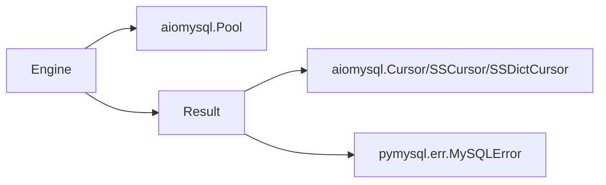

# 流式数据处理

<cite>
**本文引用的文件**   
- [asmysql/v2/_engine.py](file://asmysql/v2/_engine.py)
- [asmysql/v2/_result.py](file://asmysql/v2/_result.py)
- [asmysql/v3dev/_async_engine.py](file://asmysql/v3dev/_async_engine.py)
- [asmysql/v3dev/_async_result.py](file://asmysql/v3dev/_async_result.py)
- [asmysql/v1/_result.py](file://asmysql/v1/_result.py)
- [README.md](file://README.md)
- [pytest/v2/test_asmysql.py](file://pytest/v2/test_asmysql.py)
- [mkdocs/v2/docs/zh/best-practices.md](file://mkdocs/v2/docs/zh/best-practices.md)
- [mkdocs/v2/docs/zh/examples.md](file://mkdocs/v2/docs/zh/examples.md)
</cite>

## 目录
1. [简介](#简介)
2. [项目结构](#项目结构)
3. [核心组件](#核心组件)
4. [架构总览](#架构总览)
5. [详细组件分析](#详细组件分析)
6. [依赖关系分析](#依赖关系分析)
7. [性能与内存优化](#性能与内存优化)
8. [故障排查指南](#故障排查指南)
9. [结论](#结论)
10. [附录：使用示例路径](#附录使用示例路径)

## 简介
本文件聚焦 asmysql 的流式数据处理能力，围绕 stream=True 参数、Result 对象的异步迭代器（包括 result.iterate() 与 async for）展开，系统讲解如何以极低的内存占用处理大数据集。文档同时覆盖 fetch_one()/fetch_many()/fetch_all() 的最佳实践、错误处理与资源清理策略，并提供可落地的代码示例路径，帮助读者在生产环境中安全高效地处理海量数据。

## 项目结构
asmysql 提供多版本实现，其中 v2 与 v3dev 均支持流式查询与 Result 异步迭代；v1 提供基础 Result 接口但不包含连接池集成。核心要点如下：
- Engine 负责连接池管理与 SQL 执行入口，execute()/execute_many() 返回 Result 对象
- Result 封装游标生命周期、错误状态、结果获取方法以及异步迭代协议
- stream=True 时底层采用 SSCursor/SSDictCursor 进行服务端流式读取，避免一次性加载全量结果到内存



图表来源
- [asmysql/v2/_engine.py:227-259](file://asmysql/v2/_engine.py#L227-L259)
- [asmysql/v2/_result.py:101-125](file://asmysql/v2/_result.py#L101-L125)
- [asmysql/v3dev/_async_engine.py:217-249](file://asmysql/v3dev/_async_engine.py#L217-L249)
- [asmysql/v3dev/_async_result.py:101-125](file://asmysql/v3dev/_async_result.py#L101-L125)
- [asmysql/v1/_result.py:10-73](file://asmysql/v1/_result.py#L10-L73)

章节来源
- [README.md:15-28](file://README.md#L15-L28)

## 核心组件
- Engine.execute()/execute_many()
  - 接收 query、values、stream、result_class、commit 等参数
  - 根据 stream 与 result_class 选择底层游标类型（普通或流式、元组或字典）
  - 返回 Result 对象，支持 await 与 async with 两种用法
- Result
  - 属性：error、error_no、error_msg、row_count、last_rowid、row_number
  - 方法：fetch_one(close)、fetch_many(size, close)、fetch_all()、iterate()、close()
  - 异步迭代协议：__aiter__/__anext__ 支持 async for item in result
  - 上下文管理：__aenter__/__aexit__ 自动关闭连接与释放资源

章节来源
- [asmysql/v2/_engine.py:227-259](file://asmysql/v2/_engine.py#L227-L259)
- [asmysql/v2/_engine.py:284-316](file://asmysql/v2/_engine.py#L284-L316)
- [asmysql/v2/_result.py:21-44](file://asmysql/v2/_result.py#L21-L44)
- [asmysql/v2/_result.py:186-273](file://asmysql/v2/_result.py#L186-L273)
- [asmysql/v3dev/_async_engine.py:217-249](file://asmysql/v3dev/_async_engine.py#L217-L249)
- [asmysql/v3dev/_async_result.py:21-44](file://asmysql/v3dev/_async_result.py#L21-L44)
- [asmysql/v3dev/_async_result.py:186-273](file://asmysql/v3dev/_async_result.py#L186-L273)
- [asmysql/v1/_result.py:10-73](file://asmysql/v1/_result.py#L10-L73)

## 架构总览
下图展示从调用 execute 到逐行消费结果的完整流程，突出 stream=True 时的内存友好特性。



图表来源
- [asmysql/v2/_engine.py:227-259](file://asmysql/v2/_engine.py#L227-L259)
- [asmysql/v2/_result.py:101-125](file://asmysql/v2/_result.py#L101-L125)
- [asmysql/v2/_result.py:186-208](file://asmysql/v2/_result.py#L186-L208)
- [asmysql/v2/_result.py:251-273](file://asmysql/v2/_result.py#L251-L273)
- [asmysql/v3dev/_async_engine.py:217-249](file://asmysql/v3dev/_async_engine.py#L217-L249)
- [asmysql/v3dev/_async_result.py:101-125](file://asmysql/v3dev/_async_result.py#L101-L125)
- [asmysql/v3dev/_async_result.py:186-208](file://asmysql/v3dev/_async_result.py#L186-L208)
- [asmysql/v3dev/_async_result.py:251-273](file://asmysql/v3dev/_async_result.py#L251-L273)

## 详细组件分析

### Result 类与流式游标选择
- 游标选择策略
  - 当 result_class 为 tuple 且 stream=True：使用 SSCursor
  - 当 result_class 为 dict 且 stream=True：使用 SSDictCursor
  - 否则使用 Cursor/DictCursor（非流式）
- 执行与错误捕获
  - __call__() 内部完成 acquire/cursor/execute/commit 流程
  - 捕获 MySQLError 并记录 error，确保资源在异常分支正确释放
- 异步迭代协议
  - __aiter__/__anext__ 支持 async for item in result
  - 首次迭代触发 __call__()，随后逐行 fetch_one()，结束时自动 close()
- 生成器遍历
  - iterate() 返回异步生成器，逐行 yield，finally 中确保 close()



图表来源
- [asmysql/v2/_result.py:10-18](file://asmysql/v2/_result.py#L10-L18)
- [asmysql/v2/_result.py:21-44](file://asmysql/v2/_result.py#L21-L44)
- [asmysql/v2/_result.py:101-125](file://asmysql/v2/_result.py#L101-L125)
- [asmysql/v2/_result.py:186-273](file://asmysql/v2/_result.py#L186-L273)
- [asmysql/v2/_engine.py:227-259](file://asmysql/v2/_engine.py#L227-L259)

章节来源
- [asmysql/v2/_result.py:10-18](file://asmysql/v2/_result.py#L10-L18)
- [asmysql/v2/_result.py:101-125](file://asmysql/v2/_result.py#L101-L125)
- [asmysql/v2/_result.py:186-273](file://asmysql/v2/_result.py#L186-L273)
- [asmysql/v3dev/_async_result.py:10-18](file://asmysql/v3dev/_async_result.py#L10-L18)
- [asmysql/v3dev/_async_result.py:101-125](file://asmysql/v3dev/_async_result.py#L101-L125)
- [asmysql/v3dev/_async_result.py:186-273](file://asmysql/v3dev/_async_result.py#L186-L273)

### 流式查询最佳实践与行为差异
- stream=True 的优势
  - 通过 SSCursor/SSDictCursor 在服务端逐行推送，客户端仅持有当前行，显著降低内存峰值
  - row_count 在流式模式下返回 None（无法预知总行数）
- 对比 fetch_all()
  - fetch_all() 会将全部结果加载到内存，存在 OOM 风险
  - 适合小结果集或需要随机访问的场景
- 推荐模式
  - 大数据集：优先使用 async for 或 result.iterate()
  - 单条/少量数据：fetch_one()/fetch_many()
  - 明确需要全量：fetch_all()（谨慎评估内存）

章节来源
- [asmysql/v2/_result.py:153-165](file://asmysql/v2/_result.py#L153-L165)
- [asmysql/v2/_result.py:236-249](file://asmysql/v2/_result.py#L236-L249)
- [asmysql/v3dev/_async_result.py:153-165](file://asmysql/v3dev/_async_result.py#L153-L165)
- [asmysql/v3dev/_async_result.py:236-249](file://asmysql/v3dev/_async_result.py#L236-L249)
- [mkdocs/v2/docs/zh/best-practices.md:89-103](file://mkdocs/v2/docs/zh/best-practices.md#L89-L103)

### 异步迭代器与上下文管理
- async for 直接作用于 Result
  - 支持 async for item in engine.execute(...)
  - 内部通过 __aiter__/__anext__ 实现，自动管理连接生命周期
- context manager
  - async with engine.execute(...) as result: 退出时自动 close()
- iterate() 生成器
  - 显式控制遍历过程，finally 保证 close()

```mermaid
flowchart TD
Start(["开始"]) --> Mode{"使用方式"}
Mode --> |async for| AIter["__aiter__/__anext__"]
Mode --> |context manager| ACtx["__aenter__/__aexit__"]
Mode --> |iterate()| Gen["异步生成器"]
AIter --> Exec["__call__() 执行SQL"]
ACtx --> Exec
Gen --> Exec
Exec --> Fetch["逐行 fetch_one()"]
Fetch --> Done{"是否还有数据?"}
Done --> |是| Fetch
Done --> |否| Close["close() 释放资源"]
Close --> End(["结束"])
```

图表来源
- [asmysql/v2/_result.py:71-99](file://asmysql/v2/_result.py#L71-L99)
- [asmysql/v2/_result.py:101-125](file://asmysql/v2/_result.py#L101-L125)
- [asmysql/v2/_result.py:251-273](file://asmysql/v2/_result.py#L251-L273)
- [asmysql/v3dev/_async_result.py:71-99](file://asmysql/v3dev/_async_result.py#L71-L99)
- [asmysql/v3dev/_async_result.py:101-125](file://asmysql/v3dev/_async_result.py#L101-L125)
- [asmysql/v3dev/_async_result.py:251-273](file://asmysql/v3dev/_async_result.py#L251-L273)

章节来源
- [asmysql/v2/_result.py:71-99](file://asmysql/v2/_result.py#L71-L99)
- [asmysql/v2/_result.py:251-273](file://asmysql/v2/_result.py#L251-L273)
- [asmysql/v3dev/_async_result.py:71-99](file://asmysql/v3dev/_async_result.py#L71-L99)
- [asmysql/v3dev/_async_result.py:251-273](file://asmysql/v3dev/_async_result.py#L251-L273)

### 错误处理与资源清理
- 错误状态
  - error/error_no/error_msg 暴露执行期错误信息
  - 发生错误后 fetch_* 与 iterate 会短路返回空/不迭代
- 资源清理
  - close() 统一关闭游标并归还连接至池
  - __del__/__aexit__/iterate finally 保障异常路径下资源释放
- 手动 close 控制
  - fetch_one/close=False 或 fetch_many/close=False 需自行调用 result.close()
  - 忽略可能导致连接池耗尽

章节来源
- [asmysql/v2/_result.py:49-69](file://asmysql/v2/_result.py#L49-L69)
- [asmysql/v2/_result.py:119-125](file://asmysql/v2/_result.py#L119-L125)
- [asmysql/v2/_result.py:186-208](file://asmysql/v2/_result.py#L186-L208)
- [asmysql/v2/_result.py:210-234](file://asmysql/v2/_result.py#L210-L234)
- [asmysql/v2/_result.py:251-273](file://asmysql/v2/_result.py#L251-L273)
- [mkdocs/v2/docs/zh/best-practices.md:49-68](file://mkdocs/v2/docs/zh/best-practices.md#L49-L68)

## 依赖关系分析
- Engine 依赖 aiomysql.Pool 与 create_pool，Result 依赖 aiomysql.Cursor/SSCursor/SSDictCursor
- Result 捕获 pymysql.err.MySQLError 作为错误源
- v1 Result 仅提供基础接口，不包含连接池集成



图表来源
- [asmysql/v2/_engine.py:17-21](file://asmysql/v2/_engine.py#L17-L21)
- [asmysql/v2/_result.py:4-5](file://asmysql/v2/_result.py#L4-L5)
- [asmysql/v3dev/_async_engine.py:16-21](file://asmysql/v3dev/_async_engine.py#L16-L21)
- [asmysql/v3dev/_async_result.py:4-5](file://asmysql/v3dev/_async_result.py#L4-L5)
- [asmysql/v1/_result.py:4-7](file://asmysql/v1/_result.py#L4-L7)

章节来源
- [asmysql/v2/_engine.py:17-21](file://asmysql/v2/_engine.py#L17-L21)
- [asmysql/v2/_result.py:4-5](file://asmysql/v2/_result.py#L4-L5)
- [asmysql/v3dev/_async_engine.py:16-21](file://asmysql/v3dev/_async_engine.py#L16-L21)
- [asmysql/v3dev/_async_result.py:4-5](file://asmysql/v3dev/_async_result.py#L4-L5)
- [asmysql/v1/_result.py:4-7](file://asmysql/v1/_result.py#L4-L7)

## 性能与内存优化
- 流式 vs 全量
  - 流式：内存占用稳定，适合超大数据集
  - 全量：简单但可能 OOM，仅用于小结果集
- 批处理建议
  - 使用 fetch_many(size) 分批处理，平衡吞吐与内存
  - 结合进度打印/监控指标，便于观测处理进度
- 连接池配置
  - 合理设置 min/max pool size、pool_recycle、connect_timeout
  - 高并发场景适当提升池大小，避免等待队列过长
- 结果类型
  - tuple 更轻量；dict 可读性更好但略增内存
  - 自定义模型（如 Pydantic）可在 iterate/fetch 中按需转换

章节来源
- [mkdocs/v2/docs/zh/best-practices.md:124-141](file://mkdocs/v2/docs/zh/best-practices.md#L124-L141)
- [mkdocs/v2/docs/zh/examples.md:406-469](file://mkdocs/v2/docs/zh/examples.md#L406-L469)

## 故障排查指南
- 症状：内存持续增长或 OOM
  - 检查是否误用 fetch_all() 处理大结果集
  - 确认是否启用 stream=True 并使用 async for/iterate()
- 症状：连接池耗尽
  - 检查是否在 close=False 后忘记调用 result.close()
  - 确认是否正确使用 async with 或 async for 自动释放
- 症状：row_count 为 None
  - 流式模式下正常现象，如需总数请改用非流式查询
- 症状：查询报错
  - 检查 result.error/error_msg，定位 SQL 或权限问题

章节来源
- [asmysql/v2/_result.py:153-165](file://asmysql/v2/_result.py#L153-L165)
- [asmysql/v2/_result.py:186-208](file://asmysql/v2/_result.py#L186-L208)
- [asmysql/v2/_result.py:210-234](file://asmysql/v2/_result.py#L210-L234)
- [mkdocs/v2/docs/zh/best-practices.md:49-68](file://mkdocs/v2/docs/zh/best-practices.md#L49-L68)

## 结论
asmysql 通过 Engine + Result 的组合，提供了简洁而强大的流式数据处理能力。配合 stream=True、async for 与 result.iterate()，可以在极低内存占用下处理海量数据；同时完善的错误处理与资源管理机制，保障了生产环境的稳定性与可维护性。建议在大数据场景优先采用流式模式，并结合合适的批处理与连接池配置，以获得最佳的性能与资源利用率。

## 附录：使用示例路径
- 快速上手与流式查询示例
  - [README.md:40-96](file://README.md#L40-L96)
- 流式查询与常规查询对比
  - [mkdocs/v2/docs/zh/examples.md:406-469](file://mkdocs/v2/docs/zh/examples.md#L406-L469)
- 测试用例中的流式与迭代用法
  - [pytest/v2/test_asmysql.py:200-283](file://pytest/v2/test_asmysql.py#L200-L283)
- 最佳实践（错误处理、close 参数、大数据集）
  - [mkdocs/v2/docs/zh/best-practices.md:1-141](file://mkdocs/v2/docs/zh/best-practices.md#L1-141)