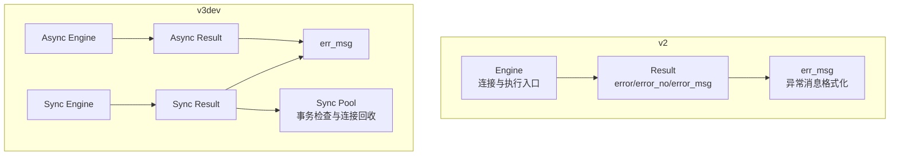
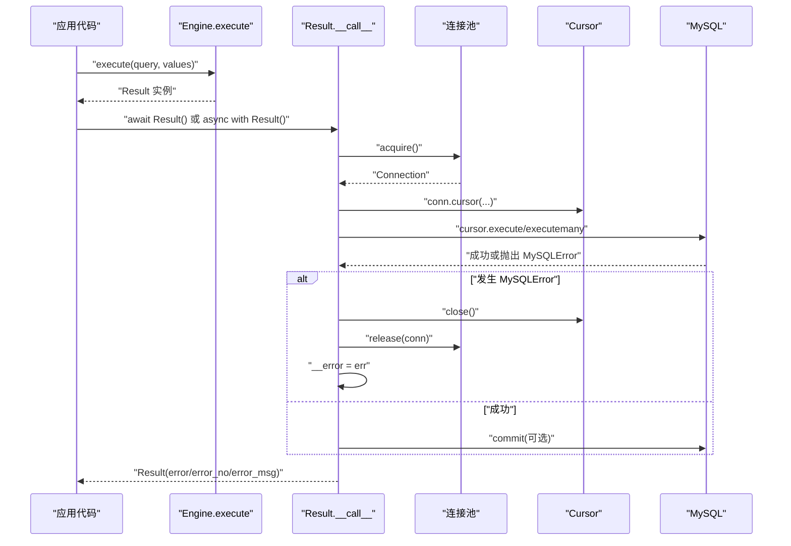
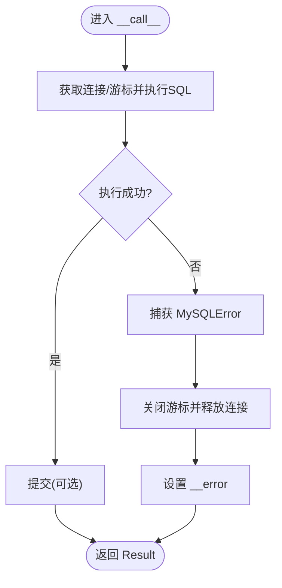
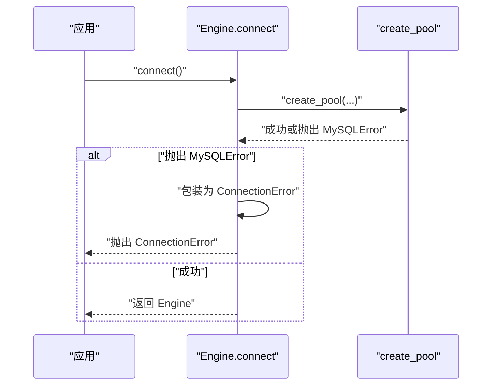
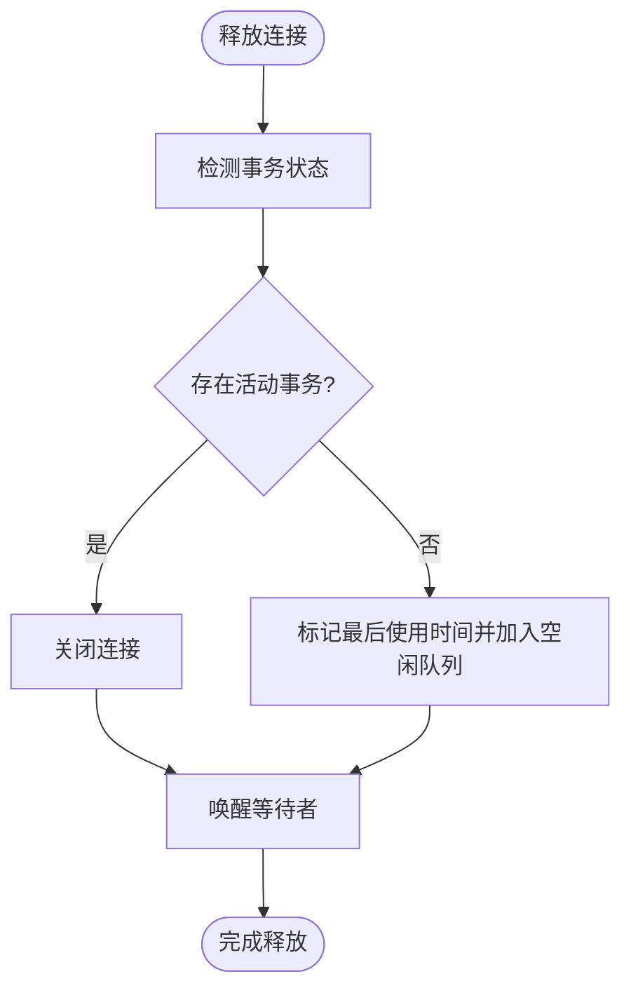
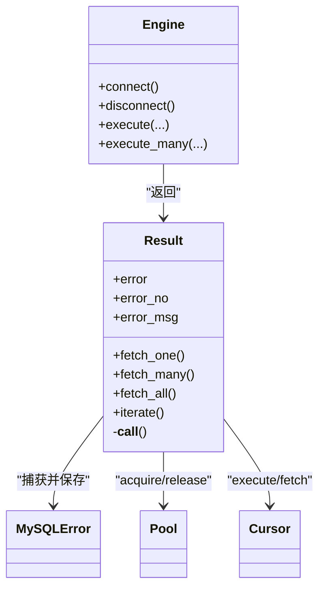

# 错误处理模式

<cite>
**本文引用的文件**
- [asmysql/v2/_result.py](file://asmysql/v2/_result.py)
- [asmysql/v2/_engine.py](file://asmysql/v2/_engine.py)
- [asmysql/v2/_error.py](file://asmysql/v2/_error.py)
- [asmysql/v3dev/_async_result.py](file://asmysql/v3dev/_async_result.py)
- [asmysql/v3dev/_sync_result.py](file://asmysql/v3dev/_sync_result.py)
- [asmysql/v3dev/_async_engine.py](file://asmysql/v3dev/_async_engine.py)
- [asmysql/v3dev/_sync_pool.py](file://asmysql/v3dev/_sync_pool.py)
- [mkdocs/v2/docs/zh/examples.md](file://mkdocs/v2/docs/zh/examples.md)
- [mkdocs/v2/docs/en/best-practices.md](file://mkdocs/v2/docs/en/best-practices.md)
- [mkdocs/v2/docs/zh/faq.md](file://mkdocs/v2/docs/zh/faq.md)
</cite>

## 目录
1. [简介](#简介)
2. [项目结构](#项目结构)
3. [核心组件](#核心组件)
4. [架构总览](#架构总览)
5. [详细组件分析](#详细组件分析)
6. [依赖关系分析](#依赖关系分析)
7. [性能考量](#性能考量)
8. [故障排查指南](#故障排查指南)
9. [结论](#结论)
10. [附录](#附录)

## 简介
本文件聚焦 asmysql 的错误处理高级模式，围绕 Result 对象中的 error、error_no、error_msg 属性展开，系统阐述如何构建健壮的错误处理机制（含重试与降级）、常见 MySQL 错误的分类与处理方法、日志记录与错误追踪最佳实践，以及在微服务架构中传播和记录数据库错误信息的方式。文档以 v2 与 v3dev 的异步/同步实现为蓝本，结合官方示例与最佳实践文档，提供可落地的工程化建议。

## 项目结构
与错误处理直接相关的核心模块包括：
- v2 版本：Engine 负责连接池与执行入口；Result 封装执行结果与错误信息；err_msg 统一异常消息格式化。
- v3dev 版本：异步/同步双实现，Result 在 __call__ 内部捕获 MySQLError 并写入 error 字段，同时暴露 error_no、error_msg 等便捷属性；Engine.connect 将底层连接异常转换为 ConnectionError；同步池在释放连接时检测事务状态并安全关闭。

图表来源
- [asmysql/v2/_engine.py:120-151](file://asmysql/v2/_engine.py#L120-L151)
- [asmysql/v2/_result.py:101-125](file://asmysql/v2/_result.py#L101-L125)
- [asmysql/v2/_error.py:2-6](file://asmysql/v2/_error.py#L2-L6)
- [asmysql/v3dev/_async_engine.py:120-141](file://asmysql/v3dev/_async_engine.py#L120-L141)
- [asmysql/v3dev/_async_result.py:101-125](file://asmysql/v3dev/_async_result.py#L101-L125)
- [asmysql/v3dev/_sync_result.py:103-127](file://asmysql/v3dev/_sync_result.py#L103-L127)
- [asmysql/v3dev/_sync_pool.py:243-272](file://asmysql/v3dev/_sync_pool.py#L243-L272)

章节来源
- [asmysql/v2/_engine.py:120-151](file://asmysql/v2/_engine.py#L120-L151)
- [asmysql/v2/_result.py:101-125](file://asmysql/v2/_result.py#L101-L125)
- [asmysql/v2/_error.py:2-6](file://asmysql/v2/_error.py#L2-L6)
- [asmysql/v3dev/_async_engine.py:120-141](file://asmysql/v3dev/_async_engine.py#L120-L141)
- [asmysql/v3dev/_async_result.py:101-125](file://asmysql/v3dev/_async_result.py#L101-L125)
- [asmysql/v3dev/_sync_result.py:103-127](file://asmysql/v3dev/_sync_result.py#L103-L127)
- [asmysql/v3dev/_sync_pool.py:243-272](file://asmysql/v3dev/_sync_pool.py#L243-L272)

## 核心组件
- Result.error：保存执行过程中捕获的 MySQLError 实例；若未发生错误则为 None。
- Result.error_no：返回错误码，无错误时返回 0。
- Result.error_msg：返回人类可读的错误信息，无错误时返回空字符串。
- err_msg(err)：统一异常消息格式化，避免空字符串导致日志缺失。
- Engine.connect：将底层连接异常包装为 ConnectionError，便于上层统一处理。

使用要点
- 在执行后优先检查 result.error，再读取数据或统计信息。
- 通过 error_no 进行错误码分支处理（如死锁、超时、权限等）。
- 通过 error_msg 记录到日志或上报链路。

章节来源
- [asmysql/v2/_result.py:49-52](file://asmysql/v2/_result.py#L49-L52)
- [asmysql/v2/_result.py:134-151](file://asmysql/v2/_result.py#L134-L151)
- [asmysql/v2/_error.py:2-6](file://asmysql/v2/_error.py#L2-L6)
- [asmysql/v2/_engine.py:148-151](file://asmysql/v2/_engine.py#L148-L151)
- [asmysql/v3dev/_async_result.py:49-52](file://asmysql/v3dev/_async_result.py#L49-L52)
- [asmysql/v3dev/_async_result.py:134-151](file://asmysql/v3dev/_async_result.py#L134-L151)
- [asmysql/v3dev/_sync_result.py:51-54](file://asmysql/v3dev/_sync_result.py#L51-L54)
- [asmysql/v3dev/_sync_result.py:131-147](file://asmysql/v3dev/_sync_result.py#L131-L147)
- [asmysql/v3dev/_async_engine.py:139-141](file://asmysql/v3dev/_async_engine.py#L139-L141)

## 架构总览
下图展示从 Engine.execute 到 Result.__call__ 的执行路径，以及错误在 Result 内部的捕获与存储流程。

图表来源
- [asmysql/v2/_engine.py:226-259](file://asmysql/v2/_engine.py#L226-L259)
- [asmysql/v2/_result.py:101-125](file://asmysql/v2/_result.py#L101-L125)
- [asmysql/v3dev/_async_engine.py:216-249](file://asmysql/v3dev/_async_engine.py#L216-L249)
- [asmysql/v3dev/_async_result.py:101-125](file://asmysql/v3dev/_async_result.py#L101-L125)

## 详细组件分析

### Result 对象错误属性与访问模式
- error：MySQLError 实例或 None。用于判断是否出错。
- error_no：int，错误码；无错误时为 0。适合做精确分支处理。
- error_msg：str，错误详情；无错误时为空串。适合日志与上报。

推荐用法
- 先判错：if result.error: ...
- 按错误码分流：根据 error_no 区分超时、死锁、权限等场景。
- 记录上下文：结合 SQL、参数、调用栈片段与业务标识，输出结构化日志。

章节来源
- [asmysql/v2/_result.py:49-52](file://asmysql/v2/_result.py#L49-L52)
- [asmysql/v2/_result.py:134-151](file://asmysql/v2/_result.py#L134-L151)
- [asmysql/v3dev/_async_result.py:49-52](file://asmysql/v3dev/_async_result.py#L49-L52)
- [asmysql/v3dev/_async_result.py:134-151](file://asmysql/v3dev/_async_result.py#L134-L151)
- [asmysql/v3dev/_sync_result.py:51-54](file://asmysql/v3dev/_sync_result.py#L51-L54)
- [asmysql/v3dev/_sync_result.py:131-147](file://asmysql/v3dev/_sync_result.py#L131-L147)

### 错误捕获与资源释放流程
Result.__call__ 在执行 SQL 时捕获 MySQLError，确保游标与连接被正确关闭并归还连接池，同时将错误保存到 __error。

图表来源
- [asmysql/v2/_result.py:101-125](file://asmysql/v2/_result.py#L101-L125)
- [asmysql/v3dev/_async_result.py:101-125](file://asmysql/v3dev/_async_result.py#L101-L125)
- [asmysql/v3dev/_sync_result.py:103-127](file://asmysql/v3dev/_sync_result.py#L103-L127)

章节来源
- [asmysql/v2/_result.py:101-125](file://asmysql/v2/_result.py#L101-L125)
- [asmysql/v3dev/_async_result.py:101-125](file://asmysql/v3dev/_async_result.py#L101-L125)
- [asmysql/v3dev/_sync_result.py:103-127](file://asmysql/v3dev/_sync_result.py#L103-L127)

### 连接层错误转换
Engine.connect 在创建连接池时捕获 MySQLError，并将其转换为 ConnectionError，便于上层统一识别“连接失败”类问题。

图表来源
- [asmysql/v2/_engine.py:131-151](file://asmysql/v2/_engine.py#L131-L151)
- [asmysql/v3dev/_async_engine.py:120-141](file://asmysql/v3dev/_async_engine.py#L120-L141)

章节来源
- [asmysql/v2/_engine.py:131-151](file://asmysql/v2/_engine.py#L131-L151)
- [asmysql/v3dev/_async_engine.py:120-141](file://asmysql/v3dev/_async_engine.py#L120-L141)

### 同步连接池的事务安全检查
同步池在释放连接前尝试检测是否存在活动事务，若有则主动关闭连接，避免脏连接复用导致的状态不一致。

图表来源
- [asmysql/v3dev/_sync_pool.py:243-272](file://asmysql/v3dev/_sync_pool.py#L243-L272)

章节来源
- [asmysql/v3dev/_sync_pool.py:243-272](file://asmysql/v3dev/_sync_pool.py#L243-L272)

### 错误处理装饰器与最佳实践
官方示例提供了基于装饰器的错误处理思路，建议在业务函数层面统一捕获并记录错误，必要时向上抛出或返回降级结果。

章节来源
- [mkdocs/v2/docs/zh/examples.md:646-686](file://mkdocs/v2/docs/zh/examples.md#L646-L686)
- [mkdocs/v2/docs/en/best-practices.md:49-96](file://mkdocs/v2/docs/en/best-practices.md#L49-L96)

## 依赖关系分析
- Result 依赖 aiomysql/pymysql 的 Cursor/Pool 与 MySQLError。
- Engine 依赖 aiomysql.create_pool 建立连接池，并在连接阶段对异常进行包装。
- err_msg 作为通用工具被多处引用，保证日志一致性。
- 同步池在释放连接时对事务状态进行检查，增强稳定性。

图表来源
- [asmysql/v2/_engine.py:226-259](file://asmysql/v2/_engine.py#L226-L259)
- [asmysql/v2/_result.py:101-125](file://asmysql/v2/_result.py#L101-L125)
- [asmysql/v3dev/_async_engine.py:216-249](file://asmysql/v3dev/_async_engine.py#L216-L249)
- [asmysql/v3dev/_async_result.py:101-125](file://asmysql/v3dev/_async_result.py#L101-L125)

章节来源
- [asmysql/v2/_engine.py:226-259](file://asmysql/v2/_engine.py#L226-L259)
- [asmysql/v2/_result.py:101-125](file://asmysql/v2/_result.py#L101-L125)
- [asmysql/v3dev/_async_engine.py:216-249](file://asmysql/v3dev/_async_engine.py#L216-L249)
- [asmysql/v3dev/_async_result.py:101-125](file://asmysql/v3dev/_async_result.py#L101-L125)

## 性能考量
- 流式查询：对于大结果集，建议使用 stream=True 并通过迭代方式消费，避免一次性加载导致内存峰值。
- 自动关闭策略：fetch_one/fetch_many/close 默认自动关闭连接，减少连接泄漏风险；仅在需要复用同一连接时手动控制 close=False，并确保最终调用 close。
- 连接池大小：依据并发量与数据库能力调整 min_pool_size/max_pool_size，参考 FAQ 的建议值。

章节来源
- [mkdocs/v2/docs/en/best-practices.md:49-96](file://mkdocs/v2/docs/en/best-practices.md#L49-L96)
- [mkdocs/v2/docs/zh/faq.md:80-97](file://mkdocs/v2/docs/zh/faq.md#L80-L97)

## 故障排查指南
- 连接失败：Engine.connect 会将底层异常包装为 ConnectionError，可在上层统一捕获并告警。
- 查询失败：检查 result.error 是否为非空，读取 error_no 与 error_msg 定位原因。
- 连接泄漏：确认 fetch_one/fetch_many/close 的使用是否符合自动关闭约定；必要时显式调用 close。
- 事务残留：同步池在释放连接时会检测事务状态，若发现活动事务会主动关闭连接，避免后续复用污染。

章节来源
- [asmysql/v2/_engine.py:148-151](file://asmysql/v2/_engine.py#L148-L151)
- [asmysql/v3dev/_async_engine.py:139-141](file://asmysql/v3dev/_async_engine.py#L139-L141)
- [asmysql/v2/_result.py:101-125](file://asmysql/v2/_result.py#L101-L125)
- [asmysql/v3dev/_sync_pool.py:243-272](file://asmysql/v3dev/_sync_pool.py#L243-L272)

## 结论
asmysql 通过 Result.error/error_no/error_msg 提供了稳定且易用的错误处理接口，配合 Engine.connect 的连接异常包装与连接池的安全回收，能够支撑高可靠的数据访问层。在生产环境中，建议结合错误码分类、重试与降级策略、结构化日志与链路追踪，形成端到端的健壮性保障。

## 附录

### 常见 MySQL 错误分类与处理建议
- 连接相关
  - 现象：连接超时、认证失败、网络不可达。
  - 处理：捕获 ConnectionError；记录 connect_timeout、host/port/user/password；必要时触发熔断与快速失败。
- 权限相关
  - 现象：权限不足、表不存在、列不匹配。
  - 处理：依据 error_no 分支，提示运维或回退到只读副本/缓存。
- 死锁与锁等待
  - 现象：死锁错误码、锁等待超时。
  - 处理：短延迟重试（指数退避），限制最大重试次数；必要时拆分事务或优化索引。
- 超时与限流
  - 现象：查询超时、服务器繁忙。
  - 处理：增加 connect_timeout/lock_wait_timeout；启用重试与降级；监控慢查询。
- 数据完整性
  - 现象：唯一键冲突、外键约束失败。
  - 处理：业务侧幂等设计；冲突时走补偿逻辑或返回友好提示。

[本节为概念性说明，不直接分析具体文件]

### 重试策略与降级方案
- 重试策略
  - 适用场景：瞬时错误（死锁、锁等待、短暂网络抖动）。
  - 策略：指数退避 + 抖动；限定最大重试次数；对幂等写操作谨慎重试。
- 降级方案
  - 读多写少：读请求失败时返回缓存或只读副本；写请求失败时排队或拒绝并告警。
  - 功能降级：关键路径失败时返回兜底数据或空结果，保证主流程可用。

[本节为概念性说明，不直接分析具体文件]

### 日志记录与错误追踪最佳实践
- 结构化日志：包含错误码、错误信息、SQL、参数摘要、耗时、线程/协程 ID、TraceID。
- 分级输出：错误级别记录完整上下文；调试级别仅记录必要信息。
- 链路追踪：在跨服务调用中携带 TraceID，便于全链路定位。
- 指标上报：错误率、重试次数、超时比例、死锁计数等。

[本节为概念性说明，不直接分析具体文件]

### 微服务架构中的错误传播与记录
- 服务间协议：将 error_no、error_msg、trace_id 纳入响应体或错误头。
- 网关/编排层：统一收集错误指标，触发熔断与告警。
- 审计与合规：敏感信息脱敏后再记录；保留最小必要上下文。

[本节为概念性说明，不直接分析具体文件]