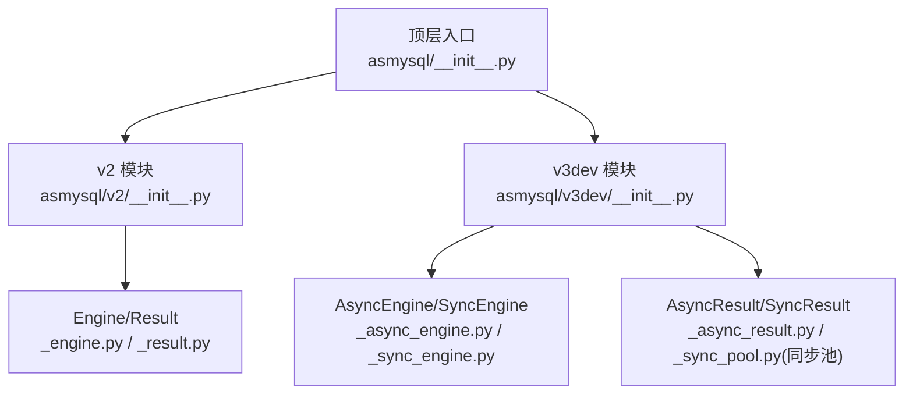
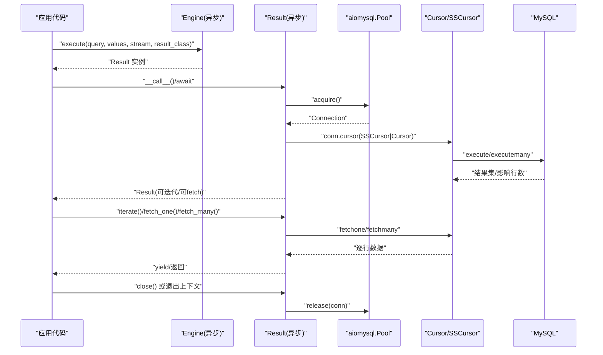
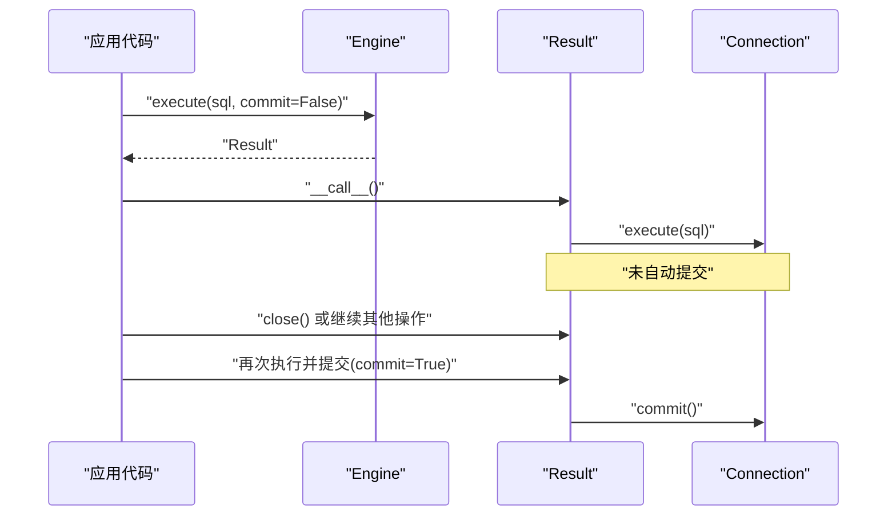
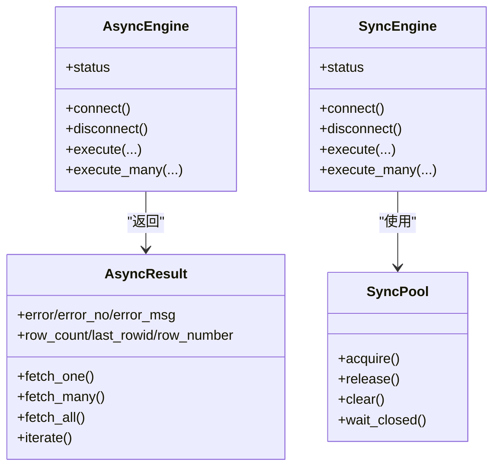

# 高级使用示例

<cite>
**本文引用的文件**
- [README.md](file://README.md)
- [asmysql/__init__.py](file://asmysql/__init__.py)
- [asmysql/v2/__init__.py](file://asmysql/v2/__init__.py)
- [asmysql/v3dev/__init__.py](file://asmysql/v3dev/__init__.py)
- [asmysql/v2/_engine.py](file://asmysql/v2/_engine.py)
- [asmysql/v2/_result.py](file://asmysql/v2/_result.py)
- [asmysql/v3dev/_async_engine.py](file://asmysql/v3dev/_async_engine.py)
- [asmysql/v3dev/_sync_engine.py](file://asmysql/v3dev/_sync_engine.py)
- [asmysql/v3dev/_async_result.py](file://asmysql/v3dev/_async_result.py)
- [asmysql/v3dev/_sync_pool.py](file://asmysql/v3dev/_sync_pool.py)
- [mkdocs/v2/docs/zh/best-practices.md](file://mkdocs/v2/docs/zh/best-practices.md)
- [mkdocs/v2/docs/zh/transaction.md](file://mkdocs/v2/docs/zh/transaction.md)
- [tests/v3/test_async.py](file://tests/v3/test_async.py)
</cite>

## 目录
1. [简介](#简介)
2. [项目结构](#项目结构)
3. [核心组件](#核心组件)
4. [架构总览](#架构总览)
5. [详细组件分析](#详细组件分析)
6. [依赖关系分析](#依赖关系分析)
7. [性能与连接池调优](#性能与连接池调优)
8. [故障排查指南](#故障排查指南)
9. [结论](#结论)
10. [附录：生产最佳实践清单](#附录生产最佳实践清单)

## 简介
本章节面向有经验的开发者，聚焦 asmysql 的高级用法与生产最佳实践，涵盖以下主题：
- 流式查询处理大结果集（stream=True）
- 批量数据操作（execute_many）
- 事务管理（auto_commit、commit 参数）
- 异步迭代器与上下文管理器组合使用
- 结果类型转换（tuple/dict/自定义对象）
- 连接池配置调优、性能监控与调试技巧

## 项目结构
仓库按版本组织，v2 为稳定版，v3dev 为开发演进版，提供同步与异步双引擎。顶层入口统一导出常用类，便于应用侧按需引入。



图示来源
- [asmysql/__init__.py:1-16](file://asmysql/__init__.py#L1-L16)
- [asmysql/v2/__init__.py:1-15](file://asmysql/v2/__init__.py#L1-L15)
- [asmysql/v3dev/__init__.py:1-14](file://asmysql/v3dev/__init__.py#L1-L14)

章节来源
- [README.md:1-135](file://README.md#L1-L135)
- [asmysql/__init__.py:1-16](file://asmysql/__init__.py#L1-L16)
- [asmysql/v2/__init__.py:1-15](file://asmysql/v2/__init__.py#L1-L15)
- [asmysql/v3dev/__init__.py:1-14](file://asmysql/v3dev/__init__.py#L1-L14)

## 核心组件
- Engine（异步/同步）：封装连接池创建、生命周期管理、执行接口 execute/execute_many；支持 URL 解析与参数覆盖；暴露 status 用于监控。
- Result：封装游标获取、错误信息、行计数、last_rowid、row_number；支持 fetch_one/fetch_many/fetch_all/iterate；支持 async for 直接迭代；支持 result_class 类型转换。
- AsMysql：业务逻辑基类，持有 engine 引用并通过 client 访问底层能力。

章节来源
- [asmysql/v2/_engine.py:37-317](file://asmysql/v2/_engine.py#L37-L317)
- [asmysql/v2/_result.py:21-273](file://asmysql/v2/_result.py#L21-L273)
- [asmysql/v3dev/_async_engine.py:27-307](file://asmysql/v3dev/_async_engine.py#L27-L307)
- [asmysql/v3dev/_sync_engine.py:26-298](file://asmysql/v3dev/_sync_engine.py#L26-L298)
- [asmysql/v3dev/_async_result.py:21-273](file://asmysql/v3dev/_async_result.py#L21-L273)
- [asmysql/v3dev/_asmysql.py:11-30](file://asmysql/v3dev/_asmysql.py#L11-L30)

## 架构总览
下图展示 v3dev 异步路径的调用链：应用通过 Engine.execute 返回 Result，Result 内部选择合适 Cursor 并执行 SQL，随后以流式或缓存方式产出数据。



图示来源
- [asmysql/v3dev/_async_engine.py:217-249](file://asmysql/v3dev/_async_engine.py#L217-L249)
- [asmysql/v3dev/_async_result.py:101-125](file://asmysql/v3dev/_async_result.py#L101-L125)
- [asmysql/v3dev/_async_result.py:251-273](file://asmysql/v3dev/_async_result.py#L251-L273)

## 详细组件分析

### 流式查询与大结果集处理（stream=True）
- 适用场景：千万级行读取、ETL 导出、报表生成等内存敏感场景。
- 关键机制：
  - 当 stream=True 且 result_class=tuple 时，底层使用 SSCursor；否则使用 SSDictCursor。
  - iterate() 基于 fetchone 循环 yield，避免一次性加载全量结果。
  - row_count 在流式模式下不可用（None）。
- 推荐模式：
  - 使用 async with 或 async for 自动管理连接释放。
  - 对大数据集优先采用 iterate() 或 async for item in result。

```mermaid
flowchart TD
Start(["开始"]) --> CheckStream{"是否启用流式?"}
CheckStream --> |是| UseSS["选择 SSCursor/SSDictCursor"]
CheckStream --> |否| UseCache["选择 Cursor/DictCursor"]
UseSS --> Exec["执行SQL"]
UseCache --> Exec
Exec --> Iterate{"遍历方式"}
Iterate --> |iterate()/async for| StreamFetch["逐行拉取(fetchone)"]
Iterate --> |fetch_all| LoadAll["一次性加载(不推荐大结果集)"]
StreamFetch --> Process["逐条处理/写入下游"]
LoadAll --> Process
Process --> Close["关闭游标/归还连接"]
Close --> End(["结束"])
```

图示来源
- [asmysql/v3dev/_async_result.py:10-18](file://asmysql/v3dev/_async_result.py#L10-L18)
- [asmysql/v3dev/_async_result.py:251-273](file://asmysql/v3dev/_async_result.py#L251-L273)
- [asmysql/v2/_result.py:10-18](file://asmysql/v2/_result.py#L10-L18)
- [asmysql/v2/_result.py:251-273](file://asmysql/v2/_result.py#L251-L273)

章节来源
- [asmysql/v3dev/_async_result.py:10-18](file://asmysql/v3dev/_async_result.py#L10-L18)
- [asmysql/v3dev/_async_result.py:153-165](file://asmysql/v3dev/_async_result.py#L153-L165)
- [asmysql/v3dev/_async_result.py:251-273](file://asmysql/v3dev/_async_result.py#L251-L273)
- [mkdocs/v2/docs/zh/best-practices.md:89-103](file://mkdocs/v2/docs/zh/best-practices.md#L89-L103)
- [tests/v3/test_async.py:49-89](file://tests/v3/test_async.py#L49-L89)

### 批量数据操作（execute_many）
- 适用场景：批量插入/更新，减少网络往返与协议开销。
- 关键点：
  - Engine.execute_many 将 values 作为多组参数传入底层 executemany。
  - 仍可通过 stream/result_class 控制结果类型与流式行为（写操作通常无需流式）。
  - commit 参数控制是否立即提交（受 auto_commit 影响）。
- 建议：
  - 分批提交（如每批 N 条），平衡吞吐与失败重试成本。
  - 结合索引与唯一键约束，避免重复写入。

章节来源
- [asmysql/v3dev/_async_engine.py:274-306](file://asmysql/v3dev/_async_engine.py#L274-L306)
- [asmysql/v2/_engine.py:284-316](file://asmysql/v2/_engine.py#L284-L316)
- [asmysql/v3dev/_async_result.py:113-118](file://asmysql/v3dev/_async_result.py#L113-L118)

### 事务管理（auto_commit 与 commit 参数）
- 默认自动提交：auto_commit=True 时，每次执行后自动 commit。
- 手动提交：设置 auto_commit=False，并在需要时通过 execute(..., commit=False) 延迟提交，最后由上层逻辑决定提交时机。
- 注意事项：
  - 非自动提交下，需确保连接正确释放，避免连接泄漏。
  - 长事务会占用连接资源，应谨慎使用。



图示来源
- [mkdocs/v2/docs/zh/transaction.md:1-44](file://mkdocs/v2/docs/zh/transaction.md#L1-L44)
- [asmysql/v3dev/_async_result.py:117-118](file://asmysql/v3dev/_async_result.py#L117-L118)

章节来源
- [mkdocs/v2/docs/zh/transaction.md:1-44](file://mkdocs/v2/docs/zh/transaction.md#L1-L44)
- [asmysql/v3dev/_async_result.py:117-118](file://asmysql/v3dev/_async_result.py#L117-L118)

### 异步迭代器与上下文管理器
- 两种等价用法：
  - async with engine.execute(...) as result: ...
  - async for item in engine.execute(...): ...
- 优势：
  - 自动管理连接与游标生命周期，降低忘记 close 的风险。
  - 与流式查询配合，实现低内存高吞吐的数据处理流水线。

章节来源
- [mkdocs/v2/docs/zh/best-practices.md:5-23](file://mkdocs/v2/docs/zh/best-practices.md#L5-L23)
- [mkdocs/v2/docs/zh/best-practices.md:39-47](file://mkdocs/v2/docs/zh/best-practices.md#L39-L47)
- [tests/v3/test_async.py:72-89](file://tests/v3/test_async.py#L72-L89)

### 结果类型转换与数据处理技巧
- 内置类型：
  - tuple：默认元组行
  - dict：字典行（列名→值）
- 自定义类型：
  - 指定 result_class=YourModel，Result 会在 fetch_one/fetch_many/iterate 中尝试以 **data 构造对象。
- 复杂字段处理：
  - 建议在模型层做类型转换与校验（例如 JSON、时间戳、枚举映射）。
  - 对超大结果集，优先使用 iterate 边读边转，避免中间列表膨胀。

章节来源
- [asmysql/v3dev/_async_result.py:202-208](file://asmysql/v3dev/_async_result.py#L202-L208)
- [asmysql/v3dev/_async_result.py:228-234](file://asmysql/v3dev/_async_result.py#L228-L234)
- [asmysql/v3dev/_async_result.py:264-268](file://asmysql/v3dev/_async_result.py#L264-L268)
- [tests/v3/test_async.py:38-47](file://tests/v3/test_async.py#L38-L47)

## 依赖关系分析
- 异步路径依赖 aiomysql.Pool 与 aiomysql.*Cursor。
- 同步路径（v3dev）使用自实现的同步连接池（仿 aiomysql.Pool 语义），依赖 pymysql.Connection。
- Engine 负责参数解析、连接池初始化与状态暴露；Result 负责游标与结果消费。



图示来源
- [asmysql/v3dev/_async_engine.py:27-307](file://asmysql/v3dev/_async_engine.py#L27-L307)
- [asmysql/v3dev/_sync_engine.py:26-298](file://asmysql/v3dev/_sync_engine.py#L26-L298)
- [asmysql/v3dev/_async_result.py:21-273](file://asmysql/v3dev/_async_result.py#L21-L273)
- [asmysql/v3dev/_sync_pool.py:18-281](file://asmysql/v3dev/_sync_pool.py#L18-L281)

章节来源
- [asmysql/v3dev/_async_engine.py:27-307](file://asmysql/v3dev/_async_engine.py#L27-L307)
- [asmysql/v3dev/_sync_engine.py:26-298](file://asmysql/v3dev/_sync_engine.py#L26-L298)
- [asmysql/v3dev/_async_result.py:21-273](file://asmysql/v3dev/_async_result.py#L21-L273)
- [asmysql/v3dev/_sync_pool.py:18-281](file://asmysql/v3dev/_sync_pool.py#L18-L281)

## 性能与连接池调优
- 连接池参数
  - min_pool_size/max_pool_size：根据并发与数据库承载能力设定，避免过小导致频繁建连，过大导致资源争用。
  - pool_recycle：定期回收空闲 TCP 连接，规避中间件/防火墙超时断开导致的“僵尸连接”。
  - connect_timeout：控制连接建立超时，防止雪崩。
  - echo_sql_log：开启后可打印 SQL，便于定位慢查询与异常语句。
- 监控指标
  - Engine.status 暴露 address/connected/pool_minsize/pool_maxsize/pool_size/pool_free/pool_used，可用于健康检查与告警。
- 流式与批处理
  - 大结果集务必使用 stream=True + iterate()/async for。
  - 批量写入建议分批次提交，结合唯一键/幂等设计，提高容错性。
- 调试技巧
  - 使用 echo_sql_log 观察实际执行的 SQL 与参数。
  - 在关键路径记录耗时与队列长度，识别瓶颈。
  - 针对热点表，关注索引命中与锁等待。

章节来源
- [asmysql/v3dev/_async_engine.py:145-156](file://asmysql/v3dev/_async_engine.py#L145-L156)
- [asmysql/v3dev/_sync_engine.py:143-154](file://asmysql/v3dev/_sync_engine.py#L143-L154)
- [mkdocs/v2/docs/zh/best-practices.md:124-141](file://mkdocs/v2/docs/zh/best-practices.md#L124-L141)

## 故障排查指南
- 常见错误
  - 连接失败：检查 host/port/user/password/url 参数与网络连通性。
  - 连接泄漏：确认所有分支均能触发 close 或处于上下文管理器中。
  - 事务未提交：auto_commit=False 时需显式提交。
- 诊断步骤
  - 查看 result.error/error_no/error_msg 定位具体错误码与信息。
  - 打开 echo_sql_log 核对 SQL 与参数。
  - 使用 Engine.status 观察连接池占用情况。
- 典型问题
  - 流式查询后忘记关闭：会导致连接无法归还，最终耗尽连接池。
  - 大批量写入未分批：可能触发 MySQL 包大小限制或长时间持锁。

章节来源
- [asmysql/v3dev/_async_result.py:133-151](file://asmysql/v3dev/_async_result.py#L133-L151)
- [asmysql/v3dev/_async_result.py:153-165](file://asmysql/v3dev/_async_result.py#L153-L165)
- [mkdocs/v2/docs/zh/best-practices.md:70-88](file://mkdocs/v2/docs/zh/best-practices.md#L70-L88)

## 结论
- 对于大数据集，优先采用 stream=True 与 iterate()/async for，避免内存峰值。
- 批量操作结合分批提交与幂等设计，提升吞吐与稳定性。
- 合理配置连接池参数并持续监控 status，保障生产环境弹性与健壮性。
- 使用上下文管理器与异步迭代器，简化资源管理，降低出错概率。

## 附录：生产最佳实践清单
- 始终使用上下文管理器或 async for 管理连接与游标。
- 大结果集一律启用流式，禁止 fetch_all。
- 批量写入分批次提交，结合唯一键与幂等策略。
- 开启 echo_sql_log 进行问题定位，上线后按需关闭。
- 依据压测结果调整 min/max_pool_size 与 pool_recycle。
- 对关键路径增加耗时与连接池指标埋点。