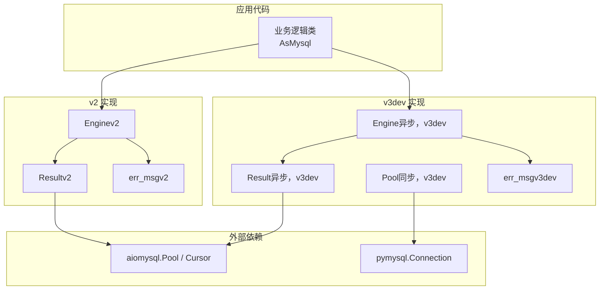
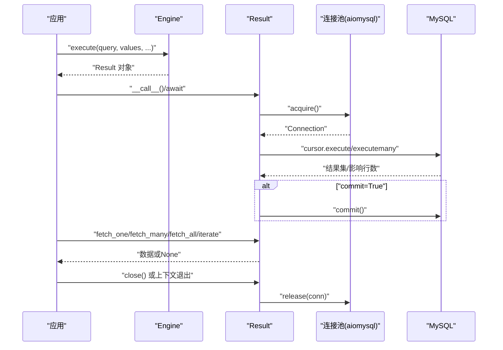
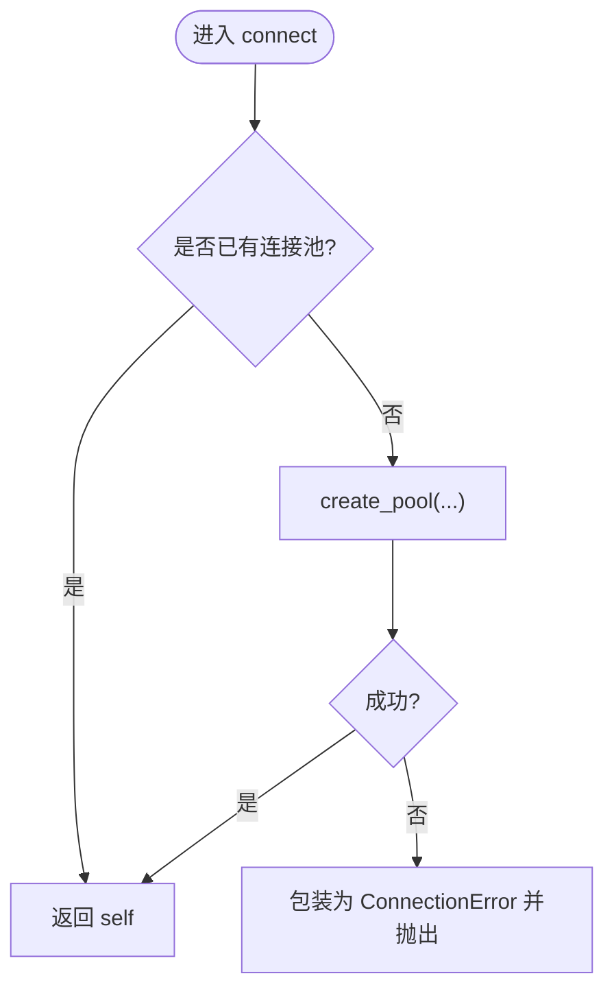
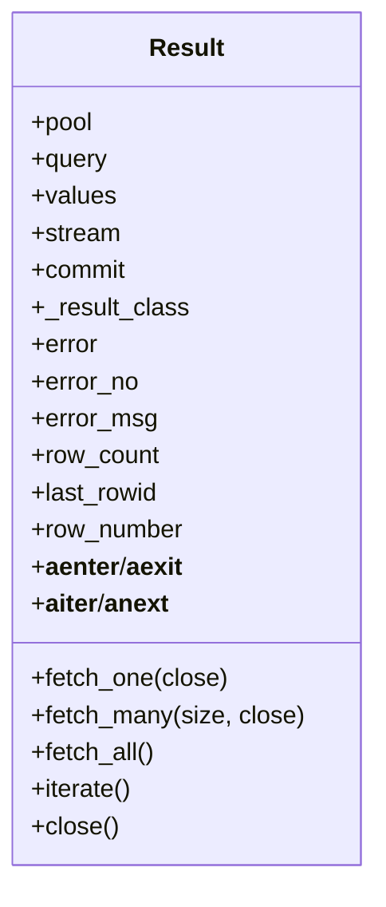
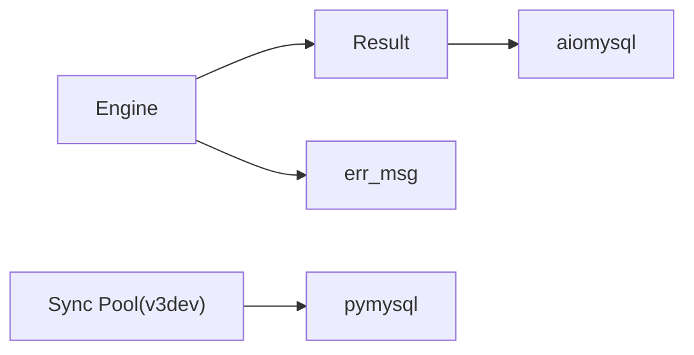

# 故障排除

<cite>
**本文引用的文件**   
- [README.md](file://README.md)
- [_error.py（v2）](file://asmysql/v2/_error.py)
- [_error.py（v3dev）](file://asmysql/v3dev/_error.py)
- [_async_engine.py（v3dev）](file://asmysql/v3dev/_async_engine.py)
- [_sync_pool.py（v3dev）](file://asmysql/v3dev/_sync_pool.py)
- [_result.py（v2）](file://asmysql/v2/_result.py)
- [_async_result.py（v3dev）](file://asmysql/v3dev/_async_result.py)
- [connection.md（中文）](file://mkdocs/v2/docs/zh/connection.md)
- [faq.md（中文）](file://mkdocs/v2/docs/zh/faq.md)
- [best-practices.md（中文）](file://mkdocs/v2/docs/zh/best-practices.md)
</cite>

## 目录
1. [简介](#简介)
2. [项目结构](#项目结构)
3. [核心组件](#核心组件)
4. [架构总览](#架构总览)
5. [详细组件分析](#详细组件分析)
6. [依赖关系分析](#依赖关系分析)
7. [性能注意事项](#性能注意事项)
8. [故障排除指南](#故障排除指南)
9. [结论](#结论)
10. [附录](#附录)

## 简介
本指南面向使用 asmysql 的开发者，聚焦于生产与开发环境中的问题定位、诊断与修复。内容覆盖常见错误消息与解决方案、连接池状态检查、SQL 日志开启、慢查询与内存优化建议、事务与流式查询的注意事项，以及系统化的排查流程与最佳实践。

## 项目结构
本项目提供多版本实现与文档：
- v2：稳定版异步封装，包含 Engine、Result、错误处理等
- v3dev：开发中版本，包含异步引擎、同步连接池等
- mkdocs：中英文文档，包括常见问题、最佳实践、连接管理等

图表来源
- [_async_engine.py（v3dev）:1-307](file://asmysql/v3dev/_async_engine.py#L1-L307)
- [_async_result.py（v3dev）:1-273](file://asmysql/v3dev/_async_result.py#L1-L273)
- [_sync_pool.py（v3dev）:1-281](file://asmysql/v3dev/_sync_pool.py#L1-L281)
- [_result.py（v2）:1-273](file://asmysql/v2/_result.py#L1-L273)
- [_error.py（v2）:1-7](file://asmysql/v2/_error.py#L1-L7)
- [_error.py（v3dev）:1-7](file://asmysql/v3dev/_error.py#L1-L7)

章节来源
- [README.md:1-135](file://README.md#L1-L135)

## 核心组件
- Engine（连接与执行入口）
  - 负责解析 URL/参数、创建/管理连接池、暴露 execute/execute_many、status/is_connected/release_connections 等能力
  - 支持 echo_sql_log 开关以输出底层 SQL 日志
- Result（结果与游标生命周期管理）
  - 封装 cursor 获取、执行、提交、关闭与自动释放；提供 error/error_no/error_msg、row_count/last_rowid/row_number、fetch_one/fetch_many/fetch_all/iterate
  - 支持 stream 模式与 result_class 自定义类型转换
- 错误处理
  - err_msg 统一格式化异常信息，避免空字符串导致日志不可读
- 连接池
  - v2/v3dev 异步基于 aiomysql.Pool
  - v3dev 提供同步 Pool 参考实现（基于 pymysql），用于理解回收、等待与释放策略

章节来源
- [_async_engine.py（v3dev）:1-307](file://asmysql/v3dev/_async_engine.py#L1-L307)
- [_result.py（v2）:1-273](file://asmysql/v2/_result.py#L1-L273)
- [_async_result.py（v3dev）:1-273](file://asmysql/v3dev/_async_result.py#L1-L273)
- [_error.py（v2）:1-7](file://asmysql/v2/_error.py#L1-L7)
- [_error.py（v3dev）:1-7](file://asmysql/v3dev/_error.py#L1-L7)

## 架构总览
下图展示一次典型查询从调用到返回的关键路径，以及错误与资源释放点。

图表来源
- [_async_engine.py（v3dev）:216-306](file://asmysql/v3dev/_async_engine.py#L216-L306)
- [_async_result.py（v3dev）:101-126](file://asmysql/v3dev/_async_result.py#L101-L126)
- [_result.py（v2）:101-126](file://asmysql/v2/_result.py#L101-L126)

## 详细组件分析

### 连接与执行（Engine）
- 关键职责
  - URL/参数解析与校验
  - 连接池初始化与关闭
  - 暴露 status/is_connected/release_connections
  - 将 execute/execute_many 委托给 Result
- 常见故障点
  - 连接失败：URL scheme 非法、认证失败、网络超时、连接池创建异常
  - 未连接即访问 pool：抛出 ConnectionError
  - 未正确断开：连接未释放导致资源泄漏

图表来源
- [_async_engine.py（v3dev）:120-141](file://asmysql/v3dev/_async_engine.py#L120-L141)

章节来源
- [_async_engine.py（v3dev）:1-307](file://asmysql/v3dev/_async_engine.py#L1-L307)

### 结果与游标（Result）
- 关键职责
  - 选择合适 Cursor 类型（普通/流式、tuple/dict）
  - 执行 SQL、提交事务、捕获 MySQLError 并记录 error/error_no/error_msg
  - 管理 close 与自动释放，支持 async with/async for
- 常见故障点
  - 忘记关闭：手动设置 close=False 后未调用 result.close()，导致连接不归还
  - 流式查询误用：对大结果集使用 fetch_all 导致内存飙升
  - 错误未检查：直接取数据而忽略 result.error

图表来源
- [_result.py（v2）:21-273](file://asmysql/v2/_result.py#L21-L273)
- [_async_result.py（v3dev）:21-273](file://asmysql/v3dev/_async_result.py#L21-L273)

章节来源
- [_result.py（v2）:1-273](file://asmysql/v2/_result.py#L1-L273)
- [_async_result.py（v3dev）:1-273](file://asmysql/v3dev/_async_result.py#L1-L273)

### 错误处理（err_msg）
- 作用：统一异常文本化，避免空字符串导致日志无意义
- 适用：连接阶段与执行阶段的异常包装

章节来源
- [_error.py（v2）:1-7](file://asmysql/v2/_error.py#L1-L7)
- [_error.py（v3dev）:1-7](file://asmysql/v3dev/_error.py#L1-L7)

### 连接池（同步参考实现）
- 说明：v3dev 提供同步 Pool 参考实现，便于理解回收、等待与释放策略
- 关键点
  - minsize/maxsize 校验
  - 空闲连接回收（pool_recycle）
  - acquire/release/wait_closed/close/terminate
  - 事务状态检测与安全关闭

章节来源
- [_sync_pool.py（v3dev）:1-281](file://asmysql/v3dev/_sync_pool.py#L1-L281)

## 依赖关系分析
- 外部依赖
  - aiomysql：异步连接池与游标
  - pymysql：底层连接与错误类型
- 内部耦合
  - Engine 依赖 Result 完成具体执行
  - Result 依赖连接池与底层 Cursor
  - 错误处理模块被多处复用

图表来源
- [_async_engine.py（v3dev）:1-307](file://asmysql/v3dev/_async_engine.py#L1-L307)
- [_result.py（v2）:1-273](file://asmysql/v2/_result.py#L1-L273)
- [_sync_pool.py（v3dev）:1-281](file://asmysql/v3dev/_sync_pool.py#L1-L281)
- [_error.py（v2）:1-7](file://asmysql/v2/_error.py#L1-L7)

## 性能注意事项
- 大数据集优先使用流式查询，避免一次性加载到内存
- 合理配置连接池大小与回收时间，匹配并发与数据库承载能力
- 使用参数化查询，减少注入风险与重复解析开销
- 通过 status 监控连接池占用，识别连接泄漏与热点

章节来源
- [best-practices.md（中文）:1-141](file://mkdocs/v2/docs/zh/best-practices.md#L1-L141)
- [faq.md（中文）:1-97](file://mkdocs/v2/docs/zh/faq.md#L1-L97)

## 故障排除指南

### 一、快速定位清单
- 确认连接是否建立
  - 使用 engine.is_connected 与 engine.status 检查地址、已连接、池大小、空闲/使用中连接
- 检查错误信息
  - 读取 result.error、result.error_no、result.error_msg
- 查看 SQL 日志
  - 开启 echo_sql_log 观察实际执行的语句与耗时
- 评估内存与流式
  - 大数据集务必使用 stream=True 与 iterate()/async for
- 检查事务与提交
  - auto_commit=False 时注意 commit 时机与回滚

章节来源
- [connection.md（中文）:103-131](file://mkdocs/v2/docs/zh/connection.md#L103-L131)
- [faq.md（中文）:1-97](file://mkdocs/v2/docs/zh/faq.md#L1-L97)
- [best-practices.md（中文）:1-141](file://mkdocs/v2/docs/zh/best-practices.md#L1-L141)

### 二、常见问题与解决方案

#### 1. 连接失败
- 可能原因
  - URL scheme 非 mysql
  - 用户名/密码/主机/端口错误
  - 网络不通或防火墙拦截
  - 连接超时（connect_timeout）
- 定位方法
  - 检查 engine.status 与 is_connected
  - 打开 echo_sql_log 观察底层日志
  - 核对 URL 与参数解析
- 解决建议
  - 修正 URL 与凭据
  - 增大 connect_timeout
  - 检查网络与权限

章节来源
- [_async_engine.py（v3dev）:67-141](file://asmysql/v3dev/_async_engine.py#L67-L141)
- [connection.md（中文）:1-65](file://mkdocs/v2/docs/zh/connection.md#L1-L65)

#### 2. 查询超时
- 可能原因
  - 慢查询、锁等待、索引缺失
  - 连接池耗尽导致排队
- 定位方法
  - 开启 echo_sql_log 定位慢语句
  - 使用 engine.status 观察 pool_used/pool_free
  - 在数据库侧查看慢查询日志与锁等待
- 解决建议
  - 优化 SQL 与索引
  - 调整连接池大小与回收策略
  - 分批/分页/流式处理

章节来源
- [faq.md（中文）:80-97](file://mkdocs/v2/docs/zh/faq.md#L80-L97)
- [best-practices.md（中文）:124-141](file://mkdocs/v2/docs/zh/best-practices.md#L124-L141)

#### 3. 权限问题
- 可能原因
  - 用户无表/库操作权限
  - 字符集/时区配置不一致
- 定位方法
  - 根据 result.error_no 与 result.error_msg 判断 MySQL 错误码
  - 核对数据库用户授权
- 解决建议
  - 授予必要权限
  - 统一字符集为 utf8mb4

章节来源
- [_result.py（v2）:133-151](file://asmysql/v2/_result.py#L133-L151)
- [_async_result.py（v3dev）:133-151](file://asmysql/v3dev/_async_result.py#L133-L151)

#### 4. 连接池耗尽/泄漏
- 可能原因
  - 未关闭游标或未释放连接（close=False 后未调用 result.close()）
  - 异常路径未走上下文退出
- 定位方法
  - 监控 engine.status 的 pool_size/pool_free/pool_used
  - 结合日志定位长时间持有的连接
- 解决建议
  - 使用 async with 或 async for 自动管理
  - 若手动控制 close，确保最终调用 result.close()

章节来源
- [best-practices.md（中文）:25-69](file://mkdocs/v2/docs/zh/best-practices.md#L25-L69)
- [_result.py（v2）:186-234](file://asmysql/v2/_result.py#L186-L234)
- [_async_result.py（v3dev）:186-234](file://asmysql/v3dev/_async_result.py#L186-L234)

#### 5. 内存溢出/高内存占用
- 可能原因
  - 大结果集使用 fetch_all
  - 未启用流式查询
- 定位方法
  - 检查是否使用了 stream=True 与 iterate()/async for
- 解决建议
  - 改为流式逐行处理
  - 分批次拉取与处理

章节来源
- [faq.md（中文）:12-27](file://mkdocs/v2/docs/zh/faq.md#L12-L27)
- [best-practices.md（中文）:89-103](file://mkdocs/v2/docs/zh/best-practices.md#L89-L103)

#### 6. 事务相关问题
- 可能原因
  - auto_commit=False 但未提交/回滚
  - 多次 execute 的提交策略不一致
- 定位方法
  - 检查 auto_commit 与每次 execute 的 commit 参数
- 解决建议
  - 明确事务边界，必要时手动提交/回滚

章节来源
- [faq.md（中文）:29-38](file://mkdocs/v2/docs/zh/faq.md#L29-L38)
- [_result.py（v2）:117-118](file://asmysql/v2/_result.py#L117-L118)
- [_async_result.py（v3dev）:117-118](file://asmysql/v3dev/_async_result.py#L117-L118)

#### 7. 批量插入性能低
- 可能原因
  - 单条插入循环
  - 未使用 execute_many
- 定位方法
  - 检查是否使用 execute_many 与合适的批大小
- 解决建议
  - 使用 execute_many 分批提交
  - 调整连接池与 autocommit 策略

章节来源
- [faq.md（中文）:51-61](file://mkdocs/v2/docs/zh/faq.md#L51-L61)

### 三、系统化诊断流程
- 复现问题
  - 最小可复现场景，固定输入与参数
- 采集证据
  - 打开 echo_sql_log，记录 SQL 与耗时
  - 记录 engine.status 快照（地址、池大小、空闲/使用中）
  - 记录 result.error/error_no/error_msg
- 根因分析
  - 网络/权限/SQL/索引/锁/连接池/内存
- 临时修复
  - 调整超时、连接池、批大小、流式处理
- 永久方案
  - SQL 优化、索引完善、架构扩容、连接池容量规划

章节来源
- [connection.md（中文）:103-131](file://mkdocs/v2/docs/zh/connection.md#L103-L131)
- [best-practices.md（中文）:1-141](file://mkdocs/v2/docs/zh/best-practices.md#L1-L141)

### 四、调试技巧与工具
- 开启 SQL 日志
  - 通过 echo_sql_log 打印底层 SQL
- 连接池状态检查
  - 使用 engine.status 定期采样
- 流式与迭代
  - 使用 stream=True 与 iterate()/async for 降低内存
- 错误信息规范化
  - 借助 err_msg 统一异常文本，便于日志检索

章节来源
- [_async_engine.py（v3dev）:120-141](file://asmysql/v3dev/_async_engine.py#L120-L141)
- [_error.py（v2）:1-7](file://asmysql/v2/_error.py#L1-L7)
- [_error.py（v3dev）:1-7](file://asmysql/v3dev/_error.py#L1-L7)

### 五、生产环境问题排查流程
- 启动前
  - 校验 URL/凭据/字符集/连接池参数
  - 预连接与健康检查
- 运行期
  - 监控 engine.status 与错误率
  - 收集慢查询与锁等待
- 事件响应
  - 快速降级：限流/熔断/切换只读副本
  - 临时修复：调优超时/连接池/批大小
  - 复盘改进：SQL 优化/索引/容量规划

章节来源
- [connection.md（中文）:1-65](file://mkdocs/v2/docs/zh/connection.md#L1-L65)
- [faq.md（中文）:80-97](file://mkdocs/v2/docs/zh/faq.md#L80-L97)

### 六、社区支持与反馈
- 文档站点与仓库链接见项目 README
- 遇到问题可在仓库提交 Issue 或在文档站点讨论

章节来源
- [README.md:10-14](file://README.md#L10-L14)

## 结论
通过规范化的连接与结果管理、合理的连接池与流式策略、完善的错误与日志体系，可以显著降低 asmysql 在生产环境的故障率与排障成本。建议将上述清单与流程纳入日常运维与发布检查项。

## 附录
- 常用属性与方法速查
  - Engine：connect/disconnect/status/is_connected/release_connections/execute/execute_many
  - Result：error/error_no/error_msg/row_count/last_rowid/row_number/fetch_one/fetch_many/fetch_all/iterate/close
  - 连接参数：host/port/user/password/charset/min_pool_size/max_pool_size/pool_recycle/connect_timeout/auto_commit/echo_sql_log/stream/result_class

章节来源
- [_async_engine.py（v3dev）:1-307](file://asmysql/v3dev/_async_engine.py#L1-L307)
- [_result.py（v2）:1-273](file://asmysql/v2/_result.py#L1-L273)
- [connection.md（中文）:48-65](file://mkdocs/v2/docs/zh/connection.md#L48-L65)