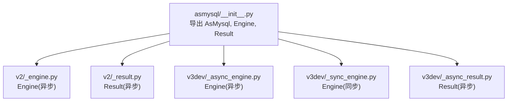
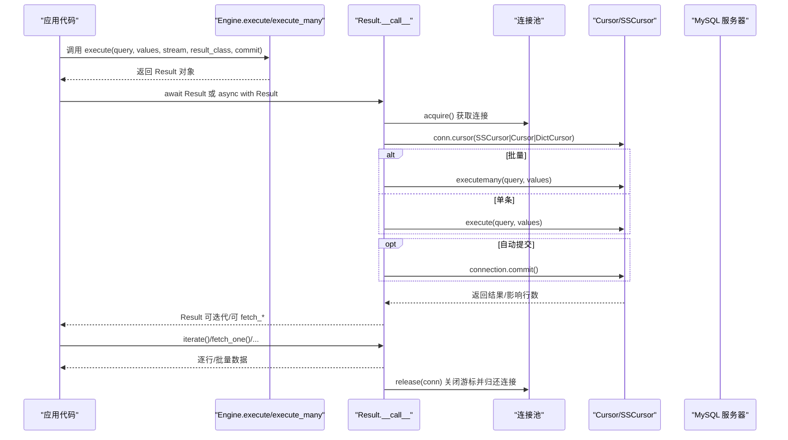
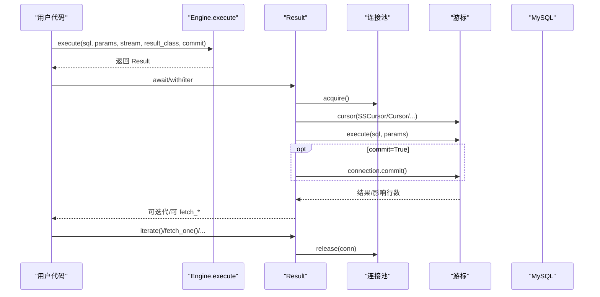
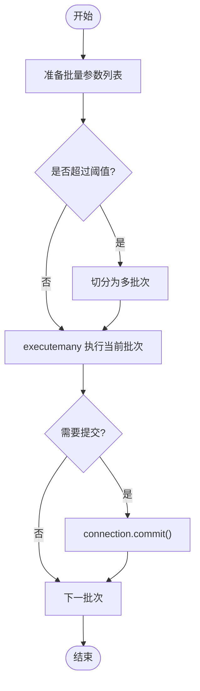
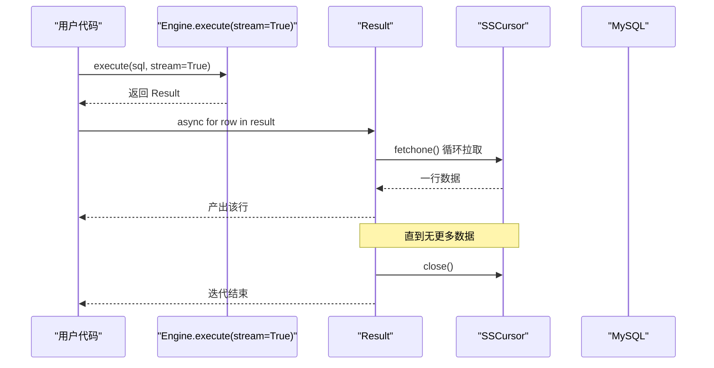
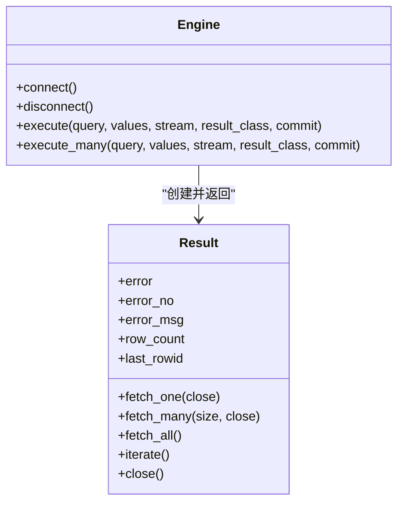

# 查询操作

<cite>
**本文引用的文件**   
- [asmysql/__init__.py](file://asmysql/__init__.py)
- [asmysql/v2/_engine.py](file://asmysql/v2/_engine.py)
- [asmysql/v2/_result.py](file://asmysql/v2/_result.py)
- [asmysql/v3dev/_async_engine.py](file://asmysql/v3dev/_async_engine.py)
- [asmysql/v3dev/_sync_engine.py](file://asmysql/v3dev/_sync_engine.py)
- [asmysql/v3dev/_async_result.py](file://asmysql/v3dev/_async_result.py)
- [mkdocs/v2/docs/zh/query.md](file://mkdocs/v2/docs/zh/query.md)
- [mkdocs/v2/docs/zh/best-practices.md](file://mkdocs/v2/docs/zh/best-practices.md)
- [mkdocs/v2/docs/zh/result.md](file://mkdocs/v2/docs/zh/result.md)
- [mkdocs/v2/docs/zh/transaction.md](file://mkdocs/v2/docs/zh/transaction.md)
- [pytest/v2/test_asmysql.py](file://pytest/v2/test_asmysql.py)
</cite>

## 目录
1. [简介](#简介)
2. [项目结构](#项目结构)
3. [核心组件](#核心组件)
4. [架构总览](#架构总览)
5. [详细组件分析](#详细组件分析)
6. [依赖关系分析](#依赖关系分析)
7. [性能与优化](#性能与优化)
8. [故障排查指南](#故障排查指南)
9. [结论](#结论)
10. [附录：示例索引](#附录示例索引)

## 简介
本章节聚焦 asmysql 的查询操作能力，覆盖以下主题：
- execute() 单条查询执行：参数化查询、流式返回、事务内提交控制
- execute_many() 批量操作：批量插入、更新、删除的最佳实践
- 流式查询处理：使用 iterate() 或 async for 迭代大结果集，避免内存溢出
- SQL 注入防护与参数绑定机制
- 查询性能优化：索引、查询计划、连接池配置等
- 日志记录与调试方法
- 面向不同经验水平开发者的渐进式说明与完整示例路径

## 项目结构
asmysql 提供 v2（异步）与 v3dev（异步/同步双实现）两套引擎与结果封装。对外统一通过 asmysql.__init__ 暴露 Engine、AsMysql、Result 等入口。

图示来源
- [asmysql/__init__.py:1-16](file://asmysql/__init__.py#L1-L16)
- [asmysql/v2/_engine.py:1-317](file://asmysql/v2/_engine.py#L1-L317)
- [asmysql/v2/_result.py:1-273](file://asmysql/v2/_result.py#L1-L273)
- [asmysql/v3dev/_async_engine.py:1-307](file://asmysql/v3dev/_async_engine.py#L1-L307)
- [asmysql/v3dev/_sync_engine.py:1-298](file://asmysql/v3dev/_sync_engine.py#L1-L298)
- [asmysql/v3dev/_async_result.py:1-273](file://asmysql/v3dev/_async_result.py#L1-L273)

章节来源
- [asmysql/__init__.py:1-16](file://asmysql/__init__.py#L1-L16)

## 核心组件
- Engine（异步/同步）：负责连接池管理、SQL 执行入口（execute / execute_many）、连接生命周期与状态信息。
- Result：封装游标与结果获取，支持 fetch_one/fetch_many/fetch_all/iterate，以及错误码/信息、受影响行数、最后插入ID等统计属性。
- AsMysql：业务逻辑类包装，持有 client 指向 Engine，便于继承扩展。

章节来源
- [asmysql/v2/_engine.py:37-317](file://asmysql/v2/_engine.py#L37-L317)
- [asmysql/v2/_result.py:21-273](file://asmysql/v2/_result.py#L21-L273)
- [asmysql/v3dev/_async_engine.py:27-307](file://asmysql/v3dev/_async_engine.py#L27-L307)
- [asmysql/v3dev/_sync_engine.py:26-298](file://asmysql/v3dev/_sync_engine.py#L26-L298)
- [asmysql/v3dev/_async_result.py:21-273](file://asmysql/v3dev/_async_result.py#L21-L273)

## 架构总览
下图展示一次典型查询从调用到数据返回的端到端流程，包括参数绑定、游标选择、流式与非流式分支、自动提交与错误捕获。

图示来源
- [asmysql/v2/_engine.py:227-316](file://asmysql/v2/_engine.py#L227-L316)
- [asmysql/v2/_result.py:101-125](file://asmysql/v2/_result.py#L101-L125)
- [asmysql/v2/_result.py:251-273](file://asmysql/v2/_result.py#L251-L273)
- [asmysql/v3dev/_async_engine.py:217-306](file://asmysql/v3dev/_async_engine.py#L217-L306)
- [asmysql/v3dev/_async_result.py:101-125](file://asmysql/v3dev/_async_result.py#L101-L125)

## 详细组件分析

### execute() 单条查询执行
- 功能要点
  - 支持 await 直接等待、上下文管理器、以及 async for 直接迭代三种用法。
  - 支持参数化查询：元组与命名占位符字典两种形式。
  - 支持流式返回：stream=True 时采用 SSCursor/SSDictCursor，避免一次性加载全部结果。
  - 支持结果类型：tuple、dict 或自定义模型（如 Pydantic），由 result_class 指定。
  - 事务控制：commit 参数可覆盖全局 auto_commit；当 commit=True 时会在执行后自动提交。
- 关键实现
  - Engine.execute 将参数透传给 Result 构造，Result.__call__ 内部完成连接获取、游标创建、执行与提交。
  - 游标选择策略：根据 result_class 与 stream 决定 Cursor/DictCursor/SSCursor/SSDictCursor。
- 参考示例路径
  - 基本查询、参数化查询、流式查询、上下文管理器用法参见文档与测试用例。

章节来源
- [asmysql/v2/_engine.py:204-259](file://asmysql/v2/_engine.py#L204-L259)
- [asmysql/v2/_result.py:10-18](file://asmysql/v2/_result.py#L10-L18)
- [asmysql/v2/_result.py:101-125](file://asmysql/v2/_result.py#L101-L125)
- [mkdocs/v2/docs/zh/query.md:1-98](file://mkdocs/v2/docs/zh/query.md#L1-L98)
- [pytest/v2/test_asmysql.py:49-146](file://pytest/v2/test_asmysql.py#L49-L146)

#### 执行时序图（execute）

图示来源
- [asmysql/v2/_engine.py:227-259](file://asmysql/v2/_engine.py#L227-L259)
- [asmysql/v2/_result.py:101-125](file://asmysql/v2/_result.py#L101-L125)

### execute_many() 批量操作
- 功能要点
  - 适用于批量插入、更新、删除。values 为 Sequence[Sequence|dict]。
  - 内部使用 executemany 执行，同样支持 stream、result_class、commit 等参数。
  - 建议按批次分批提交，避免单次过大导致超时或锁竞争。
- 最佳实践
  - 合理分片：每批 500~5000 条（视表结构与网络延迟调整）。
  - 使用命名参数 dict 提升可读性与维护性。
  - 在事务中批量提交，失败回滚保证一致性。
- 参考示例路径
  - 批量插入、批量更新、批量删除示例见文档与测试用例。

章节来源
- [asmysql/v2/_engine.py:261-316](file://asmysql/v2/_engine.py#L261-L316)
- [asmysql/v2/_result.py:101-125](file://asmysql/v2/_result.py#L101-L125)
- [mkdocs/v2/docs/zh/examples.md:471-535](file://mkdocs/v2/docs/zh/examples.md#L471-L535)
- [pytest/v2/test_asmysql.py:148-199](file://pytest/v2/test_asmysql.py#L148-L199)

#### 批量执行流程图（execute_many）

图示来源
- [asmysql/v2/_result.py:101-125](file://asmysql/v2/_result.py#L101-L125)

### 流式查询与 iterate()
- 适用场景
  - 大数据集导出、ETL 处理、报表生成等，避免一次性加载到内存。
- 使用方法
  - 方式一：engine.execute(..., stream=True)，然后 async for row in result 或 result.iterate()。
  - 方式二：在 Engine 级别设置默认 stream=True，所有查询默认流式。
- 注意事项
  - 流式查询下 row_count 为 None。
  - 使用 context manager 或 async for 可确保资源释放。
- 参考示例路径
  - 流式查询示例见文档与 README。

章节来源
- [mkdocs/v2/docs/zh/query.md:77-91](file://mkdocs/v2/docs/zh/query.md#L77-L91)
- [mkdocs/v2/docs/zh/best-practices.md:89-103](file://mkdocs/v2/docs/zh/best-practices.md#L89-L103)
- [README_zh.md:40-63](file://README_zh.md#L40-L63)
- [asmysql/v2/_result.py:251-273](file://asmysql/v2/_result.py#L251-L273)

#### 流式迭代序列图

图示来源
- [asmysql/v2/_result.py:251-273](file://asmysql/v2/_result.py#L251-L273)

### 事务内查询与提交控制
- 自动提交（默认）
  - Engine.auto_commit=True 时，每次 execute 成功后会提交。
- 手动提交
  - 设置 auto_commit=False，并在 execute(commit=False) 多次执行后，再手动提交（需结合连接管理）。
- 注意
  - v2 版本的事务管理需自行控制连接与提交时机。
- 参考示例路径
  - 事务控制与注意事项见文档。

章节来源
- [mkdocs/v2/docs/zh/transaction.md:1-44](file://mkdocs/v2/docs/zh/transaction.md#L1-L44)
- [asmysql/v2/_result.py:101-125](file://asmysql/v2/_result.py#L101-L125)

### SQL 注入防护与参数绑定
- 机制
  - 通过 %s 占位符与 values 参数进行安全绑定，底层由 aiomysql/pymysql 驱动完成转义与绑定。
- 推荐
  - 永远不要拼接字符串构造 SQL。
  - 优先使用元组或命名字典参数。
- 参考示例路径
  - 参数化查询示例见文档与测试用例。

章节来源
- [mkdocs/v2/docs/zh/query.md:41-59](file://mkdocs/v2/docs/zh/query.md#L41-L59)
- [pytest/v2/test_asmysql.py:63-70](file://pytest/v2/test_asmysql.py#L63-L70)

### 结果类型与模型映射
- 内置类型
  - tuple：默认，字段按顺序访问。
  - dict：键为列名，适合动态字段访问。
- 自定义模型
  - 传入 result_class=YourModel，Result 会将每行以 **row 的方式实例化模型。
- 参考示例路径
  - 结果类型与模型映射示例见文档与测试用例。

章节来源
- [mkdocs/v2/docs/zh/result.md:52-94](file://mkdocs/v2/docs/zh/result.md#L52-L94)
- [pytest/v2/test_asmysql.py:110-133](file://pytest/v2/test_asmysql.py#L110-L133)

## 依赖关系分析
- Engine 依赖连接池（aiomysql.Pool 或自实现同步池），Result 依赖具体游标类型（Cursor/DictCursor/SSCursor/SSDictCursor）。
- 异步与同步版本在 v3dev 中分别实现，但 API 保持一致。
- 错误处理统一基于 pymysql.err.MySQLError。

图示来源
- [asmysql/v2/_engine.py:204-316](file://asmysql/v2/_engine.py#L204-L316)
- [asmysql/v2/_result.py:21-273](file://asmysql/v2/_result.py#L21-L273)

章节来源
- [asmysql/v2/_engine.py:1-317](file://asmysql/v2/_engine.py#L1-L317)
- [asmysql/v2/_result.py:1-273](file://asmysql/v2/_result.py#L1-L273)

## 性能与优化
- 索引与查询计划
  - 为高频过滤/排序/关联字段建立合适索引；使用 EXPLAIN 分析执行计划，避免全表扫描。
- 连接池配置
  - min_pool_size/max_pool_size 依据并发量与数据库承载能力调优；pool_recycle 定期回收空闲连接，避免长连接失效。
  - connect_timeout 防止阻塞；auto_commit 根据业务一致性需求选择。
- 流式与大结果集
  - 对大结果集务必启用 stream=True 并使用 iterate()/async for 逐行处理。
- 批量写入
  - 合理分片大小，必要时在事务中批量提交，减少往返与锁竞争。
- 日志与监控
  - echo_sql_log 开启后可打印 SQL 语句，用于定位慢查询与问题；结合外部监控观察连接池指标。

章节来源
- [mkdocs/v2/docs/zh/best-practices.md:124-141](file://mkdocs/v2/docs/zh/best-practices.md#L124-L141)
- [asmysql/v2/_engine.py:41-53](file://asmysql/v2/_engine.py#L41-L53)
- [asmysql/v2/_engine.py:120-151](file://asmysql/v2/_engine.py#L120-L151)

## 故障排查指南
- 常见错误
  - 未连接即使用 pool：抛出 ConnectionError。
  - 忘记关闭连接：连接泄漏，池耗尽。
  - 流式查询下读取 row_count：返回 None。
- 诊断步骤
  - 检查 engine.status 查看连接池状态。
  - 检查 result.error/error_no/error_msg 定位错误原因。
  - 开启 echo_sql_log 打印 SQL，配合 EXPLAIN 分析。
- 参考示例路径
  - 错误处理与最佳实践见文档。

章节来源
- [asmysql/v2/_engine.py:195-202](file://asmysql/v2/_engine.py#L195-L202)
- [asmysql/v2/_result.py:133-151](file://asmysql/v2/_result.py#L133-L151)
- [mkdocs/v2/docs/zh/best-practices.md:70-88](file://mkdocs/v2/docs/zh/best-practices.md#L70-L88)

## 结论
asmysql 提供了简洁一致的查询 API，兼顾易用性与高性能：
- 通过 execute/execute_many 覆盖单条与批量场景；
- 通过 stream/iterate 安全处理大结果集；
- 通过参数化绑定保障安全；
- 通过连接池与日志工具支撑生产稳定性与可观测性。
建议在项目中遵循最佳实践，结合业务负载与数据库特性持续调优。

## 附录：示例索引
- 基础查询与上下文管理器
  - [查询操作:1-98](file://mkdocs/v2/docs/zh/query.md#L1-L98)
- 参数化查询与字典参数
  - [查询操作:41-59](file://mkdocs/v2/docs/zh/query.md#L41-L59)
- 批量插入/更新/删除
  - [示例：批量操作:471-535](file://mkdocs/v2/docs/zh/examples.md#L471-L535)
  - [测试：execute_many:148-199](file://pytest/v2/test_asmysql.py#L148-L199)
- 流式查询与 iterate()
  - [查询操作：流式查询:77-91](file://mkdocs/v2/docs/zh/query.md#L77-L91)
  - [最佳实践：大数据集处理:89-103](file://mkdocs/v2/docs/zh/best-practices.md#L89-L103)
- 结果类型与模型映射
  - [结果处理：结果类型:52-94](file://mkdocs/v2/docs/zh/result.md#L52-L94)
  - [测试：不同结果类型:110-133](file://pytest/v2/test_asmysql.py#L110-L133)
- 事务控制
  - [事务控制:1-44](file://mkdocs/v2/docs/zh/transaction.md#L1-L44)