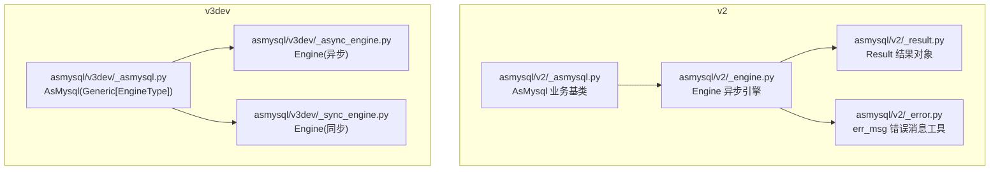
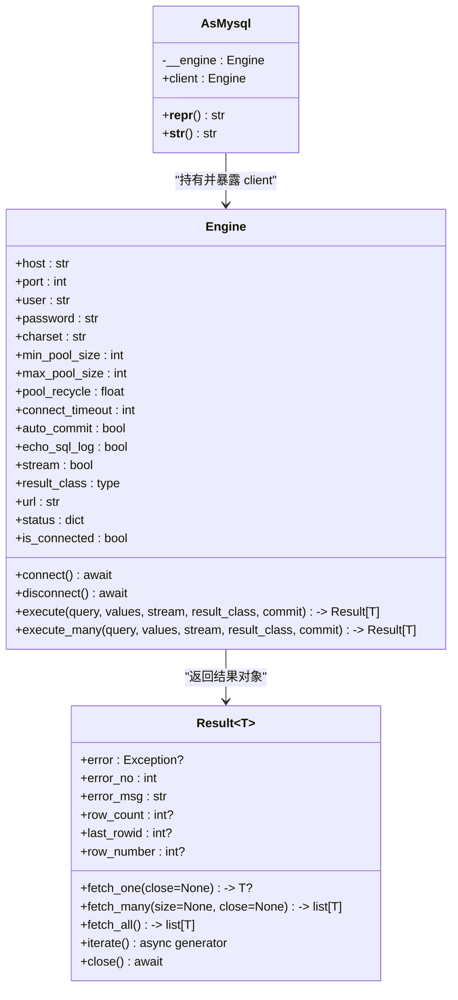
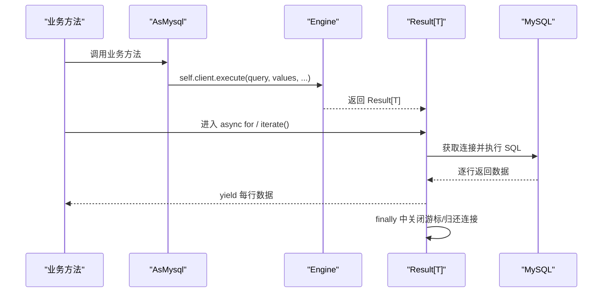
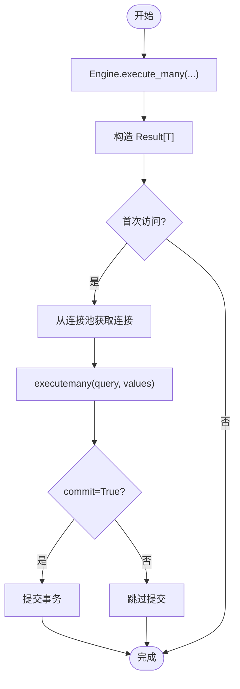
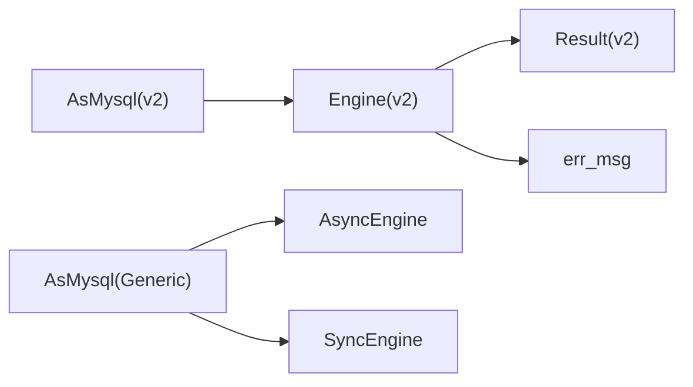

# AsMysql 业务基类

<cite>
**本文引用的文件**
- [asmysql/v2/_asmysql.py](file://asmysql/v2/_asmysql.py)
- [asmysql/v2/_engine.py](file://asmysql/v2/_engine.py)
- [asmysql/v2/_result.py](file://asmysql/v2/_result.py)
- [asmysql/v2/_error.py](file://asmysql/v2/_error.py)
- [asmysql/v3dev/_asmysql.py](file://asmysql/v3dev/_asmysql.py)
- [asmysql/v3dev/_async_engine.py](file://asmysql/v3dev/_async_engine.py)
- [asmysql/v3dev/_sync_engine.py](file://asmysql/v3dev/_sync_engine.py)
- [README.md](file://README.md)
- [mkdocs/v2/docs/zh/business-logic.md](file://mkdocs/v2/docs/zh/business-logic.md)
- [mkdocs/v2/docs/zh/best-practices.md](file://mkdocs/v2/docs/zh/best-practices.md)
- [tests/v2/v2_start.py](file://tests/v2/v2_start.py)
- [pytest/v2/test_asmysql.py](file://pytest/v2/test_asmysql.py)
</cite>

## 目录
1. [引言](#引言)
2. [项目结构](#项目结构)
3. [核心组件](#核心组件)
4. [架构总览](#架构总览)
5. [详细组件分析](#详细组件分析)
6. [依赖关系分析](#依赖关系分析)
7. [性能与资源管理](#性能与资源管理)
8. [调试与日志](#调试与日志)
9. [最佳实践与编码规范](#最佳实践与编码规范)
10. [框架集成模式（FastAPI/Django）](#框架集成模式fastapidjango)
11. [故障排查指南](#故障排查指南)
12. [结论](#结论)

## 引言
AsMysql 是一个基于 aiomysql 的异步 MySQL 客户端与连接池封装，强调“引擎与业务逻辑分离”、“执行与结果获取分离”、“类型安全与泛型支持”、“流式大结果集处理”。其业务基类 AsMysql 通过继承 Engine 提供的能力，为业务开发者提供更简洁、更安全的接口。本文面向业务逻辑开发者，系统解析 AsMysql 的设计理念、实现模式、client 属性与底层引擎访问方式、类型安全与泛型设计、调试与日志机制，并给出完整示例与最佳实践。

## 项目结构
仓库按版本划分：v1、v2、v3dev。当前文档聚焦 v2 与 v3dev 中的 AsMysql 与 Engine 设计，以及 Result 结果对象与错误处理工具。

图表来源
- [asmysql/v2/_asmysql.py:1-26](file://asmysql/v2/_asmysql.py#L1-L26)
- [asmysql/v2/_engine.py:1-317](file://asmysql/v2/_engine.py#L1-L317)
- [asmysql/v2/_result.py:1-273](file://asmysql/v2/_result.py#L1-L273)
- [asmysql/v2/_error.py:1-7](file://asmysql/v2/_error.py#L1-L7)
- [asmysql/v3dev/_asmysql.py:1-30](file://asmysql/v3dev/_asmysql.py#L1-L30)
- [asmysql/v3dev/_async_engine.py:1-307](file://asmysql/v3dev/_async_engine.py#L1-L307)
- [asmysql/v3dev/_sync_engine.py:1-298](file://asmysql/v3dev/_sync_engine.py#L1-L298)

章节来源
- [README.md:1-135](file://README.md#L1-L135)

## 核心组件
- AsMysql：业务基类，持有 Engine 实例并通过 client 属性暴露底层引擎能力，提供简洁的业务开发入口。
- Engine：数据库连接与查询执行的核心，负责连接池管理、SQL 执行、结果对象构造。
- Result：封装游标生命周期、错误信息、数据读取（fetch_one/many/all）、迭代器与上下文管理。
- err_msg：统一异常消息格式化，避免空字符串导致日志不可读。

章节来源
- [asmysql/v2/_asmysql.py:1-26](file://asmysql/v2/_asmysql.py#L1-L26)
- [asmysql/v2/_engine.py:1-317](file://asmysql/v2/_engine.py#L1-L317)
- [asmysql/v2/_result.py:1-273](file://asmysql/v2/_result.py#L1-L273)
- [asmysql/v2/_error.py:1-7](file://asmysql/v2/_error.py#L1-L7)

## 架构总览
AsMysql 作为薄包装层，将业务方法与 Engine 的 execute/execute_many 解耦；Result 承担“执行与结果获取分离”，并提供多种消费模式（await、async with、async for）。

图表来源
- [asmysql/v2/_asmysql.py:1-26](file://asmysql/v2/_asmysql.py#L1-L26)
- [asmysql/v2/_engine.py:1-317](file://asmysql/v2/_engine.py#L1-L317)
- [asmysql/v2/_result.py:1-273](file://asmysql/v2/_result.py#L1-L273)

## 详细组件分析

### AsMysql 业务基类
- 设计理念
  - 最小化业务侵入：仅保留 __init__/__repr__/__str__/client 属性，不绑定具体 SQL 细节。
  - 强约束：使用 @final 限制子类重写初始化，确保 client 行为一致。
  - 可观测性：__repr__/__str__ 输出引擎 URL，便于调试。
- client 属性
  - 直接返回内部 Engine 实例，业务方法通过 self.client.execute(...) 访问底层能力。
  - 保持“业务类”与“引擎”职责清晰，利于测试与替换。
- 调试信息
  - 使用 lru_cache 缓存字符串表示，减少重复计算开销。

章节来源
- [asmysql/v2/_asmysql.py:1-26](file://asmysql/v2/_asmysql.py#L1-L26)

### Engine 异步引擎（v2）
- 连接与池化
  - 支持 URL 参数解析（scheme=mysql），自动映射 host/port/user/password/charset 等。
  - 连接池创建失败时抛出 ConnectionError，并使用 err_msg 统一错误文本。
- 执行接口
  - execute/execute_many 均返回 Result[T]，支持三种用法：
    - result = await engine.execute(...)
    - async with engine.execute(...) as result: ...
    - async for item in engine.execute(...): ...
  - 支持 stream 模式与大结果集处理，支持 result_class 指定返回类型（tuple/dict/自定义模型）。
- 状态与资源
  - status/is_connected/pool 提供连接池状态与可用性检查。
  - disconnect/release_connections 用于优雅关闭与释放空闲连接。
- 日志与调试
  - echo_sql_log 控制底层 echo 开关，便于在开发环境打印 SQL。

章节来源
- [asmysql/v2/_engine.py:1-317](file://asmysql/v2/_engine.py#L1-L317)
- [asmysql/v2/_error.py:1-7](file://asmysql/v2/_error.py#L1-L7)

### Result 结果对象（v2）
- 执行与生命周期
  - 惰性执行：首次调用 __call__/__aiter__/__anext__/__aenter__ 时触发实际 SQL 执行。
  - 自动资源释放：__aexit__/__del__/fetch_* 末尾根据策略释放游标与连接。
- 错误处理
  - error/error_no/error_msg 提供结构化错误信息，便于上层统一处理。
- 数据读取
  - fetch_one/fetch_many/fetch_all 支持 close 参数控制是否立即关闭连接。
  - iterate 异步生成器适合大数据集流式消费。
- 类型转换
  - 当 result_class 非 tuple/dict 时，以 **data 形式构造目标类型（如 Pydantic BaseModel）。

章节来源
- [asmysql/v2/_result.py:1-273](file://asmysql/v2/_result.py#L1-L273)

### v3dev 泛型与双引擎
- AsMysql(Generic[EngineType])
  - 引入 TypeVar 限定 EngineType 为 SyncEngine 或 AsyncEngine，使 client 的类型提示更精确。
- 双引擎
  - _async_engine.Engine：基于 aiomysql 的异步引擎。
  - _sync_engine.Engine：基于 pymysql 的同步引擎（含自实现 Pool）。
- 优势
  - 同一业务基类可同时适配异步与同步场景，提升复用性与一致性。

章节来源
- [asmysql/v3dev/_asmysql.py:1-30](file://asmysql/v3dev/_asmysql.py#L1-L30)
- [asmysql/v3dev/_async_engine.py:1-307](file://asmysql/v3dev/_async_engine.py#L1-L307)
- [asmysql/v3dev/_sync_engine.py:1-298](file://asmysql/v3dev/_sync_engine.py#L1-L298)

### 关键流程时序图

#### 典型查询流程（execute + iterate）

图表来源
- [asmysql/v2/_engine.py:226-259](file://asmysql/v2/_engine.py#L226-L259)
- [asmysql/v2/_result.py:101-125](file://asmysql/v2/_result.py#L101-L125)
- [asmysql/v2/_result.py:251-273](file://asmysql/v2/_result.py#L251-L273)

#### 批量插入流程（execute_many）

图表来源
- [asmysql/v2/_engine.py:283-316](file://asmysql/v2/_engine.py#L283-L316)
- [asmysql/v2/_result.py:101-125](file://asmysql/v2/_result.py#L101-L125)

## 依赖关系分析
- AsMysql 仅依赖 Engine，职责单一，耦合度低。
- Engine 依赖 aiomysql.Pool/create_pool 与 pymysql.err.MySQLError，负责 I/O 与错误转换。
- Result 依赖 aiomysql.Cursor/DictCursor/SSCursor/SSDictCursor，负责游标与结果集消费。
- v3dev 将 Engine 拆分为异步与同步两个实现，AsMysql 通过泛型兼容两者。

图表来源
- [asmysql/v2/_asmysql.py:1-26](file://asmysql/v2/_asmysql.py#L1-L26)
- [asmysql/v2/_engine.py:1-317](file://asmysql/v2/_engine.py#L1-L317)
- [asmysql/v2/_result.py:1-273](file://asmysql/v2/_result.py#L1-L273)
- [asmysql/v3dev/_asmysql.py:1-30](file://asmysql/v3dev/_asmysql.py#L1-L30)
- [asmysql/v3dev/_async_engine.py:1-307](file://asmysql/v3dev/_async_engine.py#L1-L307)
- [asmysql/v3dev/_sync_engine.py:1-298](file://asmysql/v3dev/_sync_engine.py#L1-L298)

## 性能与资源管理
- 连接池配置
  - min_pool_size/max_pool_size/pool_recycle/connect_timeout/auto_commit 等参数可按负载调优。
- 流式查询
  - 对大结果集使用 stream=True 或 iterate()/async for，避免一次性加载到内存。
- 自动资源释放
  - 优先使用 async with 或 async for，Result 会在退出上下文或迭代完成后自动关闭游标并归还连接。
  - 若手动控制 close=False，务必显式调用 result.close()，否则可能导致连接泄漏。

章节来源
- [asmysql/v2/_engine.py:55-111](file://asmysql/v2/_engine.py#L55-L111)
- [asmysql/v2/_result.py:65-80](file://asmysql/v2/_result.py#L65-L80)
- [asmysql/v2/_result.py:186-234](file://asmysql/v2/_result.py#L186-L234)
- [mkdocs/v2/docs/zh/best-practices.md:1-141](file://mkdocs/v2/docs/zh/best-practices.md#L1-L141)

## 调试与日志
- SQL 日志
  - 设置 echo_sql_log=True 可在开发环境打印 SQL，便于定位问题。
- 错误信息
  - 通过 result.error/error_no/error_msg 获取结构化错误信息，结合 err_msg 统一格式。
- 实例表示
  - __repr__/__str__ 输出类名与引擎 URL，方便日志记录与调试。

章节来源
- [asmysql/v2/_engine.py:109-111](file://asmysql/v2/_engine.py#L109-L111)
- [asmysql/v2/_error.py:1-7](file://asmysql/v2/_error.py#L1-L7)
- [asmysql/v2/_result.py:133-151](file://asmysql/v2/_result.py#L133-L151)

## 最佳实践与编码规范
- 使用上下文管理器或 async for 管理连接与游标生命周期，避免忘记断开连接。
- 始终检查 result.error，并在出错时记录 error_no/error_msg。
- 大数据集采用流式查询（stream=True 或 iterate()/async for）。
- 使用参数化查询防止 SQL 注入。
- 合理配置连接池参数以适应生产负载。
- 使用 result_class 指定返回类型（dict 或 Pydantic 模型），增强类型安全与可读性。

章节来源
- [mkdocs/v2/docs/zh/best-practices.md:1-141](file://mkdocs/v2/docs/zh/best-practices.md#L1-L141)
- [mkdocs/v2/docs/zh/business-logic.md:1-67](file://mkdocs/v2/docs/zh/business-logic.md#L1-L67)

## 框架集成模式（FastAPI/Django）
- FastAPI
  - 使用 lifespan 在应用启动时 connect，关闭时 disconnect。
  - 在每个路由中按需创建业务服务实例（AsMysql 子类），通过 self.client 执行 SQL。
  - 结合 Pydantic 模型作为 result_class，简化响应建模。
- Django
  - 建议在中间件或 AppConfig.ready 中初始化全局 Engine 并连接。
  - 在视图层注入 AsMysql 子类实例，遵循相同的使用模式。

章节来源
- [mkdocs/v2/docs/zh/examples.md:810-880](file://mkdocs/v2/docs/zh/examples.md#L810-L880)
- [README.md:65-96](file://README.md#L65-L96)

## 故障排查指南
- 连接失败
  - 检查 URL scheme 是否为 mysql，确认 host/port/user/password 正确。
  - 捕获 ConnectionError 并查看 err_msg 输出。
- 未连接即执行
  - 调用 pool 或 execute 前需先 connect，否则会抛出 ConnectionError。
- 结果集为空或错误
  - 检查 result.error/error_no/error_msg，必要时开启 echo_sql_log 打印 SQL。
- 连接泄漏
  - 确认使用了 async with 或 async for；若手动 close=False，必须调用 result.close()。

章节来源
- [asmysql/v2/_engine.py:130-151](file://asmysql/v2/_engine.py#L130-L151)
- [asmysql/v2/_engine.py:185-192](file://asmysql/v2/_engine.py#L185-L192)
- [asmysql/v2/_result.py:119-125](file://asmysql/v2/_result.py#L119-L125)

## 结论
AsMysql 通过“引擎与业务分离”、“执行与结果获取分离”的设计，为业务开发者提供了简洁、安全、高性能的数据库访问抽象。配合类型安全与泛型、流式结果集、完善的错误与日志机制，能够显著提升代码质量与可维护性。推荐在生产环境中结合框架生命周期管理连接，使用上下文管理器与 async for 进行资源管理，并以 result_class 强化类型安全。