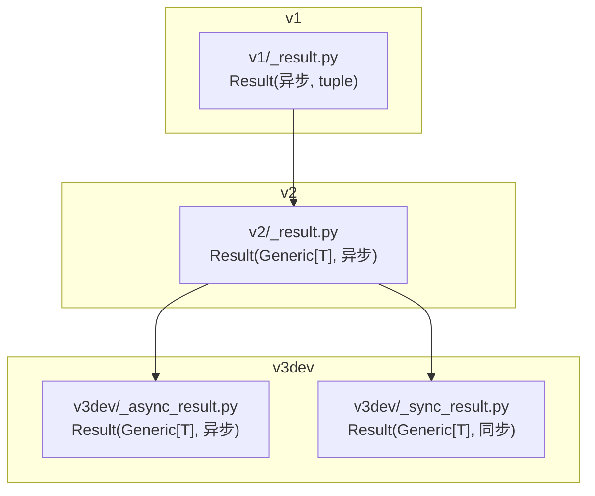
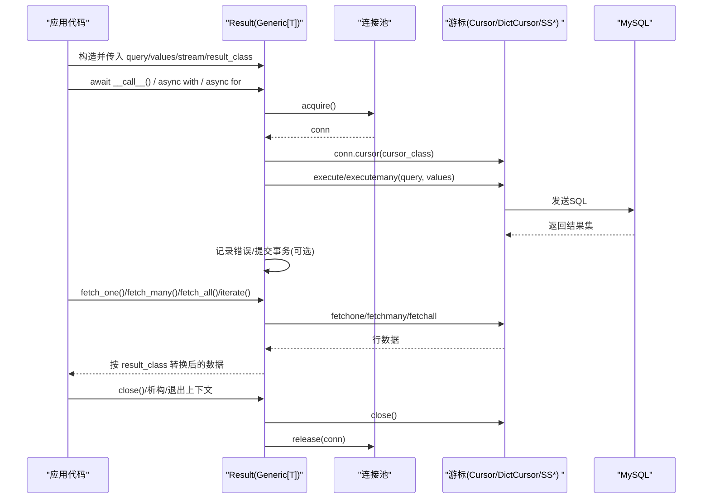
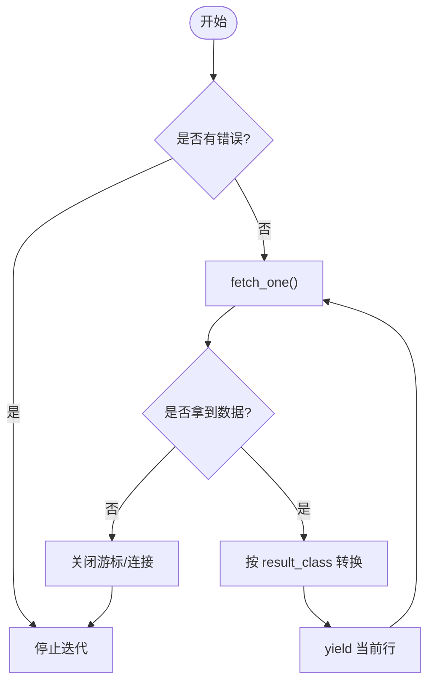
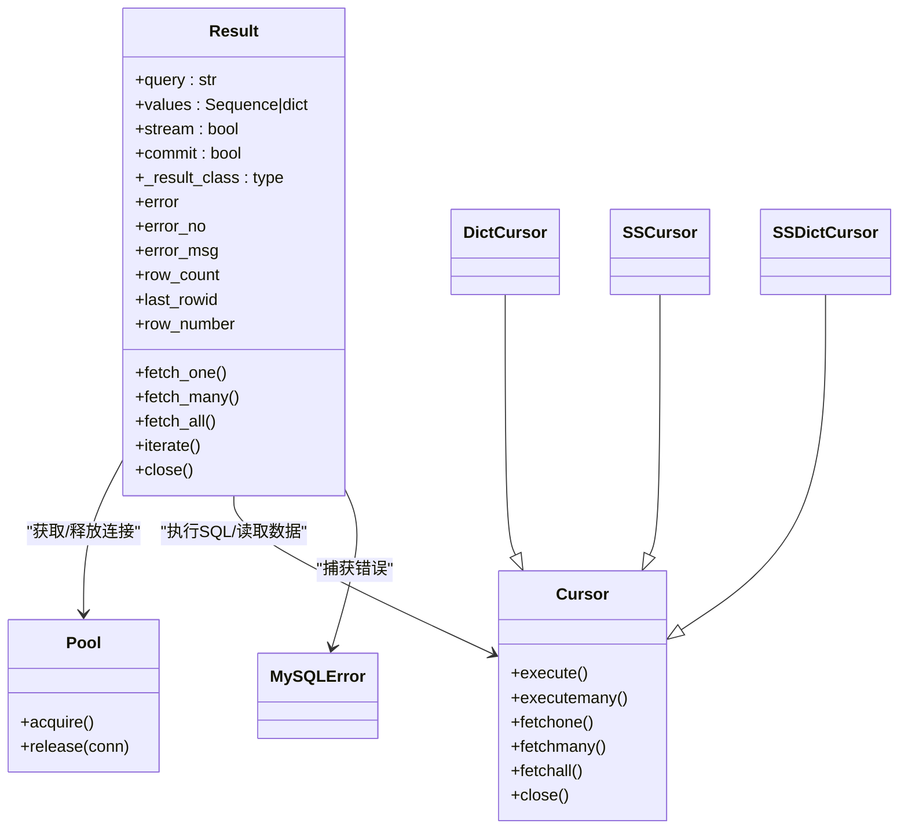

# Result 结果处理类

<cite>
**本文引用的文件**   
- [asmysql/v2/_result.py](file://asmysql/v2/_result.py)
- [asmysql/v3dev/_async_result.py](file://asmysql/v3dev/_async_result.py)
- [asmysql/v3dev/_sync_result.py](file://asmysql/v3dev/_sync_result.py)
- [asmysql/v1/_result.py](file://asmysql/v1/_result.py)
- [tests/v2/test_all_result_for_typing.py](file://tests/v2/test_all_result_for_typing.py)
- [tests/v3/test_async.py](file://tests/v3/test_async.py)
- [tests/v3/test_sync.py](file://tests/v3/test_sync.py)
</cite>

## 目录
1. [简介](#简介)
2. [项目结构](#项目结构)
3. [核心组件](#核心组件)
4. [架构总览](#架构总览)
5. [详细组件分析](#详细组件分析)
6. [依赖关系分析](#依赖关系分析)
7. [性能与内存优化](#性能与内存优化)
8. [故障排查指南](#故障排查指南)
9. [结论](#结论)
10. [附录：API 速查与最佳实践](#附录api-速查与最佳实践)

## 简介
本文件全面解析 asmysql 中 Result 结果处理类的设计与实现，重点覆盖以下方面：
- 泛型设计 T 的类型安全与类型推断机制
- 数据获取方法 fetch_one()、fetch_many()、fetch_all() 的使用场景与性能特点
- 异步迭代器支持（__aiter__/__anext__）与流式数据处理
- 元组结果、字典结果与自定义对象结果的转换机制
- 游标管理、连接池释放与大数据集处理策略
- 错误处理、异常信息与调试支持
- 面向开发者的 API 说明与最佳实践

## 项目结构
Result 类在多个版本中存在演进：
- v1：基础异步封装，返回 tuple，无泛型
- v2：引入 Generic[T]，支持 tuple/dict/自定义对象，提供异步上下文与 async for 迭代
- v3dev：进一步拆分同步与异步实现，保持一致的 API 与行为

图表来源
- [asmysql/v1/_result.py:10-73](file://asmysql/v1/_result.py#L10-L73)
- [asmysql/v2/_result.py:21-273](file://asmysql/v2/_result.py#L21-L273)
- [asmysql/v3dev/_async_result.py:21-273](file://asmysql/v3dev/_async_result.py#L21-L273)
- [asmysql/v3dev/_sync_result.py:23-268](file://asmysql/v3dev/_sync_result.py#L23-L268)

章节来源
- [asmysql/v1/_result.py:10-73](file://asmysql/v1/_result.py#L10-L73)
- [asmysql/v2/_result.py:21-273](file://asmysql/v2/_result.py#L21-L273)
- [asmysql/v3dev/_async_result.py:21-273](file://asmysql/v3dev/_async_result.py#L21-L273)
- [asmysql/v3dev/_sync_result.py:23-268](file://asmysql/v3dev/_sync_result.py#L23-L268)

## 核心组件
- 通用游标选择器：根据 result_class 与 stream 标志选择 Cursor/DictCursor/SSCursor/SSDictCursor
- Result 类：封装执行、错误、属性访问、数据获取、迭代与资源释放
- 类型系统：Generic[T] 配合 Pydantic/TypedDict/内置类型，确保类型安全与 IDE 提示

章节来源
- [asmysql/v2/_result.py:10-18](file://asmysql/v2/_result.py#L10-L18)
- [asmysql/v3dev/_async_result.py:10-18](file://asmysql/v3dev/_async_result.py#L10-L18)
- [asmysql/v3dev/_sync_result.py:12-20](file://asmysql/v3dev/_sync_result.py#L12-L20)

## 架构总览
Result 的核心职责是“执行 SQL -> 管理游标 -> 提供统一的数据读取接口 -> 自动释放资源”。其关键流程如下：

图表来源
- [asmysql/v2/_result.py:101-131](file://asmysql/v2/_result.py#L101-L131)
- [asmysql/v3dev/_async_result.py:101-131](file://asmysql/v3dev/_async_result.py#L101-L131)
- [asmysql/v3dev/_sync_result.py:103-127](file://asmysql/v3dev/_sync_result.py#L103-L127)

## 详细组件分析

### 泛型设计与类型安全
- TypeVar 定义：T = TypeVar("T")，用于标注 Result 的返回值类型
- 默认类型：result_class 默认为 tuple；可指定 dict 或任意可调用类（如 Pydantic BaseModel）
- 类型推断：当传入 result_class=MyModel 时，IDE 与静态检查工具可推断 fetch_one/iterate 等返回类型为 MyModel
- 转换规则：
  - result_class is tuple：直接返回元组
  - result_class is dict：返回字典（基于 DictCursor/SSDictCursor）
  - 其他类型：以 **data 方式构造实例（要求字段名与列名一致）

章节来源
- [asmysql/v2/_result.py:7-18](file://asmysql/v2/_result.py#L7-L18)
- [asmysql/v2/_result.py:202-208](file://asmysql/v2/_result.py#L202-L208)
- [asmysql/v3dev/_async_result.py:7-18](file://asmysql/v3dev/_async_result.py#L7-L18)
- [asmysql/v3dev/_sync_result.py:9-20](file://asmysql/v3dev/_sync_result.py#L9-L20)

### 数据获取方法与使用场景
- fetch_one(close=None)
  - 用途：获取单条记录，适合主键查询、配置项读取
  - 行为：若结果为空则关闭连接并返回 None；可按需控制是否自动关闭
  - 性能：O(1)，仅取一行
- fetch_many(size=None, close=None)
  - 用途：批量拉取固定批次，适合分页/分片处理
  - 行为：若无数据则关闭连接并返回空列表；close 参数控制自动关闭
  - 性能：O(k)，k 为 size
- fetch_all()
  - 用途：一次性加载全部结果，适合小数据集
  - 行为：将整表结果载入内存后关闭连接
  - 风险：大数据集会导致高内存占用
- iterate()
  - 用途：逐行生成，适合大数据集流式处理
  - 行为：内部循环 fetchone，直到结束；finally 中保证关闭连接
  - 性能：O(n)，但内存占用低

章节来源
- [asmysql/v2/_result.py:186-273](file://asmysql/v2/_result.py#L186-L273)
- [asmysql/v3dev/_async_result.py:186-273](file://asmysql/v3dev/_async_result.py#L186-L273)
- [asmysql/v3dev/_sync_result.py:186-268](file://asmysql/v3dev/_sync_result.py#L186-L268)

### 异步迭代器支持与流式处理
- 支持 async for item in result：通过 __aiter__/__anext__ 实现
- 支持 async with ... as result：进入上下文即执行 SQL，退出时自动关闭
- 支持 result = await execute(...)：Result 本身是可等待对象
- 流式模式：stream=True 时选择 SSCursor/SSDictCursor，避免一次性加载全量结果

图表来源
- [asmysql/v2/_result.py:81-100](file://asmysql/v2/_result.py#L81-L100)
- [asmysql/v2/_result.py:251-273](file://asmysql/v2/_result.py#L251-L273)
- [asmysql/v3dev/_async_result.py:81-100](file://asmysql/v3dev/_async_result.py#L81-L100)
- [asmysql/v3dev/_async_result.py:251-273](file://asmysql/v3dev/_async_result.py#L251-L273)

### 元组、字典与自定义对象转换
- 元组：默认行为，轻量高效
- 字典：便于按列名访问，适合动态列或复杂聚合
- 自定义对象：例如 Pydantic BaseModel，可通过 **data 构造，获得强类型与校验能力

章节来源
- [asmysql/v2/_result.py:202-208](file://asmysql/v2/_result.py#L202-L208)
- [asmysql/v2/_result.py:228-234](file://asmysql/v2/_result.py#L228-L234)
- [asmysql/v2/_result.py:243-249](file://asmysql/v2/_result.py#L243-L249)
- [tests/v2/test_all_result_for_typing.py:14-23](file://tests/v2/test_all_result_for_typing.py#L14-L23)

### 游标管理与资源释放
- 自动关闭：fetch_one/many/all/iterate 在无数据或结束时自动关闭游标与连接
- 手动控制：close 参数允许延迟关闭，但必须显式调用 close() 释放连接
- 上下文管理：async with/with 确保异常路径下也能正确释放
- 析构兜底：__del__ 在存在游标且未报错时尝试释放连接

章节来源
- [asmysql/v2/_result.py:57-79](file://asmysql/v2/_result.py#L57-L79)
- [asmysql/v2/_result.py:186-234](file://asmysql/v2/_result.py#L186-L234)
- [asmysql/v3dev/_async_result.py:57-79](file://asmysql/v3dev/_async_result.py#L57-L79)
- [asmysql/v3dev/_sync_result.py:59-81](file://asmysql/v3dev/_sync_result.py#L59-L81)

### 错误处理、异常信息与调试支持
- error/error_no/error_msg：统一暴露错误对象、错误码与消息
- 错误路径：execute 捕获 MySQLError，设置 self.__error，并在后续读取方法中短路返回
- 调试友好：__repr__ 输出查询语句，便于日志定位

章节来源
- [asmysql/v2/_result.py:49-55](file://asmysql/v2/_result.py#L49-L55)
- [asmysql/v2/_result.py:133-151](file://asmysql/v2/_result.py#L133-L151)
- [asmysql/v2/_result.py:119-125](file://asmysql/v2/_result.py#L119-L125)
- [tests/v3/test_async.py:17-18](file://tests/v3/test_async.py#L17-L18)

## 依赖关系分析
- 底层驱动：aiomysql/pymysql 的 Cursor/DictCursor/SSCursor/SSDictCursor
- 连接池：pool.acquire/release 负责连接生命周期
- 错误类型：pymysql.err.MySQLError

图表来源
- [asmysql/v2/_result.py:21-273](file://asmysql/v2/_result.py#L21-L273)
- [asmysql/v3dev/_async_result.py:21-273](file://asmysql/v3dev/_async_result.py#L21-L273)
- [asmysql/v3dev/_sync_result.py:23-268](file://asmysql/v3dev/_sync_result.py#L23-L268)

章节来源
- [asmysql/v2/_result.py:21-273](file://asmysql/v2/_result.py#L21-L273)
- [asmysql/v3dev/_async_result.py:21-273](file://asmysql/v3dev/_async_result.py#L21-L273)
- [asmysql/v3dev/_sync_result.py:23-268](file://asmysql/v3dev/_sync_result.py#L23-L268)

## 性能与内存优化
- 流式查询：stream=True 时使用 SSCursor/SSDictCursor，逐行拉取，显著降低内存峰值
- 分批读取：fetch_many(size) 控制每次拉取行数，平衡吞吐与内存
- 避免 fetch_all：对大结果集优先使用 iterate() 或 async for
- 自动关闭：尽量让 fetch_* 和 iterate() 自动关闭连接，减少连接泄漏风险
- 结果类型选择：tuple 最轻量；dict 更灵活；自定义对象带来额外构造开销

章节来源
- [asmysql/v2/_result.py:10-18](file://asmysql/v2/_result.py#L10-L18)
- [asmysql/v2/_result.py:251-273](file://asmysql/v2/_result.py#L251-L273)
- [asmysql/v3dev/_async_result.py:251-273](file://asmysql/v3dev/_async_result.py#L251-L273)
- [asmysql/v3dev/_sync_result.py:246-268](file://asmysql/v3dev/_sync_result.py#L246-L268)

## 故障排查指南
- 常见错误
  - 未关闭连接导致连接池耗尽：确认是否使用了 async with/with 或在 finally/close 中释放
  - 大数据集导致 OOM：改用 stream=True 与 iterate()/async for
  - 自定义模型字段不匹配：确保 SELECT 列名与模型字段一致
- 诊断信息
  - 使用 error/error_no/error_msg 快速定位问题
  - 借助 __repr__ 打印查询语句辅助复现
- 参考用例
  - 异步测试：[tests/v3/test_async.py:1-108](file://tests/v3/test_async.py#L1-L108)
  - 同步测试：[tests/v3/test_sync.py:1-131](file://tests/v3/test_sync.py#L1-L131)
  - 类型与模型示例：[tests/v2/test_all_result_for_typing.py:1-121](file://tests/v2/test_all_result_for_typing.py#L1-L121)

章节来源
- [tests/v3/test_async.py:17-18](file://tests/v3/test_async.py#L17-L18)
- [tests/v3/test_sync.py:17-18](file://tests/v3/test_sync.py#L17-L18)
- [tests/v2/test_all_result_for_typing.py:28-69](file://tests/v2/test_all_result_for_typing.py#L28-L69)

## 结论
Result 类通过统一的抽象屏蔽了底层驱动差异，提供了类型安全、资源安全、可扩展的结果处理能力。结合流式迭代与批处理，既能满足高性能大批量数据处理，又能兼顾易用性与可维护性。推荐在生产环境中：
- 优先使用 stream=True 与 iterate()/async for
- 使用 dict 或强类型模型提升可读性与健壮性
- 始终利用上下文管理器或自动关闭逻辑，避免连接泄漏

## 附录：API 速查与最佳实践
- 基本用法
  - 单条记录：await result.fetch_one()
  - 批量记录：await result.fetch_many(size)
  - 全部记录：await result.fetch_all()
  - 流式遍历：async for item in result.iterate() 或 async for item in result
- 类型与模型
  - result_class=tuple（默认）、dict、Pydantic 模型等
- 资源管理
  - 推荐使用 async with/with 包裹 execute 返回的 Result
  - 如需延迟关闭，请显式调用 close()
- 错误处理
  - 读取前检查 result.error，或使用 error_no/error_msg 获取详细信息

章节来源
- [asmysql/v2/_result.py:186-273](file://asmysql/v2/_result.py#L186-L273)
- [asmysql/v3dev/_async_result.py:186-273](file://asmysql/v3dev/_async_result.py#L186-L273)
- [asmysql/v3dev/_sync_result.py:186-268](file://asmysql/v3dev/_sync_result.py#L186-L268)
- [tests/v2/test_all_result_for_typing.py:28-107](file://tests/v2/test_all_result_for_typing.py#L28-L107)
- [tests/v3/test_async.py:14-89](file://tests/v3/test_async.py#L14-L89)
- [tests/v3/test_sync.py:13-106](file://tests/v3/test_sync.py#L13-L106)