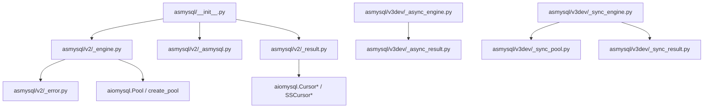
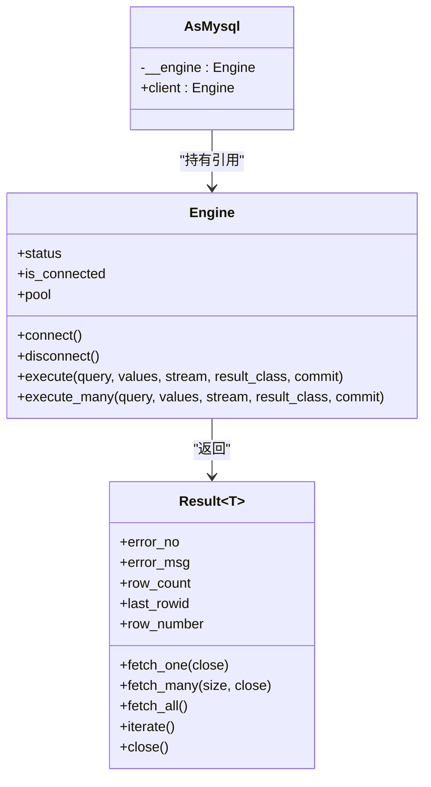
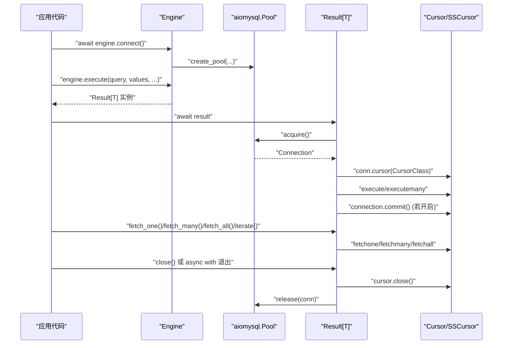
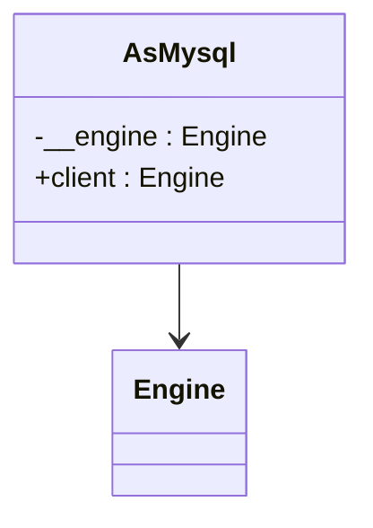
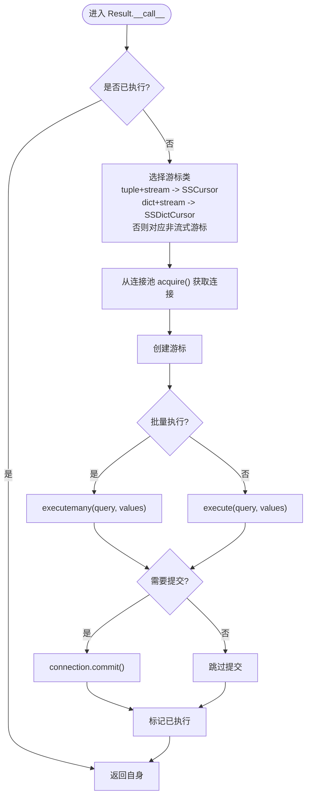
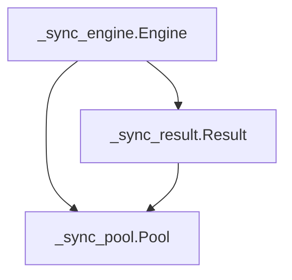
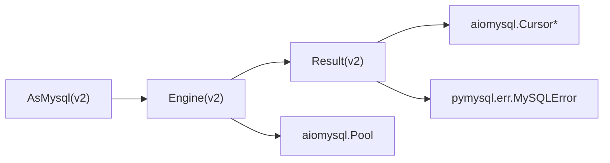

# 核心概念

<cite>
**本文引用的文件列表**
- [asmysql/__init__.py](file://asmysql/__init__.py)
- [asmysql/v2/_engine.py](file://asmysql/v2/_engine.py)
- [asmysql/v2/_asmysql.py](file://asmysql/v2/_asmysql.py)
- [asmysql/v2/_result.py](file://asmysql/v2/_result.py)
- [asmysql/v2/_error.py](file://asmysql/v2/_error.py)
- [asmysql/v3dev/_async_engine.py](file://asmysql/v3dev/_async_engine.py)
- [asmysql/v3dev/_sync_engine.py](file://asmysql/v3dev/_sync_engine.py)
- [asmysql/v3dev/_sync_pool.py](file://asmysql/v3dev/_sync_pool.py)
- [asmysql/v3dev/_async_result.py](file://asmysql/v3dev/_async_result.py)
- [asmysql/v3dev/_sync_result.py](file://asmysql/v3dev/_sync_result.py)
- [asmysql/v3dev/_types.py](file://asmysql/v3dev/_types.py)
- [README.md](file://README.md)
</cite>

## 目录
1. [简介](#简介)
2. [项目结构](#项目结构)
3. [核心组件](#核心组件)
4. [架构总览](#架构总览)
5. [详细组件分析](#详细组件分析)
6. [依赖关系分析](#依赖关系分析)
7. [性能与资源管理](#性能与资源管理)
8. [故障排查指南](#故障排查指南)
9. [结论](#结论)
10. [附录：异步编程模式与类型安全](#附录异步编程模式与类型安全)

## 简介
本文件聚焦 asmysql 的核心概念与架构设计，围绕三个关键组件展开：
- Engine 引擎类：负责连接池管理与 SQL 执行入口（支持异步/同步两套实现）
- AsMysql 业务基类：提供面向业务的开发框架，将 Engine 注入到业务逻辑中
- Result 结果处理类：封装查询结果、错误信息、迭代与自动资源释放，并支持泛型与类型安全

文档同时解释组件间的依赖关系与数据流向，说明异步编程模式在项目中的应用，深入解析连接池的工作原理、生命周期管理和资源释放机制，并详细说明 Result 类的泛型设计与类型安全支持。

## 项目结构
仓库采用版本化目录组织，v2 为当前稳定版，v3dev 为演进中的同步/异步双栈版本。顶层包通过 __init__.py 统一暴露 v2 的 API。

图表来源
- [asmysql/__init__.py:1-16](file://asmysql/__init__.py#L1-L16)
- [asmysql/v2/_engine.py:1-317](file://asmysql/v2/_engine.py#L1-L317)
- [asmysql/v2/_asmysql.py:1-26](file://asmysql/v2/_asmysql.py#L1-L26)
- [asmysql/v2/_result.py:1-273](file://asmysql/v2/_result.py#L1-L273)
- [asmysql/v2/_error.py:1-7](file://asmysql/v2/_error.py#L1-L7)
- [asmysql/v3dev/_async_engine.py:1-307](file://asmysql/v3dev/_async_engine.py#L1-L307)
- [asmysql/v3dev/_sync_engine.py:1-298](file://asmysql/v3dev/_sync_engine.py#L1-L298)
- [asmysql/v3dev/_sync_pool.py:1-281](file://asmysql/v3dev/_sync_pool.py#L1-L281)
- [asmysql/v3dev/_async_result.py:1-273](file://asmysql/v3dev/_async_result.py#L1-L273)
- [asmysql/v3dev/_sync_result.py:1-268](file://asmysql/v3dev/_sync_result.py#L1-L268)

章节来源
- [asmysql/__init__.py:1-16](file://asmysql/__init__.py#L1-L16)
- [README.md:1-135](file://README.md#L1-L135)

## 核心组件
- Engine 引擎类
  - 职责：封装 aiomysql/pymysql 的连接池创建、获取、释放；提供 execute/execute_many 入口；暴露连接状态与清理接口。
  - 特性：支持 URL 参数解析、连接超时、自动提交、SQL 日志开关、流式读取、返回类型可配置。
- AsMysql 业务基类
  - 职责：作为业务层的基类，持有 Engine 引用，对外暴露 client 属性用于执行 SQL。
  - 价值：将“连接/执行”与“业务逻辑”解耦，便于测试与复用。
- Result 结果处理类
  - 职责：封装一次 SQL 执行的完整生命周期：获取连接、创建游标、执行语句、提交事务、错误捕获、结果获取、迭代遍历、自动关闭与连接回池。
  - 特性：支持 await、async with、async for 三种使用方式；支持 fetch_one/fetch_many/fetch_all/iterate；支持自定义 result_class 进行对象映射；支持流式游标降低内存占用。

章节来源
- [asmysql/v2/_engine.py:37-317](file://asmysql/v2/_engine.py#L37-L317)
- [asmysql/v2/_asmysql.py:7-26](file://asmysql/v2/_asmysql.py#L7-L26)
- [asmysql/v2/_result.py:21-273](file://asmysql/v2/_result.py#L21-L273)

## 架构总览
下图展示了 v2 版本的异步架构与数据流：Engine 负责连接池与执行入口，Result 负责具体执行与结果处理，AsMysql 作为业务层桥接两者。

图表来源
- [asmysql/v2/_engine.py:37-317](file://asmysql/v2/_engine.py#L37-L317)
- [asmysql/v2/_asmysql.py:7-26](file://asmysql/v2/_asmysql.py#L7-L26)
- [asmysql/v2/_result.py:21-273](file://asmysql/v2/_result.py#L21-L273)

## 详细组件分析

### Engine 引擎类（异步 v2）
- 连接池初始化
  - connect：基于 aiomysql.create_pool 创建连接池，支持 host/port/user/password/charset/minsize/maxsize/pool_recycle/connect_timeout/autocommit/echo 等参数；URL 字符串解析覆盖默认值。
  - disconnect：调用 pool.close 与 wait_closed，确保所有连接释放后置空内部池引用。
  - release_connections：清空空闲连接。
- 执行入口
  - execute/execute_many：返回 Result 实例，传入 pool、query、values、stream、commit、result_class 等上下文；支持 overloads 以增强类型推断。
- 状态与访问
  - status：返回连接池统计信息（地址、是否已连接、min/max/size/free/used）。
  - is_connected/pool：便捷属性，未连接时访问 pool 会抛出明确的 ConnectionError。

图表来源
- [asmysql/v2/_engine.py:131-183](file://asmysql/v2/_engine.py#L131-L183)
- [asmysql/v2/_engine.py:227-317](file://asmysql/v2/_engine.py#L227-L317)
- [asmysql/v2/_result.py:101-126](file://asmysql/v2/_result.py#L101-L126)
- [asmysql/v2/_result.py:186-273](file://asmysql/v2/_result.py#L186-L273)

章节来源
- [asmysql/v2/_engine.py:37-317](file://asmysql/v2/_engine.py#L37-L317)

### AsMysql 业务基类
- 设计要点
  - 构造时注入 Engine，内部私有保存引用。
  - 暴露 client 属性，使业务方法可直接使用 Engine 的 execute/execute_many。
  - 提供 __repr__/__str__ 便于调试输出。
- 使用建议
  - 继承 AsMysql 定义业务方法，在方法内通过 self.client 执行 SQL，并通过 Result 提供的 API 获取数据。

图表来源
- [asmysql/v2/_asmysql.py:7-26](file://asmysql/v2/_asmysql.py#L7-L26)
- [asmysql/v2/_engine.py:37-317](file://asmysql/v2/_engine.py#L37-L317)

章节来源
- [asmysql/v2/_asmysql.py:7-26](file://asmysql/v2/_asmysql.py#L7-L26)

### Result 结果处理类（异步 v2）
- 核心流程
  - __call__/__await__/__aenter__/__aiter__/__anext__：支持多种使用方式，内部统一走 __call__ 完成连接获取、游标创建、SQL 执行与提交。
  - 错误处理：捕获 MySQLError，记录 error，并在异常路径中确保 cursor 关闭与连接回池。
  - 结果获取：fetch_one/fetch_many/fetch_all/iterate，支持自动关闭连接（可通过 close 参数控制），支持非 tuple/dict 的 result_class 进行对象映射。
  - 流式读取：根据 result_class 与 stream 选择 Cursor/SSCursor/DictCursor/SSDictCursor，避免大结果集占用内存。
- 资源释放
  - close：关闭游标并将连接归还连接池。
  - __del__/__aexit__/__anext__：在异常或迭代结束时保证资源回收。

图表来源
- [asmysql/v2/_result.py:101-126](file://asmysql/v2/_result.py#L101-L126)
- [asmysql/v2/_result.py:186-273](file://asmysql/v2/_result.py#L186-L273)

章节来源
- [asmysql/v2/_result.py:21-273](file://asmysql/v2/_result.py#L21-L273)

### 同步版本（v3dev）概览
- 同步 Engine 与 Result
  - _sync_engine.Engine 与 _sync_result.Result 提供与异步版本一致的 API 风格，但基于 pymysql 与自实现的同步连接池 _sync_pool.Pool。
- 同步连接池
  - _sync_pool.Pool 基于 threading.Condition/Lock 实现线程安全的连接获取/归还、最小/最大连接数控制、空闲回收与关闭等待。

图表来源
- [asmysql/v3dev/_sync_engine.py:26-298](file://asmysql/v3dev/_sync_engine.py#L26-L298)
- [asmysql/v3dev/_sync_pool.py:18-281](file://asmysql/v3dev/_sync_pool.py#L18-L281)
- [asmysql/v3dev/_sync_result.py:23-268](file://asmysql/v3dev/_sync_result.py#L23-L268)

章节来源
- [asmysql/v3dev/_sync_engine.py:26-298](file://asmysql/v3dev/_sync_engine.py#L26-L298)
- [asmysql/v3dev/_sync_pool.py:18-281](file://asmysql/v3dev/_sync_pool.py#L18-L281)
- [asmysql/v3dev/_sync_result.py:23-268](file://asmysql/v3dev/_sync_result.py#L23-L268)

## 依赖关系分析
- 外部依赖
  - 异步栈：aiomysql（Pool、Cursor 族）、pymysql.err.MySQLError。
  - 同步栈：pymysql（连接与游标）、标准库 threading/collections。
- 内部耦合
  - Engine 仅依赖 Result 的构造参数约定，不直接操作游标。
  - Result 依赖底层连接池与游标，屏蔽了连接获取/归还细节。
  - AsMysql 仅依赖 Engine，保持业务层简洁。

图表来源
- [asmysql/v2/_engine.py:1-317](file://asmysql/v2/_engine.py#L1-L317)
- [asmysql/v2/_result.py:1-273](file://asmysql/v2/_result.py#L1-L273)
- [asmysql/v2/_asmysql.py:1-26](file://asmysql/v2/_asmysql.py#L1-L26)

章节来源
- [asmysql/v2/_engine.py:1-317](file://asmysql/v2/_engine.py#L1-L317)
- [asmysql/v2/_result.py:1-273](file://asmysql/v2/_result.py#L1-L273)
- [asmysql/v2/_asmysql.py:1-26](file://asmysql/v2/_asmysql.py#L1-L26)

## 性能与资源管理
- 连接池工作原理
  - 异步：aiomysql.Pool 维护空闲队列与使用中集合，按需创建/回收连接，支持 minsize/maxsize/pool_recycle/connect_timeout/autocommit/echo。
  - 同步：_sync_pool.Pool 使用 deque 与 set 管理空闲/使用/终止连接，Condition 协调并发获取，支持最小/最大连接数与空闲回收。
- 生命周期管理
  - Engine.connect：首次调用创建池；重复调用直接返回实例。
  - Engine.disconnect：关闭池并等待所有连接释放，随后置空内部引用。
  - Result.close：关闭游标并将连接归还池；在异常路径与析构钩子中兜底释放。
- 资源释放机制
  - 显式：with 语句或手动调用 close。
  - 隐式：__del__/__aexit__/__anext__ 在错误或迭代结束时释放。
- 流式读取
  - 当 stream=True 且 result_class=tuple 时使用 SSCursor；result_class=dict 时使用 SSDictCursor，避免一次性加载全部结果至内存。

章节来源
- [asmysql/v2/_engine.py:131-183](file://asmysql/v2/_engine.py#L131-L183)
- [asmysql/v2/_result.py:101-126](file://asmysql/v2/_result.py#L101-L126)
- [asmysql/v3dev/_sync_pool.py:18-281](file://asmysql/v3dev/_sync_pool.py#L18-L281)

## 故障排查指南
- 常见错误
  - 连接失败：Engine.connect 捕获 MySQLError 并包装为 ConnectionError，提示连接参数或网络问题。
  - 未连接即使用：访问 Engine.pool 前需先 connect，否则会抛出明确错误的 ConnectionError。
  - 事务未提交：若 commit=False，需自行管理事务边界；否则默认自动提交。
- 诊断信息
  - Result.error/error_no/error_msg：快速定位 MySQL 错误码与消息。
  - Engine.status：查看连接池大小、空闲/使用数量，辅助判断连接泄漏或瓶颈。
- 日志与调试
  - echo_sql_log：打开后可打印 SQL 语句，便于定位慢查询与参数绑定问题。

章节来源
- [asmysql/v2/_engine.py:131-183](file://asmysql/v2/_engine.py#L131-L183)
- [asmysql/v2/_engine.py:195-203](file://asmysql/v2/_engine.py#L195-L203)
- [asmysql/v2/_result.py:133-151](file://asmysql/v2/_result.py#L133-L151)
- [asmysql/v2/_error.py:1-7](file://asmysql/v2/_error.py#L1-L7)

## 结论
asmysql 通过 Engine/AsMysql/Result 三件套实现了清晰的职责分离：Engine 专注连接池与执行入口，AsMysql 提供业务接入点，Result 封装完整的执行与资源管理。其异步优先的设计配合流式游标与泛型类型标注，既保证了高性能与低内存占用，也提升了类型安全与可维护性。同步版本在 v3dev 中提供了对传统场景的支持，进一步增强了库的适用面。

## 附录：异步编程模式与类型安全
- 异步编程模式
  - await 表达式：适用于一次性获取结果的场景。
  - async with：适用于需要显式控制生命周期的场景，确保资源及时释放。
  - async for：适用于逐行消费大结果集，结合流式游标避免内存峰值。
- 类型安全与泛型
  - Engine.execute/execute_many 使用 @overload 区分 tuple 与自定义 result_class 的返回类型，提升 IDE 推断体验。
  - Result 使用 Generic[T] 约束返回类型，当 result_class 为非 tuple/dict 时，自动将每行映射为对象实例，保证强类型。
  - 同步版本 Result 使用 TypeVar bound=type 强化类型约束。

章节来源
- [asmysql/v2/_engine.py:204-317](file://asmysql/v2/_engine.py#L204-L317)
- [asmysql/v2/_result.py:21-273](file://asmysql/v2/_result.py#L21-L273)
- [asmysql/v3dev/_sync_result.py:9-268](file://asmysql/v3dev/_sync_result.py#L9-L268)