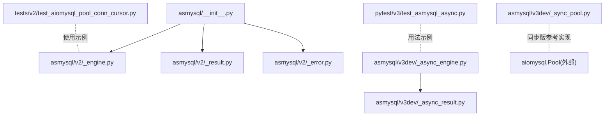
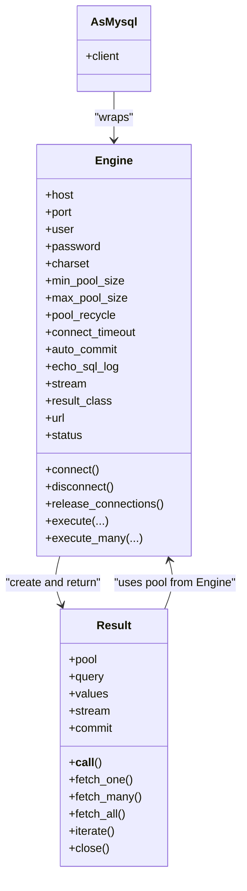
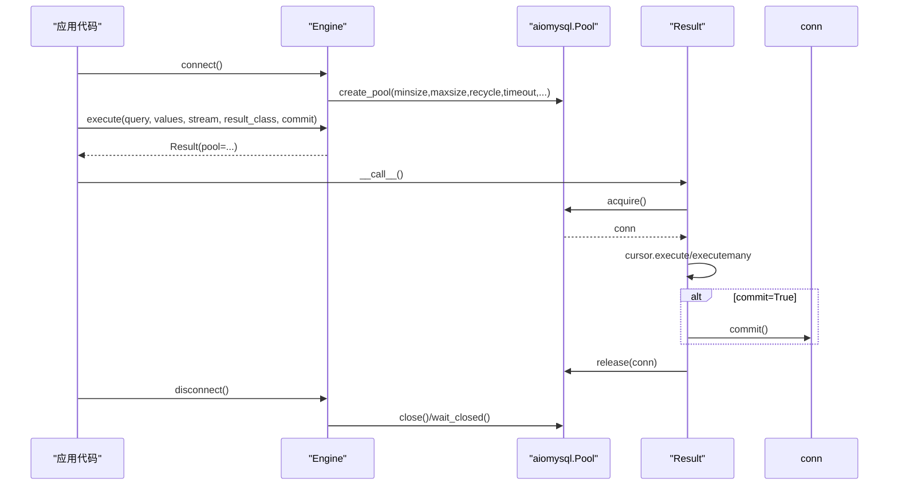
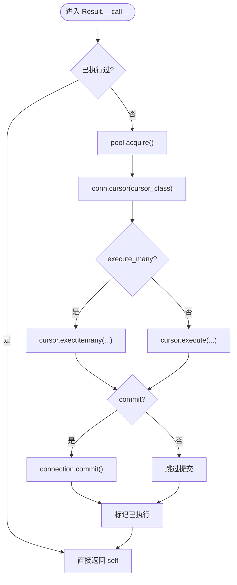
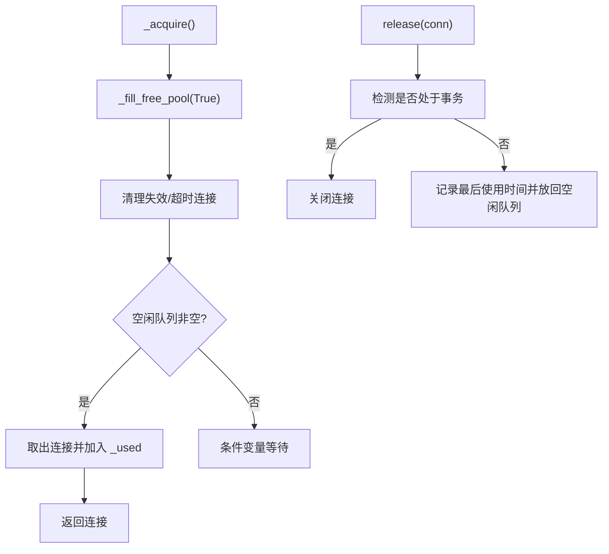
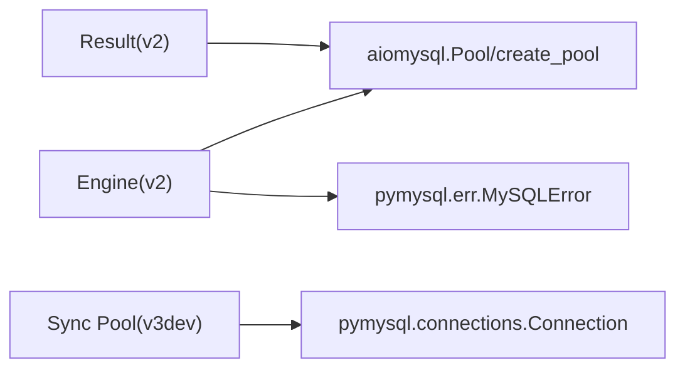

# 连接池工作原理

<cite>
**本文引用的文件**
- [asmysql/__init__.py](file://asmysql/__init__.py)
- [asmysql/v2/_engine.py](file://asmysql/v2/_engine.py)
- [asmysql/v2/_result.py](file://asmysql/v2/_result.py)
- [asmysql/v2/_error.py](file://asmysql/v2/_error.py)
- [asmysql/v3dev/_async_engine.py](file://asmysql/v3dev/_async_engine.py)
- [asmysql/v3dev/_async_result.py](file://asmysql/v3dev/_async_result.py)
- [asmysql/v3dev/_sync_pool.py](file://asmysql/v3dev/_sync_pool.py)
- [asmysql/v3dev/_types.py](file://asmysql/v3dev/_types.py)
- [tests/v2/test_aiomysql_pool_conn_cursor.py](file://tests/v2/test_aiomysql_pool_conn_cursor.py)
- [pytest/v3/test_asmysql_async.py](file://pytest/v3/test_asmysql_async.py)
</cite>

## 目录
1. [简介](#简介)
2. [项目结构](#项目结构)
3. [核心组件](#核心组件)
4. [架构总览](#架构总览)
5. [详细组件分析](#详细组件分析)
6. [依赖关系分析](#依赖关系分析)
7. [性能与参数调优](#性能与参数调优)
8. [故障排查与监控](#故障排查与监控)
9. [结论](#结论)
10. [附录：最佳实践清单](#附录最佳实践清单)

## 简介
本文件深入解析 asmysql 连接池的内部工作机制与架构设计，重点围绕 aiomysql Pool 的封装与扩展，阐述连接的创建、分配、回收与销毁策略；解释关键参数（min_pool_size、max_pool_size、pool_recycle）对性能的影响与优化建议；说明健康检查、自动重连与故障转移机制的现状与建议；提供连接状态监控与调试信息获取方法；并给出连接泄漏防护、资源清理策略以及性能调优的最佳实践。面向需要理解和优化数据库连接性能的开发者，提供从原理到实操的系统化指导。

## 项目结构
仓库采用多版本并存的组织方式：v1 为早期实现，v2 为当前稳定异步封装，v3dev 为开发中的异步/同步双栈演进版本。对外入口统一由 asmysql/__init__.py 暴露 v2 的核心类。

图表来源
- [asmysql/__init__.py:1-16](file://asmysql/__init__.py#L1-L16)
- [asmysql/v2/_engine.py:1-317](file://asmysql/v2/_engine.py#L1-L317)
- [asmysql/v2/_result.py:1-273](file://asmysql/v2/_result.py#L1-L273)
- [asmysql/v2/_error.py:1-7](file://asmysql/v2/_error.py#L1-L7)
- [asmysql/v3dev/_async_engine.py:1-307](file://asmysql/v3dev/_async_engine.py#L1-L307)
- [asmysql/v3dev/_async_result.py:1-273](file://asmysql/v3dev/_async_result.py#L1-L273)
- [asmysql/v3dev/_sync_pool.py:1-281](file://asmysql/v3dev/_sync_pool.py#L1-L281)
- [tests/v2/test_aiomysql_pool_conn_cursor.py:1-112](file://tests/v2/test_aiomysql_pool_conn_cursor.py#L1-L112)
- [pytest/v3/test_asmysql_async.py:1-283](file://pytest/v3/test_asmysql_async.py#L1-L283)

章节来源
- [asmysql/__init__.py:1-16](file://asmysql/__init__.py#L1-L16)

## 核心组件
- Engine（异步引擎）：封装 aiomysql.create_pool，负责连接池生命周期管理、SQL 执行入口、状态查询等。
- Result（结果对象）：封装游标与连接获取/释放，支持多种返回类型（tuple/dict/自定义模型）、流式迭代、上下文管理与错误处理。
- AsMysql（业务门面）：轻量包装 Engine，便于业务层以 client 属性访问。
- 同步版 Pool（v3dev）：基于 pymysql 的同步连接池实现，用于理解连接池内部逻辑与健康检查思路。

章节来源
- [asmysql/v2/_engine.py:37-317](file://asmysql/v2/_engine.py#L37-L317)
- [asmysql/v2/_result.py:21-273](file://asmysql/v2/_result.py#L21-L273)
- [asmysql/v2/_asmysql.py:7-26](file://asmysql/v2/_asmysql.py#L7-L26)
- [asmysql/v3dev/_sync_pool.py:18-281](file://asmysql/v3dev/_sync_pool.py#L18-L281)

## 架构总览
整体架构围绕“Engine 持有 aiomysql.Pool，Result 按需 acquire/release”的模式展开。Engine.connect 调用 create_pool 初始化连接池；execute/execute_many 返回 Result 对象；Result 在执行时从池中获取连接，执行 SQL，并在合适时机归还连接。

图表来源
- [asmysql/v2/_engine.py:37-317](file://asmysql/v2/_engine.py#L37-L317)
- [asmysql/v2/_result.py:21-273](file://asmysql/v2/_result.py#L21-L273)
- [asmysql/v2/_asmysql.py:7-26](file://asmysql/v2/_asmysql.py#L7-L26)

## 详细组件分析

### Engine 组件分析（异步）
- 连接池初始化：在 connect 中通过 aiomysql.create_pool 创建连接池，传入 minsize/maxsize/pool_recycle/connect_timeout/autocommit/echo 等参数。
- 生命周期管理：支持 async with 和 await 两种模式；disconnect 会关闭并等待所有连接释放；release_connections 可清空空闲连接。
- 状态监控：status 属性返回地址、是否已连接、池大小、空闲数、使用数等。
- SQL 执行：execute/execute_many 返回 Result 实例，将 pool、SQL、参数、流式标志、提交策略、结果类型等传递给 Result。

图表来源
- [asmysql/v2/_engine.py:131-183](file://asmysql/v2/_engine.py#L131-L183)
- [asmysql/v2/_engine.py:227-316](file://asmysql/v2/_engine.py#L227-L316)
- [asmysql/v2/_result.py:101-125](file://asmysql/v2/_result.py#L101-L125)

章节来源
- [asmysql/v2/_engine.py:37-317](file://asmysql/v2/_engine.py#L37-L317)

### Result 组件分析（异步）
- 连接获取与释放：在 __call__ 中从 pool.acquire 获取连接，执行 SQL，必要时 commit，最终在 close 或析构路径中释放连接。
- 结果类型与流式：根据 result_class 与 stream 选择 Cursor/DictCursor/SSCursor/SSDictCursor；支持 fetch_one/fetch_many/fetch_all/iterate 等多种读取方式。
- 上下文与迭代：支持 async with 与 async for 语法，确保异常路径下也能正确释放资源。
- 错误处理：捕获 MySQLError，记录 error/error_no/error_msg，避免后续操作继续执行。

图表来源
- [asmysql/v2/_result.py:101-125](file://asmysql/v2/_result.py#L101-L125)

章节来源
- [asmysql/v2/_result.py:21-273](file://asmysql/v2/_result.py#L21-L273)

### 同步版 Pool（v3dev）分析
该模块提供了基于 pymysql 的同步连接池实现，便于理解连接池内部逻辑与健康检查思路：
- 连接填充与扩容：_fill_free_pool 负责按 minsize 预填充，并在需要时按需扩容至 maxsize。
- 健康检查与回收：遍历空闲连接，检测 socket 是否关闭或是否超过 pool_recycle 时间，及时关闭并替换。
- 事务安全释放：release 中检测是否存在未提交事务，若有则关闭连接，避免脏连接复用。
- 线程安全：使用 Lock 与 Condition 保证并发安全。

图表来源
- [asmysql/v3dev/_sync_pool.py:169-237](file://asmysql/v3dev/_sync_pool.py#L169-L237)
- [asmysql/v3dev/_sync_pool.py:243-272](file://asmysql/v3dev/_sync_pool.py#L243-L272)

章节来源
- [asmysql/v3dev/_sync_pool.py:18-281](file://asmysql/v3dev/_sync_pool.py#L18-L281)

## 依赖关系分析
- Engine 依赖 aiomysql.Pool 与 pymysql.err.MySQLError，Result 依赖 aiomysql.Cursor 族与 MySQLError。
- v3dev 的同步 Pool 依赖 pymysql.connections.Connection，作为独立实现供参考。
- 对外入口仅暴露 v2 的 AsMysql/Engine/Result 等，保持 API 稳定。

图表来源
- [asmysql/v2/_engine.py:17-21](file://asmysql/v2/_engine.py#L17-L21)
- [asmysql/v2/_result.py:4-5](file://asmysql/v2/_result.py#L4-L5)
- [asmysql/v3dev/_sync_pool.py:6-7](file://asmysql/v3dev/_sync_pool.py#L6-L7)

章节来源
- [asmysql/v2/_engine.py:1-317](file://asmysql/v2/_engine.py#L1-L317)
- [asmysql/v2/_result.py:1-273](file://asmysql/v2/_result.py#L1-L273)
- [asmysql/v3dev/_sync_pool.py:1-281](file://asmysql/v3dev/_sync_pool.py#L1-L281)

## 性能与参数调优
- min_pool_size（最小空闲连接数）
  - 作用：启动后预先建立的最小连接数，减少冷启动延迟与突发请求时的扩容开销。
  - 建议：低延迟场景可设置为略高于平均并发度，避免频繁新建连接；但需考虑数据库最大连接限制。
- max_pool_size（最大连接数）
  - 作用：限制同时活跃连接上限，防止耗尽数据库资源。
  - 建议：结合数据库 max_connections 与进程/线程数设置，通常不超过数据库允许的连接数的 1/3~1/2。
- pool_recycle（空闲连接回收时间）
  - 作用：当空闲连接超过指定秒数后被回收，避免长连接被中间设备（如防火墙/NAT）断开导致异常。
  - 建议：若存在网络中间件强制断连，设置小于其空闲超时值；否则可设为 -1 禁用回收以降低开销。
- connect_timeout（连接超时）
  - 作用：控制 TCP 握手与认证阶段超时，避免阻塞。
  - 建议：根据网络质量设置合理值，避免过长导致雪崩。
- echo_sql_log（SQL 日志）
  - 作用：打印 SQL 语句，便于调试。
  - 建议：仅在开发与测试环境开启，生产环境关闭以减少 IO 开销。
- stream（流式结果）
  - 作用：大结果集使用流式游标降低内存占用。
  - 建议：大数据量查询启用，注意此时 row_count 不可用。

章节来源
- [asmysql/v2/_engine.py:45-111](file://asmysql/v2/_engine.py#L45-L111)
- [asmysql/v2/_engine.py:131-151](file://asmysql/v2/_engine.py#L131-L151)
- [asmysql/v2/_result.py:153-165](file://asmysql/v2/_result.py#L153-L165)
- [asmysql/v3dev/_sync_pool.py:185-237](file://asmysql/v3dev/_sync_pool.py#L185-L237)

## 故障排查与监控
- 连接池状态监控
  - 使用 Engine.status 获取 address、connected、pool_minsize、pool_maxsize、pool_size、pool_free、pool_used 等指标，便于接入监控系统。
- 连接健康检查
  - 同步版 Pool 展示了健康检查思路：在空闲队列中检测连接是否关闭或超时，及时回收；异步版依赖 aiomysql.Pool 内部实现，建议在业务侧增加重试与降级策略。
- 自动重连与故障转移
  - 当前实现未内置自动重连与故障转移逻辑；可在上层封装重试机制（指数退避），并结合多数据源配置实现读写分离或主备切换。
- 调试信息获取
  - 开启 echo_sql_log 打印 SQL；Result.error/error_no/error_msg 可快速定位错误码与信息。
- 连接泄漏防护
  - 推荐始终使用 async with engine.execute(...) 或确保 Result.close() 被调用；Result 的析构路径会在无错误情况下尝试释放连接，但仍建议显式管理。
- 常见问题排查
  - 连接数耗尽：检查 max_pool_size 与数据库 max_connections；观察 status.pool_used 是否接近上限。
  - 间歇性连接失败：检查 pool_recycle 与网络中间件空闲超时；适当减小 recycle 值。
  - 大查询内存飙升：启用 stream 并使用 iterate 或 fetch_many 分批处理。

章节来源
- [asmysql/v2/_engine.py:155-166](file://asmysql/v2/_engine.py#L155-L166)
- [asmysql/v2/_result.py:133-151](file://asmysql/v2/_result.py#L133-L151)
- [asmysql/v3dev/_sync_pool.py:185-237](file://asmysql/v3dev/_sync_pool.py#L185-L237)

## 结论
asmysql 通过 Engine 对 aiomysql.Pool 进行简洁封装，配合 Result 的结果抽象与资源管理，形成了清晰易用的异步数据库访问层。连接池的关键参数直接影响吞吐、延迟与稳定性，应结合业务特征与基础设施约束进行调优。当前版本未内置自动重连与故障转移，建议在上层补充相关策略。借助 status 与错误信息，可有效监控与诊断连接池问题。

## 附录：最佳实践清单
- 连接池大小
  - 根据并发量与数据库连接上限设置 min_pool_size 与 max_pool_size，避免过大导致数据库压力或过小导致排队。
- 超时与回收
  - 设置合理的 connect_timeout 与 pool_recycle，匹配网络与中间件策略。
- 结果处理
  - 大结果集使用 stream 与 iterate/fetch_many，避免一次性加载导致内存峰值。
- 资源管理
  - 优先使用 async with engine.execute(...) 或确保 Result.close() 被调用，避免连接泄漏。
- 监控与告警
  - 定期采集 Engine.status 指标，设置 pool_used 接近上限、长时间无空闲连接等告警阈值。
- 重试与降级
  - 对偶发连接失败实施带退避的重试；在极端情况下降级为只读或缓存响应。

章节来源
- [pytest/v3/test_asmysql_async.py:20-283](file://pytest/v3/test_asmysql_async.py#L20-L283)
- [tests/v2/test_aiomysql_pool_conn_cursor.py:6-20](file://tests/v2/test_aiomysql_pool_conn_cursor.py#L6-L20)