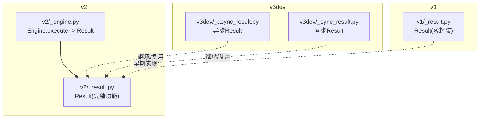
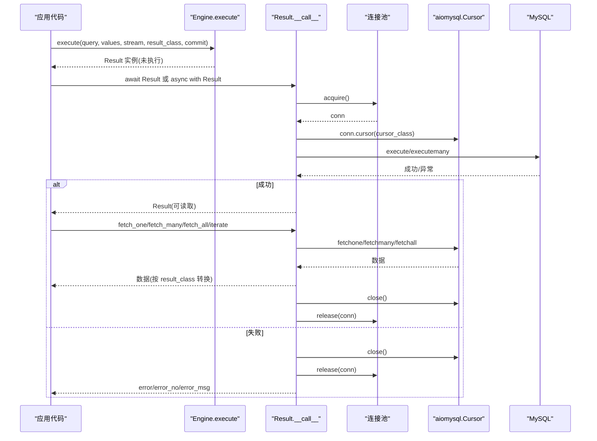
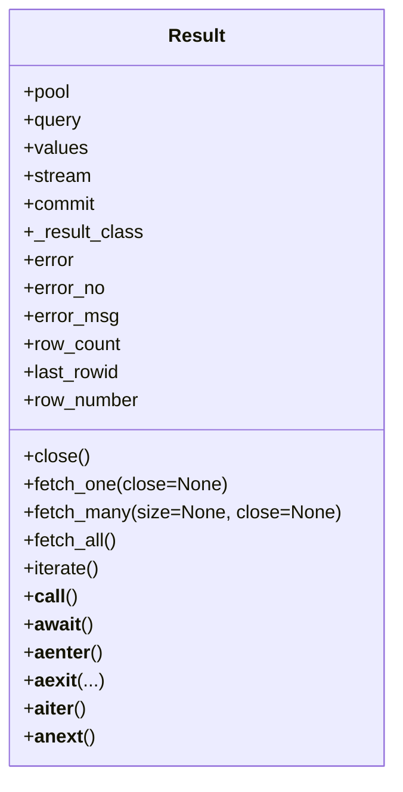
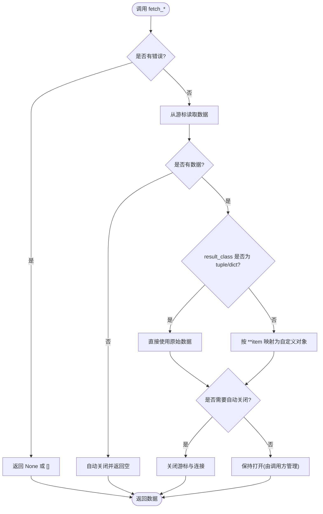
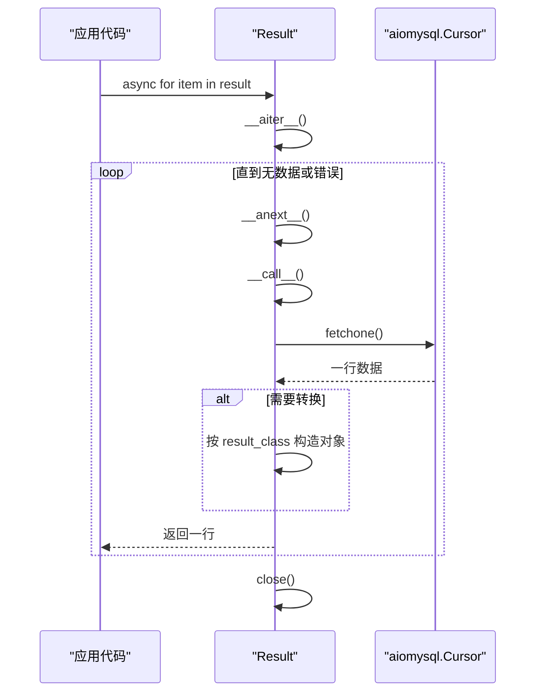
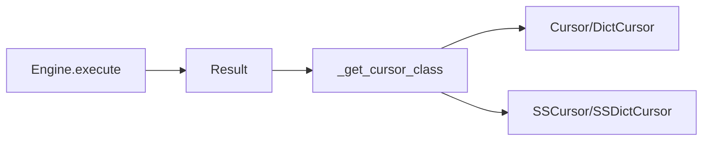

# 结果处理

<cite>
**本文引用的文件**
- [asmysql/v2/_result.py](file://asmysql/v2/_result.py)
- [asmysql/v3dev/_async_result.py](file://asmysql/v3dev/_async_result.py)
- [asmysql/v1/_result.py](file://asmysql/v1/_result.py)
- [asmysql/v2/_engine.py](file://asmysql/v2/_engine.py)
- [mkdocs/v2/docs/zh/result.md](file://mkdocs/v2/docs/zh/result.md)
- [tests/v2/test_all_result_for_typing.py](file://tests/v2/test_all_result_for_typing.py)
- [tests/v1/test_asmysql_performance.py](file://tests/v1/test_asmysql_performance.py)
</cite>

## 目录
1. [简介](#简介)
2. [项目结构](#项目结构)
3. [核心组件](#核心组件)
4. [架构总览](#架构总览)
5. [详细组件分析](#详细组件分析)
6. [依赖关系分析](#依赖关系分析)
7. [性能与内存优化](#性能与内存优化)
8. [故障排查指南](#故障排查指南)
9. [结论](#结论)
10. [附录：使用示例索引](#附录使用示例索引)

## 简介
本章节聚焦 asmysql 的结果处理机制，围绕 Result 类的数据获取方法（fetch_one、fetch_many、fetch_all）、异步迭代器 iterate()、类型转换与自定义对象映射、错误信息访问（error_no、error_msg）、上下文管理器与资源释放，以及大数据集的处理策略进行系统化解析。文档同时覆盖 v1、v2 与 v3dev 三个版本的关键差异与演进。

## 项目结构
- v1：轻量封装，Result 仅做薄包装，提供 fetch_one/fetch_many/fetch_all/iterate 等基础能力，错误属性为 err/err_msg。
- v2：增强版 Result，支持流式游标、自动关闭连接、上下文管理、直接 async for 迭代、错误码/错误消息属性、受影响的行数/最后插入ID/当前行号等统计信息；Engine.execute 返回 Result 对象，并支持 result_class 指定返回类型。
- v3dev：在 v2 基础上进一步拆分同步/异步引擎与结果实现，_async_result.py 与 _sync_result.py 分别承载不同运行时的行为。

图表来源
- [asmysql/v2/_engine.py:227-259](file://asmysql/v2/_engine.py#L227-L259)
- [asmysql/v2/_result.py:1-273](file://asmysql/v2/_result.py#L1-L273)
- [asmysql/v3dev/_async_result.py:1-273](file://asmysql/v3dev/_async_result.py#L1-L273)
- [asmysql/v1/_result.py:1-73](file://asmysql/v1/_result.py#L1-L73)

章节来源
- [asmysql/v2/_engine.py:227-259](file://asmysql/v2/_engine.py#L227-L259)
- [asmysql/v2/_result.py:1-273](file://asmysql/v2/_result.py#L1-L273)
- [asmysql/v3dev/_async_result.py:1-273](file://asmysql/v3dev/_async_result.py#L1-L273)
- [asmysql/v1/_result.py:1-73](file://asmysql/v1/_result.py#L1-L73)

## 核心组件
- Result 类（v2/v3dev）：封装一次查询的执行与结果读取，负责连接池获取/释放、游标生命周期、错误捕获、数据转换、流式与非流式模式切换、上下文管理与异步迭代。
- Engine.execute（v2）：创建并返回 Result 实例，透传 stream、result_class、commit 等参数。
- 文档与测试：mkdocs 中文文档提供了用法说明；测试用例覆盖了 tuple/dict/自定义模型、直接迭代、上下文管理等场景。

章节来源
- [asmysql/v2/_result.py:21-273](file://asmysql/v2/_result.py#L21-L273)
- [asmysql/v2/_engine.py:227-259](file://asmysql/v2/_engine.py#L227-L259)
- [mkdocs/v2/docs/zh/result.md:1-135](file://mkdocs/v2/docs/zh/result.md#L1-L135)
- [tests/v2/test_all_result_for_typing.py:1-121](file://tests/v2/test_all_result_for_typing.py#L1-L121)

## 架构总览
下图展示了从 Engine.execute 到 Result 执行、读取、释放的完整流程，包括错误路径与资源释放点。

图表来源
- [asmysql/v2/_engine.py:227-259](file://asmysql/v2/_engine.py#L227-L259)
- [asmysql/v2/_result.py:101-131](file://asmysql/v2/_result.py#L101-L131)
- [asmysql/v2/_result.py:186-273](file://asmysql/v2/_result.py#L186-L273)

## 详细组件分析

### Result 类概览（v2/v3dev）
- 构造参数
  - pool：连接池
  - query/values：SQL 与参数
  - execute_many：是否批量执行
  - stream：是否使用流式游标（SS*）
  - commit：是否自动提交
  - result_class：结果类型（tuple/dict/自定义类）
- 关键属性
  - error：底层异常对象（MySQLError 或 None）
  - error_no：错误码（无错误时为 0）
  - error_msg：错误消息（无错误时为空字符串）
  - row_count：受影响行数（stream 或错误时为 None）
  - last_rowid：最近插入 ID（非 INSERT 或错误时为 None）
  - row_number：当前游标位置（无法确定时为 None）
- 生命周期
  - __call__/__await__：触发实际执行 SQL
  - __aenter__/__aexit__：上下文管理器，确保关闭与释放
  - __aiter__/__anext__：支持 async for item in result
  - close()：显式关闭游标并释放连接
  - __del__：兜底释放（若存在连接且无错误）

图表来源
- [asmysql/v2/_result.py:21-273](file://asmysql/v2/_result.py#L21-L273)
- [asmysql/v3dev/_async_result.py:21-273](file://asmysql/v3dev/_async_result.py#L21-L273)

章节来源
- [asmysql/v2/_result.py:21-273](file://asmysql/v2/_result.py#L21-L273)
- [asmysql/v3dev/_async_result.py:21-273](file://asmysql/v3dev/_async_result.py#L21-L273)

### fetch_one()/fetch_many()/fetch_all() 行为与类型转换
- fetch_one(close=None)
  - 若已发生错误，返回 None
  - 读取一行后，若 result_class 不是 tuple/dict，则用 **data 构造自定义对象
  - 根据 __conn_autoclose 决定是否自动关闭游标与连接
- fetch_many(size=None, close=None)
  - 若已发生错误，返回空列表
  - 读取多条后，对每条记录按 result_class 进行转换
  - 若无数据，自动关闭并返回空列表
- fetch_all()
  - 若已发生错误，返回空列表
  - 读取全部后，按 result_class 转换或直接返回原始数据
  - 完成后自动关闭

图表来源
- [asmysql/v2/_result.py:186-249](file://asmysql/v2/_result.py#L186-L249)

章节来源
- [asmysql/v2/_result.py:186-249](file://asmysql/v2/_result.py#L186-L249)

### 异步迭代器 iterate() 与直接 async for 迭代
- iterate()
  - 内部循环逐行 fetchone，遇到错误不迭代
  - 对每条记录按 result_class 转换
  - finally 中确保关闭游标与连接
- 直接 async for item in result
  - 通过 __aiter__/__anext__ 实现，内部委托 fetch_one
  - 当取完所有行或出现错误时停止迭代，并在结束时关闭资源

图表来源
- [asmysql/v2/_result.py:81-100](file://asmysql/v2/_result.py#L81-L100)
- [asmysql/v2/_result.py:251-273](file://asmysql/v2/_result.py#L251-L273)

章节来源
- [asmysql/v2/_result.py:81-100](file://asmysql/v2/_result.py#L81-L100)
- [asmysql/v2/_result.py:251-273](file://asmysql/v2/_result.py#L251-L273)

### 错误信息的访问与处理
- error：底层异常对象（MySQLError 或 None）
- error_no：错误码（无错误时为 0）
- error_msg：错误消息（无错误时为空字符串）
- 注意：在 v1 中错误属性名为 err/err_msg，v2/v3dev 统一为 error/error_no/error_msg

章节来源
- [asmysql/v2/_result.py:133-151](file://asmysql/v2/_result.py#L133-L151)
- [asmysql/v1/_result.py:24-27](file://asmysql/v1/_result.py#L24-L27)
- [mkdocs/v2/docs/zh/result.md:96-114](file://mkdocs/v2/docs/zh/result.md#L96-L114)

### 上下文管理器与资源释放
- async with Result(...) as result:
  - 进入时执行 SQL，退出时确保关闭游标与释放连接
- 直接 async for result:
  - 同样保证在迭代结束后关闭资源
- close()：显式关闭游标并释放连接
- __del__：兜底释放（仅在存在连接且无错误时尝试释放）

章节来源
- [asmysql/v2/_result.py:65-79](file://asmysql/v2/_result.py#L65-L79)
- [asmysql/v2/_result.py:57-64](file://asmysql/v2/_result.py#L57-L64)

### 不同类型结果的处理示例（索引）
- tuple 结果（默认）
  - 参考：[tests/v2/test_all_result_for_typing.py:28-39](file://tests/v2/test_all_result_for_typing.py#L28-L39)
- dict 结果
  - 参考：[mkdocs/v2/docs/zh/result.md:62-71](file://mkdocs/v2/docs/zh/result.md#L62-L71)
- 自定义模型结果（如 Pydantic BaseModel）
  - 参考：[tests/v2/test_all_result_for_typing.py:14-23](file://tests/v2/test_all_result_for_typing.py#L14-L23)
  - 参考：[mkdocs/v2/docs/zh/result.md:73-94](file://mkdocs/v2/docs/zh/result.md#L73-L94)

章节来源
- [tests/v2/test_all_result_for_typing.py:1-121](file://tests/v2/test_all_result_for_typing.py#L1-L121)
- [mkdocs/v2/docs/zh/result.md:52-94](file://mkdocs/v2/docs/zh/result.md#L52-L94)

## 依赖关系分析
- Engine.execute 返回 Result 实例，并将 stream、result_class、commit 等参数透传给 Result
- Result 内部根据 result_class 与 stream 选择 aiomysql 的游标类型：
  - tuple + 非流式：Cursor
  - tuple + 流式：SSCursor
  - dict/自定义 + 非流式：DictCursor
  - dict/自定义 + 流式：SSDictCursor

图表来源
- [asmysql/v2/_engine.py:227-259](file://asmysql/v2/_engine.py#L227-L259)
- [asmysql/v2/_result.py:10-18](file://asmysql/v2/_result.py#L10-L18)

章节来源
- [asmysql/v2/_engine.py:227-259](file://asmysql/v2/_engine.py#L227-L259)
- [asmysql/v2/_result.py:10-18](file://asmysql/v2/_result.py#L10-L18)

## 性能与内存优化
- 大数据集优先使用 iterate() 或 async for 直接迭代，避免一次性加载全部结果到内存
- 对于超大结果集，建议开启 stream=True，配合 DictCursor/SSDictCursor 降低内存占用
- 使用 result_class=自定义模型时，注意对象构造开销；必要时可在业务层按需转换
- 合理设置 Engine.result_class 与 Engine.stream 全局默认值，减少重复参数传递
- 避免在高频路径上频繁创建/销毁 Result 实例，尽量复用连接池与游标生命周期

章节来源
- [asmysql/v2/_result.py:10-18](file://asmysql/v2/_result.py#L10-L18)
- [asmysql/v2/_result.py:251-273](file://asmysql/v2/_result.py#L251-L273)
- [tests/v1/test_asmysql_performance.py:1-51](file://tests/v1/test_asmysql_performance.py#L1-L51)

## 故障排查指南
- 检查错误
  - 使用 result.error 判断是否存在错误
  - 使用 result.error_no 与 result.error_msg 获取错误码与消息
- 常见现象
  - row_count 在 stream 模式下返回 None
  - last_rowid 仅在 INSERT 语句有效
  - 忘记关闭游标可能导致连接泄漏（建议使用上下文管理器或 ensure close）
- 定位问题
  - 打印 result.query 与 result.error_msg
  - 确认 result_class 字段名与列名一致（dict/自定义对象映射）

章节来源
- [mkdocs/v2/docs/zh/result.md:96-135](file://mkdocs/v2/docs/zh/result.md#L96-L135)
- [asmysql/v2/_result.py:153-184](file://asmysql/v2/_result.py#L153-L184)

## 结论
asmysql 的 Result 类在 v2/v3dev 中提供了完善的结果处理能力：支持多种数据获取方式、灵活的类型转换、完善的错误信息与资源管理。针对大数据集，推荐使用 iterate() 或 async for 直接迭代，并结合 stream 模式与合适的 result_class 以平衡可读性与性能。

## 附录：使用示例索引
- 单条/多条/全部结果获取
  - [mkdocs/v2/docs/zh/result.md:5-29](file://mkdocs/v2/docs/zh/result.md#L5-L29)
- 异步迭代器与直接迭代
  - [mkdocs/v2/docs/zh/result.md:31-50](file://mkdocs/v2/docs/zh/result.md#L31-L50)
  - [tests/v2/test_all_result_for_typing.py:31-70](file://tests/v2/test_all_result_for_typing.py#L31-L70)
- 结果类型（tuple/dict/自定义模型）
  - [mkdocs/v2/docs/zh/result.md:52-94](file://mkdocs/v2/docs/zh/result.md#L52-L94)
  - [tests/v2/test_all_result_for_typing.py:14-23](file://tests/v2/test_all_result_for_typing.py#L14-L23)
- 错误处理
  - [mkdocs/v2/docs/zh/result.md:96-114](file://mkdocs/v2/docs/zh/result.md#L96-L114)
- 执行统计信息
  - [mkdocs/v2/docs/zh/result.md:116-135](file://mkdocs/v2/docs/zh/result.md#L116-L135)