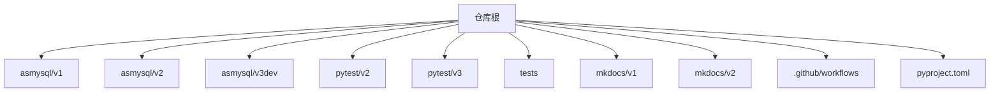
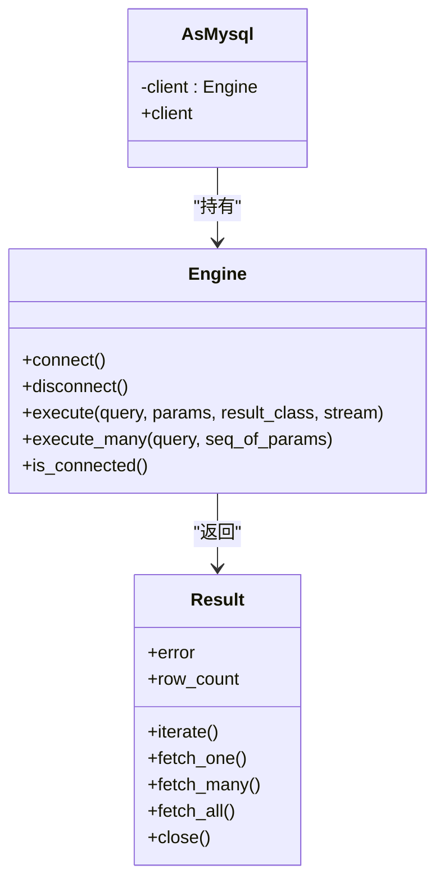
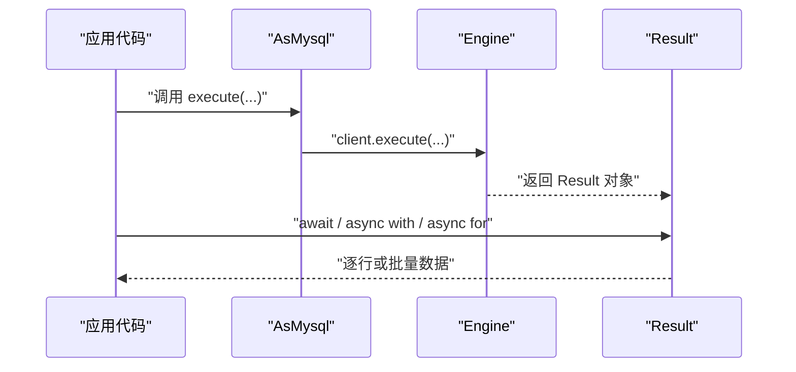
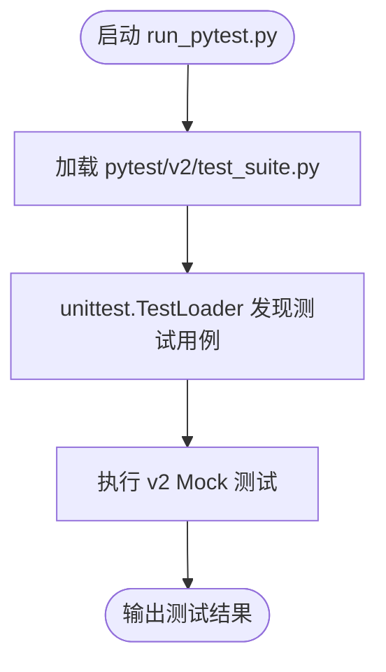

# 贡献指南

<cite>
**本文引用的文件**   
- [README.md](file://README.md)
- [README_DEV.md](file://README_DEV.md)
- [pyproject.toml](file://pyproject.toml)
- [run_pytest.py](file://run_pytest.py)
- [AGENTS.md](file://AGENTS.md)
- [pytest/v2/test_suite.py](file://pytest/v2/test_suite.py)
- [pytest/v2/test_asmysql_mock.py](file://pytest/v2/test_asmysql_mock.py)
- [pytest/v3/test_asmysql_async_mock.py](file://pytest/v3/test_asmysql_async_mock.py)
- [.github/workflows/mkdocs_auto_build.yml](file://.github/workflows/mkdocs_auto_build.yml)
- [.github/workflows/python_package_publish_to_pypi.yml](file://.github/workflows/python_package_publish_to_pypi.yml)
- [.github/workflows/python_package_publish_to_testpypi.yml](file://.github/workflows/python_package_publish_to_testpypi.yml)
- [mkdocs/readme_mkdoc_usage.md](file://mkdocs/readme_mkdoc_usage.md)
- [mkdocs/v2/mkdocs.yml](file://mkdocs/v2/mkdocs.yml)
</cite>

## 目录
1. [简介](#简介)
2. [项目结构](#项目结构)
3. [核心组件](#核心组件)
4. [架构总览](#架构总览)
5. [详细组件分析](#详细组件分析)
6. [依赖与工具链分析](#依赖与工具链分析)
7. [性能与可维护性建议](#性能与可维护性建议)
8. [故障排查指南](#故障排查指南)
9. [结论](#结论)
10. [附录：常用命令速查](#附录常用命令速查)

## 简介
本贡献指南面向希望参与 asmysql 项目开发的贡献者，涵盖开发环境搭建、代码规范、测试要求、Git 工作流、发布流程、文档编写与构建方法、以及开发工具与调试技巧。asmysql 是基于 aiomysql 的异步 MySQL 客户端/连接池封装，提供连接池管理、异步查询、事务支持、流式结果集等能力，并兼容多版本 API（v1、v2、v3dev）。

## 项目结构
仓库采用“多版本并行 + 文档按版本管理”的组织方式：
- asmysql/v1：旧版兼容实现
- asmysql/v2：当前生产版本（顶层包导出目标）
- asmysql/v3dev：开发中，已从构建排除
- pytest：正式测试套件（Mock 与集成测试入口）
- tests：独立实验脚本（非正式测试）
- mkdocs：按版本管理的文档源（v1、v2），使用 MkDocs Material 与 mike 进行多版本发布
- .github/workflows：自动化构建与发布流水线（PyPI/TestPyPI、MkDocs）

图表来源
- [AGENTS.md:40-48](file://AGENTS.md#L40-L48)
- [pyproject.toml:67-73](file://pyproject.toml#L67-L73)

章节来源
- [AGENTS.md:40-48](file://AGENTS.md#L40-L48)
- [pyproject.toml:67-73](file://pyproject.toml#L67-L73)

## 核心组件
- v2 核心设计模式
  - Engine：负责连接池生命周期管理与 SQL 执行接口，返回 Result 对象；支持 URL 配置与上下文管理器。
  - AsMysql：薄封装类，接收 Engine 实例并通过 client 属性暴露执行能力；__init__ 被标记为 final，禁止重写。
  - Result：多态异步结果对象，支持 await、async with、async for 三种用法，并提供 iterate() 与 fetch_* 系列方法；泛型参数 T 支持 tuple/dict/自定义模型。
- v3dev 同步引擎
  - 新增基于 pymysql 的线程安全自定义连接池与同步 Engine/Result，API 镜像 v2。

章节来源
- [AGENTS.md:50-75](file://AGENTS.md#L50-L75)

## 架构总览
下图展示了 v2 的核心交互关系：AsMysql 通过 client 调用 Engine.execute/execute_many，Engine 返回 Result，Result 负责游标选择、迭代与资源释放。

图表来源
- [AGENTS.md:50-68](file://AGENTS.md#L50-L68)

## 详细组件分析

### 组件A：v2 核心类关系与职责
- Engine 是连接与执行的中心，负责创建/销毁底层连接池，解析 URL 参数，统一返回 Result。
- AsMysql 作为业务逻辑基类，屏蔽底层细节，鼓励继承扩展。
- Result 抽象了不同游标类型与数据获取策略，确保内存友好与大结果集处理。

图表来源
- [AGENTS.md:50-68](file://AGENTS.md#L50-L68)

章节来源
- [AGENTS.md:50-68](file://AGENTS.md#L50-L68)

### 组件B：测试套件组织与运行
- 测试入口：run_pytest.py 默认运行 v2 测试套件。
- v2 测试套件：pytest/v2/test_suite.py 使用 unittest.TestLoader 加载模块，便于集中运行。
- Mock 测试：pytest/v2/test_asmysql_mock.py 覆盖构造、client 属性、execute/execute_many、流式查询、迭代器行为等。
- v3 测试：pytest/v3/test_asmysql_async_mock.py 对应 v3dev 的异步场景。

图表来源
- [run_pytest.py:1-11](file://run_pytest.py#L1-L11)
- [pytest/v2/test_suite.py:1-52](file://pytest/v2/test_suite.py#L1-L52)

章节来源
- [run_pytest.py:1-11](file://run_pytest.py#L1-L11)
- [pytest/v2/test_suite.py:1-52](file://pytest/v2/test_suite.py#L1-L52)
- [pytest/v2/test_asmysql_mock.py:1-245](file://pytest/v2/test_asmysql_mock.py#L1-L245)
- [pytest/v3/test_asmysql_async_mock.py:1-247](file://pytest/v3/test_asmysql_async_mock.py#L1-L247)

## 依赖与工具链分析

### 开发环境与依赖
- Python 版本要求：>=3.9
- 运行时依赖：aiomysql[rsa]>=0.3.2
- 开发依赖组（默认启用）：ruff、ipython、pydantic、mkdocs、mkdocs-material、mkdocs-static-i18n、mike
- 包构建后端：uv_build（通过 uv）

章节来源
- [pyproject.toml:31-44](file://pyproject.toml#L31-L44)
- [pyproject.toml:67-73](file://pyproject.toml#L67-L73)

### 代码风格与检查
- 使用 ruff 进行 Lint，规则包含 PEP8 错误、语法错误、导入排序，自动修复开启，行宽限制 120。
- 建议在提交前运行 ruff check 以保持一致性。

章节来源
- [pyproject.toml:47-50](file://pyproject.toml#L47-L50)

### 本地开发与运行
- 安装 uv 后，初始化开发环境、查看依赖树、运行测试、构建与发布均可通过 uv 完成。
- 测试运行入口：uv run python run_pytest.py

章节来源
- [README_DEV.md:1-47](file://README_DEV.md#L1-L47)
- [AGENTS.md:12-38](file://AGENTS.md#L12-L38)
- [run_pytest.py:1-11](file://run_pytest.py#L1-L11)

### 文档站点构建与预览
- 文档位于 mkdocs/v2/docs（中英双语），使用 MkDocs Material 与 i18n 插件。
- 本地单版本预览：cd mkdocs/v2 && uv run mkdocs serve
- 多版本预览：cd mkdocs && uv run mike serve
- 自动部署：GitHub Actions 在推送 main 分支且变更 mkdocs/** 时触发，使用 mike 部署所有版本并设置默认版本。

章节来源
- [mkdocs/readme_mkdoc_usage.md:1-36](file://mkdocs/readme_mkdoc_usage.md#L1-L36)
- [.github/workflows/mkdocs_auto_build.yml:1-64](file://.github/workflows/mkdocs_auto_build.yml#L1-L64)
- [mkdocs/v2/mkdocs.yml:127-180](file://mkdocs/v2/mkdocs.yml#L127-L180)

### 发布流程与版本管理
- PyPI 发布：
  - 手动触发 workflow_dispatch 或在 release published 事件下触发。
  - 使用 Trusted Publisher 方式发布到 PyPI。
- TestPyPI 发布：
  - 手动触发 workflow_dispatch。
- 本地发布（可选）：
  - 使用 uv publish 指定 index 与用户名（如 __token__）。

章节来源
- [.github/workflows/python_package_publish_to_pypi.yml:1-77](file://.github/workflows/python_package_publish_to_pypi.yml#L1-L77)
- [.github/workflows/python_package_publish_to_testpypi.yml:1-42](file://.github/workflows/python_package_publish_to_testpypi.yml#L1-L42)
- [README_DEV.md:39-47](file://README_DEV.md#L39-L47)

### Git 工作流与提交流程
- 文档自动构建触发分支：main（仅当 mkdocs/** 或工作流文件变更时）。
- 仓库未显式定义分支策略与提交信息规范，建议遵循通用实践：
  - 分支：feature/*、fix/*、release/*、hotfix/*
  - 提交信息：语义化提交（feat/fix/chore/docs 等）
  - Pull Request：保持小步提交、附带变更说明与测试覆盖

章节来源
- [.github/workflows/mkdocs_auto_build.yml:5-12](file://.github/workflows/mkdocs_auto_build.yml#L5-L12)

## 性能与可维护性建议
- 大结果集优先使用流式迭代（stream=True）与 Result.iterate()，避免一次性加载至内存。
- 合理设置连接池大小与超时，结合业务并发特征调优。
- 使用类型注解与 Final 标注提升可读性与稳定性（参考 AGENTS 中的约定）。
- 利用 ruff 自动修复与固定规则，减少风格分歧带来的审查成本。

章节来源
- [AGENTS.md:96-103](file://AGENTS.md#L96-L103)

## 故障排查指南
- 无法运行测试
  - 确认已使用 uv sync 初始化环境，并使用 uv run python run_pytest.py 执行。
  - 若需运行特定模块，可使用 unittest 直接加载 pytest.v2.test_asmysql_mock 等。
- 文档本地预览失败
  - 确认已安装 mkdocs-material、mike、mkdocs-static-i18n，并在对应目录执行 serve。
- 发布失败
  - 检查 GitHub Secrets 或 Trusted Publisher 授权是否配置正确；确认 uv build 产物生成于 dist/。

章节来源
- [AGENTS.md:12-38](file://AGENTS.md#L12-L38)
- [mkdocs/readme_mkdoc_usage.md:1-36](file://mkdocs/readme_mkdoc_usage.md#L1-L36)
- [README_DEV.md:31-47](file://README_DEV.md#L31-L47)

## 结论
通过本指南，贡献者可快速搭建开发环境、遵循统一的代码风格与测试规范、理解多版本并行架构、掌握文档构建与自动化发布流程，并以合理的 Git 工作流高效协作。建议在新功能或重构前先补充相应测试与文档更新，确保质量与可维护性。

## 附录：常用命令速查
- 初始化开发环境：uv sync
- 运行测试：uv run python run_pytest.py
- 运行单个测试模块：uv run python -m unittest pytest.v2.test_asmysql_mock
- 代码检查：uv run ruff check asmysql/
- 构建包：uv build
- 发布到 PyPI：uv publish --username __token__
- 发布到 TestPyPI：uv publish --index testpypi --username __token__
- 本地文档预览（单版本）：cd mkdocs/v2 && uv run mkdocs serve
- 本地文档预览（多版本）：cd mkdocs && uv run mike serve

章节来源
- [AGENTS.md:12-38](file://AGENTS.md#L12-L38)
- [README_DEV.md:1-47](file://README_DEV.md#L1-L47)
- [mkdocs/readme_mkdoc_usage.md:1-36](file://mkdocs/readme_mkdoc_usage.md#L1-L36)