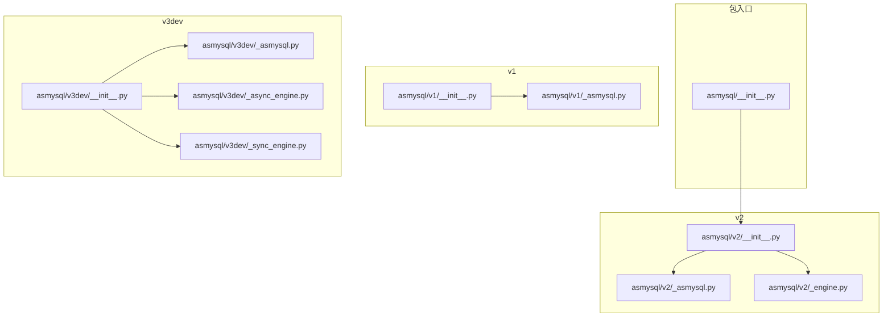
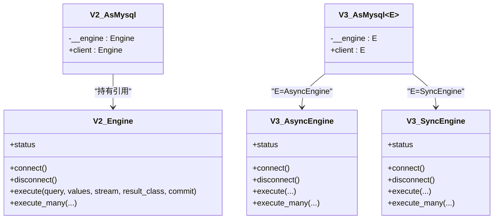
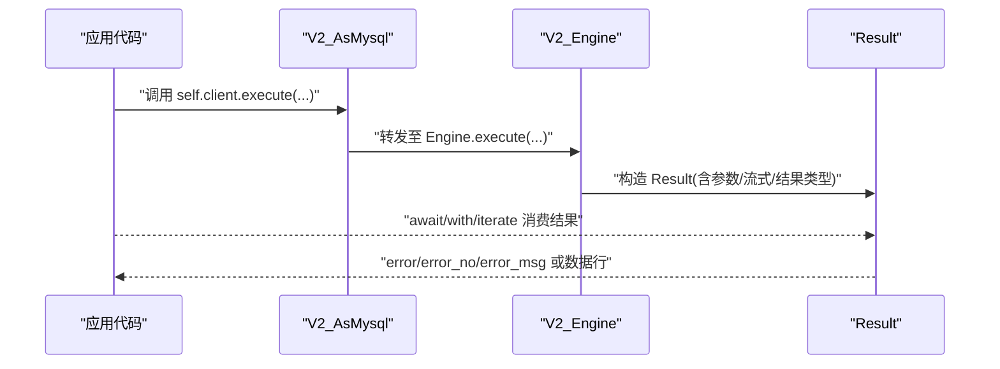
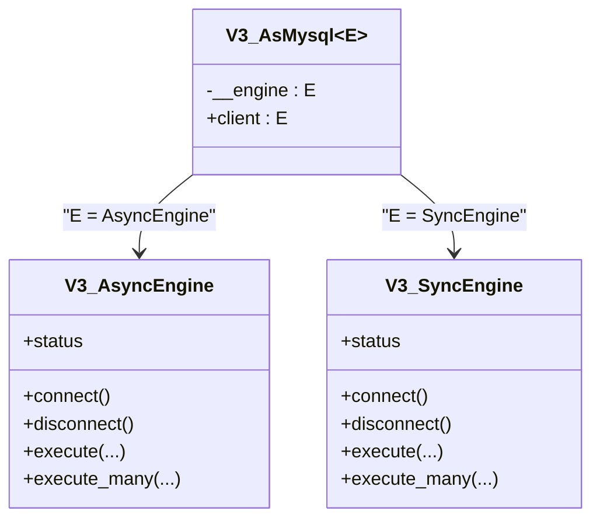
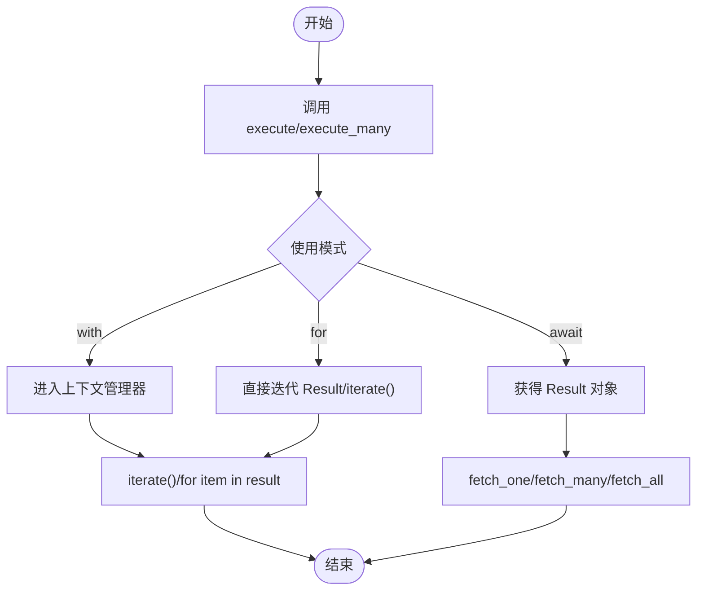
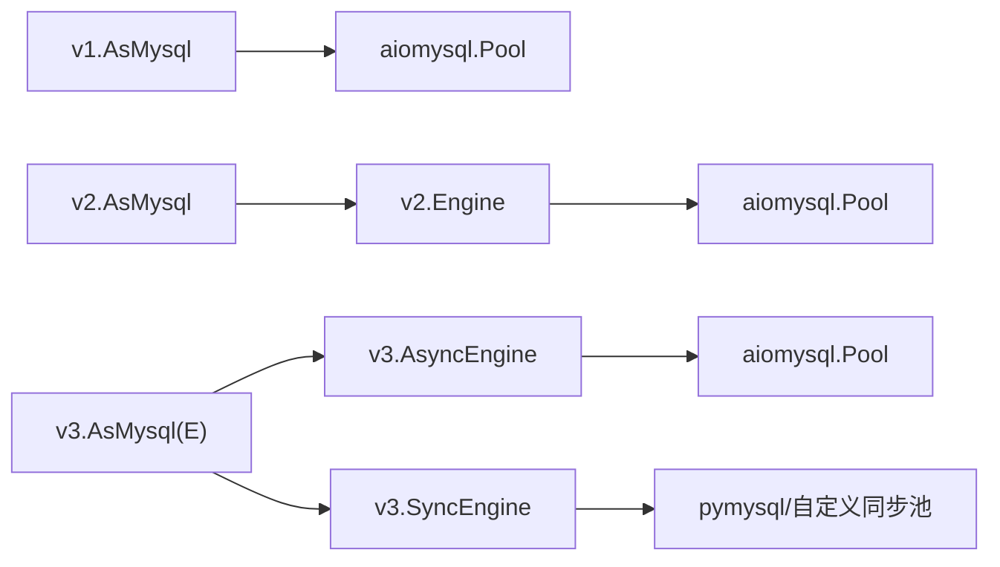

# 迁移指南

<cite>
**本文引用的文件**
- [README.md](file://README.md)
- [asmysql/__init__.py](file://asmysql/__init__.py)
- [asmysql/v1/__init__.py](file://asmysql/v1/__init__.py)
- [asmysql/v1/_asmysql.py](file://asmysql/v1/_asmysql.py)
- [asmysql/v2/__init__.py](file://asmysql/v2/__init__.py)
- [asmysql/v2/_asmysql.py](file://asmysql/v2/_asmysql.py)
- [asmysql/v2/_engine.py](file://asmysql/v2/_engine.py)
- [mkdocs/v2/docs/zh/migration.md](file://mkdocs/v2/docs/zh/migration.md)
- [tests/v2/v2_start.py](file://tests/v2/v2_start.py)
- [asmysql/v3dev/__init__.py](file://asmysql/v3dev/__init__.py)
- [asmysql/v3dev/_async_engine.py](file://asmysql/v3dev/_async_engine.py)
- [asmysql/v3dev/_sync_engine.py](file://asmysql/v3dev/_sync_engine.py)
- [asmysql/v3dev/_asmysql.py](file://asmysql/v3dev/_asmysql.py)
- [tests/v3/test_async.py](file://tests/v3/test_async.py)
- [tests/v3/test_sync.py](file://tests/v3/test_sync.py)
</cite>

## 目录
1. [简介](#简介)
2. [项目结构](#项目结构)
3. [核心组件](#核心组件)
4. [架构总览](#架构总览)
5. [详细组件分析](#详细组件分析)
6. [依赖关系分析](#依赖关系分析)
7. [性能与可用性考量](#性能与可用性考量)
8. [故障排除指南](#故障排除指南)
9. [结论](#结论)
10. [附录：迁移清单与自动化建议](#附录：迁移清单与自动化建议)

## 简介
本指南面向需要从旧版本升级到新版本的开发者，提供 asmysql 从 v1 到 v2、再到 v3（开发分支）的平滑迁移路径。内容涵盖 API 破坏性变更、新增能力、v2 到 v3 的同步/异步分离设计决策、代码迁移示例、向后兼容策略、风险评估与自动化迁移建议，以及常见问题排查方法。

## 项目结构
仓库按版本组织源码与文档，便于并行维护与渐进式升级：
- asmysql/v1：v1 实现（AsMysql 内建连接池与执行逻辑）
- asmysql/v2：v2 实现（引入 Engine 引擎类，AsMysql 仅承载业务逻辑）
- asmysql/v3dev：v3 开发分支（明确区分 AsyncEngine/SyncEngine 与对应 Result）
- mkdocs/v2/docs/zh：v2 中文文档（含迁移说明）
- tests：各版本测试用例，覆盖典型用法与边界场景

图表来源
- [asmysql/__init__.py:1-16](file://asmysql/__init__.py#L1-L16)
- [asmysql/v2/__init__.py:1-15](file://asmysql/v2/__init__.py#L1-L15)
- [asmysql/v3dev/__init__.py:1-14](file://asmysql/v3dev/__init__.py#L1-L14)

章节来源
- [README.md:1-135](file://README.md#L1-L135)
- [asmysql/__init__.py:1-16](file://asmysql/__init__.py#L1-L16)

## 核心组件
- v1 AsMysql：封装 aiomysql 连接池与执行流程，用户直接继承该类进行开发。
- v2 Engine + AsMysql：将“连接与执行”的职责从业务类中解耦，Engine 负责连接池与 SQL 执行；AsMysql 仅持有 engine 引用并暴露 client 属性。
- v3dev 同步/异步双引擎：AsyncEngine 基于 aiomysql，SyncEngine 基于 pymysql 与自定义同步池，AsMysql 通过泛型约束支持两种引擎类型。

章节来源
- [asmysql/v1/_asmysql.py:11-142](file://asmysql/v1/_asmysql.py#L11-L142)
- [asmysql/v2/_asmysql.py:7-26](file://asmysql/v2/_asmysql.py#L7-L26)
- [asmysql/v2/_engine.py:37-317](file://asmysql/v2/_engine.py#L37-L317)
- [asmysql/v3dev/_asmysql.py:11-30](file://asmysql/v3dev/_asmysql.py#L11-L30)
- [asmysql/v3dev/_async_engine.py:27-307](file://asmysql/v3dev/_async_engine.py#L27-L307)
- [asmysql/v3dev/_sync_engine.py:26-298](file://asmysql/v3dev/_sync_engine.py#L26-L298)

## 架构总览
v2 的核心变化是“引擎与业务解耦”，v3 进一步“同步/异步分离”。下图展示 v2 与 v3 的关键交互。

图表来源
- [asmysql/v2/_asmysql.py:7-26](file://asmysql/v2/_asmysql.py#L7-L26)
- [asmysql/v2/_engine.py:37-317](file://asmysql/v2/_engine.py#L37-L317)
- [asmysql/v3dev/_asmysql.py:11-30](file://asmysql/v3dev/_asmysql.py#L11-L30)
- [asmysql/v3dev/_async_engine.py:27-307](file://asmysql/v3dev/_async_engine.py#L27-L307)
- [asmysql/v3dev/_sync_engine.py:26-298](file://asmysql/v3dev/_sync_engine.py#L26-L298)

## 详细组件分析

### 从 v1 迁移到 v2：主要变更与示例
- 导入与实例化方式变化
  - v1：直接继承 AsMysql，内部自行管理连接池与客户端。
  - v2：先创建 Engine 并 connect，再将 engine 注入 AsMysql 子类。
- 错误属性命名变更
  - v1：result.err / result.err_msg
  - v2：result.error / result.error_msg
- 新增能力
  - URL 连接字符串初始化 Engine
  - 流式查询与结果类型定制（result_class）
  - execute/exectue_many 返回 Result，支持上下文管理器与迭代器模式

迁移步骤参考
- 更新导入与连接方式
- 替换错误属性名
- 使用新的 execute 风格与结果处理

章节来源
- [mkdocs/v2/docs/zh/migration.md:1-59](file://mkdocs/v2/docs/zh/migration.md#L1-L59)
- [asmysql/v1/_asmysql.py:11-142](file://asmysql/v1/_asmysql.py#L11-L142)
- [asmysql/v2/_asmysql.py:7-26](file://asmysql/v2/_asmysql.py#L7-L26)
- [asmysql/v2/_engine.py:37-317](file://asmysql/v2/_engine.py#L37-L317)
- [tests/v2/v2_start.py:1-107](file://tests/v2/v2_start.py#L1-L107)

#### 序列图：v2 执行流程（execute -> Result）

图表来源
- [asmysql/v2/_asmysql.py:22-26](file://asmysql/v2/_asmysql.py#L22-L26)
- [asmysql/v2/_engine.py:226-259](file://asmysql/v2/_engine.py#L226-L259)

### 从 v2 迁移到 v3：同步/异步分离的设计决策
- 设计目标
  - 明确区分同步与异步两套引擎，避免在单一 Engine 中混用不同 I/O 模型。
  - 为同步场景提供原生体验（SyncEngine），为异步场景保留高性能（AsyncEngine）。
- 关键变化
  - 导入与使用：v3 中分别使用 AsyncEngine 与 SyncEngine。
  - AsMysql 增加泛型约束，client 的类型随引擎类型确定。
  - 同步/异步 Result 各自独立，API 语义一致但底层实现不同。

迁移要点
- 将 v2 的 Engine 替换为 v3 的 AsyncEngine 或 SyncEngine。
- 保持 AsMysql 子类不变，仅改变传入的引擎类型。
- 注意同步/异步上下文差异（await/async with vs with）。

章节来源
- [asmysql/v3dev/__init__.py:1-14](file://asmysql/v3dev/__init__.py#L1-L14)
- [asmysql/v3dev/_asmysql.py:11-30](file://asmysql/v3dev/_asmysql.py#L11-L30)
- [asmysql/v3dev/_async_engine.py:27-307](file://asmysql/v3dev/_async_engine.py#L27-L307)
- [asmysql/v3dev/_sync_engine.py:26-298](file://asmysql/v3dev/_sync_engine.py#L26-L298)
- [tests/v3/test_async.py:1-108](file://tests/v3/test_async.py#L1-L108)
- [tests/v3/test_sync.py:1-131](file://tests/v3/test_sync.py#L1-L131)

#### 类图：v3 同步/异步双引擎与 AsMysql

图表来源
- [asmysql/v3dev/_asmysql.py:11-30](file://asmysql/v3dev/_asmysql.py#L11-L30)
- [asmysql/v3dev/_async_engine.py:27-307](file://asmysql/v3dev/_async_engine.py#L27-L307)
- [asmysql/v3dev/_sync_engine.py:26-298](file://asmysql/v3dev/_sync_engine.py#L26-L298)

### 执行与结果处理流程（通用）
无论 v2 还是 v3，execute/exectue_many 均返回 Result，支持三种使用方式：
- await 获取 Result 后按需 fetch_one/fetch_many/fetch_all
- async with/with 作为上下文管理器自动释放资源
- 直接对 Result 或 iterate() 进行迭代（流式）

图表来源
- [asmysql/v2/_engine.py:226-316](file://asmysql/v2/_engine.py#L226-L316)
- [asmysql/v3dev/_async_engine.py:216-306](file://asmysql/v3dev/_async_engine.py#L216-L306)
- [asmysql/v3dev/_sync_engine.py:206-297](file://asmysql/v3dev/_sync_engine.py#L206-L297)

## 依赖关系分析
- v1 强耦合：AsMysql 同时承担连接池管理与执行职责。
- v2 解耦：Engine 负责连接池与执行，AsMysql 仅持有 engine 引用并通过 client 暴露。
- v3 分离：AsyncEngine 与 SyncEngine 各自独立，AsMysql 通过泛型保证类型安全。

图表来源
- [asmysql/v1/_asmysql.py:11-142](file://asmysql/v1/_asmysql.py#L11-L142)
- [asmysql/v2/_engine.py:37-317](file://asmysql/v2/_engine.py#L37-L317)
- [asmysql/v3dev/_async_engine.py:27-307](file://asmysql/v3dev/_async_engine.py#L27-L307)
- [asmysql/v3dev/_sync_engine.py:26-298](file://asmysql/v3dev/_sync_engine.py#L26-L298)

章节来源
- [asmysql/v1/_asmysql.py:11-142](file://asmysql/v1/_asmysql.py#L11-L142)
- [asmysql/v2/_engine.py:37-317](file://asmysql/v2/_engine.py#L37-L317)
- [asmysql/v3dev/_async_engine.py:27-307](file://asmysql/v3dev/_async_engine.py#L27-L307)
- [asmysql/v3dev/_sync_engine.py:26-298](file://asmysql/v3dev/_sync_engine.py#L26-L298)

## 性能与可用性考量
- 流式查询：v2/v3 均支持 stream 模式，适合大结果集，降低内存占用。
- 结果类型：通过 result_class 可定制返回结构（如 tuple/dict），提升可读性与易用性。
- 连接池状态：Engine.status 提供 pool_size/free/used 等指标，便于监控与调优。
- 同步/异步分离：v3 使同步场景不再受事件循环影响，减少不必要的协程开销。

[本节为通用指导，不直接分析具体文件]

## 故障排除指南
- 未连接即访问 pool/client
  - 现象：抛出“请先连接”的连接错误。
  - 解决：确保在调用 execute 前完成 connect（v2/v3 均为显式连接）。
- 错误属性名不一致
  - 现象：v1 使用 err/err_msg，v2/v3 使用 error/error_msg。
  - 解决：全局替换错误属性名。
- URL 参数解析异常
  - 现象：URL 中的整型/浮点参数解析失败。
  - 解决：检查 URL 查询参数格式，确保数值类型正确。
- 同步/异步混用
  - 现象：在同步代码中使用 await 或在异步代码中使用 with 导致运行时错误。
  - 解决：根据引擎类型选择正确的上下文与调用方式（AsyncEngine 用 await/async with，SyncEngine 用普通 with）。

章节来源
- [asmysql/v2/_engine.py:195-202](file://asmysql/v2/_engine.py#L195-L202)
- [asmysql/v3dev/_async_engine.py:185-192](file://asmysql/v3dev/_async_engine.py#L185-L192)
- [asmysql/v3dev/_sync_engine.py:175-182](file://asmysql/v3dev/_sync_engine.py#L175-L182)
- [mkdocs/v2/docs/zh/migration.md:35-44](file://mkdocs/v2/docs/zh/migration.md#L35-L44)

## 结论
- v2 通过引入 Engine 实现了连接与业务的解耦，提升了可测试性与可维护性。
- v3 进一步将同步与异步引擎分离，提供更清晰的 API 边界与更好的性能表现。
- 迁移路径清晰：v1→v2（导入/连接/错误属性/新功能），v2→v3（切换引擎类型并保持 AsMysql 子类稳定）。
- 建议在大型项目中采用分阶段迁移与灰度发布，结合自动化脚本与测试套件保障稳定性。

[本节为总结性内容，不直接分析具体文件]

## 附录：迁移清单与自动化建议

### 迁移清单
- v1 → v2
  - 更新导入：from asmysql import Engine, AsMysql
  - 重构连接：先创建 Engine 并 connect，再注入 AsMysql 子类
  - 替换错误属性：err/err_msg → error/error_msg
  - 利用新功能：URL 连接、stream、result_class
- v2 → v3
  - 选择引擎：AsyncEngine 或 SyncEngine
  - 调整上下文：await/async with vs with
  - 保持 AsMysql 子类不变，仅更换引擎类型

章节来源
- [mkdocs/v2/docs/zh/migration.md:1-59](file://mkdocs/v2/docs/zh/migration.md#L1-L59)
- [tests/v3/test_async.py:1-108](file://tests/v3/test_async.py#L1-L108)
- [tests/v3/test_sync.py:1-131](file://tests/v3/test_sync.py#L1-L131)

### 自动化迁移工具与脚本建议
- AST 重写
  - 使用 astor/ast 模块定位并替换错误属性名（err/err_msg → error/error_msg）。
  - 识别 from asmysql import AsMysql 的导入并提示补充 Engine 导入。
- 正则替换
  - 批量替换连接方式与错误属性名，生成 diff 供人工复核。
- 单元测试驱动
  - 以 pytest 运行 v2/v3 测试用例，确保行为一致性。
- 预提交钩子
  - 在 pre-commit 中集成静态检查与迁移脚本，防止遗漏。

[本节为通用建议，不直接分析具体文件]