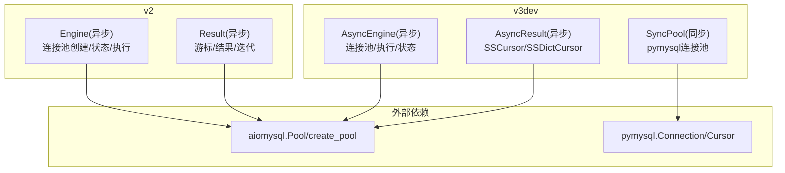
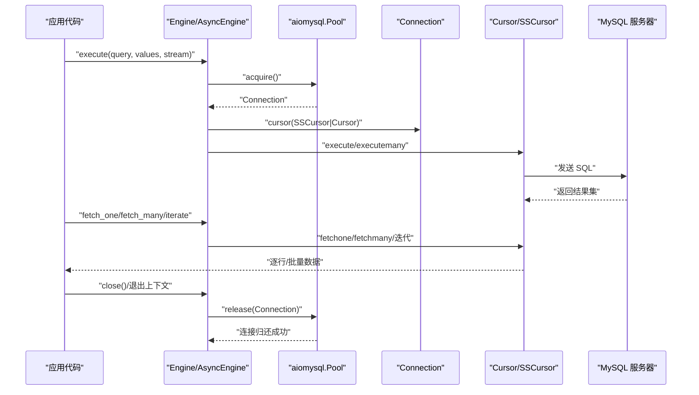

# 性能优化

<cite>
**本文引用的文件**
- [README.md](file://README.md)
- [asmysql/__init__.py](file://asmysql/__init__.py)
- [asmysql/v2/_engine.py](file://asmysql/v2/_engine.py)
- [asmysql/v2/_result.py](file://asmysql/v2/_result.py)
- [asmysql/v3dev/_async_engine.py](file://asmysql/v3dev/_async_engine.py)
- [asmysql/v3dev/_async_result.py](file://asmysql/v3dev/_async_result.py)
- [asmysql/v3dev/_sync_pool.py](file://asmysql/v3dev/_sync_pool.py)
- [mkdocs/v2/docs/zh/best-practices.md](file://mkdocs/v2/docs/zh/best-practices.md)
- [mkdocs/v2/docs/zh/query.md](file://mkdocs/v2/docs/zh/query.md)
- [tests/v1/test_asmysql_performance.py](file://tests/v1/test_asmysql_performance.py)
</cite>

## 目录
1. [简介](#简介)
2. [项目结构](#项目结构)
3. [核心组件](#核心组件)
4. [架构总览](#架构总览)
5. [详细组件分析](#详细组件分析)
6. [依赖关系分析](#依赖关系分析)
7. [性能考虑](#性能考虑)
8. [故障排查指南](#故障排查指南)
9. [结论](#结论)
10. [附录](#附录)

## 简介
本章节聚焦 asmysql 在高并发与高性能场景下的性能优化策略与最佳实践，涵盖连接池调优参数、查询优化技巧（流式查询、批量操作、SQL 建议）、内存管理策略（大结果集处理、连接释放时机、资源清理）、性能监控指标以及基准测试思路。文档面向需要高吞吐、低延迟的开发者，提供可落地的配置与调优指导。

## 项目结构
asmysql 提供 v2 与 v3dev 两套实现：
- v2：基于 aiomysql 的异步 Engine/Result 封装，对外暴露 Engine、AsMysql、Result 等能力。
- v3dev：在 v2 基础上增强类型注解与接口设计，并新增同步连接池实现（开发中）。



图表来源
- [asmysql/v2/_engine.py:130-151](file://asmysql/v2/_engine.py#L130-L151)
- [asmysql/v3dev/_async_engine.py:120-141](file://asmysql/v3dev/_async_engine.py#L120-L141)
- [asmysql/v3dev/_async_result.py:10-18](file://asmysql/v3dev/_async_result.py#L10-L18)
- [asmysql/v3dev/_sync_pool.py:18-89](file://asmysql/v3dev/_sync_pool.py#L18-L89)

章节来源
- [README.md:15-28](file://README.md#L15-L28)
- [asmysql/__init__.py:1-16](file://asmysql/__init__.py#L1-L16)

## 核心组件
- Engine/AsyncEngine：负责解析连接 URL、初始化 aiomysql 连接池、暴露 execute/execute_many、连接生命周期管理与池状态监控。
- Result/AsyncResult：封装游标选择（普通/流式）、执行 SQL、错误处理、逐行/分批/全量获取、自动关闭与连接归还。
- SyncPool（v3dev）：基于 pymysql 的同步连接池，支持 minsize/maxsize/recycle/acquire/release/wait_closed 等能力。

关键要点
- 连接池参数通过 Engine.__init__ 传入 create_pool，影响最小/最大连接数、空闲回收、连接超时、自动提交与 SQL 日志。
- Result 根据 stream 标志选择 SSCursor/SSDictCursor 或 Cursor/DictCursor，控制是否流式拉取数据。
- 上下文管理器与 async for 能确保游标与连接正确释放，避免连接泄漏。

章节来源
- [asmysql/v2/_engine.py:37-111](file://asmysql/v2/_engine.py#L37-L111)
- [asmysql/v3dev/_async_engine.py:27-101](file://asmysql/v3dev/_async_engine.py#L27-L101)
- [asmysql/v3dev/_async_result.py:21-44](file://asmysql/v3dev/_async_result.py#L21-L44)
- [asmysql/v3dev/_sync_pool.py:18-89](file://asmysql/v3dev/_sync_pool.py#L18-L89)

## 架构总览
下图展示一次典型查询从应用到数据库的调用链，包括连接池获取、游标创建、SQL 执行、结果返回与连接归还。



图表来源
- [asmysql/v3dev/_async_engine.py:216-249](file://asmysql/v3dev/_async_engine.py#L216-L249)
- [asmysql/v3dev/_async_result.py:101-125](file://asmysql/v3dev/_async_result.py#L101-L125)
- [asmysql/v3dev/_async_result.py:251-273](file://asmysql/v3dev/_async_result.py#L251-L273)

## 详细组件分析

### 连接池调优参数与影响
- min_pool_size：初始空闲连接数，降低冷启动时建立连接的延迟。过大将占用更多系统资源。
- max_pool_size：并发上限，超过后请求会等待可用连接。需结合业务 QPS、CPU 核数与 MySQL 容量综合评估。
- pool_recycle：空闲 TCP 连接回收时间（秒），用于规避中间件/NAT 超时导致的“僵尸连接”。设为 -1 表示不回收。
- connect_timeout：连接建立超时（秒），防止阻塞线程/协程。
- auto_commit：是否自动提交事务；配合 execute 的 commit 参数使用。
- echo_sql_log：是否打印 SQL 日志，便于定位慢查询与问题语句。

配置入口
- v2/v3dev 的 Engine.__init__ 均支持上述参数，并通过 create_pool 传递给底层 aiomysql.Pool。

章节来源
- [asmysql/v2/_engine.py:46-111](file://asmysql/v2/_engine.py#L46-L111)
- [asmysql/v3dev/_async_engine.py:36-101](file://asmysql/v3dev/_async_engine.py#L36-L101)
- [asmysql/v3dev/_sync_pool.py:23-89](file://asmysql/v3dev/_sync_pool.py#L23-L89)

### 查询优化技巧
- 流式查询：对大数据集使用 stream=True，底层采用 SSCursor/SSDictCursor，逐行拉取，显著降低内存峰值。
- 批量操作：使用 execute_many 减少往返次数，提升写入吞吐。
- SQL 优化建议：
  - 仅 SELECT 必要字段，避免 SELECT *。
  - 合理使用索引与过滤条件，减少回表与扫描范围。
  - 分页查询优先使用基于主键的游标分页，避免深分页。
  - 使用参数化查询，避免拼接注入与重复解析。

章节来源
- [mkdocs/v2/docs/zh/query.md:77-91](file://mkdocs/v2/docs/zh/query.md#L77-L91)
- [mkdocs/v2/docs/zh/best-practices.md:89-103](file://mkdocs/v2/docs/zh/best-practices.md#L89-L103)
- [asmysql/v3dev/_async_result.py:10-18](file://asmysql/v3dev/_async_result.py#L10-L18)

### 内存管理策略
- 大结果集处理：优先使用 iterate() 或 async for 进行流式遍历，避免 fetch_all() 导致内存暴涨。
- 连接释放时机：
  - 使用 async with 或 async for 时，框架会在退出上下文或迭代结束时自动 close 并归还连接。
  - 手动调用 fetch_one/close=False 或 fetch_many/close=False 时，务必显式调用 result.close() 归还连接。
- 资源清理机制：
  - Result 析构与 __aexit__/__anext__ 路径会确保游标关闭与连接归还。
  - Engine.disconnect 会关闭池并等待所有连接释放。

章节来源
- [mkdocs/v2/docs/zh/best-practices.md:25-68](file://mkdocs/v2/docs/zh/best-practices.md#L25-L68)
- [asmysql/v3dev/_async_result.py:57-84](file://asmysql/v3dev/_async_result.py#L57-L84)
- [asmysql/v3dev/_async_result.py:81-100](file://asmysql/v3dev/_async_result.py#L81-L100)
- [asmysql/v3dev/_async_engine.py:167-172](file://asmysql/v3dev/_async_engine.py#L167-L172)

### 性能监控指标
- 连接池使用率：pool_size、freesize、used（= size - freesize）。
- 连接池容量：minsize、maxsize。
- 连接状态：connected、address。
- 可通过 Engine.status 获取上述指标，用于告警与容量规划。

章节来源
- [asmysql/v2/_engine.py:154-166](file://asmysql/v2/_engine.py#L154-L166)
- [asmysql/v3dev/_async_engine.py:144-156](file://asmysql/v3dev/_async_engine.py#L144-L156)

### 实际性能基准与案例
- 基准脚本：tests/v1/test_asmysql_performance.py 展示了高并发任务下使用 fetch_many 与 iterate 的差异对比思路。
- 建议的基准方法：
  - 固定数据集规模与并发度，分别测量 fetch_all、fetch_many(size)、iterate/stream 三种方式的吞吐与内存峰值。
  - 调整 min_pool_size/max_pool_size/pool_recycle/connect_timeout，观察 P95/P99 延迟变化。
  - 记录 Engine.status 中的 pool_used 与 pool_free，评估连接池饱和情况。

章节来源
- [tests/v1/test_asmysql_performance.py:1-51](file://tests/v1/test_asmysql_performance.py#L1-L51)

## 依赖关系分析
- Engine/AsyncEngine 依赖 aiomysql.create_pool 与 aiomysql.Pool。
- Result/AsyncResult 依赖 aiomysql.Cursor/SSCursor/DictCursor/SSDictCursor。
- v3dev 同步池依赖 pymysql.Connection。

```mermaid
classDiagram
class Engine {
+connect()
+disconnect()
+execute(query, values, stream, result_class, commit)
+execute_many(query, values, stream, result_class, commit)
+status
}
class AsyncEngine {
+connect()
+disconnect()
+execute(...)
+execute_many(...)
+status
}
class Result {
+error
+row_count
+last_rowid
+fetch_one(close)
+fetch_many(size, close)
+fetch_all()
+iterate()
+close()
}
class AsyncResult {
+error
+row_count
+last_rowid
+fetch_one(close)
+fetch_many(size, close)
+fetch_all()
+iterate()
+close()
}
class SyncPool {
+acquire()
+release(conn)
+wait_closed()
+clear()
+terminate()
}
Engine --> Result : "创建并返回"
AsyncEngine --> AsyncResult : "创建并返回"
AsyncResult --> "aiomysql.Pool" : "使用"
Result --> "aiomysql.Pool" : "使用"
SyncPool --> "pymysql.Connection" : "管理"
```

图表来源
- [asmysql/v2/_engine.py:226-316](file://asmysql/v2/_engine.py#L226-L316)
- [asmysql/v3dev/_async_engine.py:216-306](file://asmysql/v3dev/_async_engine.py#L216-L306)
- [asmysql/v3dev/_async_result.py:21-44](file://asmysql/v3dev/_async_result.py#L21-L44)
- [asmysql/v3dev/_sync_pool.py:165-281](file://asmysql/v3dev/_sync_pool.py#L165-L281)

## 性能考虑
- 连接池容量规划
  - 估算并发连接数 ≈ 平均请求时长 × QPS / 1000。
  - 设置 min_pool_size 为常驻连接数，max_pool_size 为峰值并发上限。
  - 合理设置 pool_recycle 以匹配网络中间件超时，避免长连接失效。
- 查询模式选择
  - 小结果集：fetch_one/fetch_many 直接加载。
  - 大结果集：stream=True + iterate/async for，避免一次性加载。
- 批量写入
  - 使用 execute_many 合并多条插入/更新，减少网络往返。
  - 分批次提交，控制单批大小以避免单条事务过大。
- 超时与重试
  - connect_timeout 不宜过小，避免抖动导致频繁重连。
  - 对瞬时失败增加指数退避重试，保护后端稳定性。
- 监控与告警
  - 持续采集 Engine.status，当 pool_used 接近 maxsize 时触发扩容或限流。
  - 关注错误率与响应时间分布，结合 SQL 日志定位热点语句。

[本节为通用性能建议，不直接分析具体文件]

## 故障排查指南
- 连接泄漏
  - 症状：pool_free 持续下降，pool_used 接近 maxsize。
  - 排查：确认是否使用 async with 或 async for；若手动 close=False，是否显式调用 result.close()。
- 连接被回收
  - 症状：间歇性连接断开或建连失败。
  - 排查：检查 pool_recycle 是否小于中间件/NAT 超时；适当增大或设为 -1。
- 内存飙升
  - 症状：进程 RSS 随查询增长。
  - 排查：是否对大结果集使用了 fetch_all；改为 stream=True + iterate。
- 慢查询
  - 排查：开启 echo_sql_log，结合数据库 EXPLAIN 分析执行计划。

章节来源
- [mkdocs/v2/docs/zh/best-practices.md:25-68](file://mkdocs/v2/docs/zh/best-practices.md#L25-L68)
- [asmysql/v3dev/_async_result.py:57-84](file://asmysql/v3dev/_async_result.py#L57-L84)
- [asmysql/v3dev/_async_engine.py:167-172](file://asmysql/v3dev/_async_engine.py#L167-L172)

## 结论
- 通过合理的连接池参数与流式/批量查询策略，asmysql 可在高并发场景下获得稳定吞吐与可控内存占用。
- 借助 Engine.status 与 SQL 日志，可实现有效的性能监控与问题定位。
- 建议在上线前完成不同配置的基准测试，形成适合业务的默认配置基线。

[本节为总结性内容，不直接分析具体文件]

## 附录
- 快速参考：连接池参数与默认值
  - min_pool_size：默认 1
  - max_pool_size：默认 10
  - pool_recycle：默认 -1（不回收）
  - connect_timeout：默认 5（秒）
  - auto_commit：默认 True
  - echo_sql_log：默认 False
  - stream：默认 False
  - result_class：默认 tuple

章节来源
- [asmysql/v2/_engine.py:46-111](file://asmysql/v2/_engine.py#L46-L111)
- [asmysql/v3dev/_async_engine.py:36-101](file://asmysql/v3dev/_async_engine.py#L36-L101)