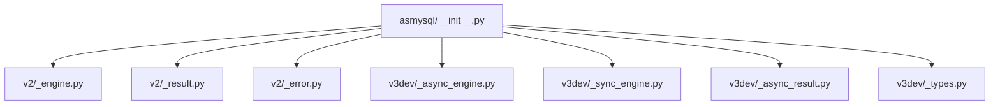
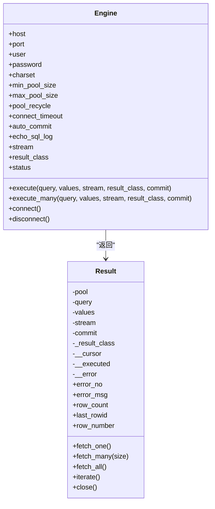
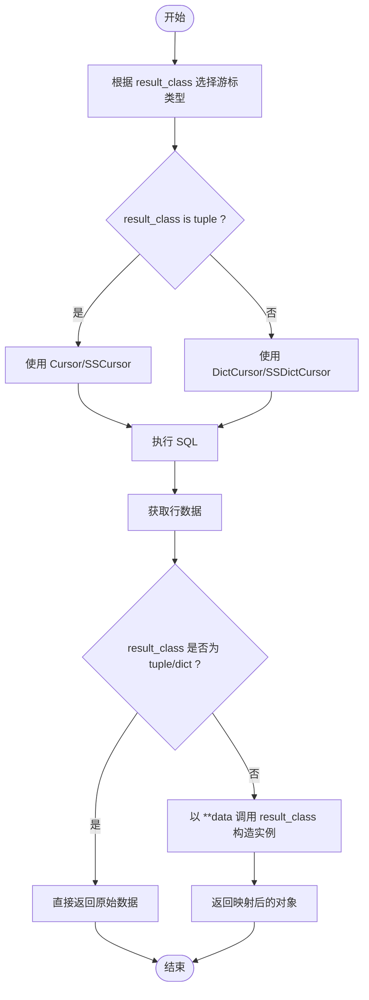
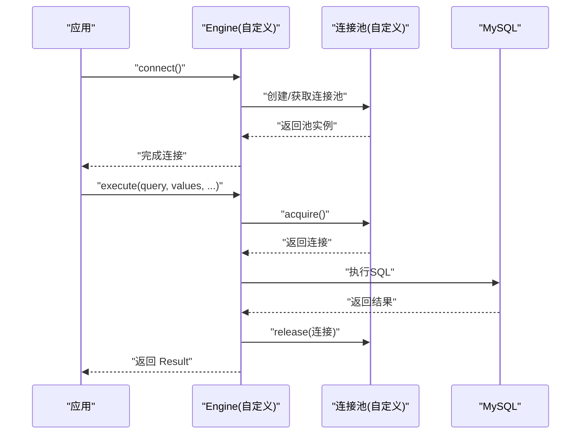
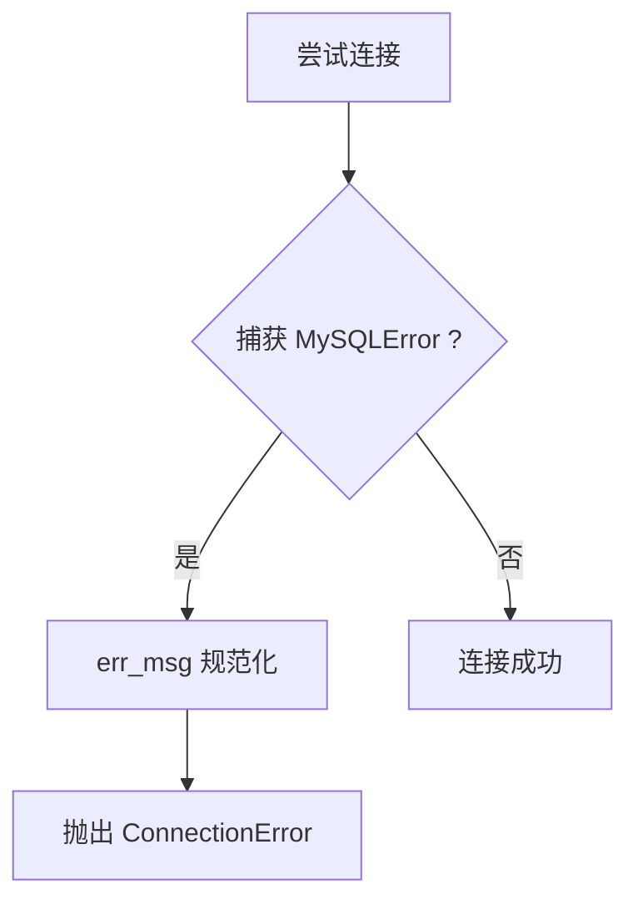
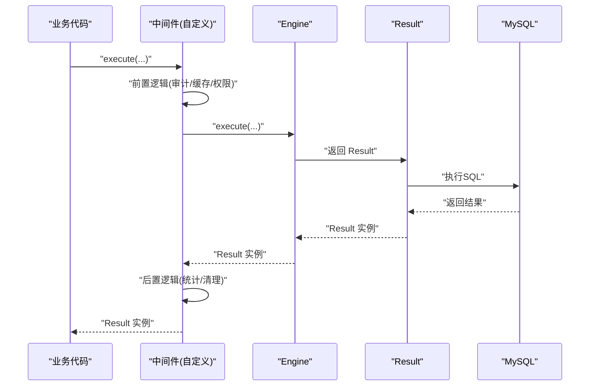
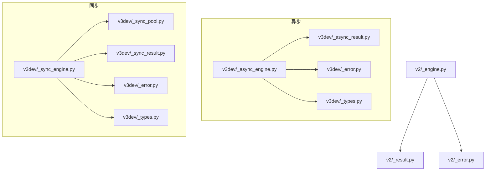

# 扩展机制

<cite>
**本文引用的文件**
- [asmysql/__init__.py](file://asmysql/__init__.py)
- [asmysql/v2/_engine.py](file://asmysql/v2/_engine.py)
- [asmysql/v2/_result.py](file://asmysql/v2/_result.py)
- [asmysql/v2/_error.py](file://asmysql/v2/_error.py)
- [asmysql/v3dev/_async_engine.py](file://asmysql/v3dev/_async_engine.py)
- [asmysql/v3dev/_sync_engine.py](file://asmysql/v3dev/_sync_engine.py)
- [asmysql/v3dev/_async_result.py](file://asmysql/v3dev/_async_result.py)
- [asmysql/v3dev/_types.py](file://asmysql/v3dev/_types.py)
- [README.md](file://README.md)
</cite>

## 目录
1. [简介](#简介)
2. [项目结构](#项目结构)
3. [核心组件](#核心组件)
4. [架构总览](#架构总览)
5. [详细组件分析](#详细组件分析)
6. [依赖分析](#依赖分析)
7. [性能考虑](#性能考虑)
8. [故障排查指南](#故障排查指南)
9. [结论](#结论)
10. [附录：扩展开发示例与最佳实践](#附录扩展开发示例与最佳实践)

## 简介
本文件聚焦 asmysql 的扩展点与自定义机制，围绕以下主题展开：
- 结果类型自定义：通过 result_class 参数将行数据映射为字典、对象或数据类等自定义格式。
- 连接工厂扩展：如何替换底层连接池与连接管理策略（异步/同步）。
- 错误处理器扩展：统一错误消息处理与异常转换规则。
- 中间件模式：在 SQL 执行前后注入审计日志、缓存拦截、权限校验等逻辑。
- 插件开发指南：接口规范、生命周期管理、依赖注入等高级特性。
- 完整扩展示例：实现业务特定的数据库访问逻辑并集成第三方服务。

## 项目结构
仓库按版本划分模块：
- v2：基于 aiomysql 的异步引擎与结果封装。
- v3dev：同时提供异步与同步引擎，以及对应的结果与类型定义。
- __init__：对外暴露 Engine、Result、AsMysql 等入口。

图表来源
- [asmysql/__init__.py:1-16](file://asmysql/__init__.py#L1-L16)
- [asmysql/v2/_engine.py:1-317](file://asmysql/v2/_engine.py#L1-L317)
- [asmysql/v2/_result.py:1-273](file://asmysql/v2/_result.py#L1-L273)
- [asmysql/v2/_error.py:1-7](file://asmysql/v2/_error.py#L1-L7)
- [asmysql/v3dev/_async_engine.py:1-307](file://asmysql/v3dev/_async_engine.py#L1-L307)
- [asmysql/v3dev/_sync_engine.py:1-298](file://asmysql/v3dev/_sync_engine.py#L1-L298)
- [asmysql/v3dev/_async_result.py:1-273](file://asmysql/v3dev/_async_result.py#L1-L273)
- [asmysql/v3dev/_types.py:1-12](file://asmysql/v3dev/_types.py#L1-L12)

章节来源
- [asmysql/__init__.py:1-16](file://asmysql/__init__.py#L1-L16)
- [README.md:1-135](file://README.md#L1-L135)

## 核心组件
- Engine（异步/同步）：负责连接池创建、连接生命周期、SQL 执行入口；支持 stream 与 result_class 配置。
- Result（异步/同步）：封装游标操作、自动提交、错误捕获、结果迭代与类型映射。
- AsMysql：业务逻辑类容器，持有 Engine 引用，便于继承式开发。
- 错误处理：统一的 err_msg 工具函数用于规范化异常信息。

章节来源
- [asmysql/v2/_engine.py:37-317](file://asmysql/v2/_engine.py#L37-L317)
- [asmysql/v2/_result.py:21-273](file://asmysql/v2/_result.py#L21-L273)
- [asmysql/v3dev/_async_engine.py:27-307](file://asmysql/v3dev/_async_engine.py#L27-L307)
- [asmysql/v3dev/_sync_engine.py:26-298](file://asmysql/v3dev/_sync_engine.py#L26-L298)
- [asmysql/v3dev/_async_result.py:21-273](file://asmysql/v3dev/_async_result.py#L21-L273)
- [asmysql/v2/_error.py:1-7](file://asmysql/v2/_error.py#L1-L7)
- [asmysql/v3dev/_error.py:1-7](file://asmysql/v3dev/_error.py#L1-L7)

## 架构总览
下图展示了异步路径下 Engine 与 Result 的交互关系，以及 result_class 对游标选择与结果映射的影响。

图表来源
- [asmysql/v2/_engine.py:227-317](file://asmysql/v2/_engine.py#L227-L317)
- [asmysql/v2/_result.py:21-273](file://asmysql/v2/_result.py#L21-L273)

## 详细组件分析

### 结果类型自定义（result_class）
- 作用范围：Engine.execute / execute_many 的 result_class 参数会传递到 Result 构造器，决定 fetch_* 与 iterate 时的行数据映射方式。
- 映射规则：
  - 当 result_class 为 tuple：使用普通 Cursor/SSCursor，返回元组。
  - 当 result_class 为 dict：使用 DictCursor/SSDictCursor，返回字典。
  - 当 result_class 为其他可调用类型（如 dataclass、Pydantic 模型、自定义类）：以 **data 形式构造实例，要求该类接受关键字参数。
- 流式与非流式：
  - stream=False：非流式游标，适合中小结果集。
  - stream=True：流式游标，适合大结果集，避免内存占用。

图表来源
- [asmysql/v2/_result.py:10-18](file://asmysql/v2/_result.py#L10-L18)
- [asmysql/v2/_result.py:202-208](file://asmysql/v2/_result.py#L202-L208)
- [asmysql/v2/_result.py:228-234](file://asmysql/v2/_result.py#L228-L234)
- [asmysql/v2/_result.py:243-249](file://asmysql/v2/_result.py#L243-L249)
- [asmysql/v2/_result.py:264-268](file://asmysql/v2/_result.py#L264-L268)

章节来源
- [asmysql/v2/_engine.py:227-259](file://asmysql/v2/_engine.py#L227-L259)
- [asmysql/v2/_engine.py:284-316](file://asmysql/v2/_engine.py#L284-L316)
- [asmysql/v2/_result.py:21-273](file://asmysql/v2/_result.py#L21-L273)
- [asmysql/v3dev/_async_engine.py:217-249](file://asmysql/v3dev/_async_engine.py#L217-L249)
- [asmysql/v3dev/_async_engine.py:274-306](file://asmysql/v3dev/_async_engine.py#L274-L306)
- [asmysql/v3dev/_async_result.py:21-273](file://asmysql/v3dev/_async_result.py#L21-L273)

### 连接工厂扩展（自定义连接池与管理策略）
- 当前实现：
  - 异步：Engine.connect 内部使用 create_pool 创建 aiomysql.Pool。
  - 同步：Engine.connect 内部使用自定义 Pool（来自 _sync_pool），参数名与异步略有差异。
- 扩展思路：
  - 子类化 Engine，重写 connect 方法，替换底层连接池创建逻辑（例如接入外部连接池、增加重试、熔断、健康检查等）。
  - 保持对外 API 不变（execute/execute_many/status/is_connected 等），确保兼容上层调用。
  - 若需全局切换，可在应用启动时注入自定义 Engine 实例给 AsMysql 或业务类。

图表来源
- [asmysql/v2/_engine.py:131-151](file://asmysql/v2/_engine.py#L131-L151)
- [asmysql/v3dev/_async_engine.py:121-141](file://asmysql/v3dev/_async_engine.py#L121-L141)
- [asmysql/v3dev/_sync_engine.py:120-139](file://asmysql/v3dev/_sync_engine.py#L120-L139)

章节来源
- [asmysql/v2/_engine.py:131-151](file://asmysql/v2/_engine.py#L131-L151)
- [asmysql/v3dev/_async_engine.py:121-141](file://asmysql/v3dev/_async_engine.py#L121-L141)
- [asmysql/v3dev/_sync_engine.py:120-139](file://asmysql/v3dev/_sync_engine.py#L120-L139)

### 错误处理器扩展（统一异常转换与日志）
- 现有机制：
  - 连接阶段：捕获 MySQLError，转换为 ConnectionError，并使用 err_msg 规范化错误信息。
  - 查询阶段：Result.__call__ 捕获 MySQLError，记录 error 属性，供上层通过 error_no/error_msg 读取。
- 扩展建议：
  - 在 Engine.connect 中替换异常转换逻辑，或包装 err_msg 输出，以满足企业级日志规范。
  - 在 Result 层增加自定义异常转换钩子（例如抛出领域异常、附带上下文信息）。

图表来源
- [asmysql/v2/_engine.py:131-151](file://asmysql/v2/_engine.py#L131-L151)
- [asmysql/v2/_error.py:1-7](file://asmysql/v2/_error.py#L1-L7)
- [asmysql/v3dev/_async_engine.py:121-141](file://asmysql/v3dev/_async_engine.py#L121-L141)
- [asmysql/v3dev/_error.py:1-7](file://asmysql/v3dev/_error.py#L1-L7)

章节来源
- [asmysql/v2/_engine.py:131-151](file://asmysql/v2/_engine.py#L131-L151)
- [asmysql/v2/_error.py:1-7](file://asmysql/v2/_error.py#L1-L7)
- [asmysql/v3dev/_async_engine.py:121-141](file://asmysql/v3dev/_async_engine.py#L121-L141)
- [asmysql/v3dev/_error.py:1-7](file://asmysql/v3dev/_error.py#L1-L7)

### 中间件模式（SQL 执行前后注入逻辑）
- 现状：当前代码未内置中间件机制。
- 推荐方案：
  - 在 Engine.execute/execute_many 外层包裹装饰器或适配器，形成“前置-执行-后置”链路。
  - 在 Result.__call__ 前后插入钩子，实现细粒度控制（如仅针对特定 SQL 或表）。
  - 常见场景：
    - 审计日志：记录 SQL、参数、耗时、用户上下文。
    - 缓存拦截：读路径命中缓存则短路执行；写路径失效缓存。
    - 权限验证：在执行前校验当前用户对目标表的读写权限。
    - 限流与熔断：结合令牌桶或断路器保护后端。

[此图为概念流程，不直接对应具体源码文件]

### 插件开发指南（接口规范、生命周期、依赖注入）
- 接口规范：
  - 自定义 Engine：保持 connect/disconnect/execute/execute_many/status/is_connected/pool 等关键接口一致。
  - 自定义 Result：保持 fetch_one/fetch_many/fetch_all/iterate/close/error_no/error_msg 等接口一致。
- 生命周期管理：
  - 应用启动：初始化 Engine（含连接池）、注册中间件、准备缓存/权限服务。
  - 请求周期：通过 AsMysql 或业务类持有 Engine 引用，按需执行 SQL。
  - 应用关闭：断开连接、释放资源。
- 依赖注入：
  - 在应用容器中将自定义 Engine 注入到 AsMysql 或业务类。
  - 将中间件作为装饰器或适配器装配到 Engine 的 execute 链路上。

章节来源
- [asmysql/v2/_engine.py:37-317](file://asmysql/v2/_engine.py#L37-L317)
- [asmysql/v2/_result.py:21-273](file://asmysql/v2/_result.py#L21-L273)
- [asmysql/v3dev/_async_engine.py:27-307](file://asmysql/v3dev/_async_engine.py#L27-L307)
- [asmysql/v3dev/_sync_engine.py:26-298](file://asmysql/v3dev/_sync_engine.py#L26-L298)
- [asmysql/v3dev/_async_result.py:21-273](file://asmysql/v3dev/_async_result.py#L21-L273)

## 依赖分析
- 外部依赖：
  - aiomysql：异步连接池与游标。
  - pymysql.err.MySQLError：异常基类。
- 内部依赖：
  - Engine 依赖 Result 进行结果封装。
  - Result 依赖 aiomysql 的 Cursor/DictCursor/SSCursor/SSDictCursor。
  - 错误处理模块提供 err_msg 工具。

图表来源
- [asmysql/v3dev/_async_engine.py:1-307](file://asmysql/v3dev/_async_engine.py#L1-L307)
- [asmysql/v3dev/_async_result.py:1-273](file://asmysql/v3dev/_async_result.py#L1-L273)
- [asmysql/v3dev/_sync_engine.py:1-298](file://asmysql/v3dev/_sync_engine.py#L1-L298)
- [asmysql/v2/_engine.py:1-317](file://asmysql/v2/_engine.py#L1-L317)
- [asmysql/v2/_result.py:1-273](file://asmysql/v2/_result.py#L1-L273)
- [asmysql/v2/_error.py:1-7](file://asmysql/v2/_error.py#L1-L7)
- [asmysql/v3dev/_error.py:1-7](file://asmysql/v3dev/_error.py#L1-L7)
- [asmysql/v3dev/_types.py:1-12](file://asmysql/v3dev/_types.py#L1-L12)

章节来源
- [asmysql/v2/_engine.py:1-317](file://asmysql/v2/_engine.py#L1-L317)
- [asmysql/v2/_result.py:1-273](file://asmysql/v2/_result.py#L1-L273)
- [asmysql/v3dev/_async_engine.py:1-307](file://asmysql/v3dev/_async_engine.py#L1-L307)
- [asmysql/v3dev/_sync_engine.py:1-298](file://asmysql/v3dev/_sync_engine.py#L1-L298)
- [asmysql/v3dev/_async_result.py:1-273](file://asmysql/v3dev/_async_result.py#L1-L273)

## 性能考虑
- 流式结果：对于大结果集，启用 stream=True 可降低内存占用，但无法获取 row_count。
- 连接池大小：合理设置 min_pool_size/max_pool_size，避免过多连接导致资源竞争。
- 自动提交：auto_commit 默认开启，批量写入时可考虑事务减少提交开销。
- 游标选择：tuple 游标通常比 dict 游标更快，dict 游标更利于可读性。
- 结果映射：自定义对象构造会带来额外 CPU 开销，建议在热点路径谨慎使用。

## 故障排查指南
- 连接失败：
  - 现象：抛出 ConnectionError。
  - 排查：检查 host/port/user/password/url 参数；查看 err_msg 输出的规范化信息。
- 查询报错：
  - 现象：Result.error 不为空，可通过 error_no/error_msg 获取详情。
  - 排查：确认 SQL 语法、字段映射、权限；必要时打印 values 与 SQL。
- 游标未释放：
  - 现象：连接泄漏或池耗尽。
  - 排查：确保使用 async with 或手动调用 close；避免长时间持有 Result。

章节来源
- [asmysql/v2/_engine.py:131-151](file://asmysql/v2/_engine.py#L131-L151)
- [asmysql/v2/_result.py:119-125](file://asmysql/v2/_result.py#L119-L125)
- [asmysql/v2/_result.py:133-151](file://asmysql/v2/_result.py#L133-L151)
- [asmysql/v2/_error.py:1-7](file://asmysql/v2/_error.py#L1-L7)

## 结论
asmysql 提供了清晰的扩展点：
- 通过 result_class 灵活定制结果类型映射。
- 通过子类化 Engine 替换连接池与连接管理策略。
- 通过统一错误处理与异常转换提升可观测性与稳定性。
- 通过中间件模式在 SQL 执行前后注入审计、缓存、权限等横切逻辑。
- 遵循接口规范与生命周期管理，可实现高内聚、低耦合的插件化架构。

## 附录：扩展开发示例与最佳实践
- 自定义结果类型
  - 使用 dataclass 或 Pydantic 模型接收 **data 构造。
  - 在 Engine 或单次 execute 调用中指定 result_class。
  - 参考路径：
    - [asmysql/v2/_result.py:202-208](file://asmysql/v2/_result.py#L202-L208)
    - [asmysql/v2/_result.py:228-234](file://asmysql/v2/_result.py#L228-L234)
    - [asmysql/v2/_result.py:243-249](file://asmysql/v2/_result.py#L243-L249)
    - [asmysql/v2/_result.py:264-268](file://asmysql/v2/_result.py#L264-L268)
- 自定义连接池
  - 子类化 Engine，重写 connect，替换底层 create_pool 或 Pool 的创建逻辑。
  - 参考路径：
    - [asmysql/v2/_engine.py:131-151](file://asmysql/v2/_engine.py#L131-L151)
    - [asmysql/v3dev/_async_engine.py:121-141](file://asmysql/v3dev/_async_engine.py#L121-L141)
    - [asmysql/v3dev/_sync_engine.py:120-139](file://asmysql/v3dev/_sync_engine.py#L120-L139)
- 错误处理增强
  - 替换 err_msg 输出格式或在 Engine.connect 中自定义异常转换。
  - 参考路径：
    - [asmysql/v2/_error.py:1-7](file://asmysql/v2/_error.py#L1-L7)
    - [asmysql/v3dev/_error.py:1-7](file://asmysql/v3dev/_error.py#L1-L7)
- 中间件实现
  - 在 Engine.execute 外层包裹装饰器，实现前置/后置逻辑。
  - 在 Result.__call__ 前后插入钩子，实现细粒度控制。
  - 参考路径：
    - [asmysql/v2/_engine.py:227-259](file://asmysql/v2/_engine.py#L227-L259)
    - [asmysql/v2/_result.py:101-125](file://asmysql/v2/_result.py#L101-L125)
- 集成第三方服务
  - 在中间件中调用缓存、权限、审计等服务。
  - 在自定义 Engine 中集成监控、指标上报、熔断降级等能力。

章节来源
- [asmysql/v2/_engine.py:227-317](file://asmysql/v2/_engine.py#L227-L317)
- [asmysql/v2/_result.py:101-125](file://asmysql/v2/_result.py#L101-L125)
- [asmysql/v2/_result.py:202-268](file://asmysql/v2/_result.py#L202-L268)
- [asmysql/v3dev/_async_engine.py:217-306](file://asmysql/v3dev/_async_engine.py#L217-L306)
- [asmysql/v3dev/_async_result.py:101-125](file://asmysql/v3dev/_async_result.py#L101-L125)
- [asmysql/v3dev/_async_result.py:202-268](file://asmysql/v3dev/_async_result.py#L202-L268)