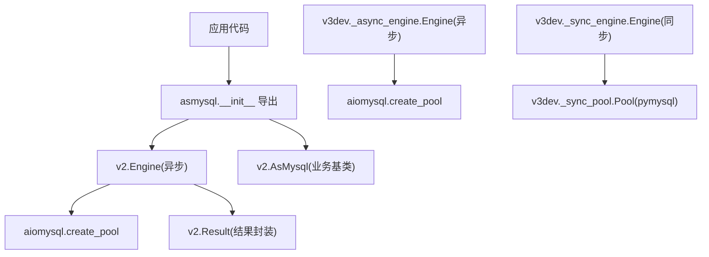
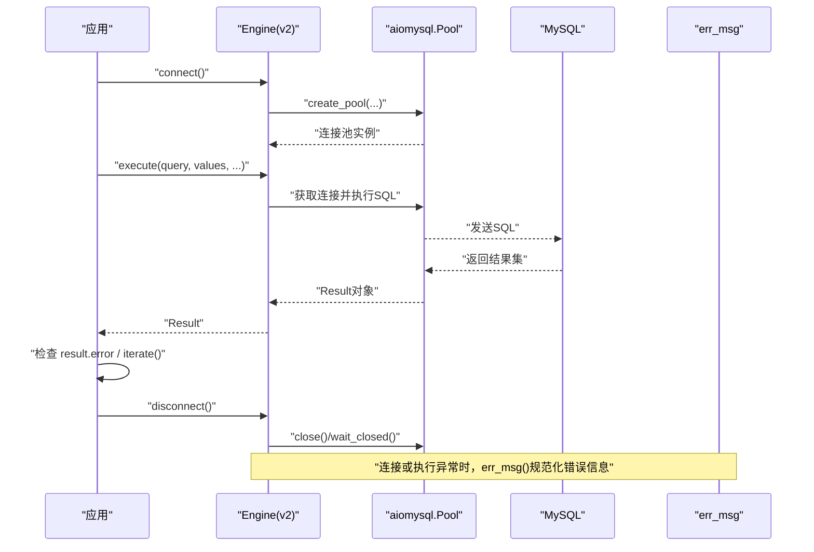
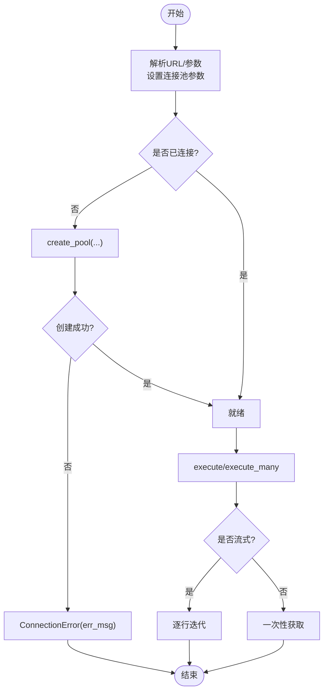
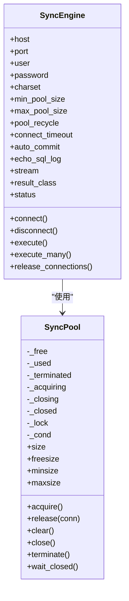
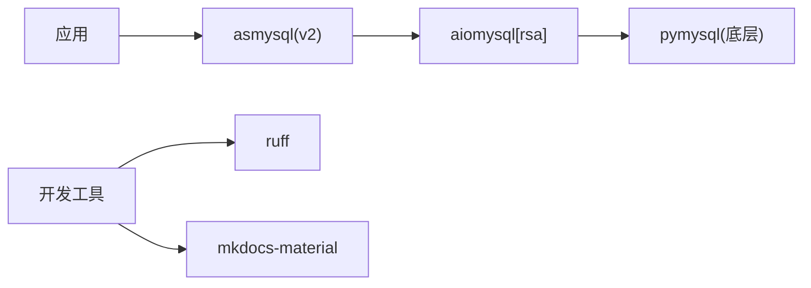

# 生产环境部署

<cite>
**本文引用的文件**   
- [README.md](file://README.md)
- [pyproject.toml](file://pyproject.toml)
- [asmysql/__init__.py](file://asmysql/__init__.py)
- [asmysql/v2/_engine.py](file://asmysql/v2/_engine.py)
- [asmysql/v2/_asmysql.py](file://asmysql/v2/_asmysql.py)
- [asmysql/v2/_error.py](file://asmysql/v2/_error.py)
- [asmysql/v3dev/_async_engine.py](file://asmysql/v3dev/_async_engine.py)
- [asmysql/v3dev/_sync_engine.py](file://asmysql/v3dev/_sync_engine.py)
- [asmysql/v3dev/_sync_pool.py](file://asmysql/v3dev/_sync_pool.py)
- [mkdocs/v2/docs/zh/connection.md](file://mkdocs/v2/docs/zh/connection.md)
- [mkdocs/v2/docs/zh/best-practices.md](file://mkdocs/v2/docs/zh/best-practices.md)
</cite>

## 目录
1. [简介](#简介)
2. [项目结构](#项目结构)
3. [核心组件](#核心组件)
4. [架构总览](#架构总览)
5. [详细组件分析](#详细组件分析)
6. [依赖分析](#依赖分析)
7. [性能与容量规划](#性能与容量规划)
8. [高可用与容灾](#高可用与容灾)
9. [容器化与微服务集成](#容器化与微服务集成)
10. [安全加固指南](#安全加固指南)
11. [备份恢复与升级策略](#备份恢复与升级策略)
12. [配置管理最佳实践](#配置管理最佳实践)
13. [部署清单与运维手册](#部署清单与运维手册)
14. [故障排查指南](#故障排查指南)
15. [结论](#结论)

## 简介
本文件面向生产环境，提供 asmysql 的部署与配置最佳实践。内容覆盖连接池调优、资源限制、高可用架构、容器化与微服务集成、安全加固、备份恢复与版本升级，并给出完整的部署清单与运维手册，确保在生产环境中稳定运行。

## 项目结构
仓库包含多版本实现与文档：
- v2 为当前稳定异步版本，基于 aiomysql 的连接池封装
- v3dev 为开发中的异步/同步双栈版本（含自定义同步连接池）
- mkdocs 文档提供连接、最佳实践等中文说明
- pyproject.toml 定义依赖与构建元数据

图表来源
- [asmysql/__init__.py:1-16](file://asmysql/__init__.py#L1-L16)
- [asmysql/v2/_engine.py:1-317](file://asmysql/v2/_engine.py#L1-L317)
- [asmysql/v2/_asmysql.py:1-26](file://asmysql/v2/_asmysql.py#L1-L26)
- [asmysql/v3dev/_async_engine.py:1-307](file://asmysql/v3dev/_async_engine.py#L1-L307)
- [asmysql/v3dev/_sync_engine.py:1-298](file://asmysql/v3dev/_sync_engine.py#L1-L298)
- [asmysql/v3dev/_sync_pool.py:1-281](file://asmysql/v3dev/_sync_pool.py#L1-L281)

章节来源
- [README.md:1-135](file://README.md#L1-L135)
- [pyproject.toml:1-80](file://pyproject.toml#L1-L80)
- [asmysql/__init__.py:1-16](file://asmysql/__init__.py#L1-L16)

## 核心组件
- Engine（异步）：封装 aiomysql 连接池，提供 connect/disconnect、execute/execute_many、status、release_connections 等能力；支持 URL 与关键字参数初始化，解析 min_pool_size、max_pool_size、pool_recycle、connect_timeout、auto_commit、echo_sql_log、stream、result_class 等参数。
- AsMysql（业务基类）：持有 Engine 引用，暴露 client 属性用于执行 SQL，便于将数据库访问与业务逻辑解耦。
- Result：统一的结果对象，支持错误检查、流式迭代、批量获取等。
- v3dev 同步引擎与自实现同步连接池：在 v3dev 中提供同步 Engine 及基于 pymysql 的 Pool，便于非 asyncio 场景使用。

章节来源
- [asmysql/v2/_engine.py:1-317](file://asmysql/v2/_engine.py#L1-L317)
- [asmysql/v2/_asmysql.py:1-26](file://asmysql/v2/_asmysql.py#L1-L26)
- [asmysql/v3dev/_async_engine.py:1-307](file://asmysql/v3dev/_async_engine.py#L1-L307)
- [asmysql/v3dev/_sync_engine.py:1-298](file://asmysql/v3dev/_sync_engine.py#L1-L298)
- [asmysql/v3dev/_sync_pool.py:1-281](file://asmysql/v3dev/_sync_pool.py#L1-L281)

## 架构总览
下图展示生产环境下典型调用链：应用通过 Engine 建立连接池，执行 SQL 后由 Result 返回结果；异常经 err_msg 规范化处理。

图表来源
- [asmysql/v2/_engine.py:120-151](file://asmysql/v2/_engine.py#L120-L151)
- [asmysql/v2/_engine.py:176-187](file://asmysql/v2/_engine.py#L176-L187)
- [asmysql/v2/_error.py:1-7](file://asmysql/v2/_error.py#L1-L7)

## 详细组件分析

### 连接与执行流程（v2 异步）
- 初始化：支持 url 与关键字参数；url 查询字符串可设置 charset、min_pool_size、max_pool_size、pool_recycle、connect_timeout、auto_commit、echo_sql_log。
- 连接：首次 connect 时创建 aiomysql 连接池；失败抛出 ConnectionError，错误消息经 err_msg 格式化。
- 执行：execute/execute_many 返回 Result；支持 stream 模式与大结果集迭代；支持 result_class 指定返回类型。
- 状态与释放：status 提供连接池大小、空闲/使用中数量；release_connections 清空空闲连接；disconnect 优雅关闭。

图表来源
- [asmysql/v2/_engine.py:55-114](file://asmysql/v2/_engine.py#L55-L114)
- [asmysql/v2/_engine.py:130-151](file://asmysql/v2/_engine.py#L130-L151)
- [asmysql/v2/_engine.py:226-259](file://asmysql/v2/_engine.py#L226-L259)
- [asmysql/v2/_error.py:1-7](file://asmysql/v2/_error.py#L1-L7)

章节来源
- [mkdocs/v2/docs/zh/connection.md:1-131](file://mkdocs/v2/docs/zh/connection.md#L1-L131)
- [mkdocs/v2/docs/zh/best-practices.md:1-141](file://mkdocs/v2/docs/zh/best-practices.md#L1-L141)
- [asmysql/v2/_engine.py:1-317](file://asmysql/v2/_engine.py#L1-L317)

### 同步引擎与自实现连接池（v3dev）
- 同步 Engine：接口与异步一致，内部使用自定义 _sync_pool.Pool。
- 同步 Pool：基于 pymysql，实现最小/最大连接数、空闲回收、等待唤醒、事务检测与安全回收等。

图表来源
- [asmysql/v3dev/_sync_engine.py:1-298](file://asmysql/v3dev/_sync_engine.py#L1-L298)
- [asmysql/v3dev/_sync_pool.py:1-281](file://asmysql/v3dev/_sync_pool.py#L1-L281)

章节来源
- [asmysql/v3dev/_sync_engine.py:1-298](file://asmysql/v3dev/_sync_engine.py#L1-L298)
- [asmysql/v3dev/_sync_pool.py:1-281](file://asmysql/v3dev/_sync_pool.py#L1-L281)

## 依赖分析
- 运行时依赖：aiomysql[rsa]>=0.3.2（异步连接池与加密认证支持）
- 可选依赖：pymysql（v3dev 同步实现）
- 构建与工具：uv_build、ruff、mkdocs 生态等

图表来源
- [pyproject.toml:31-34](file://pyproject.toml#L31-L34)
- [pyproject.toml:35-44](file://pyproject.toml#L35-L44)

章节来源
- [pyproject.toml:1-80](file://pyproject.toml#L1-L80)

## 性能与容量规划
- 连接池大小
  - min_pool_size：建议根据常驻并发量设置，避免冷启动延迟
  - max_pool_size：结合 MySQL 的 max_connections 与进程/线程模型，避免耗尽数据库连接
  - pool_recycle：合理设置空闲连接回收时间，规避中间件（如代理/NAT）超时导致的僵尸连接
- 内存与流式处理
  - 大数据集务必启用 stream=True 或使用 async for 迭代，避免一次性加载导致 OOM
- CPU 与并发
  - Python GIL 下，IO 密集型任务适合 asyncio；CPU 密集需考虑多进程或多工作进程
- 日志与诊断
  - echo_sql_log 仅用于调试，生产环境建议关闭
  - 定期采集 engine.status 指标（pool_size/pool_free/pool_used）进行容量评估

章节来源
- [mkdocs/v2/docs/zh/best-practices.md:124-141](file://mkdocs/v2/docs/zh/best-practices.md#L124-L141)
- [mkdocs/v2/docs/zh/connection.md:48-65](file://mkdocs/v2/docs/zh/connection.md#L48-L65)
- [asmysql/v2/_engine.py:153-166](file://asmysql/v2/_engine.py#L153-L166)

## 高可用与容灾
- 主从复制与读写分离
  - 应用层维护读/写两个 Engine，分别指向不同地址；写操作走主库，读操作走从库
- 故障转移
  - 健康检查：周期性读取 engine.status 与 is_connected；异常时切换备用地址并重连
  - 重试与退避：对瞬时网络抖动进行指数退避重试
- 负载均衡
  - 读多写少场景可使用多个从库轮询或加权分配；注意一致性要求与时延差异
- 限流与熔断
  - 在应用侧对慢查询与高负载路径实施限流，必要时熔断降级

[本节为概念性指导，不直接分析具体文件]

## 容器化与微服务集成
- Docker 镜像构建
  - 基础镜像选择：python:slim 或官方镜像，安装系统依赖（如需编译扩展）
  - 依赖安装：优先使用 uv 或 pip 缓存加速；固定 aiomysql 与 asmysql 版本
  - 运行用户：以非 root 用户运行，最小权限原则
- Kubernetes 部署
  - Deployment：设置副本数、资源请求/限制（CPU/Memory）、探针（liveness/readiness）
  - ConfigMap/Secret：存放连接串、用户名密码等敏感信息
  - Service：对外暴露端口；Ingress 或网关接入
  - HorizontalPodAutoscaler：基于 CPU/内存或自定义指标扩缩容
- 微服务集成
  - 每个服务独立 Engine 实例，避免跨进程共享连接
  - 通过环境变量注入连接参数，配合配置中心动态刷新

[本节为概念性指导，不直接分析具体文件]

## 安全加固指南
- 传输加密
  - 使用 TLS 连接 MySQL（在底层驱动层面开启 SSL），避免明文传输
- 权限控制
  - 最小权限原则：为应用账号授予必要的最小权限
  - 网络隔离：数据库仅允许应用网段访问
- 敏感信息管理
  - 使用 Secret/密钥管理服务存储密码与证书，禁止硬编码
  - 连接串通过环境变量注入，避免进入镜像层
- 审计与日志
  - 记录关键操作与错误，但避免输出敏感字段

[本节为概念性指导，不直接分析具体文件]

## 备份恢复与升级策略
- 数据备份
  - 全量+增量备份策略；定期校验备份可用性
- 灾难恢复
  - 制定演练计划，验证恢复时间与数据一致性
- 版本升级
  - 灰度发布：先小流量切流，观察错误率与延迟
  - 回滚预案：保留旧版本镜像与配置快照，快速回滚

[本节为概念性指导，不直接分析具体文件]

## 配置管理最佳实践
- 环境变量与配置文件
  - 使用环境变量注入 host/port/user/password/url 等参数
  - 通过 URL 查询字符串集中配置连接池与行为参数
- 多环境部署
  - dev/staging/prod 使用不同 ConfigMap/Secret 与镜像标签
  - 通过 CI/CD 流水线注入不同环境的配置
- 参数优先级
  - 显式关键字参数 > URL 查询参数 > 默认值

章节来源
- [mkdocs/v2/docs/zh/connection.md:1-131](file://mkdocs/v2/docs/zh/connection.md#L1-L131)
- [asmysql/v2/_engine.py:55-114](file://asmysql/v2/_engine.py#L55-L114)

## 部署清单与运维手册

### 部署前检查清单
- 确认 Python 版本满足要求（>=3.9）
- 确认依赖 aiomysql[rsa] 版本与兼容性
- 准备数据库账号与网络白名单
- 准备 TLS 证书与密钥（如需加密）
- 准备 ConfigMap/Secret（连接串、用户名、密码、SSL 路径）
- 准备健康检查端点与监控指标

### 启动与生命周期
- 启动顺序：应用进程启动 -> 初始化 Engine -> 连接池预热 -> 注册健康检查
- 优雅退出：捕获信号 -> 停止接收新请求 -> 等待活跃请求完成 -> disconnect 关闭连接池

### 监控与告警
- 指标：engine.status 的 pool_size/pool_free/pool_used、错误率、P95/P99 延迟
- 告警：连接池耗尽、连接失败、慢查询阈值、错误率突增

### 变更与回滚
- 变更窗口：低峰期执行
- 灰度策略：按百分比逐步放量
- 回滚条件：错误率/延迟超过阈值

[本节为通用运维规范，不直接分析具体文件]

## 故障排查指南
- 连接失败
  - 检查主机可达性与端口开放
  - 核对用户名/密码与权限
  - 查看 ConnectionError 与 err_msg 输出的详细信息
- 连接池耗尽
  - 检查是否存在未释放的连接（手动 close=False 但未调用 result.close）
  - 调整 max_pool_size 与业务并发
- 大结果集 OOM
  - 启用 stream=True 并使用 async for 迭代
- 日志过多
  - 关闭 echo_sql_log，仅在调试阶段开启

章节来源
- [asmysql/v2/_error.py:1-7](file://asmysql/v2/_error.py#L1-L7)
- [mkdocs/v2/docs/zh/best-practices.md:25-68](file://mkdocs/v2/docs/zh/best-practices.md#L25-L68)
- [mkdocs/v2/docs/zh/best-practices.md:89-103](file://mkdocs/v2/docs/zh/best-practices.md#L89-L103)

## 结论
通过合理的连接池与资源规划、高可用架构设计、容器化与微服务集成、严格的安全加固以及完善的备份恢复与升级策略，asmysql 可在生产环境中提供稳定高效的数据库访问能力。建议结合监控与告警体系持续优化，确保系统在峰值与异常情况下仍保持高可用与高性能。