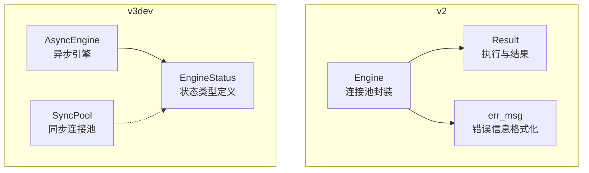
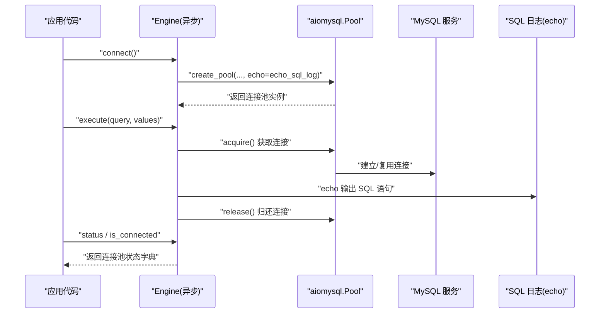
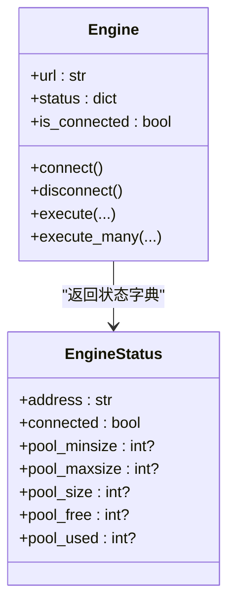
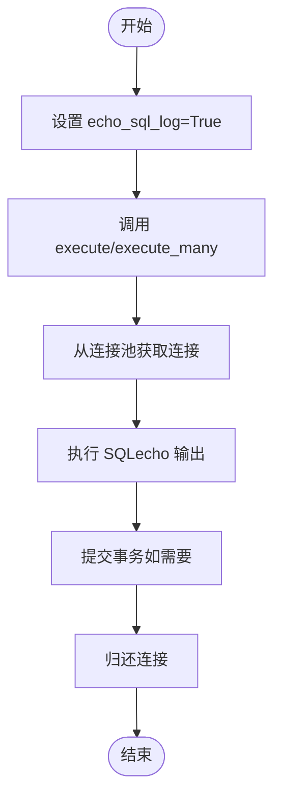
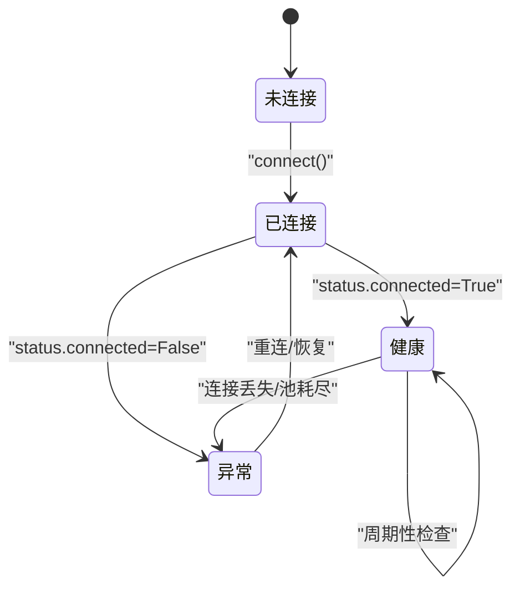
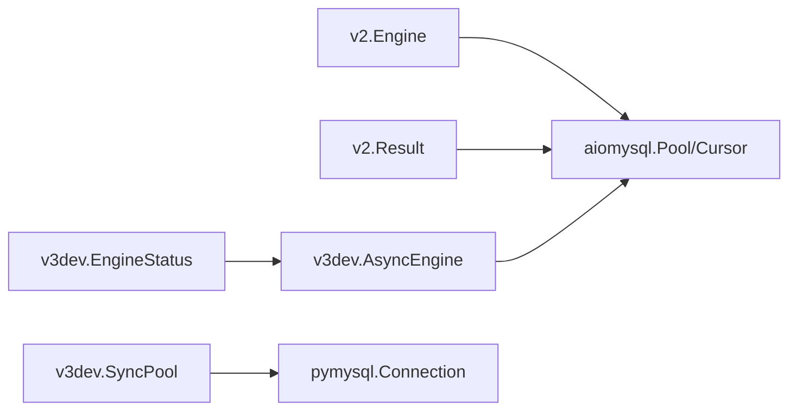

# 监控与诊断

<cite>
**本文引用的文件**   
- [README.md](file://README.md)
- [asmysql/__init__.py](file://asmysql/__init__.py)
- [asmysql/v2/__init__.py](file://asmysql/v2/__init__.py)
- [asmysql/v2/_engine.py](file://asmysql/v2/_engine.py)
- [asmysql/v2/_asmysql.py](file://asmysql/v2/_asmysql.py)
- [asmysql/v2/_result.py](file://asmysql/v2/_result.py)
- [asmysql/v2/_error.py](file://asmysql/v2/_error.py)
- [asmysql/v3dev/_async_engine.py](file://asmysql/v3dev/_async_engine.py)
- [asmysql/v3dev/_sync_pool.py](file://asmysql/v3dev/_sync_pool.py)
- [asmysql/v3dev/_types.py](file://asmysql/v3dev/_types.py)
</cite>

## 目录
1. [简介](#简介)
2. [项目结构](#项目结构)
3. [核心组件](#核心组件)
4. [架构总览](#架构总览)
5. [详细组件分析](#详细组件分析)
6. [依赖关系分析](#依赖关系分析)
7. [性能考虑](#性能考虑)
8. [故障排查指南](#故障排查指南)
9. [结论](#结论)
10. [附录](#附录)

## 简介
本章节聚焦 asmysql 的监控与诊断能力，围绕以下目标展开：
- 连接池状态监控：通过 Engine.status 获取连接池大小、空闲连接数、已用连接数等关键指标。
- 查询性能统计：基于 echo_sql_log 参数启用 SQL 日志，结合外部工具进行慢查询分析与瓶颈识别。
- 健康检查机制：利用 is_connected、status.connected 以及连接池属性判断数据库连接状态与服务可用性。
- 调试工具与方法：echo_sql_log 的使用、详细日志配置思路与问题定位技巧。
- 生产环境监控方案：指标采集、告警策略与可视化展示建议。
- 实战案例：提供可落地的监控配置示例与常见故障的诊断步骤。

## 项目结构
asmysql 提供 v2（稳定版）与 v3dev（开发版）两套实现，v2 基于 aiomysql 的异步连接池；v3dev 同时包含异步引擎与同步连接池的实现草案。监控与诊断相关的关键位置如下：
- v2 引擎与结果对象：Engine、Result、错误处理辅助函数
- v3dev 异步引擎与类型定义：Engine、EngineStatus
- v3dev 同步连接池：Pool（仿 aiomysql.Pool 的同步实现）

图表来源
- [asmysql/v2/_engine.py:27-35](file://asmysql/v2/_engine.py#L27-L35)
- [asmysql/v2/_result.py:1-273](file://asmysql/v2/_result.py#L1-L273)
- [asmysql/v2/_error.py:1-7](file://asmysql/v2/_error.py#L1-L7)
- [asmysql/v3dev/_async_engine.py:1-307](file://asmysql/v3dev/_async_engine.py#L1-L307)
- [asmysql/v3dev/_sync_pool.py:1-281](file://asmysql/v3dev/_sync_pool.py#L1-L281)
- [asmysql/v3dev/_types.py:1-12](file://asmysql/v3dev/_types.py#L1-L12)

章节来源
- [README.md:1-135](file://README.md#L1-L135)
- [asmysql/__init__.py:1-16](file://asmysql/__init__.py#L1-L16)
- [asmysql/v2/__init__.py:1-15](file://asmysql/v2/__init__.py#L1-L15)

## 核心组件
- Engine（v2/v3dev 异步）：负责创建与管理 aiomysql 连接池，暴露 status、is_connected、execute、execute_many 等方法，支持 URL 参数解析与 echo_sql_log 开关。
- Result（v2/v3dev 异步）：封装游标生命周期、SQL 执行、错误捕获、流式/非流式读取、自动释放连接等。
- Pool（v3dev 同步）：基于 pymysql 的同步连接池实现，提供 size、freesize、minsize、maxsize、clear、close/wait_closed 等能力，便于在同步场景下做监控。
- EngineStatus（v3dev 类型）：定义连接池状态的键值结构，便于统一对外输出。

章节来源
- [asmysql/v2/_engine.py:37-166](file://asmysql/v2/_engine.py#L37-L166)
- [asmysql/v2/_result.py:21-126](file://asmysql/v2/_result.py#L21-L126)
- [asmysql/v3dev/_sync_pool.py:18-117](file://asmysql/v3dev/_sync_pool.py#L18-L117)
- [asmysql/v3dev/_types.py:4-12](file://asmysql/v3dev/_types.py#L4-L12)

## 架构总览
下图展示了从应用调用到数据库连接的完整链路，并标注了监控与诊断的关键点：

图表来源
- [asmysql/v2/_engine.py:131-151](file://asmysql/v2/_engine.py#L131-L151)
- [asmysql/v2/_engine.py:154-166](file://asmysql/v2/_engine.py#L154-L166)
- [asmysql/v2/_result.py:101-126](file://asmysql/v2/_result.py#L101-L126)

## 详细组件分析

### 连接池状态监控（Engine.status）
- 使用方式：直接访问 engine.status 即可得到包含地址、连通性、最小/最大/当前/空闲/已用连接数的字典。
- 关键字段说明：
  - address：连接地址
  - connected：是否已连接
  - pool_minsize：最小连接数
  - pool_maxsize：最大连接数
  - pool_size：当前连接总数
  - pool_free：空闲连接数
  - pool_used：已用连接数（由 size - freesize 计算）
- 适用版本：v2 与 v3dev 异步 Engine 均提供该属性。

图表来源
- [asmysql/v2/_engine.py:27-35](file://asmysql/v2/_engine.py#L27-L35)
- [asmysql/v2/_engine.py:154-166](file://asmysql/v2/_engine.py#L154-L166)
- [asmysql/v3dev/_types.py:4-12](file://asmysql/v3dev/_types.py#L4-L12)

章节来源
- [asmysql/v2/_engine.py:154-166](file://asmysql/v2/_engine.py#L154-L166)
- [asmysql/v3dev/_async_engine.py:144-156](file://asmysql/v3dev/_async_engine.py#L144-L156)
- [asmysql/v3dev/_types.py:4-12](file://asmysql/v3dev/_types.py#L4-L12)

### 查询性能统计与慢查询分析
- SQL 日志开关：Engine 构造时可通过 echo_sql_log 或 URL 参数 echo_sql_log=True 开启底层 aiomysql 的 echo 功能，从而打印执行的 SQL 语句。
- 执行路径：Engine.execute/execute_many 返回 Result，Result.__call__ 内部完成 acquire、cursor.execute/executemany、commit 等操作。
- 慢查询识别：
  - 借助 echo 输出的 SQL 与外部系统的时间戳，结合数据库侧的慢查询日志（如 MySQL slow_query_log）进行关联分析。
  - 在应用层可对 execute 前后记录时间戳，计算耗时并上报指标（例如 Prometheus）。
- 性能瓶颈定位：
  - 观察 pool_size/pool_used 是否接近 maxsize，若长期饱和则需扩容或优化 SQL。
  - 关注 pool_free 是否为 0，频繁等待连接可能意味着并发过高或事务过长。

图表来源
- [asmysql/v2/_engine.py:131-151](file://asmysql/v2/_engine.py#L131-L151)
- [asmysql/v2/_result.py:101-126](file://asmysql/v2/_result.py#L101-L126)

章节来源
- [asmysql/v2/_engine.py:56-111](file://asmysql/v2/_engine.py#L56-L111)
- [asmysql/v2/_engine.py:131-151](file://asmysql/v2/_engine.py#L131-L151)
- [asmysql/v2/_result.py:101-126](file://asmysql/v2/_result.py#L101-L126)

### 健康检查机制
- 快速连通性检查：
  - is_connected：判断是否已初始化连接池。
  - status.connected：更明确的连通性标志。
- 连接池健康：
  - 定期读取 status.pool_size、status.pool_free、status.pool_used，评估连接池压力。
  - 当 pool_free 持续为 0 且 pool_used 接近 maxsize，提示潜在阻塞风险。
- 关闭与清理：
  - disconnect 会安全关闭连接池并等待所有连接释放。
  - release_connections 可主动清空空闲连接，用于压测或维护窗口。

图表来源
- [asmysql/v2/_engine.py:177-183](file://asmysql/v2/_engine.py#L177-183)
- [asmysql/v2/_engine.py:189-193](file://asmysql/v2/_engine.py#L189-193)
- [asmysql/v2/_engine.py:154-166](file://asmysql/v2/_engine.py#L154-L166)

章节来源
- [asmysql/v2/_engine.py:177-183](file://asmysql/v2/_engine.py#L177-183)
- [asmysql/v2/_engine.py:189-193](file://asmysql/v2/_engine.py#L189-193)
- [asmysql/v2/_engine.py:154-166](file://asmysql/v2/_engine.py#L154-L166)

### 调试工具与方法
- echo_sql_log：
  - 在 Engine 构造时传入 echo_sql_log=True，或通过 URL 参数 echo_sql_log=true 开启。
  - 底层将把 SQL 语句输出至日志系统，便于复现与分析。
- 错误信息增强：
  - 连接异常时会通过 err_msg 对异常信息进行格式化，避免空字符串导致日志不可读。
- 结果对象错误处理：
  - Result.error/error_no/error_msg 提供统一的错误访问入口，便于上层记录与告警。

章节来源
- [asmysql/v2/_engine.py:56-111](file://asmysql/v2/_engine.py#L56-L111)
- [asmysql/v2/_error.py:1-7](file://asmysql/v2/_error.py#L1-L7)
- [asmysql/v2/_result.py:49-151](file://asmysql/v2/_result.py#L49-L151)

### 生产环境监控方案
- 指标收集：
  - 定时采集 engine.status 中的 pool_size、pool_free、pool_used、connected 等字段。
  - 可选：在 execute 前后记录耗时，形成 SQL 执行时长分布与 P95/P99。
- 告警设置：
  - 连接池饱和：pool_used >= 0.9 * pool_maxsize 持续一段时间。
  - 无空闲连接：pool_free == 0 持续一段时间。
  - 连接失败：status.connected == False 或 connect 抛出异常。
- 可视化展示：
  - 将指标接入 Prometheus/Grafana 或企业自研平台，构建仪表盘。
  - 结合 SQL 日志与数据库慢查询日志，形成端到端追踪。

[本节为通用指导，不直接分析具体文件]

### 实际监控配置示例与故障诊断案例
- 配置示例（URL 参数）：
  - 在 Engine 初始化时使用 URL 传递 min_pool_size、max_pool_size、pool_recycle、connect_timeout、auto_commit、echo_sql_log 等参数，便于集中管理。
- 常见问题定位：
  - 现象：请求变慢，CPU 升高
    - 检查：pool_used 是否接近上限；查看 echo 输出的 SQL 是否存在全表扫描或缺少索引。
  - 现象：偶发连接超时
    - 检查：connect_timeout 是否过小；网络抖动；数据库负载峰值。
  - 现象：内存占用持续增长
    - 检查：是否使用了 fetch_all 而非 iterate/fetch_many；确认 Result 是否正确关闭连接。

章节来源
- [asmysql/v2/_engine.py:77-111](file://asmysql/v2/_engine.py#L77-L111)
- [asmysql/v2/_result.py:236-273](file://asmysql/v2/_result.py#L236-L273)

## 依赖关系分析
- v2 模块依赖 aiomysql 的连接池与游标，Result 负责游标生命周期管理与错误捕获。
- v3dev 异步引擎同样依赖 aiomysql；同步连接池基于 pymysql 实现，提供与 aiomysql.Pool 相近的属性与方法。
- EngineStatus 类型定义在 v3dev 中，v2 使用内联 TypedDict 描述相同结构。

图表来源
- [asmysql/v2/_engine.py:131-151](file://asmysql/v2/_engine.py#L131-L151)
- [asmysql/v2/_result.py:101-126](file://asmysql/v2/_result.py#L101-L126)
- [asmysql/v3dev/_async_engine.py:121-141](file://asmysql/v3dev/_async_engine.py#L121-L141)
- [asmysql/v3dev/_sync_pool.py:274-281](file://asmysql/v3dev/_sync_pool.py#L274-L281)
- [asmysql/v3dev/_types.py:4-12](file://asmysql/v3dev/_types.py#L4-L12)

章节来源
- [asmysql/v2/_engine.py:131-151](file://asmysql/v2/_engine.py#L131-L151)
- [asmysql/v2/_result.py:101-126](file://asmysql/v2/_result.py#L101-L126)
- [asmysql/v3dev/_async_engine.py:121-141](file://asmysql/v3dev/_async_engine.py#L121-L141)
- [asmysql/v3dev/_sync_pool.py:274-281](file://asmysql/v3dev/_sync_pool.py#L274-L281)
- [asmysql/v3dev/_types.py:4-12](file://asmysql/v3dev/_types.py#L4-L12)

## 性能考虑
- 合理设置连接池大小：根据业务 QPS 与平均响应时间估算所需连接数，避免过大导致上下文切换开销，过小导致排队。
- 使用流式迭代：大数据集优先使用 iterate 或 fetch_many，避免一次性加载造成内存峰值。
- 控制事务范围：缩短事务持有时间，减少连接占用与锁竞争。
- 开启 echo 仅用于调试：生产环境谨慎开启 SQL 日志，避免 I/O 放大影响性能。

[本节为通用指导，不直接分析具体文件]

## 故障排查指南
- 连接失败：
  - 检查 host/port/user/password 与网络可达性；查看 connect 抛出的异常信息。
- 连接泄漏：
  - 确认 Result 是否在异常路径正确关闭；避免长时间持有连接。
- 慢查询：
  - 结合 echo 输出与数据库慢查询日志，定位缺失索引或低效 SQL。
- 连接池耗尽：
  - 观察 pool_used 与 pool_free；必要时提升 maxsize 或优化热点 SQL。

章节来源
- [asmysql/v2/_engine.py:131-151](file://asmysql/v2/_engine.py#L131-L151)
- [asmysql/v2/_result.py:65-80](file://asmysql/v2/_result.py#L65-L80)
- [asmysql/v2/_result.py:101-126](file://asmysql/v2/_result.py#L101-L126)

## 结论
asmysql 提供了完善的连接池状态监控接口与调试开关，配合外部日志与监控系统可实现生产级可观测性。通过合理的参数配置与指标告警，能够快速定位连接池与 SQL 层面的问题，保障系统稳定性与性能。

[本节为总结，不直接分析具体文件]

## 附录
- 常用 URL 参数参考：
  - charset、min_pool_size、max_pool_size、pool_recycle、connect_timeout、auto_commit、echo_sql_log
- 推荐监控项：
  - pool_size、pool_free、pool_used、connected、SQL 执行耗时分布

章节来源
- [asmysql/v2/_engine.py:77-111](file://asmysql/v2/_engine.py#L77-L111)