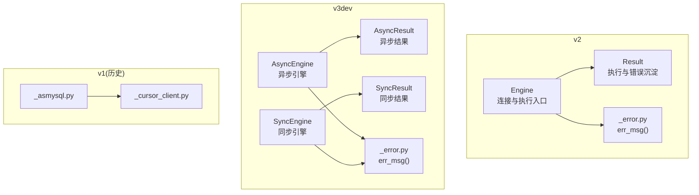
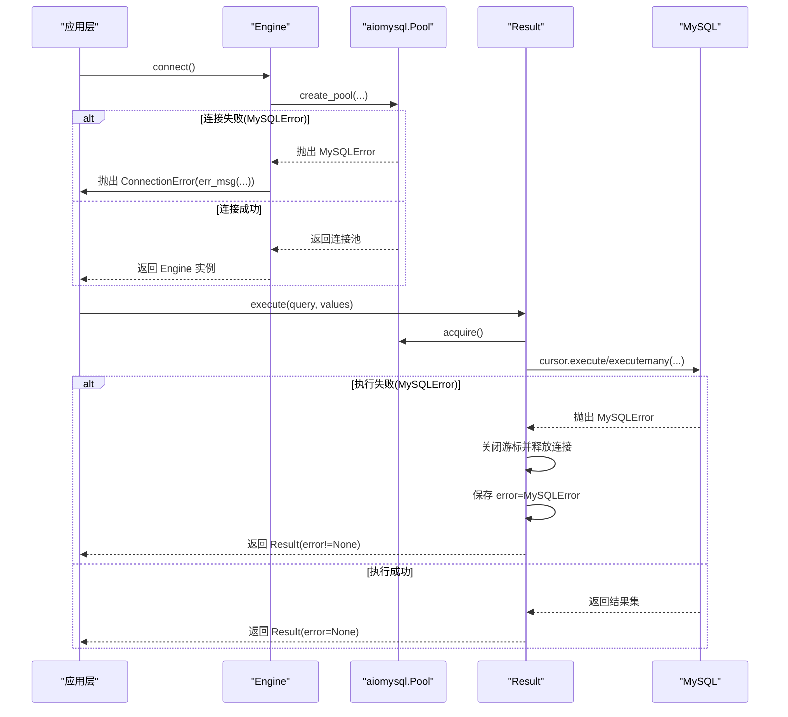
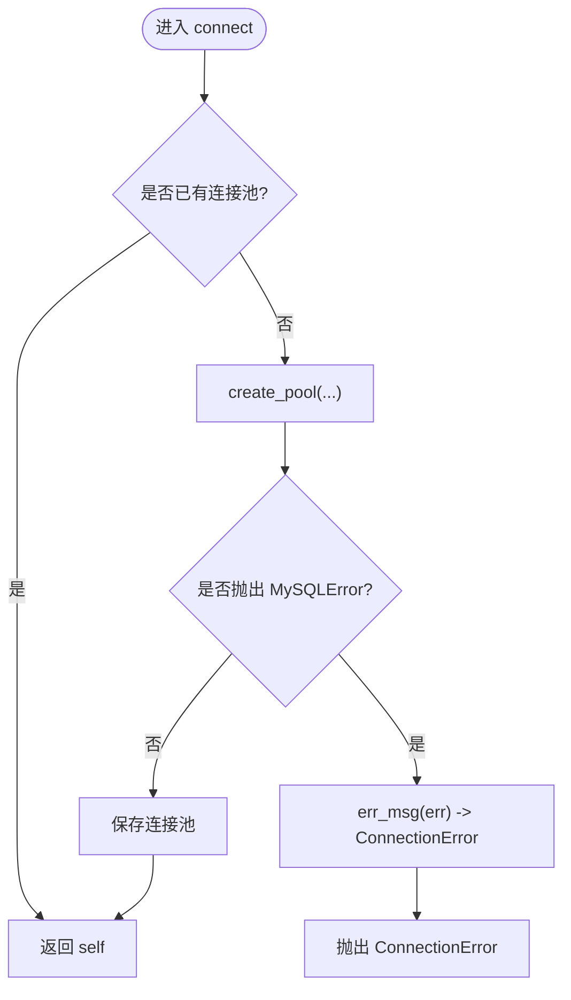
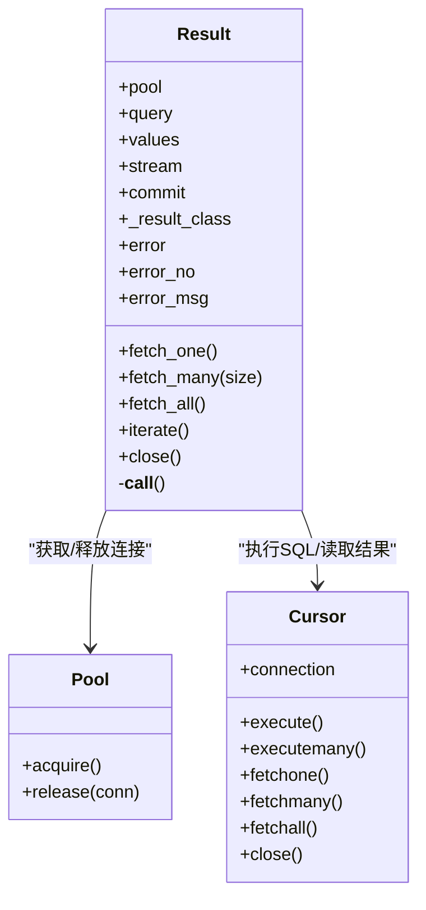
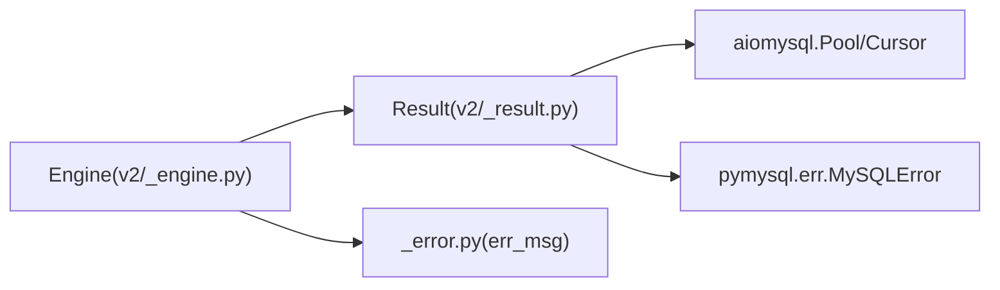

# 错误处理机制

<cite>
**本文引用的文件**   
- [asmysql/v2/_engine.py](file://asmysql/v2/_engine.py)
- [asmysql/v2/_result.py](file://asmysql/v2/_result.py)
- [asmysql/v2/_error.py](file://asmysql/v2/_error.py)
- [asmysql/v3dev/_async_engine.py](file://asmysql/v3dev/_async_engine.py)
- [asmysql/v3dev/_async_result.py](file://asmysql/v3dev/_async_result.py)
- [asmysql/v3dev/_sync_engine.py](file://asmysql/v3dev/_sync_engine.py)
- [asmysql/v3dev/_sync_result.py](file://asmysql/v3dev/_sync_result.py)
- [asmysql/v1/_asmysql.py](file://asmysql/v1/_asmysql.py)
- [asmysql/v1/_cursor_client.py](file://asmysql/v1/_cursor_client.py)
- [tests/pystands/context.py](file://tests/pystands/context.py)
</cite>

## 目录
1. [简介](#简介)
2. [项目结构](#项目结构)
3. [核心组件](#核心组件)
4. [架构总览](#架构总览)
5. [详细组件分析](#详细组件分析)
6. [依赖关系分析](#依赖关系分析)
7. [性能与健壮性考虑](#性能与健壮性考虑)
8. [故障排查指南](#故障排查指南)
9. [结论](#结论)
10. [附录：最佳实践与示例路径](#附录最佳实践与示例路径)

## 简介
本章节聚焦 asmysql 的错误处理机制与异常管理策略，覆盖以下要点：
- 内置错误类型与异常层次：连接层抛出 ConnectionError；SQL 执行层捕获并封装 pymysql.err.MySQLError。
- 全局异常捕获与统一处理：在连接建立阶段将底层 MySQLError 转换为 ConnectionError；在执行阶段将错误沉淀到 Result.error 中，避免直接向上抛错导致调用方复杂化。
- 自定义错误处理器：通过装饰器或中间件在应用层统一捕获、记录与转换错误。
- 日志与调试：支持 SQL 回显（echo_sql_log）与错误码/错误信息访问（error_no、error_msg）。
- 常见错误诊断与解决方案：连接超时、权限不足、SQL 语法错误等。
- 代码示例与最佳实践：提供可落地的模式与参考路径。

## 项目结构
错误处理相关的关键实现分布在 v2 与 v3dev 两个版本分支中，v1 作为历史版本保留部分逻辑。核心文件职责如下：
- Engine 层：负责连接池创建与生命周期管理，连接失败时抛出 ConnectionError。
- Result 层：负责 SQL 执行、结果获取与错误沉淀，内部捕获 MySQLError 并写入 error 字段。
- 工具函数：err_msg 用于规范化异常消息，便于日志输出。

图表来源
- [asmysql/v2/_engine.py:120-151](file://asmysql/v2/_engine.py#L120-L151)
- [asmysql/v2/_result.py:101-125](file://asmysql/v2/_result.py#L101-L125)
- [asmysql/v2/_error.py:1-7](file://asmysql/v2/_error.py#L1-L7)
- [asmysql/v3dev/_async_engine.py:120-141](file://asmysql/v3dev/_async_engine.py#L120-L141)
- [asmysql/v3dev/_async_result.py:101-125](file://asmysql/v3dev/_async_result.py#L101-L125)
- [asmysql/v3dev/_sync_engine.py:120-141](file://asmysql/v3dev/_sync_engine.py#L120-L141)
- [asmysql/v3dev/_sync_result.py:101-125](file://asmysql/v3dev/_sync_result.py#L101-L125)
- [asmysql/v1/_asmysql.py:80-100](file://asmysql/v1/_asmysql.py#L80-L100)
- [asmysql/v1/_cursor_client.py:35-70](file://asmysql/v1/_cursor_client.py#L35-L70)

章节来源
- [asmysql/v2/_engine.py:120-151](file://asmysql/v2/_engine.py#L120-L151)
- [asmysql/v2/_result.py:101-125](file://asmysql/v2/_result.py#L101-L125)
- [asmysql/v2/_error.py:1-7](file://asmysql/v2/_error.py#L1-L7)
- [asmysql/v3dev/_async_engine.py:120-141](file://asmysql/v3dev/_async_engine.py#L120-L141)
- [asmysql/v3dev/_async_result.py:101-125](file://asmysql/v3dev/_async_result.py#L101-L125)
- [asmysql/v3dev/_sync_engine.py:120-141](file://asmysql/v3dev/_sync_engine.py#L120-L141)
- [asmysql/v3dev/_sync_result.py:101-125](file://asmysql/v3dev/_sync_result.py#L101-L125)
- [asmysql/v1/_asmysql.py:80-100](file://asmysql/v1/_asmysql.py#L80-L100)
- [asmysql/v1/_cursor_client.py:35-70](file://asmysql/v1/_cursor_client.py#L35-L70)

## 核心组件
- 连接层异常（ConnectionError）
  - 在 Engine.connect 阶段，若底层 create_pool 抛出 MySQLError，则统一包装为 ConnectionError，确保上层以“连接错误”语义进行区分与重试。
- 执行层异常（MySQLError）
  - 在 Result.__call__ 阶段，所有 SQL 执行异常被捕获并保存到 Result.error，同时关闭游标并释放连接，避免资源泄漏。
- 错误消息格式化（err_msg）
  - 提供统一的异常消息格式化能力，避免空字符串导致的日志不可读。

章节来源
- [asmysql/v2/_engine.py:148-151](file://asmysql/v2/_engine.py#L148-L151)
- [asmysql/v2/_result.py:118-125](file://asmysql/v2/_result.py#L118-L125)
- [asmysql/v2/_error.py:1-7](file://asmysql/v2/_error.py#L1-L7)

## 架构总览
下图展示了从应用调用到数据库执行的完整错误流：连接阶段抛出 ConnectionError；执行阶段将错误沉淀到 Result.error，并提供 error_no/error_msg 供上层判断与记录。

图表来源
- [asmysql/v2/_engine.py:120-151](file://asmysql/v2/_engine.py#L120-L151)
- [asmysql/v2/_result.py:101-125](file://asmysql/v2/_result.py#L101-L125)

## 详细组件分析

### 连接层错误处理（Engine.connect）
- 行为说明
  - 当 create_pool 抛出 MySQLError 时，使用 err_msg 格式化后抛出 ConnectionError，避免向上传播底层细节。
  - 未连接时访问 pool 属性也会主动抛出 ConnectionError，提示先调用 connect。
- 关键路径
  - 连接初始化与参数解析
  - 连接池创建与异常转换
  - 未连接状态保护

图表来源
- [asmysql/v2/_engine.py:120-151](file://asmysql/v2/_engine.py#L120-L151)
- [asmysql/v2/_engine.py:186-192](file://asmysql/v2/_engine.py#L186-L192)

章节来源
- [asmysql/v2/_engine.py:120-151](file://asmysql/v2/_engine.py#L120-L151)
- [asmysql/v2/_engine.py:186-192](file://asmysql/v2/_engine.py#L186-L192)

### 执行层错误处理（Result.__call__）
- 行为说明
  - 在 acquire 连接、创建游标、执行 SQL 的过程中捕获 MySQLError。
  - 发生错误时立即关闭游标并释放连接，同时将异常对象保存到 Result.error，保证后续 fetch_* 方法安全返回空值或默认值。
  - 提供 error_no、error_msg 属性，便于上层按错误码分类处理。
- 关键路径
  - 选择游标类型（tuple/dict、stream/on-demand）
  - 执行 SQL 与事务提交
  - 异常捕获与资源清理
  - 错误信息暴露

图表来源
- [asmysql/v2/_result.py:101-125](file://asmysql/v2/_result.py#L101-L125)
- [asmysql/v2/_result.py:133-151](file://asmysql/v2/_result.py#L133-L151)

章节来源
- [asmysql/v2/_result.py:101-125](file://asmysql/v2/_result.py#L101-L125)
- [asmysql/v2/_result.py:133-151](file://asmysql/v2/_result.py#L133-L151)

### 错误消息格式化（err_msg）
- 作用
  - 统一异常消息格式，避免空字符串导致日志不可读。
- 使用位置
  - 连接层异常包装时调用，确保 ConnectionError 的消息可读且稳定。

章节来源
- [asmysql/v2/_error.py:1-7](file://asmysql/v2/_error.py#L1-L7)

### 多版本一致性（v2 与 v3dev）
- v2 与 v3dev 的异步/同步引擎与结果类均遵循相同的错误处理策略：
  - 连接阶段：MySQLError -> ConnectionError
  - 执行阶段：MySQLError -> Result.error
- 同步版本（v3dev SyncEngine/SyncResult）与异步版本（AsyncEngine/AsyncResult）保持一致。

章节来源
- [asmysql/v3dev/_async_engine.py:120-141](file://asmysql/v3dev/_async_engine.py#L120-L141)
- [asmysql/v3dev/_async_result.py:101-125](file://asmysql/v3dev/_async_result.py#L101-L125)
- [asmysql/v3dev/_sync_engine.py:120-141](file://asmysql/v3dev/_sync_engine.py#L120-L141)
- [asmysql/v3dev/_sync_result.py:101-125](file://asmysql/v3dev/_sync_result.py#L101-L125)

### 历史版本（v1）
- v1 同样在连接阶段将 MySQLError 转换为 ConnectionError，并在游标客户端中捕获执行期异常。
- 该版本可作为迁移与兼容性参考。

章节来源
- [asmysql/v1/_asmysql.py:80-100](file://asmysql/v1/_asmysql.py#L80-L100)
- [asmysql/v1/_cursor_client.py:35-70](file://asmysql/v1/_cursor_client.py#L35-L70)

## 依赖关系分析
- 外部依赖
  - aiomysql：提供连接池与游标操作。
  - pymysql.err.MySQLError：底层 MySQL 驱动异常基类。
- 内部依赖
  - Engine 依赖 Result 完成 SQL 执行。
  - Result 依赖 aiomysql 的 Cursor/Pool 完成具体 IO。
  - 错误消息格式化由 _error.py 提供。

图表来源
- [asmysql/v2/_engine.py:120-151](file://asmysql/v2/_engine.py#L120-L151)
- [asmysql/v2/_result.py:101-125](file://asmysql/v2/_result.py#L101-L125)
- [asmysql/v2/_error.py:1-7](file://asmysql/v2/_error.py#L1-L7)

章节来源
- [asmysql/v2/_engine.py:120-151](file://asmysql/v2/_engine.py#L120-L151)
- [asmysql/v2/_result.py:101-125](file://asmysql/v2/_result.py#L101-L125)
- [asmysql/v2/_error.py:1-7](file://asmysql/v2/_error.py#L1-L7)

## 性能与健壮性考虑
- 资源释放
  - 执行失败时 Result 会关闭游标并释放连接，避免连接泄漏。
- 错误短路
  - Result.error 非空时，fetch_* 等方法直接返回空值或默认值，避免二次异常。
- 日志与调试
  - echo_sql_log 开启后可打印 SQL 语句，便于定位问题。
  - error_no/error_msg 可用于结构化记录错误码与消息。
- 连接池配置
  - min_pool_size/max_pool_size/pool_recycle/connect_timeout 影响稳定性与性能，建议根据业务负载调优。

[本节为通用指导，不直接分析具体文件]

## 故障排查指南
- 连接超时
  - 现象：connect 阶段抛出 ConnectionError。
  - 排查：检查网络连通性、MySQL 服务状态、用户名密码、端口与防火墙；适当增大 connect_timeout。
  - 参考路径：[连接异常转换:148-151](file://asmysql/v2/_engine.py#L148-L151)
- 权限不足
  - 现象：执行 SQL 时报错，Result.error 非空，error_no 对应权限错误码。
  - 排查：核对用户权限、库表存在性与访问控制；查看 error_msg 中的具体描述。
  - 参考路径：[错误码/消息访问:133-151](file://asmysql/v2/_result.py#L133-L151)
- SQL 语法错误
  - 现象：execute 抛出 MySQLError，Result.error 非空。
  - 排查：启用 echo_sql_log 打印实际 SQL；检查占位符与参数绑定；简化 SQL 逐步定位。
  - 参考路径：[执行异常捕获:118-125](file://asmysql/v2/_result.py#L118-L125)
- 连接未初始化
  - 现象：未调用 connect 即访问 pool 抛出 ConnectionError。
  - 排查：确保在调用 execute 前 await engine.connect()。
  - 参考路径：[未连接保护:186-192](file://asmysql/v2/_engine.py#L186-L192)

章节来源
- [asmysql/v2/_engine.py:148-151](file://asmysql/v2/_engine.py#L148-L151)
- [asmysql/v2/_result.py:118-125](file://asmysql/v2/_result.py#L118-L125)
- [asmysql/v2/_result.py:133-151](file://asmysql/v2/_result.py#L133-L151)
- [asmysql/v2/_engine.py:186-192](file://asmysql/v2/_engine.py#L186-L192)

## 结论
asmysql 的错误处理采用“分层清晰、资源安全、信息完备”的策略：
- 连接层：将底层异常统一转换为 ConnectionError，便于上层快速识别与重试。
- 执行层：将异常沉淀到 Result.error，并提供 error_no/error_msg，兼顾易用性与可观测性。
- 日志与调试：通过 echo_sql_log 与错误信息格式化，提升排障效率。
- 多版本一致：v2 与 v3dev 的异步/同步实现保持一致的错误模型，利于迁移与维护。

[本节为总结性内容，不直接分析具体文件]

## 附录：最佳实践与示例路径
- 应用层统一错误处理（装饰器/中间件）
  - 在业务函数外层包裹 try/except，捕获 Exception 并记录日志，必要时转换为业务错误码。
  - 参考路径：[错误处理装饰器示例:646-686](file://mkdocs/v2/docs/zh/examples.md#L646-L686)
- 上下文管理器式连接
  - 使用 async with Engine(url=...) 自动管理连接生命周期，异常会在 __aexit__ 中触发 disconnect。
  - 参考路径：[异步上下文协议:124-128](file://asmysql/v2/_engine.py#L124-L128)
- 测试环境模拟连接错误
  - 在测试中可通过上下文管理器模拟连接错误，验证上层容错逻辑。
  - 参考路径：[测试上下文模拟:7-13](file://tests/pystands/context.py#L7-L13)
- 错误码分类处理
  - 基于 Result.error_no 对错误进行分类：如权限、语法、超时等，分别采取重试、降级或告警策略。
  - 参考路径：[错误码访问:133-141](file://asmysql/v2/_result.py#L133-L141)

章节来源
- [mkdocs/v2/docs/zh/examples.md:646-686](file://mkdocs/v2/docs/zh/examples.md#L646-L686)
- [asmysql/v2/_engine.py:124-128](file://asmysql/v2/_engine.py#L124-L128)
- [tests/pystands/context.py:7-13](file://tests/pystands/context.py#L7-L13)
- [asmysql/v2/_result.py:133-141](file://asmysql/v2/_result.py#L133-L141)