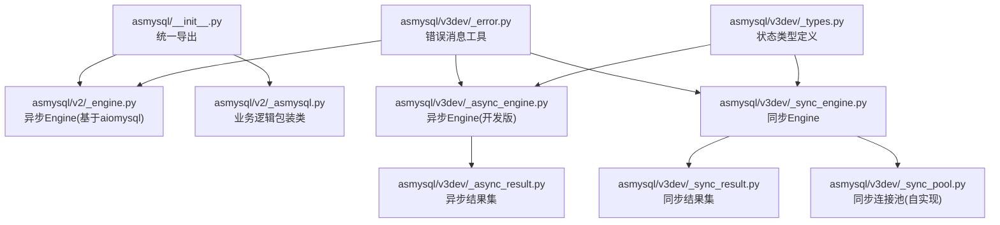
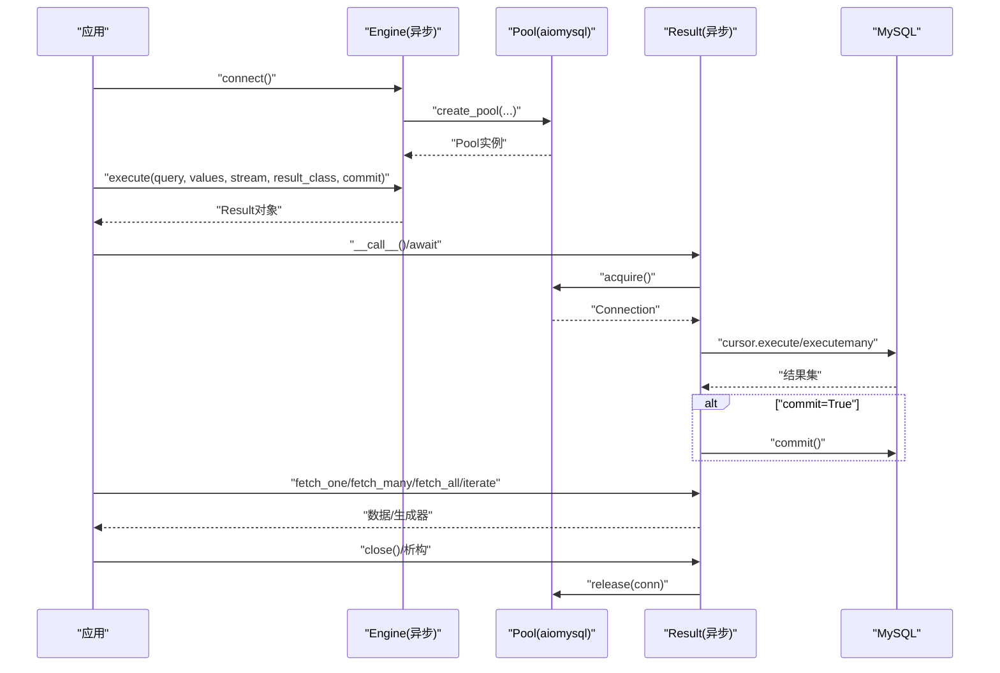
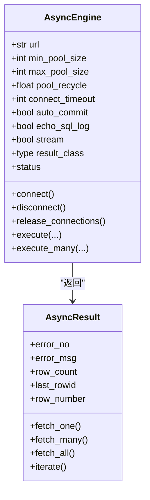
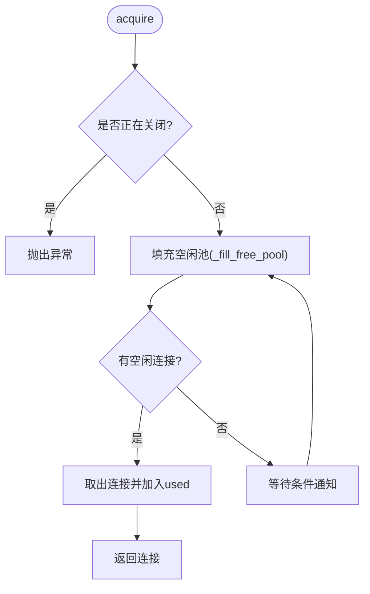
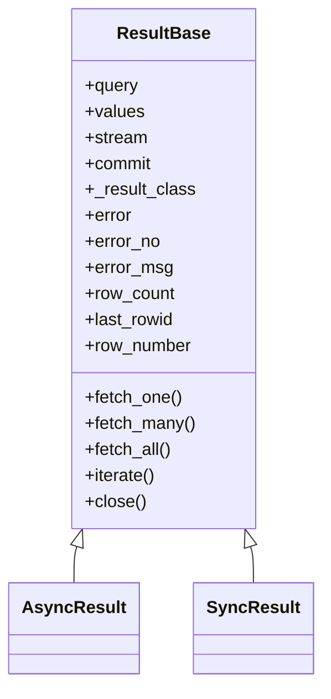
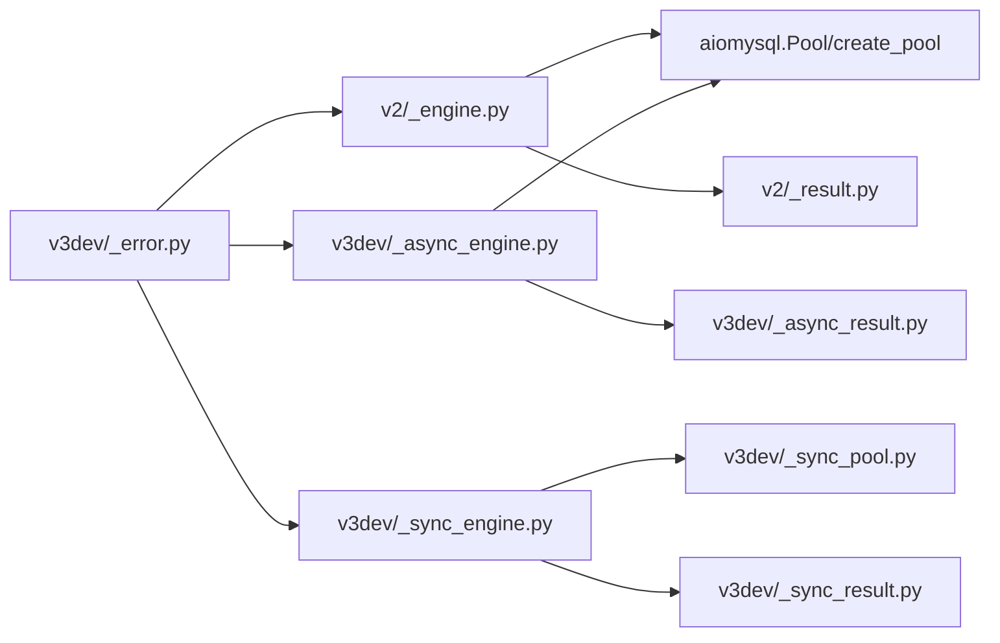
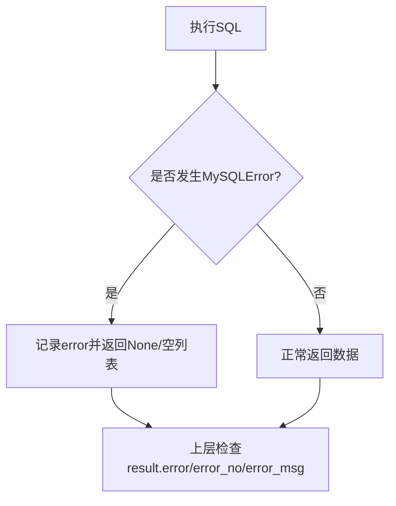

# 高级特性

<cite>
**本文引用的文件**   
- [asmysql/__init__.py](file://asmysql/__init__.py)
- [asmysql/v2/_engine.py](file://asmysql/v2/_engine.py)
- [asmysql/v2/_asmysql.py](file://asmysql/v2/_asmysql.py)
- [asmysql/v3dev/_async_engine.py](file://asmysql/v3dev/_async_engine.py)
- [asmysql/v3dev/_sync_engine.py](file://asmysql/v3dev/_sync_engine.py)
- [asmysql/v3dev/_sync_pool.py](file://asmysql/v3dev/_sync_pool.py)
- [asmysql/v3dev/_async_result.py](file://asmysql/v3dev/_async_result.py)
- [asmysql/v3dev/_sync_result.py](file://asmysql/v3dev/_sync_result.py)
- [asmysql/v3dev/_error.py](file://asmysql/v3dev/_error.py)
- [asmysql/v3dev/_types.py](file://asmysql/v3dev/_types.py)
- [README.md](file://README.md)
- [tests/v1/test_asmysql_performance.py](file://tests/v1/test_asmysql_performance.py)
</cite>

## 目录
1. [简介](#简介)
2. [项目结构](#项目结构)
3. [核心组件](#核心组件)
4. [架构总览](#架构总览)
5. [详细组件分析](#详细组件分析)
6. [依赖关系分析](#依赖关系分析)
7. [性能优化与调优](#性能优化与调优)
8. [错误处理机制](#错误处理机制)
9. [监控与诊断](#监控与诊断)
10. [扩展点机制](#扩展点机制)
11. [生产环境部署建议](#生产环境部署建议)
12. [与其他框架集成](#与其他框架集成)
13. [基准测试与案例](#基准测试与案例)
14. [故障排查指南](#故障排查指南)
15. [结论](#结论)

## 简介
本章节聚焦 asmysql 的高级特性与优化实践，面向高级用户和架构师。内容涵盖连接池调优、查询与内存管理、错误处理、监控诊断、扩展点、生产部署与多框架集成，并给出可操作的优化策略与排障建议。

## 项目结构
仓库采用版本化模块组织：v1（兼容）、v2（稳定异步封装）、v3dev（开发版，含同步/异步双引擎与自实现同步连接池）。顶层入口统一导出 v2 的 Engine/AsMysql/Result 等能力。

图表来源
- [asmysql/__init__.py:1-16](file://asmysql/__init__.py#L1-L16)
- [asmysql/v2/_engine.py:1-317](file://asmysql/v2/_engine.py#L1-L317)
- [asmysql/v2/_asmysql.py:1-26](file://asmysql/v2/_asmysql.py#L1-L26)
- [asmysql/v3dev/_async_engine.py:1-307](file://asmysql/v3dev/_async_engine.py#L1-L307)
- [asmysql/v3dev/_sync_engine.py:1-298](file://asmysql/v3dev/_sync_engine.py#L1-L298)
- [asmysql/v3dev/_sync_pool.py:1-281](file://asmysql/v3dev/_sync_pool.py#L1-L281)
- [asmysql/v3dev/_async_result.py:1-273](file://asmysql/v3dev/_async_result.py#L1-L273)
- [asmysql/v3dev/_sync_result.py:1-268](file://asmysql/v3dev/_sync_result.py#L1-L268)
- [asmysql/v3dev/_error.py:1-7](file://asmysql/v3dev/_error.py#L1-L7)
- [asmysql/v3dev/_types.py:1-12](file://asmysql/v3dev/_types.py#L1-L12)

章节来源
- [asmysql/__init__.py:1-16](file://asmysql/__init__.py#L1-L16)
- [README.md:1-135](file://README.md#L1-L135)

## 核心组件
- Engine（异步/同步）：负责连接池生命周期、参数解析、执行 SQL 并返回 Result。支持 URL 配置、流式读取、自定义结果类型、自动提交控制等。
- AsMysql：业务逻辑包装器，持有 Engine 引用，提供 client 访问底层执行能力。
- Result（异步/同步）：封装游标与连接释放，提供 fetch_one/many/all、iterate、错误码/信息、行计数、最后插入ID等。
- 同步连接池（v3dev）：基于 pymysql 的线程安全连接池，仿照 aiomysql.Pool 行为，支持最小/最大池大小、回收、等待关闭等。
- 错误处理：统一的错误消息格式化，避免空字符串日志。

章节来源
- [asmysql/v2/_engine.py:1-317](file://asmysql/v2/_engine.py#L1-L317)
- [asmysql/v2/_asmysql.py:1-26](file://asmysql/v2/_asmysql.py#L1-L26)
- [asmysql/v3dev/_async_engine.py:1-307](file://asmysql/v3dev/_async_engine.py#L1-L307)
- [asmysql/v3dev/_sync_engine.py:1-298](file://asmysql/v3dev/_sync_engine.py#L1-L298)
- [asmysql/v3dev/_async_result.py:1-273](file://asmysql/v3dev/_async_result.py#L1-L273)
- [asmysql/v3dev/_sync_result.py:1-268](file://asmysql/v3dev/_sync_result.py#L1-L268)
- [asmysql/v3dev/_sync_pool.py:1-281](file://asmysql/v3dev/_sync_pool.py#L1-L281)
- [asmysql/v3dev/_error.py:1-7](file://asmysql/v3dev/_error.py#L1-L7)

## 架构总览
下图展示异步路径的核心交互：Engine 创建/管理连接池，execute 返回 Result；Result 在需要时从池获取连接、选择游标类型、执行 SQL、提交事务、迭代或批量取数，并在结束时归还连接。

图表来源
- [asmysql/v3dev/_async_engine.py:120-172](file://asmysql/v3dev/_async_engine.py#L120-L172)
- [asmysql/v3dev/_async_engine.py:216-249](file://asmysql/v3dev/_async_engine.py#L216-L249)
- [asmysql/v3dev/_async_result.py:101-126](file://asmysql/v3dev/_async_result.py#L101-L126)
- [asmysql/v3dev/_async_result.py:186-273](file://asmysql/v3dev/_async_result.py#L186-L273)

## 详细组件分析

### 异步 Engine（v3dev）
- 关键职责
  - URL 参数解析与校验（仅支持 mysql 方案），将 query 参数映射为连接池与连接选项。
  - 连接池生命周期：connect/disconnect/release_connections/is_connected/status。
  - 执行接口：execute/execute_many，返回 Result，支持流式与自定义结果类型。
- 设计要点
  - 使用 Final 标注不可变字段，增强类型安全。
  - status 暴露 pool_minsize/maxsize/size/free/used 等指标，便于监控。
  - execute 内部委托 Result 完成具体执行与资源管理。

图表来源
- [asmysql/v3dev/_async_engine.py:27-102](file://asmysql/v3dev/_async_engine.py#L27-L102)
- [asmysql/v3dev/_async_engine.py:144-156](file://asmysql/v3dev/_async_engine.py#L144-L156)
- [asmysql/v3dev/_async_engine.py:216-249](file://asmysql/v3dev/_async_engine.py#L216-L249)
- [asmysql/v3dev/_async_result.py:21-273](file://asmysql/v3dev/_async_result.py#L21-L273)

章节来源
- [asmysql/v3dev/_async_engine.py:1-307](file://asmysql/v3dev/_async_engine.py#L1-L307)

### 同步 Engine 与同步连接池（v3dev）
- 同步 Engine
  - 与异步 Engine API 对齐，内部使用自实现的同步连接池。
  - 同样支持 URL 解析、execute/execute_many、status 等。
- 同步连接池
  - 基于 pymysql 的线程安全实现，维护 free/used/acquiring 集合与 Condition 条件变量。
  - 支持最小/最大池大小、空闲连接回收（pool_recycle）、等待关闭、清理空闲连接等。
  - 释放连接时检测未提交事务，必要时主动关闭连接以保证池健康。

图表来源
- [asmysql/v3dev/_sync_pool.py:165-184](file://asmysql/v3dev/_sync_pool.py#L165-L184)
- [asmysql/v3dev/_sync_pool.py:185-238](file://asmysql/v3dev/_sync_pool.py#L185-L238)
- [asmysql/v3dev/_sync_engine.py:119-140](file://asmysql/v3dev/_sync_engine.py#L119-L140)

章节来源
- [asmysql/v3dev/_sync_engine.py:1-298](file://asmysql/v3dev/_sync_engine.py#L1-L298)
- [asmysql/v3dev/_sync_pool.py:1-281](file://asmysql/v3dev/_sync_pool.py#L1-L281)

### 结果集 Result（异步/同步）
- 共同特性
  - 支持上下文管理器与迭代器协议，自动管理连接释放。
  - 支持流式游标（SSCursor/SSDictCursor）与非流式游标（Cursor/DictCursor）。
  - 支持将每行映射到自定义类型（result_class），通过构造函数的关键字参数注入。
  - 提供 error/error_no/error_msg、row_count/last_rowid/row_number 等属性。
- 差异
  - 异步版本使用 aiomysql 的 Cursor/Pool，同步版本使用 pymysql 的对应实现。

图表来源
- [asmysql/v3dev/_async_result.py:1-273](file://asmysql/v3dev/_async_result.py#L1-L273)
- [asmysql/v3dev/_sync_result.py:1-268](file://asmysql/v3dev/_sync_result.py#L1-L268)

章节来源
- [asmysql/v3dev/_async_result.py:1-273](file://asmysql/v3dev/_async_result.py#L1-L273)
- [asmysql/v3dev/_sync_result.py:1-268](file://asmysql/v3dev/_sync_result.py#L1-L268)

### 错误处理工具
- err_msg：对异常进行规范化输出，避免空字符串导致日志无意义。
- 连接阶段捕获 MySQLError 并转换为 ConnectionError，便于上层统一处理。

章节来源
- [asmysql/v3dev/_error.py:1-7](file://asmysql/v3dev/_error.py#L1-L7)
- [asmysql/v3dev/_async_engine.py:139-141](file://asmysql/v3dev/_async_engine.py#L139-L141)
- [asmysql/v3dev/_sync_engine.py:137-139](file://asmysql/v3dev/_sync_engine.py#L137-L139)

## 依赖关系分析
- 外部依赖
  - 异步路径：aiomysql（连接池与游标）、pymysql.err（异常类型）。
  - 同步路径：pymysql（连接与游标）。
- 内部耦合
  - Engine 与 Result 解耦：Engine 只负责创建 Result，Result 负责执行与资源管理。
  - 同步 Engine 与自实现 Pool 强耦合，以提供与异步一致的语义。

图表来源
- [asmysql/v2/_engine.py:1-317](file://asmysql/v2/_engine.py#L1-L317)
- [asmysql/v3dev/_async_engine.py:1-307](file://asmysql/v3dev/_async_engine.py#L1-L307)
- [asmysql/v3dev/_sync_engine.py:1-298](file://asmysql/v3dev/_sync_engine.py#L1-L298)
- [asmysql/v3dev/_sync_pool.py:1-281](file://asmysql/v3dev/_sync_pool.py#L1-L281)
- [asmysql/v3dev/_error.py:1-7](file://asmysql/v3dev/_error.py#L1-L7)

章节来源
- [asmysql/v2/_engine.py:1-317](file://asmysql/v2/_engine.py#L1-L317)
- [asmysql/v3dev/_async_engine.py:1-307](file://asmysql/v3dev/_async_engine.py#L1-L307)
- [asmysql/v3dev/_sync_engine.py:1-298](file://asmysql/v3dev/_sync_engine.py#L1-L298)
- [asmysql/v3dev/_sync_pool.py:1-281](file://asmysql/v3dev/_sync_pool.py#L1-L281)

## 性能优化与调优
- 连接池调优
  - min_pool_size/max_pool_size：根据并发度与数据库承载能力设置，避免频繁创建/销毁连接。
  - pool_recycle：合理设置空闲连接回收时间，防止长连接被远端断开导致异常。
  - connect_timeout：在网络不稳定或跨机房场景适当增大，降低首次连接失败率。
  - release_connections：在低峰期或任务结束后主动清空空闲连接，减少资源占用。
- 查询与内存管理
  - 大结果集优先使用流式模式（stream=True），结合 iterate 逐条消费，避免一次性加载到内存。
  - 合理选择 result_class：对于结构化数据，使用轻量级数据类可减少元组索引开销并提升可读性。
  - 批量写入使用 execute_many，减少往返次数。
- 自动提交与事务
  - auto_commit 默认开启，适合简单读写；复杂业务需显式控制 commit 参数或使用事务上下文（由上层实现）。
- 日志与可观测性
  - echo_sql_log 用于调试，生产环境谨慎开启，避免高吞吐下日志风暴。
  - 定期采集 Engine.status 指标，观察 pool_size/pool_free/pool_used 变化趋势。

章节来源
- [asmysql/v3dev/_async_engine.py:45-101](file://asmysql/v3dev/_async_engine.py#L45-L101)
- [asmysql/v3dev/_sync_engine.py:44-100](file://asmysql/v3dev/_sync_engine.py#L44-L100)
- [asmysql/v3dev/_async_result.py:10-19](file://asmysql/v3dev/_async_result.py#L10-L19)
- [asmysql/v3dev/_sync_result.py:12-21](file://asmysql/v3dev/_sync_result.py#L12-L21)
- [asmysql/v3dev/_async_engine.py:144-156](file://asmysql/v3dev/_async_engine.py#L144-L156)
- [asmysql/v3dev/_sync_engine.py:142-154](file://asmysql/v3dev/_sync_engine.py#L142-L154)

## 错误处理机制
- 全局异常捕获
  - 连接阶段捕获 MySQLError 并转为 ConnectionError，附带规范化错误消息，便于上层统一拦截。
- 执行期错误
  - Result 在执行过程中捕获 MySQLError，记录 error 并返回 None/空列表，调用方可通过 error/error_no/error_msg 判断。
- 错误日志
  - 使用 err_msg 统一格式化异常信息，避免空字符串导致的日志缺失。

图表来源
- [asmysql/v3dev/_async_result.py:119-125](file://asmysql/v3dev/_async_result.py#L119-L125)
- [asmysql/v3dev/_sync_result.py:121-127](file://asmysql/v3dev/_sync_result.py#L121-L127)
- [asmysql/v3dev/_error.py:1-7](file://asmysql/v3dev/_error.py#L1-L7)
- [asmysql/v3dev/_async_engine.py:139-141](file://asmysql/v3dev/_async_engine.py#L139-L141)
- [asmysql/v3dev/_sync_engine.py:137-139](file://asmysql/v3dev/_sync_engine.py#L137-L139)

章节来源
- [asmysql/v3dev/_async_result.py:101-126](file://asmysql/v3dev/_async_result.py#L101-L126)
- [asmysql/v3dev/_sync_result.py:103-127](file://asmysql/v3dev/_sync_result.py#L103-L127)
- [asmysql/v3dev/_error.py:1-7](file://asmysql/v3dev/_error.py#L1-L7)

## 监控与诊断
- 连接池状态监控
  - 通过 Engine.status 获取 address/connected/pool_minsize/pool_maxsize/pool_size/pool_free/pool_used 等指标，可用于 Prometheus/Grafana 等系统采集。
- 查询性能统计
  - 可在应用层对 execute 前后计时，结合 echo_sql_log 定位慢查询。
- 慢查询分析
  - 结合数据库侧 slow_query_log 与应用层耗时统计，识别热点 SQL 与参数化问题。

章节来源
- [asmysql/v3dev/_async_engine.py:144-156](file://asmysql/v3dev/_async_engine.py#L144-L156)
- [asmysql/v3dev/_sync_engine.py:142-154](file://asmysql/v3dev/_sync_engine.py#L142-L154)

## 扩展点机制
- 自定义结果类型
  - 通过 result_class 指定任意可构造的类型（如 Pydantic 模型、dataclass），Result 会在取数时以关键字参数方式构造对象。
- 自定义连接工厂
  - 异步路径：替换底层 aiomysql.create_pool 的行为（例如封装重试、熔断、动态路由）。
  - 同步路径：在 v3dev 中可直接替换 _sync_pool.Pool 的实现，保持 acquire/release/wait_closed 等接口一致。
- 自定义错误处理器
  - 在 Engine.connect 阶段捕获 MySQLError 后，可按需转换为更高层的业务异常，或接入统一告警通道。
- 流式与游标定制
  - 通过 stream 与 result_class 组合，灵活选择 SSCursor/SSDictCursor/Cursor/DictCursor，平衡内存与易用性。

章节来源
- [asmysql/v3dev/_async_engine.py:216-249](file://asmysql/v3dev/_async_engine.py#L216-L249)
- [asmysql/v3dev/_sync_engine.py:206-239](file://asmysql/v3dev/_sync_engine.py#L206-L239)
- [asmysql/v3dev/_async_result.py:10-19](file://asmysql/v3dev/_async_result.py#L10-L19)
- [asmysql/v3dev/_sync_result.py:12-21](file://asmysql/v3dev/_sync_result.py#L12-L21)
- [asmysql/v3dev/_sync_pool.py:165-184](file://asmysql/v3dev/_sync_pool.py#L165-L184)

## 生产环境部署建议
- 配置管理
  - 使用 URL 集中配置连接参数（host/port/user/password/charset/min_pool_size/max_pool_size/pool_recycle/connect_timeout/auto_commit/echo_sql_log/stream/result_class）。
  - 区分环境与敏感信息，避免硬编码。
- 资源限制
  - 根据 CPU/内存与数据库承载能力设定合理的 min_pool_size/max_pool_size，避免连接耗尽或过度竞争。
  - 启用 pool_recycle 防止长连接失效。
- 故障恢复
  - 启动时预热连接（connect），优雅关闭（disconnect/wait_closed）。
  - 在低峰期调用 release_connections 释放空闲连接，降低资源占用。
  - 对连接错误进行重试与降级策略，保障服务可用性。

章节来源
- [asmysql/v3dev/_async_engine.py:67-101](file://asmysql/v3dev/_async_engine.py#L67-L101)
- [asmysql/v3dev/_sync_engine.py:66-100](file://asmysql/v3dev/_sync_engine.py#L66-L100)
- [asmysql/v3dev/_async_engine.py:167-172](file://asmysql/v3dev/_async_engine.py#L167-L172)
- [asmysql/v3dev/_sync_engine.py:161-168](file://asmysql/v3dev/_sync_engine.py#L161-L168)

## 与其他框架集成
- FastAPI
  - 使用 lifespan 管理 Engine 生命周期（启动时 connect，退出时 disconnect）。
  - 在 Service 层继承 AsMysql，使用 result_class 直接映射到 Pydantic 模型，简化响应构建。
- Django
  - 在中间件或 AppConfig.ready 中初始化 Engine，请求上下文中注入 AsMysql 实例。
- Celery
  - 在 worker 启动时建立连接，任务完成后释放连接；注意每个 worker 进程独立连接池。

章节来源
- [README.md:40-96](file://README.md#L40-L96)

## 基准测试与案例
- 现有测试
  - tests/v1/test_asmysql_performance.py 展示了高并发任务下的基本用法与迭代消费模式，可作为压测起点。
- 建议的基准方法
  - 固定数据集与 SQL，对比不同连接池大小、是否流式、是否批量写入的 QPS 与 P99 延迟。
  - 引入慢查询阈值统计，结合数据库慢日志定位瓶颈。
  - 针对大数据集场景，对比 fetch_all 与 iterate 的内存峰值与吞吐。

章节来源
- [tests/v1/test_asmysql_performance.py:1-51](file://tests/v1/test_asmysql_performance.py#L1-L51)

## 故障排查指南
- 常见问题
  - 连接失败：检查 URL scheme 与网络连通性，确认 connect_timeout 与认证信息。
  - 连接泄漏：确保 Result 正确关闭（使用上下文管理器或显式 close），避免长时间持有连接。
  - 事务未提交：释放连接时会检测未提交事务并关闭连接，可能导致意外回滚，需在业务层明确事务边界。
- 诊断手段
  - 打印 Engine.status 观察池状态。
  - 临时开启 echo_sql_log 定位异常 SQL。
  - 使用 result.error/error_no/error_msg 快速定位错误原因。

章节来源
- [asmysql/v3dev/_async_engine.py:144-156](file://asmysql/v3dev/_async_engine.py#L144-L156)
- [asmysql/v3dev/_sync_engine.py:142-154](file://asmysql/v3dev/_sync_engine.py#L142-L154)
- [asmysql/v3dev/_async_result.py:119-125](file://asmysql/v3dev/_async_result.py#L119-L125)
- [asmysql/v3dev/_sync_result.py:121-127](file://asmysql/v3dev/_sync_result.py#L121-L127)
- [asmysql/v3dev/_sync_pool.py:243-272](file://asmysql/v3dev/_sync_pool.py#L243-L272)

## 结论
asmysql 通过清晰的 Engine/Result 分层、灵活的流式与结果类型扩展、完善的错误处理与监控能力，为高可用与高性能的 MySQL 访问提供了坚实基础。在生产环境中，应结合连接池参数、流式读取与批处理策略，配合监控与日志，持续优化性能与稳定性。